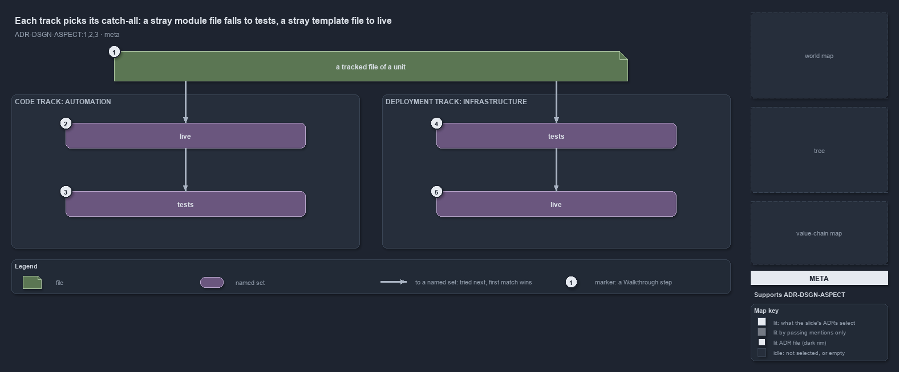

---
catzc:
  derived:
    path: docs/explanation/design/each-track-picks-its-catch-all.md
    kind: explanation
    body_sha: "87398671b7d3"
    adrs:
      - ADR-DSGN-ASPECT#{1-3}
    links:
      - docs/.assets/explanation/adr-dsgn-aspect--each-track-picks-its-catch-all--meta.drawio.md
      - docs/.assets/explanation/adr-dsgn-aspect--each-track-picks-its-catch-all--meta.drawio.png
      - docs/adr/design/module-aspects.md
      - docs/explanation/design/gate-checks-order-not-liveness.md
      - docs/explanation/design/get-aspect-feeds-globs-and-maps.md
      - docs/explanation/design/get-aspect-names-the-remainder.md
      - docs/explanation/design/index.md
      - docs/explanation/design/only-automation-compiles-its-aspects.md
      - docs/explanation/index.md#how-to-read-the-diagrams
---

# Each track picks its catch-all: a stray module file falls to tests, a stray template file to live

```text
Each track picks its catch-all: a stray module file falls to tests, a stray template file to live.

1  a tracked file of a unit  any file git tracks under a module folder or a template
2  live                      the code track's first aspect: a closed convention, what ships
3  tests                     the code track's last aspect: the ** remainder, never ships
4  tests                     the deployment track's first aspect: only an explicit tests/ folder
5  live                      the deployment track's last aspect: the ** remainder, it ships

Supports ADR-DSGN-ASPECT#1, #2 and #3 (meta lens).
```

A unit in cats, a module folder or a template, holds files that ship and files that verify them. Its tracked files partition into aspects by
ordered first match: a file is tried against the aspects in their declared order, and the last aspect, the bare `**`, takes whatever no
earlier aspect claimed. Which aspect is that remainder is each track's call. The automation track keeps `live` closed and lets `tests` catch
the rest, so a stray file can never silently ship. The infrastructure track declares the opposite order, because a template deploys whole.



The diagram is described element by element in
[its asset description](../../.assets/explanation/adr-dsgn-aspect--each-track-picks-its-catch-all--meta.drawio.md).

## Walkthrough

1. **A tracked file of a unit.** Any file git tracks under a module folder of the automation track, or under a template of the
   infrastructure track. Each track declares its own ordered list of aspects in the `aspects` variant, and the file is tried against that
   list from the top. The first aspect whose pattern matches claims it.
2. **live, in the automation track.** The first aspect of a code track is a closed convention: `*.ps1`, `private/**`, `types/**`,
   `configs/**` and `assets/**`, folder-scoped patterns that never reach `tests/`. A `*` inside a segment never crosses a `/`, so `*.ps1`
   claims the module's root files only. This is what the builder ships, and a new kind of file enters it only through an explicit change to
   the convention.
3. **tests, in the automation track.** The last aspect of a code track is the `**` remainder: every file `live` did not claim. Tests, docs,
   a file dropped at the module root, all land here, and none of it ships. Shipping code is default-deny.
4. **tests, in the infrastructure track.** A deployment track puts the non-live part first and keeps it closed: `**/tests/**`, an explicit
   `tests/` folder anywhere under the template, is the only part that does not deploy.
5. **live, in the infrastructure track.** The last aspect of a deployment track is `live`, the `**` remainder. Everything else under a
   template deploys, so a stray template file ships. The track's class backs the choice: automation is the core, infrastructure an adapter
   to a delivery target.

## Why it holds

- A unit's tracked files partition into aspects that are pairwise disjoint and jointly exhaustive, and the aspect set is the `aspects`
  variant, an ordered first-match classification per track (ADR-DSGN-ASPECT#1).
- Aspects derive from folder conventions, never from a hand-written list. `live` is a closed convention, the last aspect is the `**`
  remainder, and ordered first match makes the partition true by construction (ADR-DSGN-ASPECT#2).
- Which aspect is the remainder is the track's call: a code track declares the non-live `tests` last, a deployment track declares `live`
  last, and the config type checks the structure when the variants load (ADR-DSGN-ASPECT#3).

## Where the code and the ADR differ

- The ADR partitions every delivery package at track granularity by the same convention. In the code, only the module folders of the
  automation track are compiled into aspect sets; the infrastructure convention is read and classifies files as live or not, but no set is
  derived from it.
- The code comment on the aspect type says the last aspect is non-live by rule; the infrastructure track declares `live` last.

## See also

- [Module aspects](../../adr/design/module-aspects.md) — the decision this article explains.
- The other lenses on the same catch-all: [architecture](only-automation-compiles-its-aspects.md),
  [implementation](get-aspect-feeds-globs-and-maps.md), [operations](get-aspect-names-the-remainder.md) and
  [governance](gate-checks-order-not-liveness.md).
- [The design explanations](index.md) · [How to read the diagrams](../index.md#how-to-read-the-diagrams)
