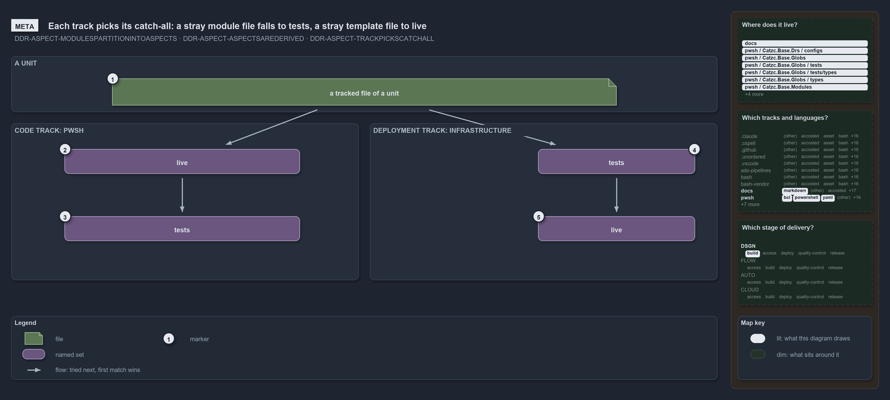

---
catzc:
  warning: "Header is generated by Format-FileMeta via Format-Code; do not change it"
  edges:
    cites:
      - DDR-ASPECT-MODULESPARTITIONINTOASPECTS
      - DDR-ASPECT-ASPECTSAREDERIVED
      - DDR-ASPECT-TRACKPICKSCATCHALL
    drs_total: 3
---

# Each track picks its catch-all: a stray module file falls to tests, a stray template file to live

```text
Each track picks its catch-all: a stray module file falls to tests, a stray template file to live.

1  a tracked file of a unit  any file git tracks under a module folder or a template
2  live                      the code track's first aspect: a closed convention, what ships
3  tests                     the code track's last aspect: the ** remainder, never ships
4  tests                     the deployment track's first aspect: only an explicit tests/ folder
5  live                      the deployment track's last aspect: the ** remainder, it ships

Supports DDR-ASPECT-MODULESPARTITIONINTOASPECTS, DDR-ASPECT-ASPECTSAREDERIVED and DDR-ASPECT-TRACKPICKSCATCHALL (meta lens).
```

A unit in cats, a module folder or a template, holds files that ship and files that verify them. Its tracked files partition into aspects by
ordered first match: a file is tried against the aspects in their declared order, and the last aspect, the bare `**`, takes whatever no
earlier aspect claimed. Which aspect is that remainder is each track's call. The pwsh track keeps `live` closed and lets `tests` catch the
rest, so a stray file can never silently ship. The infrastructure track declares the opposite order, because a template deploys whole.

```yml drawio
description:
  "A tracked file is tried against its track's aspects in order and the first match wins: the code track tries live first and lets tests
  catch the rest, the deployment track tries tests first and lets live catch the rest."
about:
  adrs: [DDR-ASPECT-MODULESPARTITIONINTOASPECTS, DDR-ASPECT-ASPECTSAREDERIVED, DDR-ASPECT-TRACKPICKSCATCHALL]
  lens: meta
content:
  title: "Each track picks its catch-all: a stray module file falls to tests, a stray template file to live"
  kind: explanation
  flow: left-to-right
  relation: tried next, first match wins
  theme: dark
  bands:
    - { id: band-unit, label: A UNIT }
    - { id: band-code, label: "CODE TRACK: PWSH" }
    - { id: band-deployment, label: "DEPLOYMENT TRACK: INFRASTRUCTURE" }
  glyphs:
    - { id: f-tracked, kind: file, label: a tracked file of a unit, in: band-unit }
    - { id: s-code-live, kind: set, label: live, in: band-code }
    - { id: s-code-tests, kind: set, label: tests, in: band-code }
    - { id: s-deployment-tests, kind: set, label: tests, in: band-deployment }
    - { id: s-deployment-live, kind: set, label: live, in: band-deployment }
  edges:
    - { from: f-tracked, to: s-code-live, kind: flow, label: "" }
    - { from: s-code-live, to: s-code-tests, kind: flow, label: "" }
    - { from: f-tracked, to: s-deployment-tests, kind: flow, label: "" }
    - { from: s-deployment-tests, to: s-deployment-live, kind: flow, label: "" }
  markers:
    - { at: f-tracked, number: 1 }
    - { at: s-code-live, number: 2 }
    - { at: s-code-tests, number: 3 }
    - { at: s-deployment-tests, number: 4 }
    - { at: s-deployment-live, number: 5 }
  legend: auto
  minimaps:
    code-locations:
      - cell: docs/-/.
        by:
          - docs/drs/design/dora-explains.md
          - docs/drs/design/module-aspects.md
          - docs/drs/index.md
          - docs/references/pwsh/catzc-base-globs/Get-ModuleGlobSet.ps1.md
          - docs/references/pwsh/catzc-base-globs/tests/types/Aspect.Tests.ps1.md
          - docs/references/pwsh/catzc-base-globs/types/Aspect.cs.md
          - docs/references/pwsh/catzc-base-modules/Get-Aspect.ps1.md
          - docs/references/pwsh/catzc-base-quality-gates/private/Get-ModuleProtectionIdentity.ps1.md
          - docs/references/pwsh/catzc-base-variants/configs/variants.yml.md
          - docs/references/pwsh/catzc-base-variants/types/VariantAspect.cs.md
          - docs/references/pwsh/catzc-base-variants/types/VariantsConfig.cs.md
          - DDR-ASPECT-ASPECTSAREDERIVED
          - DDR-ASPECT-MODULESPARTITIONINTOASPECTS
          - DDR-ASPECT-TRACKPICKSCATCHALL
      - cell: pwsh/Catzc.Base.Drs/configs
        by:
          - pwsh/Catzc.Base.Drs/configs/drs.yml
          - DDR-ASPECT-ASPECTSAREDERIVED
          - DDR-ASPECT-MODULESPARTITIONINTOASPECTS
          - DDR-ASPECT-TRACKPICKSCATCHALL
      - cell: pwsh/Catzc.Base.Globs/.
        by:
          - pwsh/Catzc.Base.Globs/Get-ModuleGlobSet.ps1
          - DDR-ASPECT-ASPECTSAREDERIVED
          - DDR-ASPECT-MODULESPARTITIONINTOASPECTS
          - DDR-ASPECT-TRACKPICKSCATCHALL
      - cell: pwsh/Catzc.Base.Globs/tests
        by:
          - pwsh/Catzc.Base.Globs/tests/Get-ModuleGlobSet.Tests.ps1
          - DDR-ASPECT-ASPECTSAREDERIVED
          - DDR-ASPECT-MODULESPARTITIONINTOASPECTS
          - DDR-ASPECT-TRACKPICKSCATCHALL
      - cell: pwsh/Catzc.Base.Globs/tests/types
        by:
          - pwsh/Catzc.Base.Globs/tests/types/Aspect.Tests.ps1
          - DDR-ASPECT-ASPECTSAREDERIVED
          - DDR-ASPECT-MODULESPARTITIONINTOASPECTS
          - DDR-ASPECT-TRACKPICKSCATCHALL
      - cell: pwsh/Catzc.Base.Globs/types
        by:
          - pwsh/Catzc.Base.Globs/types/Aspect.cs
          - DDR-ASPECT-ASPECTSAREDERIVED
          - DDR-ASPECT-MODULESPARTITIONINTOASPECTS
          - DDR-ASPECT-TRACKPICKSCATCHALL
      - cell: pwsh/Catzc.Base.Modules/.
        by:
          - pwsh/Catzc.Base.Modules/Get-Aspect.ps1
          - DDR-ASPECT-ASPECTSAREDERIVED
          - DDR-ASPECT-MODULESPARTITIONINTOASPECTS
          - DDR-ASPECT-TRACKPICKSCATCHALL
      - cell: pwsh/Catzc.Base.Modules/tests
        by:
          - pwsh/Catzc.Base.Modules/tests/Get-Aspect.Tests.ps1
          - DDR-ASPECT-ASPECTSAREDERIVED
          - DDR-ASPECT-MODULESPARTITIONINTOASPECTS
          - DDR-ASPECT-TRACKPICKSCATCHALL
      - cell: pwsh/Catzc.Base.QualityGates/private
        by:
          - pwsh/Catzc.Base.QualityGates/private/Get-ModuleProtectionIdentity.ps1
          - DDR-ASPECT-ASPECTSAREDERIVED
          - DDR-ASPECT-MODULESPARTITIONINTOASPECTS
          - DDR-ASPECT-TRACKPICKSCATCHALL
      - cell: pwsh/Catzc.Base.Variants/configs
        by:
          - pwsh/Catzc.Base.Variants/configs/variants.yml
          - DDR-ASPECT-ASPECTSAREDERIVED
          - DDR-ASPECT-MODULESPARTITIONINTOASPECTS
          - DDR-ASPECT-TRACKPICKSCATCHALL
      - cell: pwsh/Catzc.Base.Variants/types
        by:
          - pwsh/Catzc.Base.Variants/types/VariantAspect.cs
          - pwsh/Catzc.Base.Variants/types/VariantsConfig.cs
          - DDR-ASPECT-ASPECTSAREDERIVED
          - DDR-ASPECT-MODULESPARTITIONINTOASPECTS
          - DDR-ASPECT-TRACKPICKSCATCHALL
    grid:
      - cell: docs/markdown
        by:
          - docs/drs/design/dora-explains.md
          - docs/drs/design/module-aspects.md
          - docs/drs/index.md
          - docs/references/pwsh/catzc-base-globs/Get-ModuleGlobSet.ps1.md
          - docs/references/pwsh/catzc-base-globs/tests/types/Aspect.Tests.ps1.md
          - docs/references/pwsh/catzc-base-globs/types/Aspect.cs.md
          - docs/references/pwsh/catzc-base-modules/Get-Aspect.ps1.md
          - docs/references/pwsh/catzc-base-quality-gates/private/Get-ModuleProtectionIdentity.ps1.md
          - docs/references/pwsh/catzc-base-variants/configs/variants.yml.md
          - docs/references/pwsh/catzc-base-variants/types/VariantAspect.cs.md
          - docs/references/pwsh/catzc-base-variants/types/VariantsConfig.cs.md
          - DDR-ASPECT-ASPECTSAREDERIVED
          - DDR-ASPECT-MODULESPARTITIONINTOASPECTS
          - DDR-ASPECT-TRACKPICKSCATCHALL
      - cell: pwsh/bcl
        by:
          - pwsh/Catzc.Base.Globs/types/Aspect.cs
          - pwsh/Catzc.Base.Variants/types/VariantAspect.cs
          - pwsh/Catzc.Base.Variants/types/VariantsConfig.cs
          - DDR-ASPECT-ASPECTSAREDERIVED
          - DDR-ASPECT-MODULESPARTITIONINTOASPECTS
          - DDR-ASPECT-TRACKPICKSCATCHALL
      - cell: pwsh/powershell
        by:
          - pwsh/Catzc.Base.Globs/Get-ModuleGlobSet.ps1
          - pwsh/Catzc.Base.Globs/tests/Get-ModuleGlobSet.Tests.ps1
          - pwsh/Catzc.Base.Globs/tests/types/Aspect.Tests.ps1
          - pwsh/Catzc.Base.Modules/Get-Aspect.ps1
          - pwsh/Catzc.Base.Modules/tests/Get-Aspect.Tests.ps1
          - pwsh/Catzc.Base.QualityGates/private/Get-ModuleProtectionIdentity.ps1
          - DDR-ASPECT-ASPECTSAREDERIVED
          - DDR-ASPECT-MODULESPARTITIONINTOASPECTS
          - DDR-ASPECT-TRACKPICKSCATCHALL
      - cell: pwsh/yaml
        by:
          - pwsh/Catzc.Base.Drs/configs/drs.yml
          - pwsh/Catzc.Base.Variants/configs/variants.yml
          - DDR-ASPECT-ASPECTSAREDERIVED
          - DDR-ASPECT-MODULESPARTITIONINTOASPECTS
          - DDR-ASPECT-TRACKPICKSCATCHALL
    axis:
      - cell: DSGN/build
        by: [DDR-ASPECT-ASPECTSAREDERIVED, DDR-ASPECT-MODULESPARTITIONINTOASPECTS, DDR-ASPECT-TRACKPICKSCATCHALL]
layout:
  band-unit: { x: 20, y: 84, w: 1260, h: 100 }
  band-code: { x: 20, y: 204, w: 620, h: 280 }
  band-deployment: { x: 660, y: 204, w: 620, h: 280 }
  f-tracked: { x: 200, y: 124, w: 900, h: 48 }
  s-code-live: { x: 115, y: 250, w: 420, h: 44 }
  s-code-tests: { x: 115, y: 370, w: 420, h: 44 }
  s-deployment-tests: { x: 960, y: 250, w: 280, h: 44 }
  s-deployment-live: { x: 960, y: 370, w: 280, h: 44 }
```



## Walkthrough

1. **A tracked file of a unit.** Any file git tracks under a module folder of the pwsh track, or under a template of the infrastructure
   track. Each track declares its own ordered list of aspects in the `aspects` variant, and the file is tried against that list from the
   top. The first aspect whose pattern matches claims it.
2. **live, in the pwsh track.** The first aspect of a code track is a closed convention: `*.ps1`, `private/**`, `types/**`, `configs/**` and
   `assets/**`, folder-scoped patterns that never reach `tests/`. A `*` inside a segment never crosses a `/`, so `*.ps1` claims the module's
   root files only. This is what the builder ships, and a new kind of file enters it only through an explicit change to the convention.
3. **tests, in the pwsh track.** The last aspect of a code track is the `**` remainder: every file `live` did not claim. Tests, docs, a file
   dropped at the module root, all land here, and none of it ships. Shipping code is default-deny.
4. **tests, in the infrastructure track.** A deployment track puts the non-live part first and keeps it closed: `**/tests/**`, an explicit
   `tests/` folder anywhere under the template, is the only part that does not deploy.
5. **live, in the infrastructure track.** The last aspect of a deployment track is `live`, the `**` remainder. Everything else under a
   template deploys, so a stray template file ships. The track's class backs the choice: the pwsh track is the core, infrastructure an
   adapter to a delivery target.

## Why it holds

- A unit's tracked files partition into aspects that are pairwise disjoint and jointly exhaustive, and the aspect set is the `aspects`
  variant, an ordered first-match classification per track (DDR-ASPECT-MODULESPARTITIONINTOASPECTS).
- Aspects derive from folder conventions, never from a hand-written list. `live` is a closed convention, the last aspect is the `**`
  remainder, and ordered first match makes the partition true by construction (DDR-ASPECT-ASPECTSAREDERIVED).
- Which aspect is the remainder is the track's call: a code track declares the non-live `tests` last, a deployment track declares `live`
  last, and the config type checks the structure when the variants load (DDR-ASPECT-TRACKPICKSCATCHALL).

## Where the code and the decision record differ

- The DDR partitions every delivery package at track granularity by the same convention. In the code, only the module folders of the pwsh
  track are compiled into aspect sets; the infrastructure convention is read and classifies files as live or not, but no set is derived from
  it.
- The reference page of the aspect type (`Aspect.cs.md`) says the last aspect is non-live by rule; the infrastructure track declares `live`
  last.

## See also

- [Module aspects](../../drs/design/module-aspects.md) — the decision this article explains.
- The other lenses on the same catch-all: [architecture](only-pwsh-compiles-its-aspects.md),
  [implementation](get-aspect-feeds-globs-and-maps.md), [operations](get-aspect-names-the-remainder.md) and
  [governance](gate-checks-order-not-liveness.md).
- [The design explanations](index.md) · [How to read the diagrams](../index.md#how-to-read-the-diagrams)
