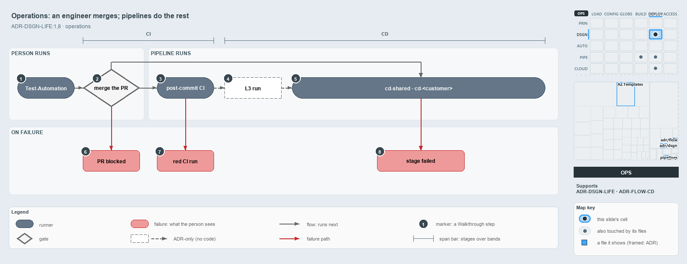

---
catzc:
  derived:
    path: docs/explanation/design/engineer-merges-pipelines-do-the-rest.md
    kind: explanation
    language: markdown
    filekind: md
    track: docs
    body_sha: d4592a9826a0
    adrs:
      - ADR-AUTO-PARITY#2
      - ADR-DSGN-LIFE#{1,8}
      - ADR-FLOW-CD#8
    links:
      - docs/.assets/explanation/adr-dsgn-life--engineer-merges-pipelines-do-the-rest--operations.drawio.md
      - docs/.assets/explanation/adr-dsgn-life--engineer-merges-pipelines-do-the-rest--operations.drawio.png
      - docs/adr/design/commit-lifecycle.md
      - docs/adr/flow/cd-discipline-and-promotion-flow.md
      - docs/explanation/design/code-wires-only-the-first-rungs.md
      - docs/explanation/design/four-domains-promote-one-artifact.md
      - docs/explanation/design/index.md
      - docs/explanation/design/one-way-climb-three-endings.md
      - docs/explanation/design/which-rung-gates-exist-in-code.md
      - docs/explanation/index.md#how-to-read-the-diagrams
---

# An engineer runs the tests and merges; pipelines do the rest

```text
An engineer runs the tests and merges the pull request; pipelines run everything after the merge.

1  Test-Automation           the engineer runs the tests on the devbox, then opens a pull request
2  merge the PR              clears only when PR build validation is green
3  post-commit CI            ci-automation, ci-infrastructure and the expected-failures run on main
4  L3 run                    the ADR's slow system tests after CI; no pipeline step yet
5  cd-shared, cd-<customer>  the CD pipelines: their own CI stage, then the Deploy_* stages
6  PR blocked                build validation is red, so the pull request cannot merge
7  red CI run                the BVT discard; nothing records it, and it stops no deploy
8  stage failed              the later Deploy_* stages skip

Supports ADR-DSGN-LIFE#1 and #8 (operations lens).
```

A person moves a commit through the first rungs of the cats lifecycle by hand: they run `Test-Automation` on the devbox and merge the pull
request once its build validation is green. Azure DevOps pipelines run everything after the merge. When a rung fails, what the person sees
is a red result: a blocked pull request, a red CI run, or a failed deploy stage.



The diagram is described element by element in
[its asset description](../../.assets/explanation/adr-dsgn-life--engineer-merges-pipelines-do-the-rest--operations.drawio.md).

## Walkthrough

1. **Test-Automation.** The engineer runs the tests on the devbox, then opens a pull request to `main`. The devbox and the pipeline run the
   same tiers, so a failure surfaces on the devbox first.
2. **Merge the PR.** The merge clears only when PR build validation is green; build validations on `main` block by default. The merge starts
   both the post-commit CI and the CD pipelines on `main`.
3. **Post-commit CI.** `ci-automation` and `ci-infrastructure`, plus `ci-automation-expected-failures`, run again on the merged commit.
4. **L3 run.** The ADR places the slow L3 system tests after CI, in the CD pipeline's post-commit path. No pipeline step runs them yet.
5. **`cd-shared` and `cd-<customer>`.** The CD pipelines run on `main`: their own CI stage, then the `Deploy_*` stages in order, into the
   Azure DevOps environment `<customer>-<env>[-<slot>]` (`shared-<env>` for `cd-shared`). The deploys are reference shapes until real
   service connections and a non-placeholder `azure.yml` exist.
6. **PR blocked.** Build validation is red, so the pull request cannot merge.
7. **Red CI run.** The BVT discard. Nothing in code records it, and a red `ci-automation` or `ci-infrastructure` run stops nothing
   downstream: each CD pipeline's own CI stage is what gates its deploys.
8. **Stage failed.** Later `Deploy_*` stages skip, because each runs only when the stage before it succeeded. `-SubscriptionIdAssertIs`
   fails a mis-wired service connection: the deploy throws when the az session targets another subscription, and `Deploy-Bicep` throws in a
   pipeline when the GUID is missing.

A new attempt is a new commit: the engineer fixes forward with a new pull request and never re-runs a commit downward. RC, RBC and the
`pre-prod` activation have no runnable step in this repository.

## Why it holds

- A commit only climbs, and a new attempt is a new commit (ADR-DSGN-LIFE#1).
- A commit that fails a stage cannot go downstream (ADR-DSGN-LIFE#8).
- `Test-Automation` and its tiers run on the devbox and in the pipeline, and must agree (ADR-AUTO-PARITY#2).
- PR build validation is the inner CI gate; the L3 outer loop runs post-commit (ADR-FLOW-CD#8).

## Where the code and the ADR differ

- Nothing records a BVT discard.
- No L3, RC, RBC or `pre-prod` activation step exists to run.

## See also

- [The commit lifecycle](../../adr/design/commit-lifecycle.md) — the decision this article explains.
- [The CI discipline and the promotion flow](../../adr/flow/cd-discipline-and-promotion-flow.md) — the gates and pipelines.
- The other lenses on the same lifecycle: [meta](one-way-climb-three-endings.md), [architecture](four-domains-promote-one-artifact.md),
  [implementation](code-wires-only-the-first-rungs.md) and [governance](which-rung-gates-exist-in-code.md).
- [The design explanations](index.md) · [How to read the diagrams](../index.md#how-to-read-the-diagrams)
