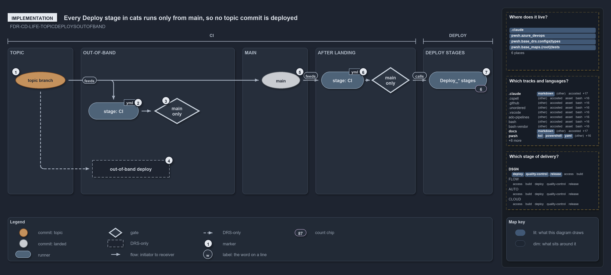

---
catzc:
  warning: "Header is generated by Format-FileMeta via Format-Code; do not change it"
  edges:
    cites:
      - FDR-CD-LIFE
    drs_total: 2
---

# Every Deploy stage in cats runs only from main, so no topic commit is deployed

```text
A pull request run skips every Deploy_* stage; only the run on main deploys, so no topic commit is deployed.

1  topic branch         a pull request into main starts a run (pr: [main])
2  stage: CI            the PR run builds and publishes the templates
3  main only            the Deploy_* condition; false on a PR run
4  out-of-band deploy   the deploy FDR-CD-LIFE-TOPICDEPLOYSOUTOFBAND allows; no pipeline or workflow runs it
5  main                 completing the PR lands the commit; trigger: [main] starts the CD run
6  stage: CI            the CD run's CI stage; the main-only condition now holds
7  Deploy_* stages      six stages carry the condition; they run in dependsOn order

Supports FDR-CD-LIFE-TOPICDEPLOYSOUTOFBAND (implementation lens).
```

Every `Deploy_*` stage in cats runs only from main. FDR-CD-LIFE-TOPICDEPLOYSOUTOFBAND allows a workflow or pipeline to deploy a topic commit
without integrating it, but in the code nothing does. The CD pipelines run on a pull request into main, yet a PR run executes only the `CI`
stage: every `Deploy_*` stage carries a condition that the source branch is `refs/heads/main`. Only the merge to main starts a run that
deploys.

```yml drawio
description:
  A pull request run builds in a CI stage but its Deploy stages carry a main-only condition and skip, so only the run on main deploys and no
  topic commit is deployed by a pipeline.
about:
  adrs: [FDR-CD-LIFE-TOPICDEPLOYSOUTOFBAND]
  lens: implementation
content:
  title: Every Deploy stage in cats runs only from main, so no topic commit is deployed
  kind: explanation
  flow: left-to-right
  relation: starts or runs next
  theme: dark
  bands:
    - { id: band-topic, label: TOPIC }
    - { id: band-out-of-band, label: OUT-OF-BAND }
    - { id: band-main, label: MAIN }
    - { id: band-landing, label: AFTER LANDING }
  spans:
    - id: span-integration
      label: CI
      over: [band-out-of-band]
    - id: span-delivery
      label: CD
      over: [band-landing]
  glyphs:
    - { id: c-topic, kind: commit, label: topic branch, in: band-topic, state: topic }
    - { id: r-pull-request-stage, kind: runner, label: "stage: CI", in: band-out-of-band }
    - { id: g-pull-request-condition, kind: gate, label: main only, in: band-out-of-band }
    - { id: a-deploy, kind: drsonly, label: out-of-band deploy, in: band-out-of-band }
    - { id: c-main, kind: commit, label: main, in: band-main, state: landed }
    - { id: r-main-stage, kind: runner, label: "stage: CI", in: band-landing }
    - { id: g-main-condition, kind: gate, label: main only, in: band-landing }
    - { id: r-deploy, kind: runner, label: Deploy_* stages, in: band-landing }
  edges:
    - { from: c-topic, to: r-pull-request-stage, kind: flow, label: "" }
    - { from: r-pull-request-stage, to: g-pull-request-condition, kind: flow, label: "" }
    - { from: c-topic, to: a-deploy, kind: adr, label: "" }
    - { from: c-topic, to: c-main, kind: flow, label: "" }
    - { from: c-main, to: r-main-stage, kind: flow, label: "" }
    - { from: r-main-stage, to: g-main-condition, kind: flow, label: "" }
    - { from: g-main-condition, to: r-deploy, kind: flow, label: "" }
  markers:
    - { at: c-topic, number: 1 }
    - { at: r-pull-request-stage, number: 2 }
    - { at: g-pull-request-condition, number: 3 }
    - { at: a-deploy, number: 4 }
    - { at: c-main, number: 5 }
    - { at: r-main-stage, number: 6 }
    - { at: r-deploy, number: 7 }
  chips:
    - { at: r-deploy, kind: count, text: "6" }
  legend: auto
  minimaps: [code-locations, grid, axis]
layout:
  band-topic: { x: 20, y: 108, w: 170, h: 380 }
  band-out-of-band: { x: 210, y: 108, w: 420, h: 380 }
  band-main: { x: 650, y: 108, w: 200, h: 380 }
  band-landing: { x: 870, y: 108, w: 410, h: 380 }
  c-topic: { x: 40, y: 170, w: 130, h: 44 }
  r-pull-request-stage: { x: 230, y: 250, w: 130, h: 44 }
  g-pull-request-condition: { x: 400, y: 238, w: 120, h: 68 }
  a-deploy: { x: 400, y: 420, w: 200, h: 44 }
  c-main: { x: 700, y: 170, w: 100, h: 44 }
  r-main-stage: { x: 885, y: 170, w: 110, h: 44 }
  g-main-condition: { x: 1015, y: 158, w: 100, h: 68 }
  r-deploy: { x: 1130, y: 170, w: 140, h: 44 }
```



## Walkthrough

1. **Topic branch.** The work starts on a topic branch with a pull request into main. Every CD root pipeline, `cd-apex.yaml`,
   `cd-flux.yaml`, `cd-nova.yaml` and `cd-shared.yaml`, declares `pr: branches: include: [main]`, so the PR starts a run.
2. **Stage `CI`.** The PR run executes the `CI` stage. In the customer template it runs `Build-Bicep` for foundation, discovery and
   expedition, and publishes each as a pipeline artifact.
3. **Main only.** Each `Deploy_*` stage carries `condition: and(succeeded(), eq(variables['Build.SourceBranch'], 'refs/heads/main'))`. A PR
   run's source branch is a pull-request ref, so the condition is false and every deploy stage is skipped.
4. **Out-of-band deploy.** The deploy that FDR-CD-LIFE-TOPICDEPLOYSOUTOFBAND allows has no pipeline or workflow. The GitHub `CI` workflow
   only runs tests, and the `Release` workflow builds and may publish the package from any ref, which is a release, not a deploy to an
   environment.
5. **Main.** Completing the pull request lands the commit on main, and the push trigger `trigger: branches: include: [main]` starts the CD
   run.
6. **Stage `CI`.** The CD run executes the same `CI` stage, and the main-only condition now holds.
7. **`Deploy_*` stages.** `Deploy_Foundation`, `Deploy_Discovery` and `Deploy_Expedition` follow one another through `dependsOn`. Six
   `Deploy_*` stages carry the main-only condition: three in the customer template `extends/cd-customer.yaml` and three in `cd-shared.yaml`.
   In the customer template, `Deploy_Expedition` deploys an entry with a slot to the environment `<Customer>-<env>-<slot>`, and an entry
   without one to the env's base slot, `<Customer>-<env>`.

No stage in `.ado/pipelines/` is named BVT; the pipeline guide names the CI type's post-commit run on main the BVT.

## Why it holds

- A topic commit can be deployed out-of-band by a workflow or pipeline, and that deploy is not an integration
  (FDR-CD-LIFE-TOPICDEPLOYSOUTOFBAND). The code takes the stricter path: it deploys nothing that has not landed on main.

## Where the code and the decision record differ

- FDR-CD-LIFE-TOPICDEPLOYSOUTOFBAND says a workflow or pipeline may deploy a topic commit; no pipeline or workflow does, and every
  `Deploy_*` stage is main-only.
- The `Release` workflow is the only path from a topic ref to an output, and no FDR-CD-LIFE rule covers it.

## See also

- [The commit lifecycle](../../drs/flow/commit-lifecycle.md) — the decision this article explains.
- The other lenses on the same deploy: [meta](deploying-is-not-integrating.md),
  [architecture](deploy-and-integrate-share-only-the-topic.md), [operations](merging-to-main-is-what-deploys.md) and
  [governance](out-of-band-deploy-is-drs-only.md).
- [The design explanations](index.md) · [How to read the diagrams](../index.md#how-to-read-the-diagrams)
