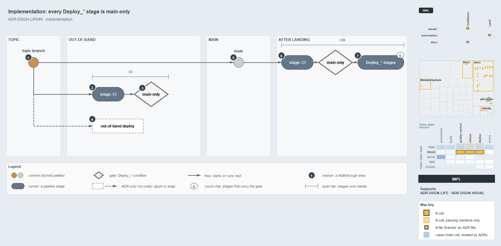

---
catzc:
  derived:
    path: docs/explanation/design/every-deploy-stage-is-main-only.md
    folder: docs/explanation/design
    name: every-deploy-stage-is-main-only
    filetype: md
    kind: explanation
    language: markdown
    track: docs
    body_sha: "1dbd42896d00"
    adrs:
      - ADR-DSGN-LIFE#9
    links:
      - docs/.assets/explanation/adr-dsgn-life--every-deploy-stage-is-main-only--implementation.drawio.md
      - docs/.assets/explanation/adr-dsgn-life--every-deploy-stage-is-main-only--implementation.drawio.png
      - docs/adr/design/commit-lifecycle.md
      - docs/explanation/design/deploy-and-integrate-share-only-the-topic.md
      - docs/explanation/design/deploying-is-not-integrating.md
      - docs/explanation/design/index.md
      - docs/explanation/design/merging-to-main-is-what-deploys.md
      - docs/explanation/design/out-of-band-deploy-is-adr-only.md
      - docs/explanation/index.md#how-to-read-the-diagrams
---

# Every Deploy stage in cats runs only from main, so no topic commit is deployed

```text
A pull request run skips every Deploy_* stage; only the run on main deploys, so no topic commit is deployed.

1  topic branch         a pull request into main starts a run (pr: [main])
2  stage: CI            the PR run builds and publishes the templates
3  main only            the Deploy_* condition; false on a PR run
4  out-of-band deploy   the deploy ADR-DSGN-LIFE#9 allows; no pipeline or workflow runs it
5  main                 completing the PR lands the commit; trigger: [main] starts the CD run
6  stage: CI            the CD run's CI stage; the main-only condition now holds
7  Deploy_* stages      six stages carry the condition; they run in dependsOn order

Supports ADR-DSGN-LIFE#9 (implementation lens).
```

Every `Deploy_*` stage in cats runs only from main. ADR-DSGN-LIFE#9 allows a workflow or pipeline to deploy a topic commit without
integrating it, but in the code nothing does. The CD pipelines run on a pull request into main, yet a PR run executes only the `CI` stage:
every `Deploy_*` stage carries a condition that the source branch is `refs/heads/main`. Only the merge to main starts a run that deploys.



The diagram is described element by element in
[its asset description](../../.assets/explanation/adr-dsgn-life--every-deploy-stage-is-main-only--implementation.drawio.md).

## Walkthrough

1. **Topic branch.** The work starts on a topic branch with a pull request into main. Every CD root pipeline, `cd-apex.yaml`,
   `cd-flux.yaml`, `cd-nova.yaml` and `cd-shared.yaml`, declares `pr: branches: include: [main]`, so the PR starts a run.
2. **Stage `CI`.** The PR run executes the `CI` stage. In the customer template it runs `Build-Bicep` for foundation, discovery and
   expedition, and publishes each as a pipeline artifact.
3. **Main only.** Each `Deploy_*` stage carries `condition: and(succeeded(), eq(variables['Build.SourceBranch'], 'refs/heads/main'))`. A PR
   run's source branch is a pull-request ref, so the condition is false and every deploy stage is skipped.
4. **Out-of-band deploy.** The deploy that ADR-DSGN-LIFE#9 allows has no pipeline or workflow. The GitHub `CI` workflow only runs tests, and
   the `Release` workflow builds and may publish the package from any ref, which is a release, not a deploy to an environment.
5. **Main.** Completing the pull request lands the commit on main, and the push trigger `trigger: branches: include: [main]` starts the CD
   run.
6. **Stage `CI`.** The CD run executes the same `CI` stage, and the main-only condition now holds.
7. **`Deploy_*` stages.** `Deploy_Foundation`, `Deploy_Discovery` and `Deploy_Expedition` follow one another through `dependsOn`. Six
   `Deploy_*` stages carry the main-only condition: three in the customer template `extends/cd-customer.yaml` and three in `cd-shared.yaml`.
   In the customer template, `Deploy_Expedition` deploys an entry with a slot to the environment `<Customer>-<env>-<slot>`, and an entry
   without one to the env's base slot, `<Customer>-<env>`.

No stage in `pipelines/` is named BVT; the pipeline guide names the CI type's post-commit run on main the BVT.

## Why it holds

- A topic commit can be deployed out-of-band by a workflow or pipeline, and that deploy is not an integration (ADR-DSGN-LIFE#9). The code
  takes the stricter path: it deploys nothing that has not landed on main.

## Where the code and the ADR differ

- ADR-DSGN-LIFE#9 says a workflow or pipeline may deploy a topic commit; no pipeline or workflow does, and every `Deploy_*` stage is
  main-only.
- The `Release` workflow is the only path from a topic ref to an output, and no ADR-DSGN-LIFE rule covers it.

## See also

- [The commit lifecycle](../../adr/design/commit-lifecycle.md) — the decision this article explains.
- The other lenses on the same deploy: [meta](deploying-is-not-integrating.md),
  [architecture](deploy-and-integrate-share-only-the-topic.md), [operations](merging-to-main-is-what-deploys.md) and
  [governance](out-of-band-deploy-is-adr-only.md).
- [The design explanations](index.md) · [How to read the diagrams](../index.md#how-to-read-the-diagrams)
