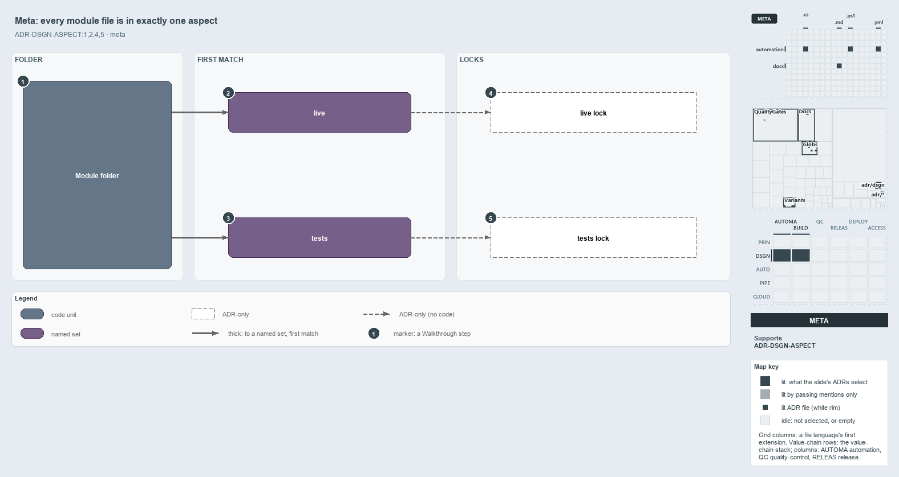

---
catzc:
  derived:
    path: docs/explanation/design/every-file-in-exactly-one-aspect.md
    kind: explanation
    language: markdown
    filekind: md
    track: docs
    body_sha: edf4b6a5a7fa
    adrs:
      - ADR-DSGN-ASPECT#{1,2,4,5}
      - ADR-FLOW-CD-GLOBS#9
    links:
      - docs/.assets/explanation/adr-dsgn-aspect--every-file-in-exactly-one-aspect--meta.drawio.md
      - docs/.assets/explanation/adr-dsgn-aspect--every-file-in-exactly-one-aspect--meta.drawio.png
      - docs/adr/design/module-aspects.md
      - docs/explanation/design/drop-a-file-the-import-exports-it.md
      - docs/explanation/design/index.md
      - docs/explanation/design/manifest-and-aspects-from-one-folder.md
      - docs/explanation/design/one-folder-two-independent-readers.md
      - docs/explanation/design/partition-integrity-runs-only-in-unit-tests.md
      - docs/explanation/index.md#how-to-read-the-diagrams
---

# Every module file is in exactly one aspect

```text
Every module file is in exactly one aspect: live first by a closed convention, tests as the remainder.

1  Module folder  every tracked file of the module
2  live           the first aspect: a closed convention, what ships
3  tests          the last aspect: the ** remainder, never ships
4  live lock      ADR-only: the live aspect's own sha lock
5  tests lock     ADR-only: the tests aspect's own sha lock

Supports ADR-DSGN-ASPECT#1, #2, #4 and #5 (meta lens).
```

A cats module holds two kinds of thing with opposite roles: the runtime code that ships, and the tests that verify it. Aspects keep them
apart. The module's files split into two aspects by ordered first match: `live` first, a closed convention, and `tests` last, the catch-all
that takes every other file. No file is in two aspects and no file is in none, so a test edit and a runtime edit never touch the same
identity.



The diagram is described element by element in
[its asset description](../../.assets/explanation/adr-dsgn-aspect--every-file-in-exactly-one-aspect--meta.drawio.md).

## Walkthrough

1. **Module folder.** Every tracked file of the module. The aspects split it into a true partition: pairwise disjoint and jointly
   exhaustive.
2. **live.** The first aspect, tested first: a closed convention of four folder-scoped patterns that never reaches `tests/`. It is what
   ships.
3. **tests.** The last aspect, the `**` remainder: every file `live` does not claim, which never ships. In the code track a stray or
   unclassified file lands here, so nothing ships by accident. It also takes the module's Go, Python and Bash test folders, which sit
   outside the module folder.
4. **live lock.** The ADR makes each aspect an immutable sha lock. The live lock re-keys only on a runtime change.
5. **tests lock.** The tests lock re-keys only on a test change, so a module is two independently versioned artifacts. In the code, each
   aspect is its own derived set, but no lock or marker file exists.

## Why it holds

- A module's files partition into aspects that are disjoint and exhaustive (ADR-DSGN-ASPECT#1).
- Ordered first match with a `**` remainder makes the partition true by construction: each aspect is its own patterns minus every earlier
  one (ADR-DSGN-ASPECT#2).
- Each aspect is an immutable, independently versioned lock, never one lock for the whole module (ADR-DSGN-ASPECT#4).
- A file claimed by two aspects, or by none, fails the integrity check (ADR-DSGN-ASPECT#5). That check exists, but only unit tests on
  fixture files run it.

## Where the code and the ADR differ

- ADR-DSGN-ASPECT#4 makes each aspect a sha lock with a `<unit>-<aspect>.yml` marker by way of ADR-FLOW-CD-GLOBS#9, but that rule computes
  change from git at real refs, never from a committed hash, and no aspect marker exists.
- ADR-DSGN-ASPECT#2 prefixes every aspect pattern with the unit root, but the tests aspect also reaches the language test folders outside
  it.
- ADR-DSGN-ASPECT#5 makes the partition an integrity check over `git ls-files`, but no gate runs it on the real tree.

## See also

- [Module aspects](../../adr/design/module-aspects.md) — the decision this article explains.
- The other lenses on the same layout: [architecture](one-folder-two-independent-readers.md),
  [implementation](manifest-and-aspects-from-one-folder.md), [operations](drop-a-file-the-import-exports-it.md) and
  [governance](partition-integrity-runs-only-in-unit-tests.md).
- [The design explanations](index.md) · [How to read the diagrams](../index.md#how-to-read-the-diagrams)
