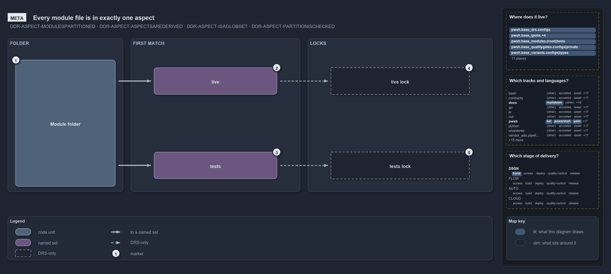

# Every module file is in exactly one aspect

```text
Every module file is in exactly one aspect: live first by a closed convention, tests as the remainder.

1  Module folder  every tracked file of the module
2  live           the first aspect: a closed convention, what ships
3  tests          the last aspect: the ** remainder, never ships
4  live lock      DRS-only: the live aspect's own sha lock
5  tests lock     DRS-only: the tests aspect's own sha lock

Supports DDR-ASPECT-MODULESPARTITIONED, DDR-ASPECT-ASPECTSAREDERIVED, DDR-ASPECT-ISAGLOBSET
and DDR-ASPECT-PARTITIONISCHECKED (meta lens).
```

A cats module holds two kinds of thing with opposite roles: the runtime code that ships, and the tests that verify it. Aspects keep them
apart. The module's files split into two aspects by ordered first match: `live` first, a closed convention, and `tests` last, the catch-all
that takes every other file. No file is in two aspects and no file is in none, so a test edit and a runtime edit never touch the same
identity.

```yml drawio
description:
  "Every file of a module folder goes to exactly one aspect by ordered first match: live first by a closed convention, tests as the
  remainder, and each aspect has its own sha lock."
about:
  adrs: [DDR-ASPECT-MODULESPARTITIONED, DDR-ASPECT-ASPECTSAREDERIVED, DDR-ASPECT-ISAGLOBSET, DDR-ASPECT-PARTITIONISCHECKED]
  lens: meta
content:
  title: Every module file is in exactly one aspect
  kind: explanation
  flow: left-to-right
  theme: dark
  bands:
    - { id: band-folder, label: FOLDER }
    - { id: band-match, label: FIRST MATCH }
    - { id: band-locks, label: LOCKS }
  glyphs:
    - { id: c-folder, kind: code, label: Module folder, in: band-folder }
    - { id: s-live, kind: set, label: live, in: band-match }
    - { id: s-tests, kind: set, label: tests, in: band-match }
    - { id: a-live-lock, kind: drsonly, label: live lock, in: band-locks }
    - { id: a-tests-lock, kind: drsonly, label: tests lock, in: band-locks }
  edges:
    - { from: c-folder, to: s-live, kind: thick, label: "" }
    - { from: c-folder, to: s-tests, kind: thick, label: "" }
    - { from: s-live, to: a-live-lock, kind: adr, label: "" }
    - { from: s-tests, to: a-tests-lock, kind: adr, label: "" }
  markers:
    - { at: c-folder, number: 1 }
    - { at: s-live, number: 2 }
    - { at: s-tests, number: 3 }
    - { at: a-live-lock, number: 4 }
    - { at: a-tests-lock, number: 5 }
  legend: auto
  minimaps: [code-locations, grid, axis]
layout:
  band-folder: { x: 20, y: 84, w: 300, h: 400 }
  band-match: { x: 340, y: 84, w: 440, h: 400 }
  band-locks: { x: 800, y: 84, w: 480, h: 400 }
  c-folder: { x: 40, y: 140, w: 260, h: 330 }
  s-live: { x: 400, y: 160, w: 320, h: 70 }
  s-tests: { x: 400, y: 380, w: 320, h: 70 }
  a-live-lock: { x: 860, y: 160, w: 360, h: 70 }
  a-tests-lock: { x: 860, y: 380, w: 360, h: 70 }
```



## Walkthrough

1. **Module folder.** Every tracked file of the module. The aspects split it into a true partition: pairwise disjoint and jointly
   exhaustive.
2. **live.** The first aspect, tested first: a closed convention of four folder-scoped patterns that never reaches `tests/`. It is what
   ships.
3. **tests.** The last aspect, the `**` remainder: every file `live` does not claim, which never ships. In the code track a stray or
   unclassified file lands here, so nothing ships by accident. It also takes the module's Go, Python and Bash test folders, which sit
   outside the module folder.
4. **live lock.** The DDR makes each aspect an immutable sha lock. The live lock re-keys only on a runtime change.
5. **tests lock.** The tests lock re-keys only on a test change, so a module is two independently versioned artifacts. In the code, each
   aspect is its own derived set, but no lock or marker file exists.

## Why it holds

- A module's files partition into aspects that are disjoint and exhaustive (DDR-ASPECT-MODULESPARTITIONED).
- Ordered first match with a `**` remainder makes the partition true by construction: each aspect is its own patterns minus every earlier
  one (DDR-ASPECT-ASPECTSAREDERIVED).
- Each aspect is an immutable, independently versioned lock, never one lock for the whole module (DDR-ASPECT-ISAGLOBSET).
- A file claimed by two aspects, or by none, fails the integrity check (DDR-ASPECT-PARTITIONISCHECKED). That check exists, but only unit
  tests on fixture files run it.

## Where the code and the decision record differ

- DDR-ASPECT-ISAGLOBSET makes each aspect a sha lock with a `<unit>-<aspect>.yml` marker by way of FDR-GLOBS-CHANGECOMPUTEDFROMGIT, but that
  rule computes change from git at real refs, never from a committed hash, and no aspect marker exists.
- DDR-ASPECT-ASPECTSAREDERIVED prefixes every aspect pattern with the unit root, but the tests aspect also reaches the language test folders
  outside it.
- DDR-ASPECT-PARTITIONISCHECKED makes the partition an integrity check over `git ls-files`, but no gate runs it on the real tree.

## See also

- [Module aspects](../../drs/design/module-aspects.md) — the decision this article explains.
- The other lenses on the same layout: [architecture](one-folder-two-independent-readers.md),
  [implementation](manifest-and-aspects-from-one-folder.md), [operations](drop-a-file-the-import-exports-it.md) and
  [governance](partition-integrity-runs-only-in-unit-tests.md).
- [The design explanations](index.md) · [How to read the diagrams](../index.md#how-to-read-the-diagrams)
