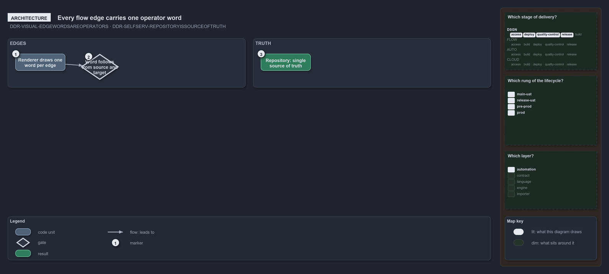

---
catzc:
  warning: "Experimental: this article merges two rules into one and holds nothing beyond what they say"
  edges:
    cites:
      - DDR-VISUAL-EDGEWORDSAREOPERATORS
      - DDR-SELFSERV-REPOSITORYISSOURCEOFTRUTH
---

# Every flow edge carries one operator word and the repository is the source of truth

This article is one rule: [DDR-VISUAL-EDGEWORDSAREOPERATORS](../../drs/design/visual-design.md#rule-ddr-visual-edgewordsareoperators) and
[DDR-SELFSERV-REPOSITORYISSOURCEOFTRUTH](../../drs/design/self-service.md#rule-ddr-selfserv-repositoryissourceoftruth) merged into one. It
holds nothing beyond what those two rules say.

Every flow edge of an action diagram carries one word, drawn by the renderer and never named in the declaration; the word follows from the
edge's source and target, never from the author. The repository is likewise the single source of truth for everything the platform manages,
all represented as code, and self-service means editing that source and letting the platform apply it.

