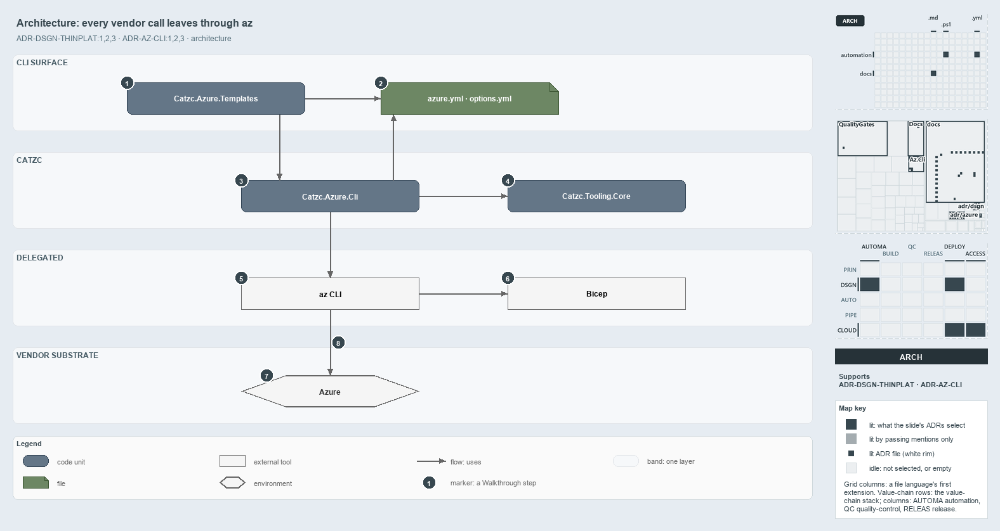

---
catzc:
  immutable:
    with_body_sha: "53dfed796091"
    path: docs/explanation/design/every-vendor-call-leaves-through-az.md
    folder: docs/explanation/design
    name: every-vendor-call-leaves-through-az
    filetype: md
    kind: explanation
    language: markdown
    track: docs
    tracktype: documentation
  edges:
    cites:
      - ADR-AZ-CLI#{1-3}
      - ADR-DSGN-THINPLAT#{1-3}
    links:
      - docs/.assets/explanation/adr-dsgn-thinplat--every-vendor-call-leaves-through-az--architecture.drawio.md
      - docs/.assets/explanation/adr-dsgn-thinplat--every-vendor-call-leaves-through-az--architecture.drawio.png
      - docs/adr/azure/prefer-az-cli.md
      - docs/adr/design/thin-platforms.md
      - docs/explanation/design/bind-to-one-cli-delegate-the-rest.md
      - docs/explanation/design/deploy-bicep-delegates-to-az.md
      - docs/explanation/design/index.md
      - docs/explanation/design/same-deploy-bicep-on-both-sides.md
      - docs/explanation/design/what-keeps-the-platform-thin.md
      - docs/explanation/index.md#how-to-read-the-diagrams
---

# Every vendor call leaves cats through the az CLI

```text
Every vendor call leaves cats through the az CLI, the one exit to Azure.

1  Catzc.Azure.Templates    the module behind the deploy commands; never calls the vendor itself
2  azure.yml, options.yml   the configuration both Azure modules read
3  Catzc.Azure.Cli          the module that owns the az session and the az wrapper
4  Catzc.Tooling.Core       the tooling contract: checks the installed az against its pin
5  az CLI                   the vendor's control-plane tool, and the one exit to Azure
6  Bicep                    the vendor's templating language, compiled by az
7  Azure                    the vendor substrate, today the only one
8  the single exit          the only edge that reaches Azure leaves from az

Supports ADR-DSGN-THINPLAT#1, #2 and #3, and ADR-AZ-CLI#1, #2 and #3 (architecture lens).
```

Cats is a thin platform over Azure: it standardizes how the vendor is used and leaves the work to the vendor's own tools. On the Bicep
deploy path, two Azure modules do the platform's part. One composes and deploys templates, the other owns the az session and the az wrapper,
and everything that reaches Azure, compiling a template included, goes out through the az CLI.



The diagram is described element by element in
[its asset description](../../.assets/explanation/adr-dsgn-thinplat--every-vendor-call-leaves-through-az--architecture.drawio.md).

## Walkthrough

1. **Catzc.Azure.Templates.** The module behind the CLI surface for infrastructure: its public `Build-Bicep` and `Deploy-Bicep` are the
   commands a developer and a CD pipeline both type. It composes the Bicep templates under `infrastructure/templates/` and never calls the
   vendor itself; its declared Azure dependency is `Catzc.Azure.Cli`.
2. **azure.yml and options.yml.** The configuration that drives the commands. `azure.yml` holds the environments, subscriptions and regions,
   and each template can carry an `options.yml` of validated overrides beside it. Both modules read it.
3. **Catzc.Azure.Cli.** The module that owns the az session: the login, the session's subscription, and `Invoke-AzCli`, the wrapper every
   deploy-path call goes through.
4. **Catzc.Tooling.Core.** The tooling contract. It reads the `az_cli` pin from `tools.yml`, which `Catzc.Base.Execution` holds, and
   `Assert-Tool 'az_cli'` checks the installed az against it before the wrapper runs az.
5. **az CLI.** The vendor's control-plane tool, and the one exit to Azure. The resource-group check and create, the deployment and the
   tracking tags all go through it.
6. **Bicep.** The vendor's templating language. The platform does not generate ARM by hand: az compiles each template with `az bicep build`.
7. **Azure.** The vendor substrate, today the only one cats covers.
8. **The single exit.** Only one arrow reaches Azure, and it leaves from the az CLI. No automation code imports an Az PowerShell module.

## Why it holds

- Cats is a single CLI abstraction over the vendor that standardizes how Azure is used without reimplementing it (ADR-DSGN-THINPLAT#1).
- Thin comes from delegation: Bicep for templating and the az CLI for control-plane actions, never a clone of either (ADR-DSGN-THINPLAT#2).
- The `Verb-Noun` functions and their configuration are the platform's API, so the modules behind them can be re-wired without touching a
  consumer (ADR-DSGN-THINPLAT#3).
- az is the default for every Azure operation, called through `Invoke-Executable` (ADR-AZ-CLI#1); a function that calls az asserts it with
  `Assert-Tool 'az_cli'` first (ADR-AZ-CLI#2); and automation code never imports `Az.*` (ADR-AZ-CLI#3).

## Where the code and the ADR differ

`Get-AdoAuthorizationHeader` in `Catzc.Azure.DevOps` calls az directly and never asserts `Assert-Tool 'az_cli'`, which ADR-AZ-CLI#2 asks of
every function that calls az. It still leaves through az, so the finding holds.

## See also

- [Thin platforms](../../adr/design/thin-platforms.md) — the decision this article explains.
- [Prefer Az CLI over Az PowerShell modules](../../adr/azure/prefer-az-cli.md) — the az-first rules.
- The other lenses on the same platform: [meta](bind-to-one-cli-delegate-the-rest.md), [implementation](deploy-bicep-delegates-to-az.md),
  [operations](same-deploy-bicep-on-both-sides.md) and [governance](what-keeps-the-platform-thin.md).
- [The design explanations](index.md) · [How to read the diagrams](../index.md#how-to-read-the-diagrams)
