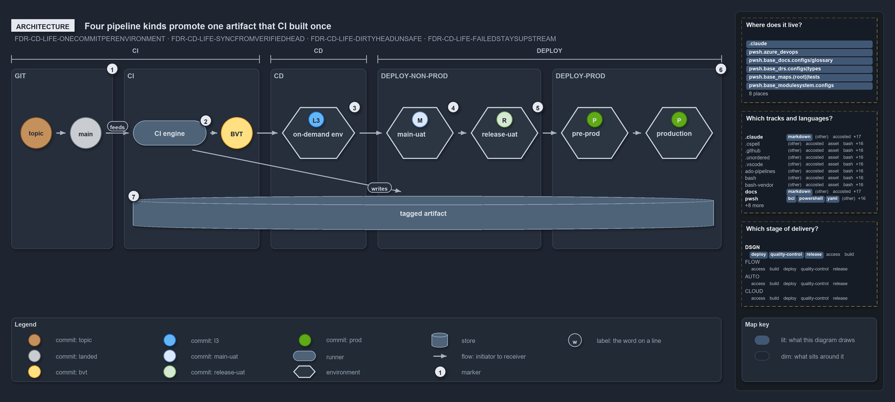

# Four pipeline kinds promote one artifact that CI built once

```text
Every pipeline kind after CI promotes the one artifact CI built, and each environment holds one occupant.

1  topic -> main            the GIT domain: a topic commit, then the commit landed on main
2  CI engine                builds and verifies the landed commit once; the BVT-verified commit
3  on-demand env            CD deploys there and runs the L3 tests; its occupant is L3-verified
4  main-uat                 DEPLOY-Non-Prod, the RC gate on main-AT; it takes the BVT-verified sync point first
5  release-uat              DEPLOY-Non-Prod, the RBC gate on release-AT; the release candidate under test
6  pre-prod -> production   DEPLOY-Prod: staged inactive, then activated live
7  tagged artifact          the one build every later domain promotes, never rebuilt

Supports FDR-CD-LIFE-ONECOMMITPERENVIRONMENT, FDR-CD-LIFE-SYNCFROMVERIFIEDHEAD, FDR-CD-LIFE-DIRTYHEADUNSAFE and FDR-CD-LIFE-FAILEDSTAYSUPSTREAM (architecture lens).
```

The commit ladder in cats is cut into domains: GIT, then the pipeline kinds CI, CD, DEPLOY-Non-Prod and DEPLOY-Prod. Every domain after CI
promotes the same tagged artifact, the one the CI engine built once, and each always-on environment holds exactly one commit as its
occupant. Reading the occupants tells you what lives where right now, and which commit is safe to build on.

```yml drawio
description:
  "The ladder of commit states cut into its domains: GIT, then the pipeline kinds CI, CD, DEPLOY-Non-Prod and DEPLOY-Prod, each always-on
  environment holding one commit as its occupant, and the tagged artifact CI built once that every later domain promotes."
about:
  adrs:
    - FDR-CD-LIFE-ONECOMMITPERENVIRONMENT
    - FDR-CD-LIFE-SYNCFROMVERIFIEDHEAD
    - FDR-CD-LIFE-DIRTYHEADUNSAFE
    - FDR-CD-LIFE-FAILEDSTAYSUPSTREAM
  lens: architecture
content:
  title: Four pipeline kinds promote one artifact that CI built once
  kind: explanation
  flow: left-to-right
  theme: dark
  bands:
    - { id: band-git, label: GIT }
    - { id: band-ci, label: CI }
    - { id: band-cd, label: CD }
    - { id: band-non-prod, label: DEPLOY-NON-PROD }
    - { id: band-prod, label: DEPLOY-PROD }
  spans:
    - id: span-ci
      label: CI
      over: [band-git, band-ci]
    - id: span-cd
      label: CD
      over: [band-cd]
    - id: span-deploy
      label: DEPLOY
      over: [band-non-prod, band-prod]
  glyphs:
    - { id: c-topic, kind: commit, label: topic, in: band-git, state: topic }
    - { id: c-main, kind: commit, label: main, in: band-git, state: landed }
    - { id: g-engine, kind: runner, label: CI engine, in: band-ci }
    - { id: c-bvt, kind: commit, label: BVT, in: band-ci }
    - { id: g-on-demand, kind: env, label: on-demand env, in: band-cd }
    - { id: c-l3, kind: commit, label: L3, in: g-on-demand, state: l3 }
    - { id: g-main-uat, kind: env, label: main-uat, in: band-non-prod }
    - { id: c-main-uat, kind: commit, label: M, in: g-main-uat, state: main-uat }
    - { id: g-release-uat, kind: env, label: release-uat, in: band-non-prod }
    - { id: c-release-uat, kind: commit, label: R, in: g-release-uat, state: release-uat }
    - { id: g-pre-prod, kind: env, label: pre-prod, in: band-prod }
    - { id: c-pre-prod, kind: commit, label: P, in: g-pre-prod, state: prod }
    - { id: g-production, kind: env, label: production, in: band-prod }
    - { id: c-production, kind: commit, label: P, in: g-production, state: prod }
    - { id: s-artifact, kind: store, label: tagged artifact, in: band-non-prod }
  edges:
    - { from: c-topic, to: c-main, kind: flow, label: "" }
    - { from: c-main, to: g-engine, kind: flow, label: feeds }
    - { from: g-engine, to: c-bvt, kind: flow, label: "" }
    - { from: c-bvt, to: g-on-demand, kind: flow, label: "" }
    - { from: g-on-demand, to: g-main-uat, kind: flow, label: "" }
    - { from: g-main-uat, to: g-release-uat, kind: flow, label: "" }
    - { from: g-release-uat, to: g-pre-prod, kind: flow, label: "" }
    - { from: g-pre-prod, to: g-production, kind: flow, label: "" }
    - { from: g-engine, to: s-artifact, kind: flow, label: "" }
  markers:
    - { at: band-git, number: 1, corner: top-right }
    - { at: g-engine, number: 2 }
    - { at: g-on-demand, number: 3 }
    - { at: g-main-uat, number: 4 }
    - { at: g-release-uat, number: 5 }
    - { at: band-prod, number: 6, corner: top-right }
    - { at: s-artifact, number: 7 }
  legend: auto
  minimaps: [code-locations, grid, axis]
layout:
  band-git: { x: 20, y: 84, w: 180, h: 320 }
  band-ci: { x: 220, y: 84, w: 240, h: 320 }
  band-cd: { x: 480, y: 84, w: 170, h: 320 }
  band-non-prod: { x: 670, y: 84, w: 290, h: 320 }
  band-prod: { x: 980, y: 84, w: 300, h: 320 }
  c-topic: { x: 36, y: 170, w: 56, h: 56 }
  c-main: { x: 124, y: 170, w: 56, h: 56 }
  g-engine: { x: 236, y: 176, w: 130, h: 44 }
  c-bvt: { x: 392, y: 170, w: 56, h: 56 }
  g-on-demand: { x: 500, y: 152, w: 130, h: 92 }
  g-main-uat: { x: 685, y: 152, w: 120, h: 92 }
  g-release-uat: { x: 835, y: 152, w: 120, h: 92 }
  g-pre-prod: { x: 995, y: 152, w: 120, h: 92 }
  g-production: { x: 1145, y: 152, w: 120, h: 92 }
  c-l3: { x: 547, y: 160, w: 28, h: 28 }
  c-main-uat: { x: 731, y: 160, w: 28, h: 28 }
  c-release-uat: { x: 881, y: 160, w: 28, h: 28 }
  c-pre-prod: { x: 1041, y: 160, w: 28, h: 28 }
  c-production: { x: 1191, y: 160, w: 28, h: 28 }
  s-artifact: { x: 236, y: 310, w: 1030, h: 60 }
```



## Walkthrough

1. **Topic to main.** GIT holds the first two states and is where the CI discipline starts: the inner CI loop begins at the topic branch's
   pull request build validation (FDR-CD-INNERANDOUTERLOOP), so the CI span covers GIT and the CI engine. A commit on a topic branch is
   off-main and brown; once its pull request merges, it has landed on main and is grey.
2. **CI engine.** The CI engine builds and verifies the landed commit and produces the BVT-verified, yellow commit. A CD pipeline always
   contains this same CI component, so the build that a CD run deploys is the build its own CI stage made.
3. **On-demand env.** CD deploys the artifact to an on-demand environment and runs the L3 system-level end-to-end tests there. The
   environment's occupant is blue while it holds an L3-verified commit.
4. **main-uat.** DEPLOY-Non-Prod rolls the artifact onto the always-on `main-uat`, where it clears the RC gate on its acceptance testing,
   `main-AT`. The commit it takes first is the BVT-verified server head, the stable sync point that upstream integrators build on, never on
   HEAD; once deployed, that commit is the `main-uat` occupant.
5. **release-uat.** The release branch's environment, `release-uat`, clears the RBC gate on `release-AT`. Its light-green occupant is the
   release candidate under test.
6. **Pre-prod to production.** DEPLOY-Prod stages the artifact inactive in `pre-prod`, then activates the same bytes live in `production`.
   Both occupants are green.
7. **Tagged artifact.** The release candidate is built once from one commit and never rebuilt. Every domain after CI promotes those same
   bytes, so what reaches production is what was certified in non-prod. In the code, each deploy stage downloads the artifact its CI stage
   published.

## Why it holds

- Each always-on environment hosts exactly one commit, its occupant, plus a history of the commits it held before
  (FDR-CD-LIFE-ONECOMMITPERENVIRONMENT).
- Upstream integrators sync from the BVT-verified server head, the same commit the always-on non-prod environment takes first, so the commit
  synced from and the commit `main-uat` takes are one (FDR-CD-LIFE-SYNCFROMVERIFIEDHEAD).
- The tip of main is only the newest commit; when it has failed a downstream stage it is the dirty HEAD, and nobody syncs or promotes from
  it (FDR-CD-LIFE-DIRTYHEADUNSAFE).
- A commit that fails a stage cannot go downstream: neither promotion nor consumption proceeds from it (FDR-CD-LIFE-FAILEDSTAYSUPSTREAM).
- A CD pipeline always contains the CI component, and the pipeline kinds share one key, the immutable tagged artifact
  (FDR-CD-SEPARATEPIPELINEKINDS, FDR-CD-CDCONTAINSCI).

## Where the code and the decision record differ

- No DEPLOY pipeline exists: each CD pipeline deploys straight from its own CI stage, and no environment is named `main-uat` or
  `release-uat`.
- No pipeline runs the L3 tests, so the on-demand environment and its L3 run exist only in the FDR.
- Occupancy is prose only: nothing in the code records which commit an environment holds.

## See also

- [The commit lifecycle](../../drs/flow/commit-lifecycle.md) — the decision this article explains.
- [The CI discipline and the promotion flow](../../drs/flow/cd-discipline-and-promotion-flow.md) — the pipeline kinds.
- The other lenses on the same lifecycle: [meta](one-way-climb-three-endings.md), [implementation](code-wires-only-the-first-rungs.md),
  [operations](engineer-merges-pipelines-do-the-rest.md) and [governance](which-rung-gates-exist-in-code.md).
- [The design explanations](index.md) · [How to read the diagrams](../index.md#how-to-read-the-diagrams)
