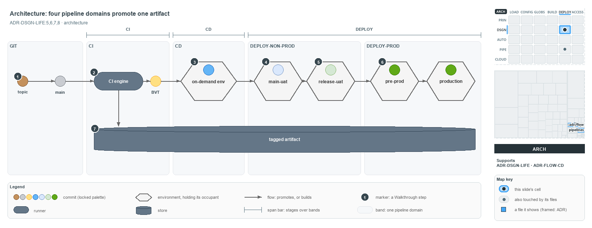

# docs/explanation/design/four-domains-promote-one-artifact.md

`Four pipeline domains promote one artifact that CI built once`

```text
Every pipeline domain after CI promotes the one artifact CI built, and each environment holds one occupant.

1  topic -> main            the GIT domain: a topic commit, then the commit landed on main
2  CI engine                builds and verifies the landed commit once; the BVT-verified commit
3  on-demand env            CD deploys there and runs the L3 tests; its occupant is L3-verified
4  main-uat                 DEPLOY-Non-Prod, the RC gate on main-AT; its occupant is the sync point
5  release-uat              DEPLOY-Non-Prod, the RBC gate on release-AT; the release candidate under test
6  pre-prod -> production   DEPLOY-Prod: staged inactive, then activated live
7  tagged artifact          the one build every later domain promotes, never rebuilt

Supports ADR-DSGN-LIFE#5, #6, #7 and #8 (architecture lens).
```

The commit ladder in cats is cut into domains: GIT, then the pipeline domains CI, CD, DEPLOY-Non-Prod and DEPLOY-Prod. Every domain after CI
promotes the same tagged artifact, the one the CI engine built once, and each always-on environment holds exactly one commit as its
occupant. Reading the occupants tells you what lives where right now, and which commit is safe to build on.



The diagram is described element by element in
[its asset description](../../.assets/explanation/adr-dsgn-life--four-domains-promote-one-artifact--architecture.drawio.md).

## Walkthrough

1. **Topic to main.** The GIT domain holds the first two states. A commit on a topic branch is off-main and brown; once its pull request
   merges, it has landed on main and is grey.
2. **CI engine.** The CI engine builds and verifies the landed commit and produces the BVT-verified, yellow commit. A CD pipeline always
   contains this same CI component, so the build that a CD run deploys is the build its own CI stage made.
3. **On-demand env.** CD deploys the artifact to an on-demand environment and runs the L3 system-level end-to-end tests there. The
   environment's occupant is blue while it holds an L3-verified commit.
4. **main-uat.** DEPLOY-Non-Prod rolls the artifact onto the always-on `main-uat`, where it clears the RC gate on its acceptance testing,
   `main-AT`. The `main-uat` occupant is the stable sync point: upstream integrators build on it, never on HEAD.
5. **release-uat.** The release branch's environment, `release-uat`, clears the RBC gate on `release-AT`. Its light-green occupant is the
   release candidate under test.
6. **Pre-prod to production.** DEPLOY-Prod stages the artifact inactive in `pre-prod`, then activates the same bytes live in `production`.
   Both occupants are green.
7. **Tagged artifact.** The release candidate is built once from one commit and never rebuilt. Every later domain promotes those same bytes,
   so what reaches production is what was certified in non-prod. In the code, each deploy stage downloads the artifact its CI stage
   published.

## Why it holds

- Each always-on environment hosts exactly one commit, its occupant, plus a history of the commits it held before (ADR-DSGN-LIFE#5).
- Upstream integrators sync from the current `main-uat` occupant, the latest commit certified onto the always-on non-prod environment
  (ADR-DSGN-LIFE#6).
- The tip of main is only the newest commit; when it has failed a downstream stage it is the dirty HEAD, and nobody syncs or promotes from
  it (ADR-DSGN-LIFE#7).
- A commit that fails a stage cannot go downstream: neither promotion nor consumption proceeds from it (ADR-DSGN-LIFE#8).
- A CD pipeline always contains the CI component, and the pipeline kinds share one key, the immutable tagged artifact (ADR-FLOW-CD#3,
  ADR-FLOW-CD#4).

## Where the code and the ADR differ

- No DEPLOY pipeline exists: each CD pipeline deploys straight from its own CI stage, and no environment is named `main-uat` or
  `release-uat`.
- No pipeline runs the L3 tests, so the on-demand environment and its L3 run exist only in the ADR.
- The CI engine in the code does not run `Test-BuildArtifact`, which the ADR makes part of the BVT.
- Occupancy is prose only: nothing in the code records which commit an environment holds.

## See also

- [The commit lifecycle](../../adr/design/commit-lifecycle.md) — the decision this article explains.
- [The CI discipline and the promotion flow](../../adr/flow/cd-discipline-and-promotion-flow.md) — the pipeline domains.
- The other lenses on the same lifecycle: [meta](one-way-climb-three-endings.md), [implementation](code-wires-only-the-first-rungs.md),
  [operations](engineer-merges-pipelines-do-the-rest.md) and [governance](which-rung-gates-exist-in-code.md).
- [The design explanations](index.md) · [How to read the diagrams](../index.md#how-to-read-the-diagrams)
