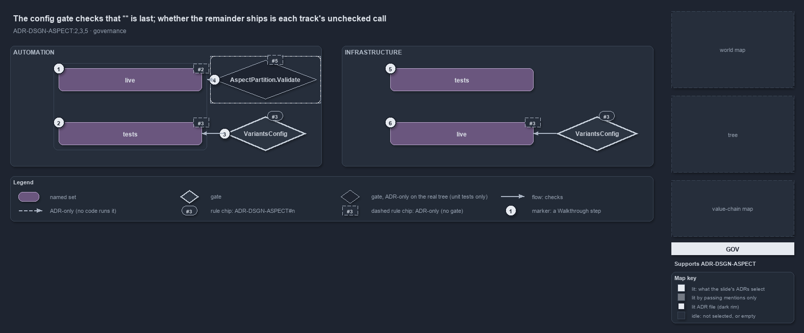

---
catzc:
  immutable:
    with_body_sha: "8bb9e4fa8e48"
    path: docs/explanation/design/gate-checks-order-not-liveness.md
    folder: docs/explanation/design
    name: gate-checks-order-not-liveness
    filetype: md
    kind: explanation
    language: markdown
    track: docs
    tracktype: documentation
  edges:
    cites:
      - ADR-DSGN-ASPECT#{2,3,5}
    links:
      - docs/.assets/explanation/adr-dsgn-aspect--gate-checks-order-not-liveness--governance.drawio.md
      - docs/.assets/explanation/adr-dsgn-aspect--gate-checks-order-not-liveness--governance.drawio.png
      - docs/adr/design/module-aspects.md
      - docs/explanation/design/each-track-picks-its-catch-all.md
      - docs/explanation/design/get-aspect-feeds-globs-and-maps.md
      - docs/explanation/design/get-aspect-names-the-remainder.md
      - docs/explanation/design/index.md
      - docs/explanation/design/only-automation-compiles-its-aspects.md
      - docs/explanation/index.md#how-to-read-the-diagrams
---

# The quality gate on config checks that ** is last; whether the remainder ships is each track's unchecked call

```text
The quality gate on config checks that ** is last; whether the remainder ships is each track's unchecked call.

1  live                      automation's closed convention: no gate checks that it stays closed
2  tests                     automation's remainder: that it is the non-live one is the track's call
3  VariantsConfig            the gate: the last aspect is the bare **, and no earlier aspect uses it
4  AspectPartition.Validate  the partition check: unit tests on fixtures are its only callers
5  tests                     infrastructure's closed head: the explicit tests/ folders
6  live                      infrastructure's remainder: that it ships is the track's call

Supports ADR-DSGN-ASPECT#2, #3 and #5 (governance lens).
```

The aspect convention of cats has one real quality gate, and it checks shape, not meaning. When the variants config loads, the config type
refuses any track whose last aspect is not the bare `**`, or that uses `**` anywhere earlier, so the remainder is always exactly one aspect
and always last. Which aspect that is, and so whether a stray file ships or not, is each track's declaration, and no gate reads it. The
partition check that the ADR describes exists in code, but only unit tests on fixture files call it.



The diagram is described element by element in
[its asset description](../../.assets/explanation/adr-dsgn-aspect--gate-checks-order-not-liveness--governance.drawio.md).

## Walkthrough

1. **live, in the automation track.** The closed convention of ADR-DSGN-ASPECT#2: folder-scoped patterns that never reach `tests/`. The rule
   is ADR-only in this respect: no gate checks that the patterns stay closed, and a pattern that reached `tests/` would load.
2. **tests, in the automation track.** The remainder. That the code track's remainder is the non-live aspect, so that a stray file never
   ships, is the track's own declaration in its `aspects` entry. A unit test proves it on a fixture module; no gate checks the real
   convention for it.
3. **VariantsConfig.** The gate, run per track entry when the config loads. The last aspect must be the single pattern `**`, and no earlier
   aspect may use the bare `**`; names must be kebab-case and unique, and every aspect needs a pattern. The same check runs for the
   infrastructure entry.
4. **AspectPartition.Validate.** The disjoint-and-exhaustive check of ADR-DSGN-ASPECT#5 over a file universe: a file claimed by two aspects,
   or by none, is a violation. The type's own comment calls it the integrity check, but its only callers are the aspect unit tests, so on
   the real tree it is ADR-only.
5. **tests, in the infrastructure track.** The deployment track's closed head, `**/tests/**`. Only the gate's structural checks apply to it.
6. **live, in the infrastructure track.** The deployment track's remainder, and the one that ships. Its liveness is a declaration like the
   automation one, unchecked by any gate; and no code derives an infrastructure globset from it, so the partition check could not run there
   even if it were wired.

## Why it holds

- `live` is a closed convention and the last aspect is the `**` catch-all remainder (ADR-DSGN-ASPECT#2).
- Which aspect is the remainder is each track's call, and the config type enforces the structure at load: the last aspect is `**`, and no
  earlier one uses it (ADR-DSGN-ASPECT#3).
- A file claimed by two aspects, or by none, fails the partition integrity check (ADR-DSGN-ASPECT#5).

## Where the code and the ADR differ

- The ADR makes the partition invariant an integrity check over `git ls-files`, and the type's comment calls `AspectPartition.Validate` the
  integrity check; no gate runs it on the real tree.
- The ADR partitions every delivery package at track granularity by the same convention; no code derives a track's delivery packages, and
  the infrastructure convention only classifies files for the world map.
- The comment on the aspect type says the last aspect is non-live by rule; the infrastructure track declares `live` last.

## See also

- [Module aspects](../../adr/design/module-aspects.md) — the decision this article explains.
- The other lenses on the same catch-all: [meta](each-track-picks-its-catch-all.md),
  [architecture](only-automation-compiles-its-aspects.md), [implementation](get-aspect-feeds-globs-and-maps.md) and
  [operations](get-aspect-names-the-remainder.md).
- [The design explanations](index.md) · [How to read the diagrams](../index.md#how-to-read-the-diagrams)
