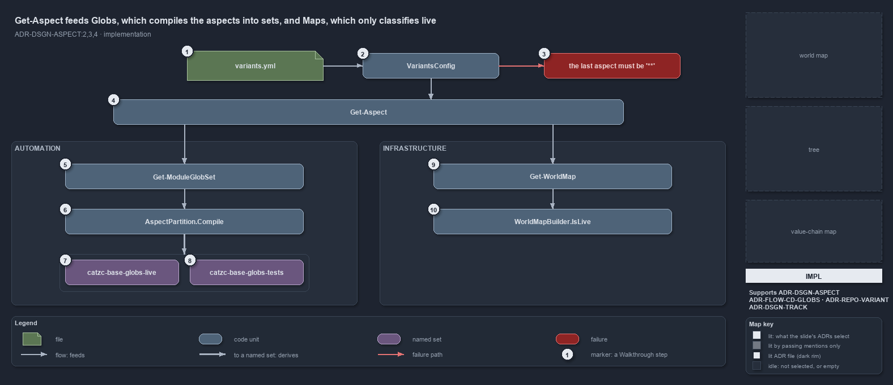

---
catzc:
  derived:
    path: docs/explanation/design/get-aspect-feeds-globs-and-maps.md
    kind: explanation
    body_sha: "15139b8bcd1b"
    adrs:
      - ADR-DSGN-ASPECT#2
      - ADR-DSGN-ASPECT#3
      - ADR-DSGN-ASPECT#4
      - ADR-DSGN-TRACK#3
      - ADR-FLOW-CD-GLOBS#4
      - ADR-REPO-VARIANT#1
    links:
      - docs/.assets/explanation/adr-dsgn-aspect--get-aspect-feeds-globs-and-maps--implementation.drawio.md
      - docs/.assets/explanation/adr-dsgn-aspect--get-aspect-feeds-globs-and-maps--implementation.drawio.png
      - docs/adr/design/module-aspects.md
      - docs/adr/design/tracks.md
      - docs/adr/flow/durable-sha-globs.md
      - docs/adr/repository/repo-variants.md
      - docs/explanation/design/each-track-picks-its-catch-all.md
      - docs/explanation/design/gate-checks-order-not-liveness.md
      - docs/explanation/design/get-aspect-names-the-remainder.md
      - docs/explanation/design/index.md
      - docs/explanation/design/only-automation-compiles-its-aspects.md
      - docs/explanation/index.md#how-to-read-the-diagrams
---

# Get-Aspect feeds Globs, which compiles the aspects into sets, and Maps, which only classifies live

```text
Get-Aspect feeds Globs, which compiles the aspects into sets, and Maps, which only classifies live.

1   variants.yml                  the aspects entry: automation live then tests, infrastructure tests then live
2   VariantsConfig                the config type: validates the map when the variants config loads
3   the last aspect must be '**'  the throw for a track whose last aspect is not the bare **
4   Get-Aspect                    returns one track's ordered aspects; unknown track -> the automation convention
5   Get-ModuleGlobSet             asks for the automation convention and walks every module folder
6   AspectPartition.Compile       aspect k = its own patterns, minus every earlier aspect's, under the unit root
7   catzc-base-globs-live         the derived live set of Catzc.Base.Globs, its own GlobSet
8   catzc-base-globs-tests        the derived tests set, the remainder plus the language test folders
9   Get-WorldMap                  asks for the convention of every track that has an entry
10  WorldMapBuilder.IsLive        first match over the track's aspects; live when that aspect is named live

Supports ADR-DSGN-ASPECT#2, #3 and #4, ADR-FLOW-CD-GLOBS#4, ADR-REPO-VARIANT#1 and #2, and ADR-DSGN-TRACK#3 (implementation lens).
```

One function, `Get-Aspect`, is the only way a convention leaves `variants.yml`, and two callers take it in different directions. In
`Catzc.Base.Globs`, `Get-ModuleGlobSet` compiles the automation convention onto every module folder, so each aspect becomes a globset with a
scan program. In `Catzc.Base.Maps`, `Get-WorldMap` reads the convention of every track and the builder answers one question per file: is it
live? The code that validates the order sits in the config type, before either caller sees a list.



The diagram is described element by element in
[its asset description](../../.assets/explanation/adr-dsgn-aspect--get-aspect-feeds-globs-and-maps--implementation.drawio.md).

## Walkthrough

1. **variants.yml.** The `aspects` entry of the repo-wide variants: `automation` lists `live` with five patterns (`*.ps1`, `private/**`,
   `types/**`, `configs/**`, `assets/**`) and then `tests: ["**"]`; `infrastructure` lists `tests: ["**/tests/**"]` and then `live: ["**"]`.
   Patterns are relative to the unit root.
2. **VariantsConfig.** The config type that `Get-Config -Config variants` builds. For every track entry it checks each aspect name is
   kebab-case and unique, each has at least one non-empty pattern, the last aspect is the bare `**`, and no earlier aspect uses it.
3. **The last aspect must be `**`.** The throw when a track's final aspect is not the remainder, naming the track and the aspect:
   `aspects['automation']: the last aspect ('live') must be the '**' catch-all remainder`. An earlier aspect that uses the bare `**` fails
   with its own message. Either stops the config from loading at all.
4. **Get-Aspect.** The public reader in `Catzc.Base.Variants`. It reads the variant through the private `Get-Variant`, carries the same
   two-track convention as its default, and returns the requested track's list in declared order. A track with no entry gets the automation
   convention.
5. **Get-ModuleGlobSet.** The derived-globset function of `Catzc.Base.Globs`. It calls `Get-Aspect -Track automation` once, turns each
   `VariantAspect` into an `Aspect`, and then visits every non-dot folder under `automation/`.
6. **AspectPartition.Compile.** For one unit root such as `automation/Catzc.Base.Globs`, aspect _k_ becomes a `CompiledAspect` whose include
   patterns are its own, prefixed by the root, and whose exclude patterns are every earlier aspect's. A leaf scan program runs the includes
   as `+` and the excludes as `-`, last match wins, which is exactly first-match slicing.
7. **The live set.** `Get-ModuleGlobSet` builds one `GlobSet` per compiled aspect in the `module` layer, named by the module's kebab form
   plus the aspect: `catzc-base-globs-live` includes the five patterns under `automation/Catzc.Base.Globs/` and excludes nothing.
8. **The tests set.** `catzc-base-globs-tests` includes `automation/Catzc.Base.Globs/**` and excludes the live patterns, so it is the
   remainder. Three more includes reach outside the module root: the module's Go, Python and Bash test folders.
9. **Get-WorldMap.** The world-map entry point of `Catzc.Base.Maps`. It reads the `aspects` map from the variants config and calls
   `Get-Aspect -Track <track>` for every track that has an entry, infrastructure included, then hands the lists to the builder.
10. **WorldMapBuilder.IsLive.** The builder's classifier. A file of a verification track or under a `.vendor/` folder is not live; a track
    without an entry is live throughout; otherwise the unit-relative path is tried against the track's aspects in order, and the first
    pattern that matches decides: live exactly when that aspect is named `live`. The patterns are compiled as plain `GlobPattern`s, not as a
    partition, and no globset is built.

## Why it holds

- The aspect engine compiles aspect _k_ as its own patterns minus every earlier aspect's, prefixed by the unit root (ADR-DSGN-ASPECT#2).
- Which aspect is the remainder is declared per track, and the config type enforces at load that the last aspect is `**` and no earlier one
  uses it (ADR-DSGN-ASPECT#3).
- Each aspect is its own derived globset, `<unit>-<aspect>` (ADR-DSGN-ASPECT#4).
- A globset's scan program is an ordered list of `+` and `-` rules evaluated last match wins, and a leaf set's program is its includes then
  its excludes (ADR-FLOW-CD-GLOBS#4).
- The variants file is read through the session-cached config, by typed primitives and the one private reader (ADR-REPO-VARIANT#1, #2).
- A track owns one coherent tech-stack, and the world map checks it on live files only, so the builder must classify every file of every
  track (ADR-DSGN-TRACK#3).

## Where the code and the ADR differ

- The comment on the aspect type names `Get-ModuleAspect` as the PowerShell side that builds the sets; `Get-ModuleGlobSet` does it, and no
  function of that name exists.
- The ADR prefixes every aspect pattern with the unit root; the derived `tests` set adds the language test folders outside it.
- The comment on the aspect type says the last aspect is non-live by rule; the infrastructure entry declares `live` last.

## See also

- [Module aspects](../../adr/design/module-aspects.md) — the decision this article explains. Also
  [durable sha globs](../../adr/flow/durable-sha-globs.md), [repo-wide variants](../../adr/repository/repo-variants.md) and
  [tracks](../../adr/design/tracks.md).
- The other lenses on the same catch-all: [meta](each-track-picks-its-catch-all.md),
  [architecture](only-automation-compiles-its-aspects.md), [operations](get-aspect-names-the-remainder.md) and
  [governance](gate-checks-order-not-liveness.md).
- [The design explanations](index.md) · [How to read the diagrams](../index.md#how-to-read-the-diagrams)
