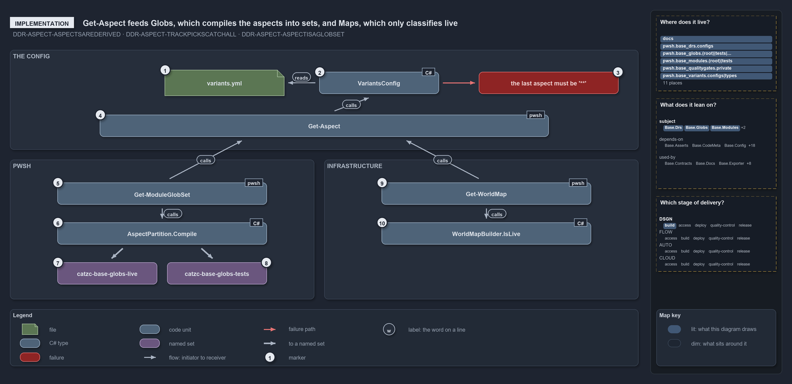

---
catzc:
  edges:
    cites:
      - ADR-REPO-VARIANT-SESSIONVARIANT
      - ADR-REPO-VARIANT-NODIRECTREADS
      - DDR-ASPECT-ASPECTSAREDERIVED
      - DDR-ASPECT-TRACKPICKSCATCHALL
      - DDR-ASPECT-ASPECTISAGLOBSET
      - DDR-TRACK-ONETECHSTACK
      - FDR-CD-GLOBS-TRACKEDFILESONLY
---

# Get-Aspect feeds Globs, which compiles the aspects into sets, and Maps, which only classifies live

```text
Get-Aspect feeds Globs, which compiles the aspects into sets, and Maps, which only classifies live.

1   variants.yml                  the aspects entry: infrastructure tests then live
2   VariantsConfig                the config type: validates the map when the variants config loads
3   the last aspect must be '**'  the throw for a track whose last aspect is not the bare **
4   Get-Aspect                    returns one track's ordered aspects; the code track's from languages.yml
5   Get-ModuleGlobSet             asks for the pwsh convention and walks every module folder
6   AspectPartition.Compile       aspect k = its own patterns, minus every earlier aspect's, under the unit root
7   catzc-base-globs-live         the derived live set of Catzc.Base.Globs, its own GlobSet
8   catzc-base-globs-tests        the derived tests set, the remainder plus the language test folders
9   Get-WorldMap                  asks for the convention of every track that has an entry
10  WorldMapBuilder.IsLive        first match over the track's aspects; live when that aspect is named live

Supports DDR-ASPECT-ASPECTSAREDERIVED, DDR-ASPECT-TRACKPICKSCATCHALL and DDR-ASPECT-ASPECTISAGLOBSET (implementation lens).
```

One function, `Get-Aspect`, is the only way a convention reaches a caller, and two callers take it in different directions. In
`Catzc.Base.Globs`, `Get-ModuleGlobSet` compiles the pwsh convention onto every module folder, so each aspect becomes a globset with a scan
program. In `Catzc.Base.Maps`, `Get-WorldMap` reads the convention of every track and the builder answers one question per file: is it live?
The code that validates the order sits in the config type, before either caller sees a list.

```yml drawio
description:
  Get-Aspect returns a track's ordered aspects from the validated variants config; Globs compiles them into derived globsets and Maps only
  classifies a file as live or not.
about:
  adrs: [DDR-ASPECT-ASPECTSAREDERIVED, DDR-ASPECT-TRACKPICKSCATCHALL, DDR-ASPECT-ASPECTISAGLOBSET]
  lens: implementation
content:
  title: Get-Aspect feeds Globs, which compiles the aspects into sets, and Maps, which only classifies live
  kind: explanation
  flow: left-to-right
  relation: feeds
  theme: dark
  bands:
    - { id: band-config, label: THE CONFIG }
    - { id: band-code, label: PWSH }
    - { id: band-deployment, label: INFRASTRUCTURE }
  glyphs:
    - { id: f-variants, kind: file, label: variants.yml, in: band-config }
    - { id: c-variants-config, kind: type, label: VariantsConfig, in: band-config }
    - { id: f-last-aspect, kind: failure, label: the last aspect must be '**', in: band-config }
    - { id: c-get-aspect, kind: code, label: Get-Aspect, in: band-config }
    - { id: c-glob-set, kind: code, label: Get-ModuleGlobSet, in: band-code }
    - { id: c-compile, kind: type, label: AspectPartition.Compile, in: band-code }
    - { id: s-live, kind: set, label: catzc-base-globs-live, in: band-code }
    - { id: s-tests, kind: set, label: catzc-base-globs-tests, in: band-code }
    - { id: c-world-map, kind: code, label: Get-WorldMap, in: band-deployment }
    - { id: c-is-live, kind: type, label: WorldMapBuilder.IsLive, in: band-deployment }
  edges:
    - { from: f-variants, to: c-variants-config, kind: flow, label: "" }
    - { from: c-variants-config, to: f-last-aspect, kind: fail, label: "" }
    - { from: c-variants-config, to: c-get-aspect, kind: flow, label: "" }
    - { from: c-get-aspect, to: c-glob-set, kind: flow, label: "" }
    - { from: c-get-aspect, to: c-world-map, kind: flow, label: "" }
    - { from: c-glob-set, to: c-compile, kind: flow, label: "" }
    - { from: c-compile, to: s-live, kind: thick, label: "" }
    - { from: c-compile, to: s-tests, kind: thick, label: "" }
    - { from: c-world-map, to: c-is-live, kind: flow, label: "" }
  markers:
    - { at: f-variants, number: 1 }
    - { at: c-variants-config, number: 2 }
    - { at: f-last-aspect, number: 3 }
    - { at: c-get-aspect, number: 4 }
    - { at: c-glob-set, number: 5 }
    - { at: c-compile, number: 6 }
    - { at: s-live, number: 7 }
    - { at: s-tests, number: 8 }
    - { at: c-world-map, number: 9 }
    - { at: c-is-live, number: 10 }
  legend: auto
  minimaps:
    code-locations:
      - cell: docs/-/.
        by:
          - docs/drs/design/dora-explains.md
          - docs/drs/design/module-aspects.md
          - docs/drs/index.md
          - docs/references/pwsh/catzc-base-globs/Get-ModuleGlobSet.ps1.md
          - docs/references/pwsh/catzc-base-globs/tests/types/Aspect.Tests.ps1.md
          - docs/references/pwsh/catzc-base-globs/types/Aspect.cs.md
          - docs/references/pwsh/catzc-base-modules/Get-Aspect.ps1.md
          - docs/references/pwsh/catzc-base-quality-gates/private/Get-ModuleProtectionIdentity.ps1.md
          - docs/references/pwsh/catzc-base-variants/configs/variants.yml.md
          - docs/references/pwsh/catzc-base-variants/types/VariantAspect.cs.md
          - docs/references/pwsh/catzc-base-variants/types/VariantsConfig.cs.md
          - DDR-ASPECT-ASPECTISAGLOBSET
          - DDR-ASPECT-ASPECTSAREDERIVED
          - DDR-ASPECT-TRACKPICKSCATCHALL
      - cell: pwsh/Catzc.Base.Drs/configs
        by: [pwsh/Catzc.Base.Drs/configs/drs.yml, DDR-ASPECT-ASPECTISAGLOBSET, DDR-ASPECT-ASPECTSAREDERIVED, DDR-ASPECT-TRACKPICKSCATCHALL]
      - cell: pwsh/Catzc.Base.Globs/.
        by:
          - pwsh/Catzc.Base.Globs/Get-ModuleGlobSet.ps1
          - DDR-ASPECT-ASPECTISAGLOBSET
          - DDR-ASPECT-ASPECTSAREDERIVED
          - DDR-ASPECT-TRACKPICKSCATCHALL
      - cell: pwsh/Catzc.Base.Globs/tests
        by:
          - pwsh/Catzc.Base.Globs/tests/Get-ModuleGlobSet.Tests.ps1
          - DDR-ASPECT-ASPECTISAGLOBSET
          - DDR-ASPECT-ASPECTSAREDERIVED
          - DDR-ASPECT-TRACKPICKSCATCHALL
      - cell: pwsh/Catzc.Base.Globs/tests/types
        by:
          - pwsh/Catzc.Base.Globs/tests/types/Aspect.Tests.ps1
          - DDR-ASPECT-ASPECTISAGLOBSET
          - DDR-ASPECT-ASPECTSAREDERIVED
          - DDR-ASPECT-TRACKPICKSCATCHALL
      - cell: pwsh/Catzc.Base.Globs/types
        by:
          - pwsh/Catzc.Base.Globs/types/Aspect.cs
          - DDR-ASPECT-ASPECTISAGLOBSET
          - DDR-ASPECT-ASPECTSAREDERIVED
          - DDR-ASPECT-TRACKPICKSCATCHALL
      - cell: pwsh/Catzc.Base.Modules/.
        by:
          - pwsh/Catzc.Base.Modules/Get-Aspect.ps1
          - DDR-ASPECT-ASPECTISAGLOBSET
          - DDR-ASPECT-ASPECTSAREDERIVED
          - DDR-ASPECT-TRACKPICKSCATCHALL
      - cell: pwsh/Catzc.Base.Modules/tests
        by:
          - pwsh/Catzc.Base.Modules/tests/Get-Aspect.Tests.ps1
          - DDR-ASPECT-ASPECTISAGLOBSET
          - DDR-ASPECT-ASPECTSAREDERIVED
          - DDR-ASPECT-TRACKPICKSCATCHALL
      - cell: pwsh/Catzc.Base.QualityGates/private
        by:
          - pwsh/Catzc.Base.QualityGates/private/Get-ModuleProtectionIdentity.ps1
          - DDR-ASPECT-ASPECTISAGLOBSET
          - DDR-ASPECT-ASPECTSAREDERIVED
          - DDR-ASPECT-TRACKPICKSCATCHALL
      - cell: pwsh/Catzc.Base.Variants/configs
        by:
          - pwsh/Catzc.Base.Variants/configs/variants.yml
          - DDR-ASPECT-ASPECTISAGLOBSET
          - DDR-ASPECT-ASPECTSAREDERIVED
          - DDR-ASPECT-TRACKPICKSCATCHALL
      - cell: pwsh/Catzc.Base.Variants/types
        by:
          - pwsh/Catzc.Base.Variants/types/VariantAspect.cs
          - pwsh/Catzc.Base.Variants/types/VariantsConfig.cs
          - DDR-ASPECT-ASPECTISAGLOBSET
          - DDR-ASPECT-ASPECTSAREDERIVED
          - DDR-ASPECT-TRACKPICKSCATCHALL
    module-neighbourhood:
      - cell: subject/Catzc.Base.Drs
        by: [pwsh/Catzc.Base.Drs/configs/drs.yml, DDR-ASPECT-ASPECTISAGLOBSET, DDR-ASPECT-ASPECTSAREDERIVED, DDR-ASPECT-TRACKPICKSCATCHALL]
      - cell: subject/Catzc.Base.Globs
        by:
          - pwsh/Catzc.Base.Globs/Get-ModuleGlobSet.ps1
          - pwsh/Catzc.Base.Globs/tests/Get-ModuleGlobSet.Tests.ps1
          - pwsh/Catzc.Base.Globs/tests/types/Aspect.Tests.ps1
          - pwsh/Catzc.Base.Globs/types/Aspect.cs
          - DDR-ASPECT-ASPECTISAGLOBSET
          - DDR-ASPECT-ASPECTSAREDERIVED
          - DDR-ASPECT-TRACKPICKSCATCHALL
      - cell: subject/Catzc.Base.Modules
        by:
          - pwsh/Catzc.Base.Modules/Get-Aspect.ps1
          - pwsh/Catzc.Base.Modules/tests/Get-Aspect.Tests.ps1
          - DDR-ASPECT-ASPECTISAGLOBSET
          - DDR-ASPECT-ASPECTSAREDERIVED
          - DDR-ASPECT-TRACKPICKSCATCHALL
      - cell: subject/Catzc.Base.QualityGates
        by:
          - pwsh/Catzc.Base.QualityGates/private/Get-ModuleProtectionIdentity.ps1
          - DDR-ASPECT-ASPECTISAGLOBSET
          - DDR-ASPECT-ASPECTSAREDERIVED
          - DDR-ASPECT-TRACKPICKSCATCHALL
      - cell: subject/Catzc.Base.Variants
        by:
          - pwsh/Catzc.Base.Variants/configs/variants.yml
          - pwsh/Catzc.Base.Variants/types/VariantAspect.cs
          - pwsh/Catzc.Base.Variants/types/VariantsConfig.cs
          - DDR-ASPECT-ASPECTISAGLOBSET
          - DDR-ASPECT-ASPECTSAREDERIVED
          - DDR-ASPECT-TRACKPICKSCATCHALL
    axis:
      - cell: DSGN/build
        by: [DDR-ASPECT-ASPECTISAGLOBSET, DDR-ASPECT-ASPECTSAREDERIVED, DDR-ASPECT-TRACKPICKSCATCHALL]
layout:
  band-config: { x: 20, y: 84, w: 1260, h: 200 }
  band-code: { x: 20, y: 304, w: 610, h: 280 }
  band-deployment: { x: 650, y: 304, w: 630, h: 280 }
  f-variants: { x: 330, y: 124, w: 240, h: 52 }
  c-variants-config: { x: 640, y: 128, w: 240, h: 44 }
  f-last-aspect: { x: 960, y: 128, w: 280, h: 44 }
  c-get-aspect: { x: 200, y: 214, w: 900, h: 44 }
  c-glob-set: { x: 115, y: 350, w: 420, h: 44 }
  c-compile: { x: 115, y: 430, w: 420, h: 44 }
  s-live: { x: 115, y: 510, w: 200, h: 44 }
  s-tests: { x: 335, y: 510, w: 200, h: 44 }
  c-world-map: { x: 765, y: 350, w: 420, h: 44 }
  c-is-live: { x: 765, y: 430, w: 420, h: 44 }
```



## Walkthrough

1. **variants.yml.** The `aspects` entry of the repo-wide variants: `infrastructure` lists `tests: ["**/tests/**"]` and then `live: ["**"]`.
   Patterns are relative to the unit root. The code track `pwsh` declares no entry: its convention is the layout of `languages.yml`, `live`
   with five patterns (`*.ps1`, `private/**`, `types/**`, `configs/**`, `assets/**`) and then `tests: ["**"]`.
2. **VariantsConfig.** The config type that `Get-Config -Config variants` builds. For every track entry it checks each aspect name is
   kebab-case and unique, each has at least one non-empty pattern, the last aspect is the bare `**`, and no earlier aspect uses it.
3. **The last aspect must be `**`.** The throw when a track's final aspect is not the remainder, naming the track and the aspect:
   `aspects['infrastructure']: the last aspect ('tests') must be the '**' catch-all remainder`. An earlier aspect that uses the bare `**`
   fails with its own message. Either stops the config from loading at all.
4. **Get-Aspect.** The public reader in `Catzc.Base.Modules`. For a track of type `modules` it derives the convention from the layout of
   `languages.yml`; for any other track it returns the declared list, which it reads through `Get-AspectDeclaration` in
   `Catzc.Base.Variants`, in declared order. A track with no entry gets the layout's convention.
5. **Get-ModuleGlobSet.** The derived-globset function of `Catzc.Base.Globs`. It calls `Get-Aspect -Track pwsh` once, turns each
   `VariantAspect` into an `Aspect`, and then visits every non-dot folder under `pwsh/`.
6. **AspectPartition.Compile.** For one unit root such as `pwsh/Catzc.Base.Globs`, aspect _k_ becomes a `CompiledAspect` whose include
   patterns are its own, prefixed by the root, and whose exclude patterns are every earlier aspect's. A leaf scan program runs the includes
   as `+` and the excludes as `-`, last match wins, which is exactly first-match slicing.
7. **The live set.** `Get-ModuleGlobSet` builds one `GlobSet` per compiled aspect in the `module` layer, named by the module's kebab form
   plus the aspect: `catzc-base-globs-live` includes the five patterns under `pwsh/Catzc.Base.Globs/` and excludes nothing.
8. **The tests set.** `catzc-base-globs-tests` includes `pwsh/Catzc.Base.Globs/**` and excludes the live patterns, so it is the remainder.
   Three more includes reach outside the module root: the module's Go, Python and Bash test folders.
9. **Get-WorldMap.** The world-map entry point of `Catzc.Base.Maps`. It asks `Test-AspectDeclaration` which tracks have an entry and calls
   `Get-Aspect -Track <track>` for each of them, infrastructure included, then hands the lists to the builder.
10. **WorldMapBuilder.IsLive.** The builder's classifier. A file under a `.vendor/` folder is not live; a track without an entry is live
    throughout; otherwise the unit-relative path is tried against the track's aspects in order, and the first pattern that matches decides:
    live exactly when that aspect is named `live`. The patterns are compiled as plain `GlobPattern`s, not as a partition, and no globset is
    built.

## Why it holds

- The aspect engine compiles aspect _k_ as its own patterns minus every earlier aspect's, prefixed by the unit root
  (DDR-ASPECT-ASPECTSAREDERIVED).
- Which aspect is the remainder is declared per track, and the config type enforces at load that the last aspect is `**` and no earlier one
  uses it (DDR-ASPECT-TRACKPICKSCATCHALL).
- Each aspect is its own derived globset, `<unit>-<aspect>` (DDR-ASPECT-ASPECTISAGLOBSET).
- A globset's scan program is an ordered list of `+` and `-` rules evaluated last match wins, and a leaf set's program is its includes then
  its excludes (FDR-CD-GLOBS-TRACKEDFILESONLY).
- The variants file is read through the session-cached config, by typed primitives and the one private reader
  (ADR-REPO-VARIANT-SESSIONVARIANT, ADR-REPO-VARIANT-NODIRECTREADS).
- A track owns one coherent tech-stack, and the world map checks it on live files only, so the builder must classify every file of every
  track (DDR-TRACK-ONETECHSTACK).

## Where the code and the decision record differ

- The reference page of the aspect type (`Aspect.cs.md`) names `Get-ModuleAspect` as the PowerShell side that builds the sets;
  `Get-ModuleGlobSet` does it, and no function of that name exists.
- The DDR prefixes every aspect pattern with the unit root; the derived `tests` set adds the language test folders outside it.
- The reference page of the aspect type (`Aspect.cs.md`) says the last aspect is non-live by rule; the infrastructure entry declares `live`
  last.

## See also

- [Module aspects](../../drs/design/module-aspects.md) — the decision this article explains. Also
  [durable sha globs](../../drs/flow/durable-sha-globs.md), [repo-wide variants](../../drs/repository/repo-variants.md) and
  [tracks](../../drs/design/tracks.md).
- The other lenses on the same catch-all: [meta](each-track-picks-its-catch-all.md), [architecture](only-pwsh-compiles-its-aspects.md),
  [operations](get-aspect-names-the-remainder.md) and [governance](gate-checks-order-not-liveness.md).
- [The design explanations](index.md) · [How to read the diagrams](../index.md#how-to-read-the-diagrams)
