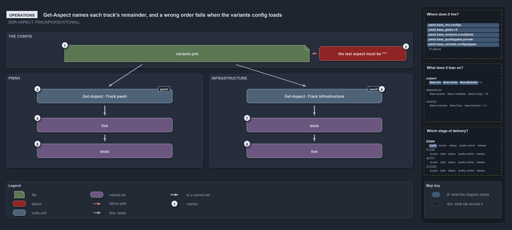

---
catzc:
  warning: "Header is generated by Format-FileMeta via Format-Code; do not change it"
  edges:
    cites:
      - ADR-REPO-VARIANT-SESSIONVARIANT
      - ADR-REPO-VARIANT-NODIRECTREADS
      - DDR-ASPECT-TRACKPICKSCATCHALL
    drs_total: 3
---

# Get-Aspect names each track's remainder, and a wrong order fails when the variants config loads

```text
Get-Aspect names each track's remainder, and a wrong order fails when the variants config loads.

1  variants.yml                     the file a person edits to change a track's convention
2  the last aspect must be '**'     the failure a wrong order raises the next time the config loads
3  Get-Aspect -Track pwsh           the command that answers the code track's convention
4  live                             first: the closed convention, what ships
5  tests                            last: the remainder, never ships
6  Get-Aspect -Track infrastructure the command that answers the deployment track's convention
7  tests                            first: the explicit tests/ folders, the only non-live part
8  live                             last: the remainder, it ships

Supports DDR-ASPECT-TRACKPICKSCATCHALL (operations lens).
```

A person who wants to know which aspect a track's stray files fall into asks `Get-Aspect`. The command returns the track's aspects in their
declared order, and the last one is the remainder, so `(Get-Aspect -Track infrastructure)[-1].Name` is `live` and the same expression for
`pwsh` is `tests`. A person who wants to change a deployment track's order edits `variants.yml` and runs the importer again; the code
track's order follows the layout of `languages.yml`. A wrong order does not get far: the config type refuses to load a track whose last
aspect is not the bare `**`.

```yml drawio
description:
  "Get-Aspect answers each track's aspect order from variants.yml, naming the remainder: the code track ends in tests, the deployment track
  ends in live, and a wrong order fails the next time the config loads."
about:
  adrs: [DDR-ASPECT-TRACKPICKSCATCHALL]
  lens: operations
content:
  title: Get-Aspect names each track's remainder, and a wrong order fails when the variants config loads
  kind: explanation
  flow: left-to-right
  relation: feeds
  theme: dark
  bands:
    - { id: band-config, label: THE CONFIG }
    - { id: band-code, label: PWSH }
    - { id: band-deployment, label: INFRASTRUCTURE }
  glyphs:
    - { id: f-variants, kind: file, label: variants.yml, in: band-config }
    - { id: f-last-aspect, kind: failure, label: the last aspect must be '**', in: band-config }
    - { id: c-code-aspect, kind: code, label: Get-Aspect -Track pwsh, in: band-code }
    - { id: s-code-live, kind: set, label: live, in: band-code }
    - { id: s-code-tests, kind: set, label: tests, in: band-code }
    - { id: c-deployment-aspect, kind: code, label: Get-Aspect -Track infrastructure, in: band-deployment }
    - { id: s-deployment-tests, kind: set, label: tests, in: band-deployment }
    - { id: s-deployment-live, kind: set, label: live, in: band-deployment }
  edges:
    - { from: f-variants, to: f-last-aspect, kind: fail, label: "" }
    - { from: f-variants, to: c-code-aspect, kind: flow, label: "" }
    - { from: f-variants, to: c-deployment-aspect, kind: flow, label: "" }
    - { from: c-code-aspect, to: s-code-live, kind: thick, label: "" }
    - { from: s-code-live, to: s-code-tests, kind: thick, label: "" }
    - { from: c-deployment-aspect, to: s-deployment-tests, kind: thick, label: "" }
    - { from: s-deployment-tests, to: s-deployment-live, kind: thick, label: "" }
  markers:
    - { at: f-variants, number: 1 }
    - { at: f-last-aspect, number: 2 }
    - { at: c-code-aspect, number: 3 }
    - { at: s-code-live, number: 4 }
    - { at: s-code-tests, number: 5 }
    - { at: c-deployment-aspect, number: 6 }
    - { at: s-deployment-tests, number: 7 }
    - { at: s-deployment-live, number: 8 }
  legend: auto
  minimaps: [code-locations, module-neighbourhood, axis]
layout:
  band-config: { x: 20, y: 84, w: 1260, h: 110 }
  band-code: { x: 20, y: 214, w: 610, h: 290 }
  band-deployment: { x: 650, y: 214, w: 630, h: 290 }
  f-variants: { x: 200, y: 124, w: 760, h: 52 }
  f-last-aspect: { x: 990, y: 128, w: 270, h: 44 }
  c-code-aspect: { x: 115, y: 260, w: 420, h: 44 }
  s-code-live: { x: 115, y: 350, w: 420, h: 44 }
  s-code-tests: { x: 115, y: 430, w: 420, h: 44 }
  c-deployment-aspect: { x: 765, y: 260, w: 420, h: 44 }
  s-deployment-tests: { x: 765, y: 350, w: 420, h: 44 }
  s-deployment-live: { x: 765, y: 430, w: 420, h: 44 }
```



## Walkthrough

1. **variants.yml.** The repo-wide variants of `Catzc.Base.Variants`. Its `aspects` entry holds one ordered list per declared track, today
   `infrastructure`, and a comment above it states the rule a person needs: the last aspect is the `**` catch-all, and whether that
   catch-all is live is the track's call. The file is read once per importer session, so an edit takes effect when the importer runs again.
2. **The last aspect must be `**`.** The failure a person sees after a wrong edit, raised the first time any variant primitive reads the
   config: `aspects['<track>']: the last aspect ('<name>') must be the '**' catch-all remainder`. Giving an earlier aspect the bare `**`
   fails with a second message, `uses the bare '**' catch-all but is not last`. Nothing reads a broken convention.
3. **Get-Aspect -Track pwsh.** The command for the code track, which derives its convention from the layout of `languages.yml`. Each element
   it returns is a `VariantAspect` with a `Name` and its `Patterns`.
4. **live.** The first element: the closed convention of five folder-scoped patterns, what ships.
5. **tests.** The last element, with the single pattern `**`: the remainder, which never ships. A stray module file lands here.
6. **Get-Aspect -Track infrastructure.** The command for the deployment track. A track that has no entry in the file, or a name the file
   does not know, gets the code track's layout convention instead of an error.
7. **tests.** The first element: `**/tests/**`, the explicit test folders, the only part of a template that does not deploy.
8. **live.** The last element, `**`: the remainder, and it ships. A stray template file deploys with the template.

## Why it holds

- Which aspect is the catch-all remainder is each track's call, declared in its `aspects` entry, and the config type enforces at load that
  the last aspect is `**` and no earlier one uses it (DDR-ASPECT-TRACKPICKSCATCHALL).
- A repo-wide variant is fixed for the importer session and declared in `configs/variants.yml`; `aspects` is read by `Get-Aspect`, and the
  importer must run again for a change to apply (ADR-REPO-VARIANT-SESSIONVARIANT).
- Nothing reads the file directly: a person asks the typed primitive, and the private `Get-Variant` is the one place the file is read
  (ADR-REPO-VARIANT-NODIRECTREADS).

## See also

- [Module aspects](../../drs/design/module-aspects.md) — the decision this article explains. Also
  [repo-wide variants](../../drs/repository/repo-variants.md).
- The other lenses on the same catch-all: [meta](each-track-picks-its-catch-all.md), [architecture](only-pwsh-compiles-its-aspects.md),
  [implementation](get-aspect-feeds-globs-and-maps.md) and [governance](gate-checks-order-not-liveness.md).
- [The design explanations](index.md) · [How to read the diagrams](../index.md#how-to-read-the-diagrams)
