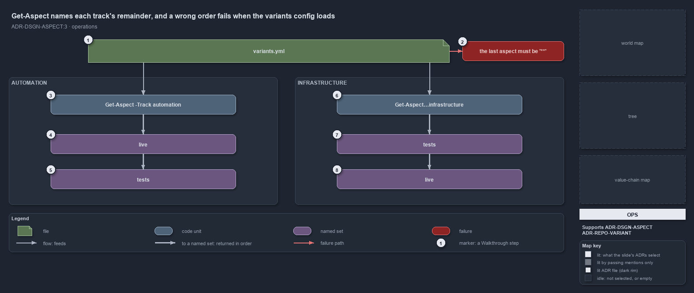

---
catzc:
  derived:
    path: docs/explanation/design/get-aspect-names-the-remainder.md
    kind: explanation
    body_sha: "640b239cd646"
    adrs:
      - ADR-DSGN-ASPECT#3
      - ADR-REPO-VARIANT#{1,2}
    links:
      - docs/.assets/explanation/adr-dsgn-aspect--get-aspect-names-the-remainder--operations.drawio.md
      - docs/.assets/explanation/adr-dsgn-aspect--get-aspect-names-the-remainder--operations.drawio.png
      - docs/adr/design/module-aspects.md
      - docs/adr/repository/repo-variants.md
      - docs/explanation/design/each-track-picks-its-catch-all.md
      - docs/explanation/design/gate-checks-order-not-liveness.md
      - docs/explanation/design/get-aspect-feeds-globs-and-maps.md
      - docs/explanation/design/index.md
      - docs/explanation/design/only-automation-compiles-its-aspects.md
      - docs/explanation/index.md#how-to-read-the-diagrams
---

# Get-Aspect names each track's remainder, and a wrong order fails when the variants config loads

```text
Get-Aspect names each track's remainder, and a wrong order fails when the variants config loads.

1  variants.yml                     the file a person edits to change a track's convention
2  the last aspect must be '**'     the failure a wrong order raises the next time the config loads
3  Get-Aspect -Track automation     the command that answers the code track's convention
4  live                             first: the closed convention, what ships
5  tests                            last: the remainder, never ships
6  Get-Aspect -Track infrastructure the command that answers the deployment track's convention
7  tests                            first: the explicit tests/ folders, the only non-live part
8  live                             last: the remainder, it ships

Supports ADR-DSGN-ASPECT#3, ADR-REPO-VARIANT#1 and #2 (operations lens).
```

A person who wants to know which aspect a track's stray files fall into asks `Get-Aspect`. The command returns the track's aspects in their
declared order, and the last one is the remainder, so `(Get-Aspect -Track infrastructure)[-1].Name` is `live` and the same expression for
`automation` is `tests`. A person who wants to change that edits `variants.yml` and runs the importer again. A wrong order does not get far:
the config type refuses to load a track whose last aspect is not the bare `**`.



The diagram is described element by element in
[its asset description](../../.assets/explanation/adr-dsgn-aspect--get-aspect-names-the-remainder--operations.drawio.md).

## Walkthrough

1. **variants.yml.** The repo-wide variants of `Catzc.Base.Variants`. Its `aspects` entry holds one ordered list per track, and a comment
   above it states the rule a person needs: the last aspect is the `**` catch-all, and whether that catch-all is live is the track's call.
   The file is read once per importer session, so an edit takes effect when the importer runs again.
2. **The last aspect must be `**`.** The failure a person sees after a wrong edit, raised the first time any variant primitive reads the
   config: `aspects['<track>']: the last aspect ('<name>') must be the '**' catch-all remainder`. Giving an earlier aspect the bare `**`
   fails with a second message, `uses the bare '**' catch-all but is not last`. Nothing reads a broken convention.
3. **Get-Aspect -Track automation.** The command for the code track. Each element it returns is a `VariantAspect` with a `Name` and its
   `Patterns`.
4. **live.** The first element: the closed convention of five folder-scoped patterns, what ships.
5. **tests.** The last element, with the single pattern `**`: the remainder, which never ships. A stray module file lands here.
6. **Get-Aspect -Track infrastructure.** The command for the deployment track. A track that has no entry in the file, or a name the file
   does not know, gets the automation convention instead of an error.
7. **tests.** The first element: `**/tests/**`, the explicit test folders, the only part of a template that does not deploy.
8. **live.** The last element, `**`: the remainder, and it ships. A stray template file deploys with the template.

## Why it holds

- Which aspect is the catch-all remainder is each track's call, declared in its `aspects` entry, and the config type enforces at load that
  the last aspect is `**` and no earlier one uses it (ADR-DSGN-ASPECT#3).
- A repo-wide variant is fixed for the importer session and declared in `configs/variants.yml`; `aspects` is read by `Get-Aspect`, and the
  importer must run again for a change to apply (ADR-REPO-VARIANT#1).
- Nothing reads the file directly: a person asks the typed primitive, and the private `Get-Variant` is the one place the file is read
  (ADR-REPO-VARIANT#2).

## See also

- [Module aspects](../../adr/design/module-aspects.md) — the decision this article explains. Also
  [repo-wide variants](../../adr/repository/repo-variants.md).
- The other lenses on the same catch-all: [meta](each-track-picks-its-catch-all.md),
  [architecture](only-automation-compiles-its-aspects.md), [implementation](get-aspect-feeds-globs-and-maps.md) and
  [governance](gate-checks-order-not-liveness.md).
- [The design explanations](index.md) · [How to read the diagrams](../index.md#how-to-read-the-diagrams)
