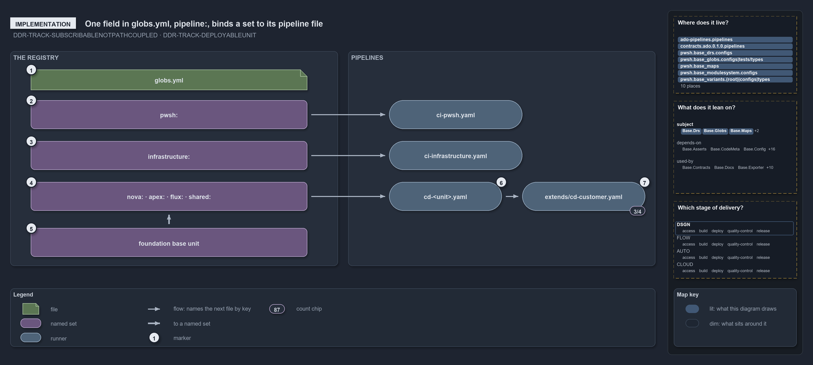

# One field in globs.yml, pipeline:, binds a set to its pipeline file

```text
One key in globs.yml, pipeline:, binds a globset to the file .ado/pipelines/<name>.yaml.

1  globs.yml                    the globset registry, validated by GlobsConfig on load
2  pwsh:                        loose-fileset, pipeline: ci-pwsh, pwsh/**
3  infrastructure:              loose-fileset, pipeline: ci-infrastructure, infrastructure/**
4  nova: apex: flux: shared:    deployable-units, each binding its own cd-<name>
5  foundation base unit         deployable-unit with no pipeline:, composed by the four
6  cd-<unit>.yaml               the CD pipeline file whose trigger is the unit's projection
7  extends/cd-customer.yaml     the template three of the four CD pipelines extend

Supports DDR-TRACK-SUBSCRIBABLENOTPATHCOUPLED and DDR-TRACK-DEPLOYABLEUNIT (implementation lens).
```

The link between what ships and the pipeline that ships it is a single key. Each entry in the globset registry `globs.yml` may carry
`pipeline:`, and that name resolves to the file `.ado/pipelines/<name>.yaml`. The two track sets bind the CI pipelines, the four configured
deployable-units bind the CD pipelines, and the base unit they compose binds none.

```yml drawio
description:
  One key in globs.yml, pipeline:, binds a globset to the pipeline file that carries its trigger; the unit sets bind their own CD pipelines,
  which extend one shared customer template.
about:
  adrs: [DDR-TRACK-SUBSCRIBABLENOTPATHCOUPLED, DDR-TRACK-DEPLOYABLEUNIT]
  lens: implementation
content:
  title: One field in globs.yml, pipeline:, binds a set to its pipeline file
  kind: explanation
  flow: left-to-right
  theme: dark
  bands:
    - { id: band-registry, label: THE REGISTRY }
    - { id: band-pipelines, label: PIPELINES }
  glyphs:
    - { id: f-registry, kind: file, label: globs.yml, in: band-registry }
    - { id: s-automation, kind: set, label: "pwsh:", in: band-registry }
    - { id: s-infrastructure, kind: set, label: "infrastructure:", in: band-registry }
    - { id: s-units, kind: set, label: "nova: · apex: · flux: · shared:", in: band-registry }
    - { id: s-foundation, kind: set, label: foundation base unit, in: band-registry }
    - { id: r-automation, kind: runner, label: ci-pwsh.yaml, in: band-pipelines }
    - { id: r-infrastructure, kind: runner, label: ci-infrastructure.yaml, in: band-pipelines }
    - { id: r-unit, kind: runner, label: cd-<unit>.yaml, in: band-pipelines }
    - { id: r-extends, kind: runner, label: extends/cd-customer.yaml, in: band-pipelines }
  edges:
    - { from: s-automation, to: r-automation, kind: flow, label: feeds }
    - { from: s-infrastructure, to: r-infrastructure, kind: flow, label: feeds }
    - { from: s-units, to: r-unit, kind: flow, label: feeds }
    - { from: s-units, to: s-foundation, kind: thick, label: composes }
    - { from: r-unit, to: r-extends, kind: flow, label: calls }
  markers:
    - { at: f-registry, number: 1 }
    - { at: s-automation, number: 2 }
    - { at: s-infrastructure, number: 3 }
    - { at: s-units, number: 4 }
    - { at: s-foundation, number: 5 }
    - { at: r-unit, number: 6 }
    - { at: r-extends, number: 7 }
  chips:
    - { at: r-extends, kind: count, text: 3/4 }
  legend: auto
  minimaps: [code-locations, module-neighbourhood, axis]
layout:
  band-registry: { x: 20, y: 84, w: 640, h: 420 }
  band-pipelines: { x: 680, y: 84, w: 600, h: 420 }
  f-registry: { x: 60, y: 120, w: 540, h: 40 }
  s-automation: { x: 60, y: 180, w: 540, h: 56 }
  s-infrastructure: { x: 60, y: 260, w: 540, h: 56 }
  s-units: { x: 60, y: 340, w: 540, h: 56 }
  s-foundation: { x: 60, y: 430, w: 540, h: 56 }
  r-automation: { x: 760, y: 180, w: 260, h: 56 }
  r-infrastructure: { x: 760, y: 260, w: 260, h: 56 }
  r-unit: { x: 760, y: 340, w: 220, h: 56 }
  r-extends: { x: 1020, y: 340, w: 240, h: 56 }
```



## Walkthrough

1. **globs.yml.** The registry at `pwsh/Base.Globs/configs/globs/globs.yml`, joined by its derived part `track-sets.yml`. `GlobsConfig`
   reads it on load and rejects a layer that is not declared, an unknown key, or a `compose:` reference that does not resolve or forms a
   cycle. Only the bindings and the composition are drawn here.
2. **`pwsh:`.** `layer: loose-fileset`, `pipeline: ci-pwsh`, `include: pwsh/**`. The GitHub workflow `.github/workflows/ci-pwsh.yml`
   triggers on the same projection, and `Test-GitHubWorkflowTriggerGlob` checks that it does.
3. **`infrastructure:`.** `layer: loose-fileset`, `pipeline: ci-infrastructure`, a `verify:` scope of `Catzc.Azure.Templates` at level 2,
   and `include: infrastructure/**`.
4. **`nova:` · `apex:` · `flux:` · `shared:`.** Each has `layer: deployable-unit`, `compose: [template-azure-subscription-foundation]`,
   `pipeline: cd-<name>`, and its own configuration include.
5. **foundation base unit.** The entry `template-azure-subscription-foundation:`: `layer: deployable-unit`, no `pipeline:`, the foundation
   template plus `infrastructure/modules/**`, minus the deployment configuration. The four configured units compose it.
6. **`cd-<unit>.yaml`.** `.ado/pipelines/<name>.yaml` for each CD binding. Its `trigger:` and `pr:` path filters are the unit's projection
   from `Get-GlobSetTrigger`; `Test-AdoPipelineTriggerGlob` resolves the file from the `pipeline:` name and fails when the filters drift.
7. **`extends/cd-customer.yaml`.** Three of the four CD pipelines, `cd-nova`, `cd-apex` and `cd-flux`, name it under `extends:`;
   `cd-shared.yaml` stands alone with its own `stages:`.

## Why it holds

- A consumer binds a track through its globset's projection, never by matching its paths by hand, so the trigger in each pipeline file is
  the set's projection (DDR-TRACK-SUBSCRIBABLENOTPATHCOUPLED).
- A pipeline is the delivery machine of one deployable-unit, and a base unit that only exists to be composed binds none
  (DDR-TRACK-DEPLOYABLEUNIT).

Besides the gate against trigger drift, `Test-GlobSetTriggerCoverage` and `Register-AdoBuildValidation` also read the `pipeline:` field. The
loose-filesets `templates`, `markdown-scope` and `repository` carry no `pipeline:`, and `ci-pwsh-expected-failures.yaml` triggers on
`pwsh/**` without any globset binding it.

## Where the code and the decision record differ

`cd-shared.yaml` and `Test-GlobSetTriggerCoverage` name an in-pipeline `Test-GlobSetAffected` check as the exact backstop, but no ado
pipeline under `.ado/pipelines/` runs it.

## See also

- [Tracks — the repository's root concerns](../../drs/design/tracks.md) — the decision this article explains.
- The other lenses on the same model: [meta](one-unit-one-pipeline.md), [architecture](units-not-tracks-own-the-pipelines.md),
  [operations](a-push-fires-only-touched-pipelines.md) and [governance](unit-to-pipeline-rule-is-review-only.md).
- [The design explanations](index.md) · [How to read the diagrams](../index.md#how-to-read-the-diagrams)
