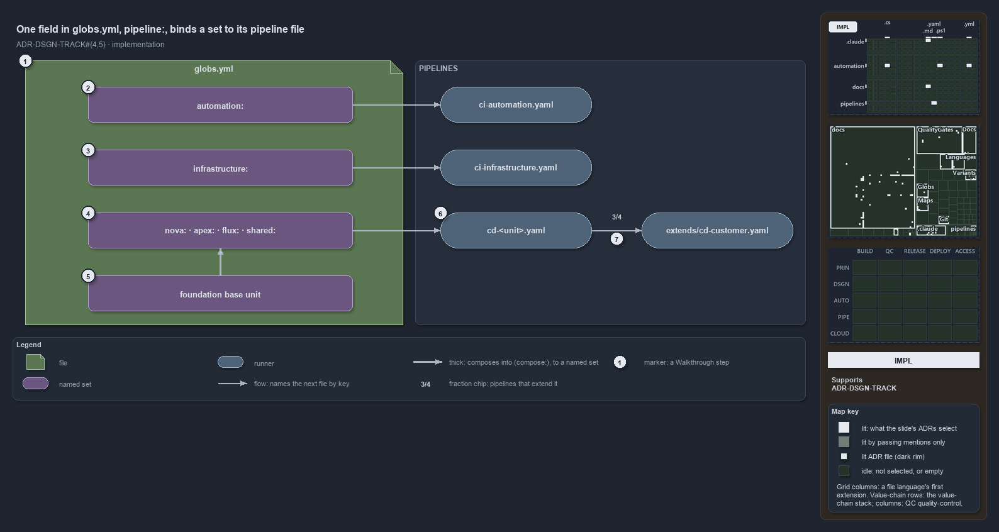

# One field in globs.yml, pipeline:, binds a set to its pipeline file

```text
One key in globs.yml, pipeline:, binds a globset to the file pipelines/<name>.yaml.

1  globs.yml                    the globset registry, validated by GlobsConfig on load
2  automation:                  loose-fileset, pipeline: ci-automation, pwsh/**
3  infrastructure:              loose-fileset, pipeline: ci-infrastructure, infrastructure/**
4  nova: apex: flux: shared:    deployable-units, each binding its own cd-<name>
5  foundation base unit         deployable-unit with no pipeline:, composed by the four
6  cd-<unit>.yaml               the CD pipeline file whose trigger is the unit's projection
7  extends/cd-customer.yaml     the template three of the four CD pipelines extend

Supports ADR-DSGN-TRACK#4 and #5 (implementation lens).
```

The link between what ships and the pipeline that ships it is a single key. Each entry in the globset registry `globs.yml` may carry
`pipeline:`, and that name resolves to the file `pipelines/<name>.yaml`. The two track sets bind the CI pipelines, the four configured
deployable-units bind the CD pipelines, and the base unit they compose binds none.



The diagram is described element by element in [its asset description](.assets/globs-yml-pipeline-field-is-the-binding/diagram.drawio.md).

## Walkthrough

1. **globs.yml.** The registry at `pwsh/Catzc.Base.Globs/configs/globs.yml`. `GlobsConfig` reads it on load and rejects a layer that is not
   declared, an unknown key, or a `compose:` reference that does not resolve or forms a cycle. Only the bindings and the composition are
   drawn here.
2. **`automation:`.** `layer: loose-fileset`, `pipeline: ci-automation`, `include: pwsh/**`. The GitHub workflow
   `.github/workflows/ci-automation.yml` triggers on the same projection, and `Test-GitHubWorkflowTriggerGlob` checks that it does.
3. **`infrastructure:`.** `layer: loose-fileset`, `pipeline: ci-infrastructure`, a `verify:` scope of `Catzc.Azure.Templates` at level 2,
   and `include: infrastructure/**`.
4. **`nova:` · `apex:` · `flux:` · `shared:`.** Each has `layer: deployable-unit`, `compose: [template-azure-subscription-foundation]`,
   `pipeline: cd-<name>`, and its own configuration include.
5. **foundation base unit.** The entry `template-azure-subscription-foundation:`: `layer: deployable-unit`, no `pipeline:`, the foundation
   template plus `infrastructure/modules/**`, minus the deployment configuration. The four configured units compose it.
6. **`cd-<unit>.yaml`.** `pipelines/<name>.yaml` for each CD binding. Its `trigger:` and `pr:` path filters are the unit's projection from
   `Get-GlobSetTrigger`; `Test-AdoPipelineTriggerGlob` resolves the file from the `pipeline:` name and fails when the filters drift.
7. **`extends/cd-customer.yaml`.** Three of the four CD pipelines, `cd-nova`, `cd-apex` and `cd-flux`, name it under `extends:`;
   `cd-shared.yaml` stands alone with its own `stages:`.

## Why it holds

- A consumer binds a track through its globset's projection, never by matching its paths by hand, so the trigger in each pipeline file is
  the set's projection (ADR-DSGN-TRACK#4).
- A pipeline is the delivery machine of one deployable-unit, and a base unit that only exists to be composed binds none (ADR-DSGN-TRACK#5).

Besides the gate against trigger drift, `Test-GlobSetTriggerCoverage` and `Register-AdoBuildValidation` also read the `pipeline:` field. The
loose-filesets `templates`, `markdown-scope` and `repository` carry no `pipeline:`, and `ci-automation-expected-failures.yaml` triggers on
`pwsh/**` without any globset binding it.

## Where the code and the ADR differ

`cd-shared.yaml` and `Test-GlobSetTriggerCoverage` name an in-pipeline `Test-GlobSetAffected` check as the exact backstop, but no pipeline
under `pipelines/` runs it.

## See also

- [Tracks — the repository's root concerns](../../adr/design/tracks.md) — the decision this article explains.
- The other lenses on the same model: [meta](one-unit-one-pipeline.md), [architecture](units-not-tracks-own-the-pipelines.md),
  [operations](a-push-fires-only-touched-pipelines.md) and [governance](unit-to-pipeline-rule-is-review-only.md).
- [The design explanations](index.md) · [How to read the diagrams](../index.md#how-to-read-the-diagrams)
