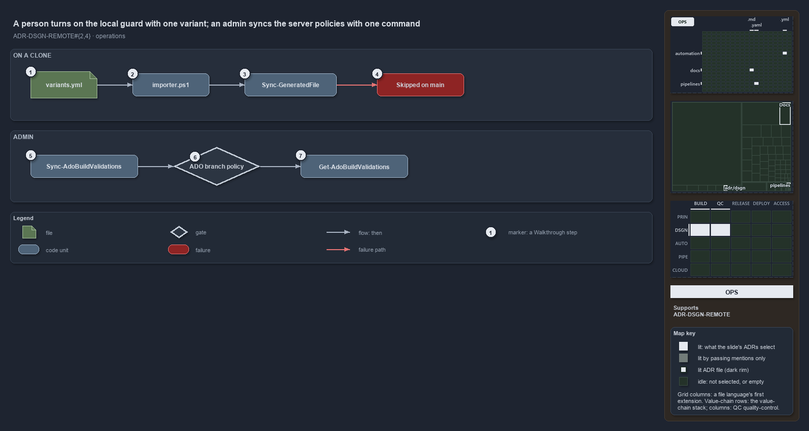

# A person turns on the local guard with one variant; an admin syncs the server policies with one command

```text
A person turns on the local guard with one variant; an admin syncs the server policies with one command.

1  variants.yml              set git_workspace: main-via-pr (the shipped value is main-direct)
2  importer.ps1              re-run it; variants are fixed for the importer session
3  Sync-GeneratedFile        the importer's last janitor; commits the generated files
4  Skipped on main           on main under main-via-pr it says why and commits nothing
5  Sync-AdoBuildValidations  the admin command; -DryRun first, then apply
6  ADO branch policy         one blocking build validation on main per globset
7  Get-AdoBuildValidations   lists what the server now holds

Supports ADR-DSGN-REMOTE#2 and #4, and ADR-REPO-VARIANT#6 (operations lens).
```

Two people put the ingress rule into effect in cats, and each has one thing to do. On a clone, a person flips the `git_workspace` variant
and re-runs the importer, after which automation refuses to commit straight to main. Against Azure DevOps, an admin runs
`Sync-AdoBuildValidations` to put the blocking build-validation policies on `main`, and lists them afterwards. No command exists for the
other half of the decision, picking the last verified commit to integrate from.



The diagram is described element by element in [its asset description](.assets/guard-and-policies-by-command/diagram.drawio.md).

## Walkthrough

1. **`variants.yml`.** Set `git_workspace: main-via-pr` in the repo-wide variants file. The shipped value is `main-direct`, the solo-author
   trunk, which never stops a commit.
2. **`importer.ps1`.** Re-run `. ./importer.ps1`: variants are fixed for the importer session, so an edit takes effect on the next import.
3. **`Sync-GeneratedFile`.** The importer runs this janitor last, to commit the files it generates. It is not called in a pipeline session,
   and in an agent session it only announces the changed paths ("Not committed: this is an agent session …").
4. **Skipped on main.** In a person's session on `main` under `main-via-pr`, the janitor prints "Skipped: the git_workspace variant is
   'main-via-pr' and this is main — commit generated files from a working branch" and commits nothing.
5. **`Sync-AdoBuildValidations`.** The admin command. Run it with `-DryRun` first to see each globset's planned action, Create, Update or
   Unchanged, without touching the server; run it plainly to apply the plan.
6. **ADO branch policy.** Applying prints `Created build validation '<name>' … on main` or `Updated build validation '<name>' … on main` per
   globset, or says the policy is already current. Each policy is blocking unless its entry says otherwise.
7. **`Get-AdoBuildValidations`.** Lists what the server now holds: `Get-AdoBuildValidations -Branch main | Where-Object Blocking` shows the
   blocking policies on `main`.

## Why it holds

- The pull request is the authenticated ingress; the server branch policy enforces it, and `Sync-GeneratedFile`'s branch guard is the local
  half (ADR-DSGN-REMOTE#4).
- `git_workspace` is read once per importer session, and its single stop condition is a direct commit while standing on main or master in
  `main-via-pr` (ADR-REPO-VARIANT#6).
- Consumers integrate from the last remote-verified commit, never the remote HEAD (ADR-DSGN-REMOTE#2).

## Where the code and the ADR differ

- The ADR tells every consumer to integrate from the last verified commit, but no command in cats resolves or checks out that commit.
- The ADR has the branch policy admit merges only through a pull request, but the admin command registers only build-validation policies on
  Azure DevOps; it sets no direct-push rule and has no GitHub counterpart.

## See also

- [The audited server git remote](../../adr/design/server-remote-integration.md) — the decision this article explains.
- [Repo variants](../../adr/repository/repo-variants.md) — the `git_workspace` variant.
- The other lenses on the same decision: [meta](one-door-in-one-stable-point-out.md), [architecture](clients-bridge-to-one-server.md),
  [implementation](local-guard-and-server-policies.md) and [governance](ingress-gated-the-rest-by-review.md).
- [The design explanations](index.md) · [How to read the diagrams](../index.md#how-to-read-the-diagrams)
