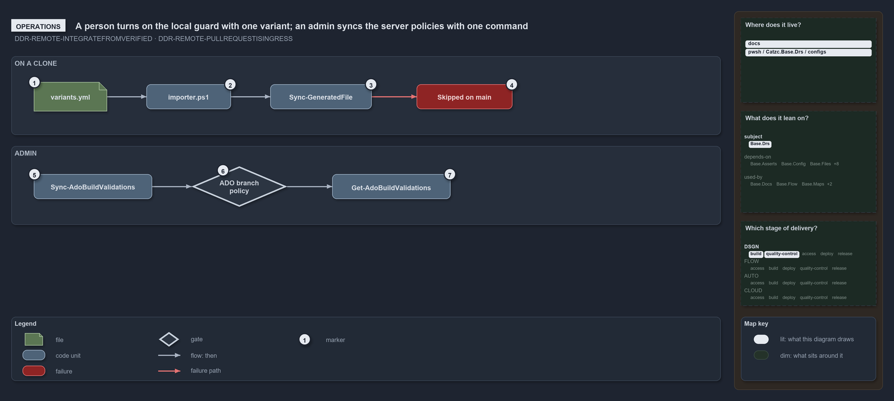

# How the guard and the server policies are turned on

```text
How the guard and the server policies are turned on.

1  variants.yml              set git_workspace: main-via-pr (the shipped value is main-direct)
2  importer.ps1              re-run it; variants are fixed for the importer session
3  Sync-GeneratedFile        the importer's last janitor; commits the generated files
4  Skipped on main           on main under main-via-pr it says why and commits nothing
5  Sync-AdoBuildValidations  the admin command; -DryRun first, then apply
6  ADO branch policy         one blocking build validation on main per globset
7  Get-AdoBuildValidations   lists what the server now holds

Supports DDR-REMOTE-INTEGRATEFROMVERIFIED and DDR-REMOTE-PULLREQUESTISINGRESS (operations lens).
```

Two people put the ingress rule into effect in cats, and each has one thing to do. On a clone, a person flips the `git_workspace` variant
and re-runs the importer, after which automation refuses to commit straight to main. Against Azure DevOps, an admin runs
`Sync-AdoBuildValidations` to put the blocking build-validation policies on `main`, and lists them afterwards. No command exists for the
other half of the decision, picking the last verified commit to integrate from.

```yml drawio
description:
  A person turns on the local guard by setting one variant and re-running the importer, which then skips the generated-file commit on main;
  an admin syncs the server's branch policies with one command and lists what the server holds.
about:
  rules: [DDR-REMOTE-INTEGRATEFROMVERIFIED, DDR-REMOTE-PULLREQUESTISINGRESS]
  lens: operations
content:
  title: How the guard and the server policies are turned on
  kind: explanation
  flow: top-to-bottom
  theme: dark
  bands:
    - { id: band-clone, label: ON A CLONE }
    - { id: band-admin, label: ADMIN }
  glyphs:
    - { id: f-variants, kind: file, label: variants.yml, in: band-clone }
    - { id: c-importer, kind: code, label: importer.ps1, in: band-clone }
    - { id: c-sync, kind: code, label: Sync-GeneratedFile, in: band-clone }
    - { id: f-skipped, kind: failure, label: Skipped on main, in: band-clone }
    - { id: c-validations, kind: code, label: Sync-AdoBuildValidations, in: band-admin }
    - { id: g-policy, kind: gate, label: ADO branch policy, in: band-admin }
    - { id: c-list, kind: code, label: Get-AdoBuildValidations, in: band-admin }
  edges:
    - { from: c-importer, to: f-variants, kind: flow, label: reads }
    - { from: c-importer, to: c-sync, kind: flow, label: calls }
    - { from: c-sync, to: f-skipped, kind: fail, label: "" }
    - { from: c-validations, to: g-policy, kind: flow, label: "" }
    - { from: g-policy, to: c-list, kind: flow, label: calls }
  markers:
    - { at: f-variants, number: 1 }
    - { at: c-importer, number: 2 }
    - { at: c-sync, number: 3 }
    - { at: f-skipped, number: 4 }
    - { at: c-validations, number: 5 }
    - { at: g-policy, number: 6 }
    - { at: c-list, number: 7 }
  legend: auto
  minimaps: [code-locations, module-neighbourhood, axis]
layout:
  band-clone: { x: 20, y: 84, w: 1260, h: 140 }
  band-admin: { x: 20, y: 244, w: 1260, h: 140 }
  f-variants: { x: 60, y: 130, w: 130, h: 52 }
  c-importer: { x: 260, y: 134, w: 150, h: 44 }
  c-sync: { x: 480, y: 134, w: 180, h: 44 }
  f-skipped: { x: 740, y: 134, w: 170, h: 44 }
  c-validations: { x: 60, y: 294, w: 210, h: 44 }
  g-policy: { x: 340, y: 280, w: 170, h: 72 }
  c-list: { x: 590, y: 294, w: 210, h: 44 }
```



## Walkthrough

1. **`variants.yml`.** Set `git_workspace: main-via-pr` in the repo-wide variants file. The shipped value is `main-direct`, the solo-author
   trunk, which never stops a commit.
2. **`importer.ps1`.** Re-run `. ./importer.ps1`: variants are fixed for the importer session, so an edit takes effect on the next import.
3. **`Sync-GeneratedFile`.** The importer runs this janitor last, to commit the files it generates. It is not called in a pipeline session,
   and in an agent session it only announces the changed paths ("Not committed: this is an agent session …").
4. **Skipped on main.** In a person's session on `main` under `main-via-pr`, the janitor prints "Skipped: the git_workspace variant is
   'main-via-pr' and this is main — commit generated files from a working branch" and commits nothing.
5. **`Sync-AdoBuildValidations`.** The admin command. Run it with `-DryRun` first to see each globset's planned action, Create, Update or
   Unchanged, without touching the server; run it plainly to apply the plan.
6. **ADO branch policy.** Applying prints `Created build validation '<name>' … on main` or `Updated build validation '<name>' … on main` per
   globset, or says the policy is already current. Each policy is blocking unless its entry says otherwise.
7. **`Get-AdoBuildValidations`.** Lists what the server now holds: `Get-AdoBuildValidations -Branch main | Where-Object Blocking` shows the
   blocking policies on `main`.

## Why it holds

- The pull request is the authenticated ingress; the server branch policy enforces it, and `Sync-GeneratedFile`'s branch guard is the local
  half (DDR-REMOTE-PULLREQUESTISINGRESS).
- `git_workspace` is read once per importer session, and its single stop condition is a direct commit while standing on main or master in
  `main-via-pr` (ADR-REPO-VARIANT-GITWORKSPACE).
- Consumers integrate from the last remote-verified commit, never the remote HEAD (DDR-REMOTE-INTEGRATEFROMVERIFIED).

## Where the code and the decision record differ

- The DDR tells every consumer to integrate from the last verified commit, but no command in cats resolves or checks out that commit.
- The DDR has the branch policy admit merges only through a pull request, but the admin command registers only build-validation policies on
  Azure DevOps; it sets no direct-push rule and has no GitHub counterpart.

## See also

- [The audited server git remote](../../drs/design/server-remote-integration.md) — the decision this article explains.
- [Repo variants](../../drs/repository/repo-variants.md) — the `git_workspace` variant.
- The other lenses on the same decision: [meta](one-door-in-one-stable-point-out.md), [architecture](clients-bridge-to-one-server.md),
  [implementation](how-ingress-is-guarded-locally-and-on-the-server.md) and [governance](ingress-gated-the-rest-by-review.md).
- [The design explanations](index.md) · [How to read the diagrams](../index.md#how-to-read-the-diagrams)
