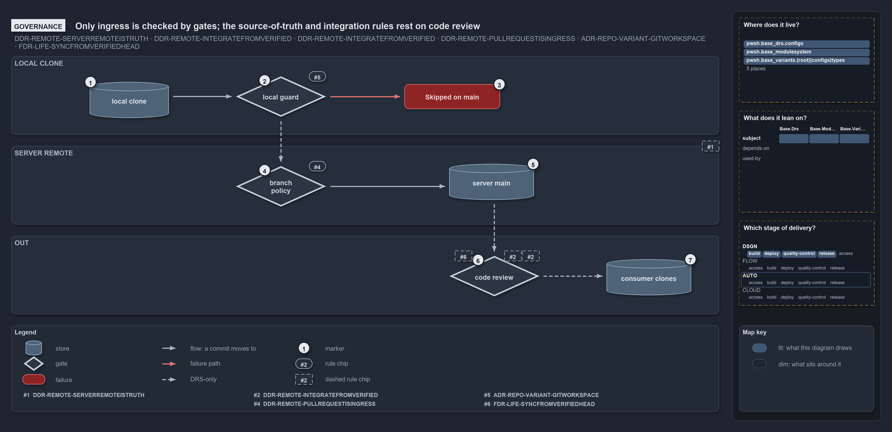

# Only ingress is checked by gates; the source-of-truth and integration rules rest on code review

```text
Only ingress is checked by gates; the source-of-truth and integration rules rest on code review.

1  local clone      automation commits the files it generates here
2  local guard      Sync-GeneratedFile's branch guard, the local half of ingress (V6)
3  Skipped on main  the guard's stop: no direct automated commit on main in main-via-pr
4  branch policy    the server half of ingress: blocking build validations on main (R4)
5  server main      the single source of truth; no gate checks that rule (R1)
6  code review      the only check on where consumers integrate from (R2, R3, L6)
7  consumer clones  meant to build on the verified point; nothing resolves it

Supports DDR-REMOTE-SERVERREMOTEISTRUTH, DDR-REMOTE-INTEGRATEFROMVERIFIED, DDR-REMOTE-INTEGRATEFROMVERIFIED
and DDR-REMOTE-PULLREQUESTISINGRESS, ADR-REPO-VARIANT-GITWORKSPACE and FDR-LIFE-SYNCFROMVERIFIEDHEAD (governance lens).
```

DDR-REMOTE makes four rules about the server remote, but only one of them is checked by something that runs. The way in has two gates: a
local guard in cats and a branch policy on the server. The rule that the server is the single truth, and the rules about where consumers
integrate from, are checked by code review alone. Following a commit from a local clone to a consumer, each step carries a rule chip for the
rule that governs it: R is DDR-REMOTE, V is ADR-REPO-VARIANT and L is FDR-LIFE.

```yml drawio
description:
  Only ingress is checked by gates, a local guard and a server branch policy; the rules that the server main is the truth and that consumers
  integrate from the verified point rest on code review alone.
about:
  rules:
    - DDR-REMOTE-SERVERREMOTEISTRUTH
    - DDR-REMOTE-INTEGRATEFROMVERIFIED
    - DDR-REMOTE-INTEGRATEFROMVERIFIED
    - DDR-REMOTE-PULLREQUESTISINGRESS
    - ADR-REPO-VARIANT-GITWORKSPACE
    - FDR-LIFE-SYNCFROMVERIFIEDHEAD
  lens: governance
content:
  title: Only ingress is checked by gates; the source-of-truth and integration rules rest on code review
  kind: explanation
  flow: top-to-bottom
  relation: a commit moves to
  states: true
  theme: dark
  bands:
    - { id: band-clone, label: LOCAL CLONE }
    - { id: band-remote, label: SERVER REMOTE }
    - { id: band-out, label: OUT }
  glyphs:
    - { id: s-clone, kind: store, label: local clone, in: band-clone }
    - { id: g-guard, kind: gate, label: local guard, in: band-clone }
    - { id: f-skipped, kind: failure, label: Skipped on main, in: band-clone }
    - { id: g-policy, kind: gate, label: branch policy, in: band-remote }
    - { id: s-main, kind: store, label: server main, in: band-remote }
    - { id: g-review, kind: gate, label: code review, in: band-out }
    - { id: s-consumers, kind: store, label: consumer clones, in: band-out }
  edges:
    - { from: s-clone, to: g-guard, kind: flow, label: "" }
    - { from: g-guard, to: f-skipped, kind: fail, label: "" }
    - { from: g-guard, to: g-policy, kind: record, label: "" }
    - { from: g-policy, to: s-main, kind: flow, label: "" }
    - { from: s-main, to: g-review, kind: record, label: "" }
    - { from: g-review, to: s-consumers, kind: record, label: "" }
  markers:
    - { at: s-clone, number: 1 }
    - { at: g-guard, number: 2 }
    - { at: f-skipped, number: 3 }
    - { at: g-policy, number: 4 }
    - { at: s-main, number: 5 }
    - { at: g-review, number: 6 }
    - { at: s-consumers, number: 7 }
  chips:
    - { at: g-guard, kind: rule, rule: ADR-REPO-VARIANT-GITWORKSPACE }
    - { at: g-policy, kind: rule, rule: DDR-REMOTE-PULLREQUESTISINGRESS }
    - { at: band-remote, kind: rule, rule: DDR-REMOTE-SERVERREMOTEISTRUTH, gated: false }
    - { at: g-review, kind: rule, rule: DDR-REMOTE-INTEGRATEFROMVERIFIED, gated: false }
    - { at: g-review, kind: rule, rule: DDR-REMOTE-INTEGRATEFROMVERIFIED, gated: false }
    - { at: g-review, kind: rule, rule: FDR-LIFE-SYNCFROMVERIFIEDHEAD, gated: false }
  legend: auto
  minimaps: [code-locations, module-neighbourhood, axis]
layout:
  band-clone: { x: 20, y: 84, w: 1260, h: 140 }
  band-remote: { x: 20, y: 244, w: 1260, h: 140 }
  band-out: { x: 20, y: 404, w: 1260, h: 140 }
  s-clone: { x: 160, y: 130, w: 140, h: 64 }
  g-guard: { x: 420, y: 120, w: 160, h: 72 }
  f-skipped: { x: 720, y: 134, w: 170, h: 44 }
  g-policy: { x: 420, y: 280, w: 160, h: 72 }
  s-main: { x: 800, y: 276, w: 150, h: 64 }
  g-review: { x: 800, y: 440, w: 160, h: 72 }
  s-consumers: { x: 1080, y: 446, w: 150, h: 64 }
```



## Walkthrough

1. **Local clone.** Automation on a person's clone commits the files it generates. That commit is what the local guard checks.
2. **Local guard.** `Sync-GeneratedFile`'s branch guard is the local half of the ingress rule. It stops a direct automated commit made while
   standing on `main` / `master` in the `main-via-pr` mode, and lets every other commit through. It acts only in a person's session: an
   agent session returns before it, and the importer does not call it in a pipeline session.
3. **Skipped on main.** When the guard stops, the commit is not made and the guard says why: the `git_workspace` variant is `main-via-pr`
   and this is main, so generated files are committed from a working branch. The shipped mode is `main-direct`, the solo-author exception,
   where the guard never stops anything.
4. **Branch policy.** The server half is the branch policy on the protected branch, which in cats is the blocking build-validation policies
   registered on `main` in Azure DevOps. The step from the guard to the pull request has no code of its own, so it is dashed.
5. **Server main.** The merged commit lands on the server's main, the single source of truth. No gate checks that rule; code review rejects
   a process that treats anything else as the truth.
6. **Code review.** The integration rules have no checker. Code review rejects a build or workflow that pins its integration base to the
   remote HEAD instead of the last verified commit, the stable point that the commit lifecycle names.
7. **Consumer clones.** Consumers are meant to integrate from the verified point. Nothing in cats resolves it, so the path from server main
   through code review to the consumers is dashed.

## Why it holds

- The server remote is the single source of truth, and clones are bridges to it (DDR-REMOTE-SERVERREMOTEISTRUTH).
- Consumers integrate from the last remote-verified commit and so never reconcile a rewritten tip (DDR-REMOTE-INTEGRATEFROMVERIFIED,
  DDR-REMOTE-INTEGRATEFROMVERIFIED); that commit is the BVT-verified server head, the same one `main-UAT` takes first
  (FDR-LIFE-SYNCFROMVERIFIEDHEAD).
- The pull request is the authenticated ingress, enforced by the server branch policy (DDR-REMOTE-PULLREQUESTISINGRESS).
- `git_workspace` selects the regime, and its single stop condition is a direct commit while standing on main or master in `main-via-pr`
  (ADR-REPO-VARIANT-GITWORKSPACE).

## Where the code and the decision record differ

- The DDR says the server branch policy admits merges only through a pull request, but cats registers only Azure DevOps build-validation
  policies, sets no direct-push rule, and has nothing for GitHub.
- The DDR tells consumers to integrate from the last verified commit, but nothing in cats resolves that commit.
- The repository ships `git_workspace: main-direct`, so it runs the exception and the local guard is dormant.

## See also

- [The audited server git remote](../../drs/design/server-remote-integration.md) — the decision this article explains.
- [Repo variants](../../drs/repository/repo-variants.md) and [Commit lifecycle](../../drs/flow/commit-lifecycle.md) — the `git_workspace`
  variant and the stable point.
- The other lenses on the same decision: [meta](one-door-in-one-stable-point-out.md), [architecture](clients-bridge-to-one-server.md),
  [implementation](local-guard-and-server-policies.md) and [operations](guard-and-policies-by-command.md).
- [The design explanations](index.md) · [How to read the diagrams](../index.md#how-to-read-the-diagrams)
