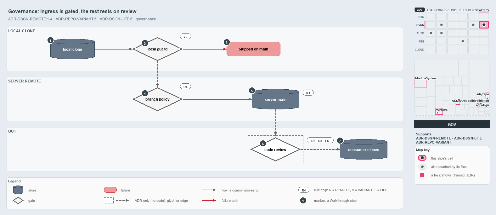

---
catzc:
  derived:
    path: docs/explanation/design/ingress-gated-the-rest-by-review.md
    kind: explanation
    body_sha: "38ff1b133ab0"
    adrs:
      - ADR-DSGN-LIFE#6
      - ADR-DSGN-REMOTE#1
      - ADR-DSGN-REMOTE#2
      - ADR-DSGN-REMOTE#3
      - ADR-DSGN-REMOTE#4
      - ADR-REPO-VARIANT#6
    links:
      - docs/.assets/explanation/adr-dsgn-remote--ingress-gated-the-rest-by-review--governance.drawio.md
      - docs/.assets/explanation/adr-dsgn-remote--ingress-gated-the-rest-by-review--governance.drawio.png
      - docs/adr/design/commit-lifecycle.md
      - docs/adr/design/server-remote-integration.md
      - docs/adr/repository/repo-variants.md
      - docs/explanation/design/clients-bridge-to-one-server.md
      - docs/explanation/design/guard-and-policies-by-command.md
      - docs/explanation/design/index.md
      - docs/explanation/design/local-guard-and-server-policies.md
      - docs/explanation/design/one-door-in-one-stable-point-out.md
      - docs/explanation/index.md#how-to-read-the-diagrams
---

# Only ingress is checked by gates; the source-of-truth and integration rules rest on code review

```text
Only ingress is checked by gates; the source-of-truth and integration rules rest on code review.

1  local clone      automation commits the files it generates here
2  local guard      Sync-GeneratedFile's branch guard, the local half of ingress (V6)
3  Skipped on main  the guard's stop: no direct automated commit on main in main-via-pr
4  branch policy    the server half of ingress: blocking build validations on main (R4)
5  server main      the single source of truth; no gate checks that rule (R1)
6  code review      the only check on where consumers integrate from (R2, R3, L6)
7  consumer clones  meant to build on the verified point; nothing resolves it

Supports ADR-DSGN-REMOTE#1, #2, #3 and #4, ADR-REPO-VARIANT#6 and ADR-DSGN-LIFE#6 (governance lens).
```

ADR-DSGN-REMOTE makes four rules about the server remote, but only one of them is checked by something that runs. The way in has two gates:
a local guard in cats and a branch policy on the server. The rule that the server is the single truth, and the rules about where consumers
integrate from, are checked by code review alone. Following a commit from a local clone to a consumer, each step carries a rule chip for the
rule that governs it: R is ADR-DSGN-REMOTE, V is ADR-REPO-VARIANT and L is ADR-DSGN-LIFE.



The diagram is described element by element in
[its asset description](../../.assets/explanation/adr-dsgn-remote--ingress-gated-the-rest-by-review--governance.drawio.md).

## Walkthrough

1. **Local clone.** Automation on a person's clone commits the files it generates. That commit is what the local guard checks.
2. **Local guard.** `Sync-GeneratedFile`'s branch guard is the local half of the ingress rule. It stops a direct automated commit made while
   standing on `main` / `master` in the `main-via-pr` mode, and lets every other commit through. It acts only in a person's session: an
   agent session returns before it, and the importer does not call it in a pipeline session.
3. **Skipped on main.** When the guard stops, the commit is not made and the guard says why: the `git_workspace` variant is `main-via-pr`
   and this is main, so generated files are committed from a working branch. The shipped mode is `main-direct`, the solo-author exception,
   where the guard never stops anything.
4. **Branch policy.** The server half is the branch policy on the protected branch, which in cats is the blocking build-validation policies
   registered on `main` in Azure DevOps. The step from the guard to the pull request has no code of its own, so it is dashed.
5. **Server main.** The merged commit lands on the server's main, the single source of truth. No gate checks that rule; code review rejects
   a process that treats anything else as the truth.
6. **Code review.** The integration rules have no checker. Code review rejects a build or workflow that pins its integration base to the
   remote HEAD instead of the last verified commit, the stable point that the commit lifecycle names.
7. **Consumer clones.** Consumers are meant to integrate from the verified point. Nothing in cats resolves it, so the path from server main
   through code review to the consumers is dashed.

## Why it holds

- The server remote is the single source of truth, and clones are bridges to it (ADR-DSGN-REMOTE#1).
- Consumers integrate from the last remote-verified commit and so never reconcile a rewritten tip (ADR-DSGN-REMOTE#2, ADR-DSGN-REMOTE#3);
  that commit is the `main-UAT` occupant (ADR-DSGN-LIFE#6).
- The pull request is the authenticated ingress, enforced by the server branch policy (ADR-DSGN-REMOTE#4).
- `git_workspace` selects the regime, and its single stop condition is a direct commit while standing on main or master in `main-via-pr`
  (ADR-REPO-VARIANT#6).

## Where the code and the ADR differ

- The ADR says the server branch policy admits merges only through a pull request, but cats registers only Azure DevOps build-validation
  policies, sets no direct-push rule, and has nothing for GitHub.
- The ADR tells consumers to integrate from the last verified commit, but nothing in cats resolves that commit.
- The repository ships `git_workspace: main-direct`, so it runs the exception and the local guard is dormant.

## See also

- [The audited server git remote](../../adr/design/server-remote-integration.md) — the decision this article explains.
- [Repo variants](../../adr/repository/repo-variants.md) and [Commit lifecycle](../../adr/design/commit-lifecycle.md) — the `git_workspace`
  variant and the stable point.
- The other lenses on the same decision: [meta](one-door-in-one-stable-point-out.md), [architecture](clients-bridge-to-one-server.md),
  [implementation](local-guard-and-server-policies.md) and [operations](guard-and-policies-by-command.md).
- [The design explanations](index.md) · [How to read the diagrams](../index.md#how-to-read-the-diagrams)
