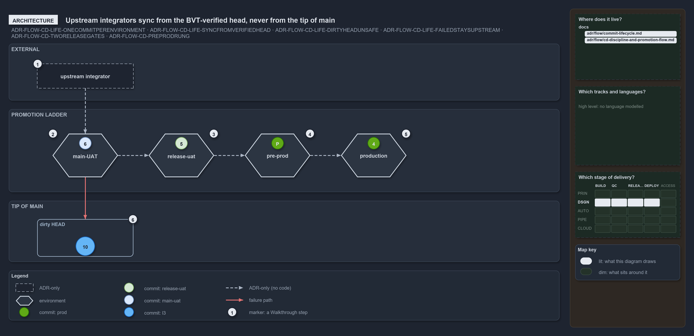

# Upstream integrators sync from the BVT-verified head, never from the tip of main

```text
Upstream integrators take the BVT-verified head, every rung takes its commit from the rung before it, and nobody takes the tip of main.

1  upstream integrator  builds on cats from outside; takes commit 6, the BVT-verified head
2  main-UAT             holds commit 6, the BVT-verified head it took first: the sync point
3  release-uat          holds commit 5, the release candidate; takes its commit from main-UAT
4  pre-prod             the staged rung before production; takes its commit from release-uat
5  production           holds commit 4; takes its commit from pre-prod
6  dirty HEAD           commit 10, the newest commit on main, which failed in main-UAT

Supports ADR-FLOW-CD-LIFE-ONECOMMITPERENVIRONMENT, ADR-FLOW-CD-LIFE-SYNCFROMVERIFIEDHEAD, ADR-FLOW-CD-LIFE-DIRTYHEADUNSAFE and ADR-FLOW-CD-LIFE-FAILEDSTAYSUPSTREAM, ADR-FLOW-CD-TWORELEASEGATES and ADR-FLOW-CD-PREPRODRUNG (architecture lens).
```

Each always-on environment in cats holds one commit, its occupant, and anyone outside the repository who needs a stable base takes the
BVT-verified server head, not the tip of main. That same commit is the one `main-UAT` takes first, so when it is deployed it is the
`main-UAT` occupant too. Every environment on the promotion ladder likewise takes its commit from the rung before it, so the whole chain
rests on occupants, never on HEAD. Keeping "what is newest" apart from "what is safe to build on" is what stops one broken commit from
spreading. All of this is stated by the ADRs; no pipeline in the repository runs it yet.



## Walkthrough

1. **Upstream integrator.** An external or upstream consumer that builds on cats. It takes commit 6, the BVT-verified head, which is also
   the `main-UAT` occupant, and never the tip of main.
2. **main-UAT.** Holds commit 6, the BVT-verified head, which this environment takes first. The commit synced from and the commit `main-UAT`
   takes are one commit, so the occupant is also the stable sync point.
3. **Release-uat.** Holds commit 5, the release candidate under test. It takes its commit from `main-UAT` once the RC gate clears; RC and
   RBC are the two manual release gates.
4. **Pre-prod.** The staged rung before production, not yet live. It holds one green commit; none of the worked examples sits there, so the
   commit carries no number. It takes its commit from release-uat once the RBC gate clears.
5. **Production.** An always-on environment that holds exactly one commit plus a history. Its occupant is commit 4, which rolled over commit
   3 and shipped. It takes its commit from pre-prod.
6. **Dirty HEAD.** Commit 10 is the newest commit on main. It entered `main-UAT` and failed there, so it is not a source for sync and it
   cannot be promoted. It keeps the blue of the L3-verified state it carried into `main-UAT`.

## Why it holds

- Each always-on environment hosts exactly one commit, its occupant, plus a history; an environment box is neutral and the occupant carries
  the state colour (ADR-FLOW-CD-LIFE-ONECOMMITPERENVIRONMENT, ADR-DSGN-VISUAL-ENVIRONMENTISCONTAINER).
- The stable integration point is the BVT-verified server head, and upstream integrators sync from it, never from HEAD; the same commit goes
  into `main-UAT` first, so once deployed it is the `main-UAT` occupant (ADR-FLOW-CD-LIFE-SYNCFROMVERIFIEDHEAD).
- The dirty HEAD is the latest commit on main and is not safe to sync or promote from (ADR-FLOW-CD-LIFE-DIRTYHEADUNSAFE).
- A commit that fails a stage cannot go downstream, neither by promotion nor by consumption (ADR-FLOW-CD-LIFE-FAILEDSTAYSUPSTREAM).
- RC at `main-UAT` and RBC at release-uat are the manual gates, and the prod tail runs release-uat, pre-prod, production
  (ADR-FLOW-CD-TWORELEASEGATES, ADR-FLOW-CD-PREPRODRUNG).

## Where the code and the ADR differ

The ADRs describe `main-UAT`, release-uat and pre-prod as always-on environments with one occupant each, joined by the RC and RBC gates. The
CD pipelines define no `main-uat` or release-uat environment and record no occupant: once a main commit passes its CI stage, CD deploys it
to every target of a stage at once, non-prod and prod tier side by side (`nsub` and `psub`, or the expedition's `dev` and `prod`), with no
gate between them. In code, every environment therefore takes the tip of main. The ADRs also spell the environment two ways: `main-UAT` in
the commit lifecycle and `main-uat` in the promotion flow.

## See also

- [The commit lifecycle](../../adr/flow/commit-lifecycle.md) — the decision this article explains.
- [CD discipline and promotion flow](../../adr/flow/cd-discipline-and-promotion-flow.md) — the RC and RBC gates and the pre-prod rung.
- The other lenses on the same sync point: [meta](sync-from-the-bvt-verified-head.md) and [governance](sync-point-rules-are-adr-only.md).
- [The design explanations](index.md) · [How to read the diagrams](../index.md#how-to-read-the-diagrams)
