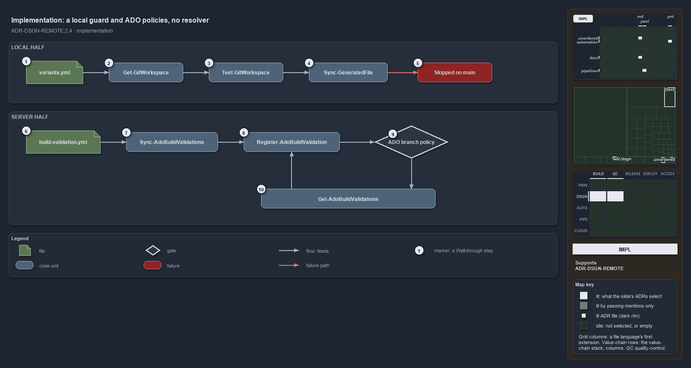

---
catzc:
  derived:
    path: docs/explanation/design/local-guard-and-server-policies.md
    kind: explanation
    language: markdown
    track: docs
    body_sha: f8b79c407fcb
    adrs:
      - ADR-DSGN-REMOTE#{2,4}
      - ADR-REPO-VARIANT#6
    links:
      - docs/.assets/explanation/adr-dsgn-remote--local-guard-and-server-policies--implementation.drawio.md
      - docs/.assets/explanation/adr-dsgn-remote--local-guard-and-server-policies--implementation.drawio.png
      - docs/adr/design/server-remote-integration.md
      - docs/adr/repository/repo-variants.md
      - docs/explanation/design/clients-bridge-to-one-server.md
      - docs/explanation/design/guard-and-policies-by-command.md
      - docs/explanation/design/index.md
      - docs/explanation/design/ingress-gated-the-rest-by-review.md
      - docs/explanation/design/one-door-in-one-stable-point-out.md
      - docs/explanation/index.md#how-to-read-the-diagrams
---

# The code carries both halves of ingress, but nothing finds the last verified commit

```text
The code carries both halves of ingress, but nothing finds the last verified commit.

1   variants.yml                  ships git_workspace: main-direct
2   Get-GitWorkspace              returns the mode, main-direct by default
3   Test-GitWorkspace             -MainViaPr is true in main-via-pr
4   Sync-GeneratedFile            the importer's last janitor; holds the branch guard
5   Skipped on main               the stop: no commit on main or master in main-via-pr
6   build-validation.yml          the guarded branch, main, and six globset entries
7   Sync-AdoBuildValidations      reads the config, registers each entry; -DryRun plans only
8   Register-AdoBuildValidation   creates or updates one policy on the server
9   ADO branch policy             a build validation on main; blocking stops the merge
10  Get-AdoBuildValidations       reads the policies back, so registration is idempotent

Supports ADR-DSGN-REMOTE#2 and #4, and ADR-REPO-VARIANT#6 (implementation lens).
```

Cats implements the way in from both sides. On the clone, a `git_workspace` variant feeds a guard that keeps automation from committing
straight to main; on the server, a config file feeds the blocking build-validation policies on `main` in Azure DevOps. Both chains run in
the order shown. The way out has no chain at all: no function returns the last verified commit that consumers are told to integrate from.



The diagram is described element by element in
[its asset description](../../.assets/explanation/adr-dsgn-remote--local-guard-and-server-policies--implementation.drawio.md).

## Walkthrough

1. **`variants.yml`.** The repo-wide variants file sets `git_workspace: main-direct`. The `VariantsConfig` type accepts only `main-direct`
   or `main-via-pr`, and the private `Get-Variant` is the one place the file is read.
2. **`Get-GitWorkspace`.** Returns the mode, reading the variant with `main-direct` as the default.
3. **`Test-GitWorkspace`.** The predicate over that mode: its `-MainViaPr` switch is true when the mode is `main-via-pr`.
4. **`Sync-GeneratedFile`.** The importer runs it as its last janitor, never in a pipeline session. After its build-mode, snapshot, actor
   and detached-HEAD checks, it stops when the branch is `main` or `master` and `Test-GitWorkspace -MainViaPr` is true.
5. **Skipped on main.** The stop writes a message and returns without committing: the `git_workspace` variant is `main-via-pr` and this is
   main, so generated files are committed from a working branch. Under the shipped `main-direct` this path is never taken.
6. **`build-validation.yml`.** Declares the guarded branch, `main`, and six entries, one per globset: automation, infrastructure, shared,
   nova, apex and flux. Each entry is blocking unless it says otherwise.
7. **`Sync-AdoBuildValidations`.** Reads the config and calls `Register-AdoBuildValidation` once per entry. With `-DryRun` it returns each
   entry's planned action instead of touching the server.
8. **`Register-AdoBuildValidation`.** Builds the desired policy, with `isBlocking` from the entry, and creates it with a POST or updates it
   with a PUT on `policy/configurations`. A policy that is already current is left alone.
9. **ADO branch policy.** The gate on the server side: a build validation on `main` that queues the globset's pipeline for a pull request
   and, when blocking, stops the merge until it passes.
10. **`Get-AdoBuildValidations`.** Reads the existing policies back from the server. `Register-AdoBuildValidation` calls it to find the
    policy it must update, which is what makes the registration idempotent.

## Why it holds

- The pull request is the authenticated ingress, and the server branch policy is what enforces it; `Sync-GeneratedFile`'s branch guard is
  the local half (ADR-DSGN-REMOTE#4).
- `git_workspace` declares how changes reach main, and its single stop condition is a direct commit made while standing on main or master in
  `main-via-pr` (ADR-REPO-VARIANT#6).
- Consumers integrate from the last remote-verified commit, never the remote HEAD (ADR-DSGN-REMOTE#2).

## Where the code and the ADR differ

- The ADR tells consumers to integrate from the last verified commit, but no function in cats returns it, and the pipelines trigger on
  `main`.
- The ADR has the branch policy admit merges only through a pull request, but the code registers only build-validation policies: it sets no
  direct-push rule and has nothing for GitHub.

## See also

- [The audited server git remote](../../adr/design/server-remote-integration.md) — the decision this article explains.
- [Repo variants](../../adr/repository/repo-variants.md) — the `git_workspace` variant.
- The other lenses on the same decision: [meta](one-door-in-one-stable-point-out.md), [architecture](clients-bridge-to-one-server.md),
  [operations](guard-and-policies-by-command.md) and [governance](ingress-gated-the-rest-by-review.md).
- [The design explanations](index.md) · [How to read the diagrams](../index.md#how-to-read-the-diagrams)
