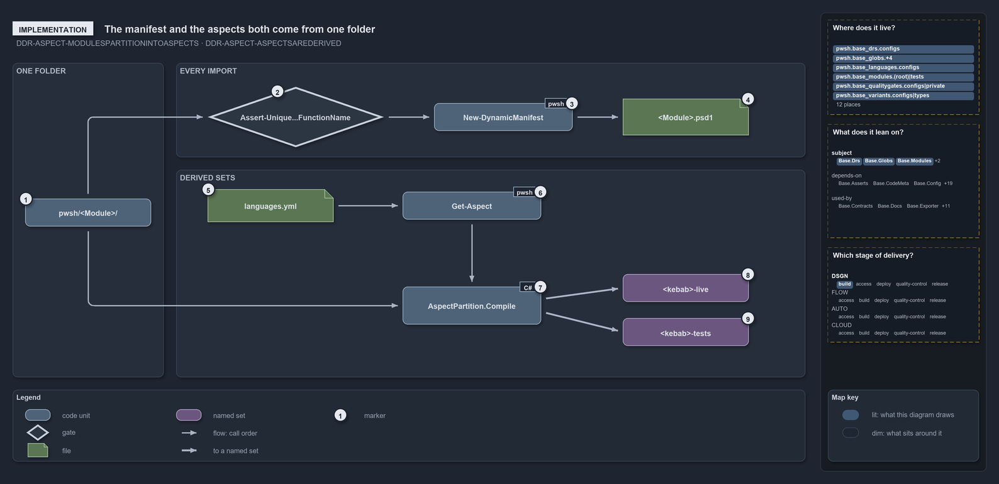

---
catzc:
  warning: "Header is generated by Format-FileMeta via Format-Code; do not change it"
  edges:
    cites:
      - ADR-PWSH-MANIFEST-MANIFESTSGITIGNORED
      - DDR-ASPECT-MODULESPARTITIONINTOASPECTS
      - DDR-ASPECT-ASPECTSAREDERIVED
    drs_total: 3
---

# The manifest and the aspects both come from one folder

```text
The manifest and the aspects both come from one folder, by two code paths in call order.

1  pwsh/<Module>/                the unit root both paths read
2  Assert-Unique...FunctionName  the import guard: unique function names
3  New-DynamicManifest           turns the folder's .ps1 files into a manifest
4  <Module>.psd1                 the manifest: written on drift, gitignored
5  languages.yml                 the layout: its live rows, then the tests remainder
6  Get-Aspect                    reads the aspect convention for the track
7  AspectPartition.Compile       each aspect minus every earlier one, per root
8  <kebab>-live                  the live set
9  <kebab>-tests                 the tests set, plus the language test folders

Supports DDR-ASPECT-MODULESPARTITIONINTOASPECTS and DDR-ASPECT-ASPECTSAREDERIVED (implementation lens).
```

Two code paths in cats read the same module folder and derive different things from it. On every import, the bootstrap guards the function
names and then turns the folder's `.ps1` files into a manifest. Separately, `Get-ModuleGlobSet` compiles the `aspects` variant onto the
folder and derives a live set and a tests set. Each path runs in call order, left to right, and neither needs a file the author maintains by
hand.

```yml drawio
description:
  "Two code paths read the same module folder: the import guards its function names and writes a manifest, and the aspect compiler derives a
  live set and a tests set from the layout of languages.yml."
about:
  adrs: [DDR-ASPECT-MODULESPARTITIONINTOASPECTS, DDR-ASPECT-ASPECTSAREDERIVED]
  lens: implementation
content:
  title: The manifest and the aspects both come from one folder
  kind: explanation
  flow: left-to-right
  relation: call order
  theme: dark
  bands:
    - { id: band-root, label: ONE FOLDER }
    - { id: band-import, label: EVERY IMPORT }
    - { id: band-sets, label: DERIVED SETS }
  glyphs:
    - { id: g-root, kind: code, label: pwsh/<Module>/, in: band-root }
    - { id: g-assert-unique, kind: gate, label: Assert-Unique...FunctionName, in: band-import }
    - { id: g-manifest, kind: code, label: New-DynamicManifest, in: band-import }
    - { id: g-psd1, kind: file, label: <Module>.psd1, in: band-import }
    - { id: g-languages, kind: file, label: languages.yml, in: band-sets }
    - { id: g-get-aspect, kind: code, label: Get-Aspect, in: band-sets }
    - { id: g-compile, kind: code, label: AspectPartition.Compile, in: band-sets }
    - { id: g-live, kind: set, label: <kebab>-live, in: band-sets }
    - { id: g-tests, kind: set, label: <kebab>-tests, in: band-sets }
  edges:
    - { from: g-root, to: g-assert-unique, kind: flow, label: "" }
    - { from: g-assert-unique, to: g-manifest, kind: flow, label: "" }
    - { from: g-manifest, to: g-psd1, kind: flow, label: "" }
    - { from: g-languages, to: g-get-aspect, kind: flow, label: "" }
    - { from: g-get-aspect, to: g-compile, kind: flow, label: "" }
    - { from: g-root, to: g-compile, kind: flow, label: "" }
    - { from: g-compile, to: g-live, kind: thick, label: "" }
    - { from: g-compile, to: g-tests, kind: thick, label: "" }
  markers:
    - { at: g-root, number: 1 }
    - { at: g-assert-unique, number: 2 }
    - { at: g-manifest, number: 3 }
    - { at: g-psd1, number: 4 }
    - { at: g-languages, number: 5 }
    - { at: g-get-aspect, number: 6 }
    - { at: g-compile, number: 7 }
    - { at: g-live, number: 8 }
    - { at: g-tests, number: 9 }
  legend: auto
  minimaps:
    code-locations:
      - cell: docs/-/.
        by:
          - docs/drs/design/dora-explains.md
          - docs/drs/design/module-aspects.md
          - docs/drs/index.md
          - docs/references/pwsh/catzc-base-globs/Get-ModuleGlobSet.ps1.md
          - docs/references/pwsh/catzc-base-globs/tests/types/Aspect.Tests.ps1.md
          - docs/references/pwsh/catzc-base-globs/types/Aspect.cs.md
          - docs/references/pwsh/catzc-base-modules/Get-Aspect.ps1.md
          - docs/references/pwsh/catzc-base-quality-gates/private/Get-ModuleProtectionIdentity.ps1.md
          - docs/references/pwsh/catzc-base-variants/configs/variants.yml.md
          - docs/references/pwsh/catzc-base-variants/types/VariantAspect.cs.md
          - docs/references/pwsh/catzc-base-variants/types/VariantsConfig.cs.md
          - DDR-ASPECT-ASPECTSAREDERIVED
          - DDR-ASPECT-MODULESPARTITIONINTOASPECTS
      - cell: pwsh/Catzc.Base.Drs/configs
        by: [pwsh/Catzc.Base.Drs/configs/drs.yml, DDR-ASPECT-ASPECTSAREDERIVED, DDR-ASPECT-MODULESPARTITIONINTOASPECTS]
      - cell: pwsh/Catzc.Base.Globs/.
        by: [pwsh/Catzc.Base.Globs/Get-ModuleGlobSet.ps1, DDR-ASPECT-ASPECTSAREDERIVED, DDR-ASPECT-MODULESPARTITIONINTOASPECTS]
      - cell: pwsh/Catzc.Base.Globs/tests
        by: [pwsh/Catzc.Base.Globs/tests/Get-ModuleGlobSet.Tests.ps1, DDR-ASPECT-ASPECTSAREDERIVED, DDR-ASPECT-MODULESPARTITIONINTOASPECTS]
      - cell: pwsh/Catzc.Base.Globs/tests/types
        by: [pwsh/Catzc.Base.Globs/tests/types/Aspect.Tests.ps1, DDR-ASPECT-ASPECTSAREDERIVED, DDR-ASPECT-MODULESPARTITIONINTOASPECTS]
      - cell: pwsh/Catzc.Base.Globs/types
        by: [pwsh/Catzc.Base.Globs/types/Aspect.cs, DDR-ASPECT-ASPECTSAREDERIVED, DDR-ASPECT-MODULESPARTITIONINTOASPECTS]
      - cell: pwsh/Catzc.Base.Modules/.
        by: [pwsh/Catzc.Base.Modules/Get-Aspect.ps1, DDR-ASPECT-ASPECTSAREDERIVED, DDR-ASPECT-MODULESPARTITIONINTOASPECTS]
      - cell: pwsh/Catzc.Base.Modules/tests
        by: [pwsh/Catzc.Base.Modules/tests/Get-Aspect.Tests.ps1, DDR-ASPECT-ASPECTSAREDERIVED, DDR-ASPECT-MODULESPARTITIONINTOASPECTS]
      - cell: pwsh/Catzc.Base.QualityGates/private
        by:
          - pwsh/Catzc.Base.QualityGates/private/Get-ModuleProtectionIdentity.ps1
          - DDR-ASPECT-ASPECTSAREDERIVED
          - DDR-ASPECT-MODULESPARTITIONINTOASPECTS
      - cell: pwsh/Catzc.Base.Variants/configs
        by: [pwsh/Catzc.Base.Variants/configs/variants.yml, DDR-ASPECT-ASPECTSAREDERIVED, DDR-ASPECT-MODULESPARTITIONINTOASPECTS]
      - cell: pwsh/Catzc.Base.Variants/types
        by:
          - pwsh/Catzc.Base.Variants/types/VariantAspect.cs
          - pwsh/Catzc.Base.Variants/types/VariantsConfig.cs
          - DDR-ASPECT-ASPECTSAREDERIVED
          - DDR-ASPECT-MODULESPARTITIONINTOASPECTS
    module-neighbourhood:
      - cell: subject/Catzc.Base.Drs
        by: [pwsh/Catzc.Base.Drs/configs/drs.yml, DDR-ASPECT-ASPECTSAREDERIVED, DDR-ASPECT-MODULESPARTITIONINTOASPECTS]
      - cell: subject/Catzc.Base.Globs
        by:
          - pwsh/Catzc.Base.Globs/Get-ModuleGlobSet.ps1
          - pwsh/Catzc.Base.Globs/tests/Get-ModuleGlobSet.Tests.ps1
          - pwsh/Catzc.Base.Globs/tests/types/Aspect.Tests.ps1
          - pwsh/Catzc.Base.Globs/types/Aspect.cs
          - DDR-ASPECT-ASPECTSAREDERIVED
          - DDR-ASPECT-MODULESPARTITIONINTOASPECTS
      - cell: subject/Catzc.Base.Modules
        by:
          - pwsh/Catzc.Base.Modules/Get-Aspect.ps1
          - pwsh/Catzc.Base.Modules/tests/Get-Aspect.Tests.ps1
          - DDR-ASPECT-ASPECTSAREDERIVED
          - DDR-ASPECT-MODULESPARTITIONINTOASPECTS
      - cell: subject/Catzc.Base.QualityGates
        by:
          - pwsh/Catzc.Base.QualityGates/private/Get-ModuleProtectionIdentity.ps1
          - DDR-ASPECT-ASPECTSAREDERIVED
          - DDR-ASPECT-MODULESPARTITIONINTOASPECTS
      - cell: subject/Catzc.Base.Variants
        by:
          - pwsh/Catzc.Base.Variants/configs/variants.yml
          - pwsh/Catzc.Base.Variants/types/VariantAspect.cs
          - pwsh/Catzc.Base.Variants/types/VariantsConfig.cs
          - DDR-ASPECT-ASPECTSAREDERIVED
          - DDR-ASPECT-MODULESPARTITIONINTOASPECTS
    axis:
      - cell: DSGN/build
        by: [DDR-ASPECT-ASPECTSAREDERIVED, DDR-ASPECT-MODULESPARTITIONINTOASPECTS]
layout:
  band-root: { x: 20, y: 84, w: 240, h: 500 }
  band-import: { x: 280, y: 84, w: 1000, h: 150 }
  band-sets: { x: 280, y: 254, w: 1000, h: 330 }
  g-root: { x: 40, y: 300, w: 200, h: 44 }
  g-assert-unique: { x: 330, y: 122, w: 280, h: 96 }
  g-manifest: { x: 690, y: 148, w: 220, h: 44 }
  g-psd1: { x: 990, y: 141, w: 200, h: 58 }
  g-languages: { x: 330, y: 285, w: 200, h: 52 }
  g-get-aspect: { x: 640, y: 289, w: 220, h: 44 }
  g-compile: { x: 640, y: 440, w: 220, h: 60 }
  g-live: { x: 990, y: 420, w: 200, h: 44 }
  g-tests: { x: 990, y: 490, w: 200, h: 44 }
```



## Walkthrough

1. **pwsh/&lt;Module&gt;/.** The unit root both paths read. The import walks every module folder, and the aspects compile per folder with
   `pwsh/<Module>` as the root.
2. **Assert-UniqueModuleFunctionName.** Shown shortened as `Assert-Unique…FunctionName`. `Import-AllModules` calls it before any module or
   C# type loads, reached from `importer.ps1` through `Invoke-Importer`. A duplicate name throws "Function name collision(s) detected before
   import".
3. **New-DynamicManifest.** Called once per module. Root `*.ps1` files, minus `*.Tests.ps1`, become the exported functions; `private/*.ps1`
   files join the nested modules, private first, each group sorted ordinally.
4. **&lt;Module&gt;.psd1.** The manifest is written only when its content differs, and `pwsh/**/*.psd1` is gitignored. A module with no
   `.ps1` left gets no manifest, and `Import-AllModules` deletes a stale one.
5. **languages.yml.** The code track declares no `aspects` entry; its convention is the layout of `languages.yml`. `live` is the layout's
   live rows, `*.ps1`, `private/**`, `types/**`, `configs/**` and `assets/**`, and `tests` is the `**` remainder.
6. **Get-Aspect.** `Get-ModuleGlobSet` calls `Get-Aspect -Track pwsh`. For a track of type `modules` it derives the convention from that
   layout; a track with its own `aspects` entry in `variants.yml`, as `infrastructure` has, is read through `Get-AspectDeclaration` instead.
7. **AspectPartition.Compile.** Called per module with the root `pwsh/<Module>`: aspect _k_ gets its own patterns, prefixed by the root, and
   excludes every earlier aspect's patterns.
8. **&lt;kebab&gt;-live.** The live set, named for the folder lower-cased with dots turned to dashes, plus `-live`.
9. **&lt;kebab&gt;-tests.** The tests set. It also takes `<go|python|bash root>/tests/<kebab>/**`. `tests/` and `README.md` match no live
   pattern, so they fall to this `**` remainder.

## Why it holds

- A module's files partition into aspects that are disjoint and exhaustive (DDR-ASPECT-MODULESPARTITIONINTOASPECTS).
- The aspects are derived from folder conventions by ordered first match, each aspect minus every earlier one, all prefixed by the unit root
  (DDR-ASPECT-ASPECTSAREDERIVED).

## Where the code and the decision record differ

- ADR-PWSH-MANIFEST-MANIFESTSGITIGNORED says `New-DynamicManifest` deletes the manifest when no `.ps1` is left; that function returns
  nothing, and `Import-AllModules` deletes the stale file.
- DDR-ASPECT-ASPECTSAREDERIVED prefixes every aspect pattern by the unit root; `Get-ModuleGlobSet` adds the language test folders to the
  tests set outside it.

## See also

- [Module aspects](../../drs/design/module-aspects.md) — the decision this article explains.
- The other lenses on the same layout: [meta](every-file-in-exactly-one-aspect.md), [architecture](one-folder-two-independent-readers.md),
  [operations](drop-a-file-the-import-exports-it.md) and [governance](partition-integrity-runs-only-in-unit-tests.md).
- [The design explanations](index.md) · [How to read the diagrams](../index.md#how-to-read-the-diagrams)
