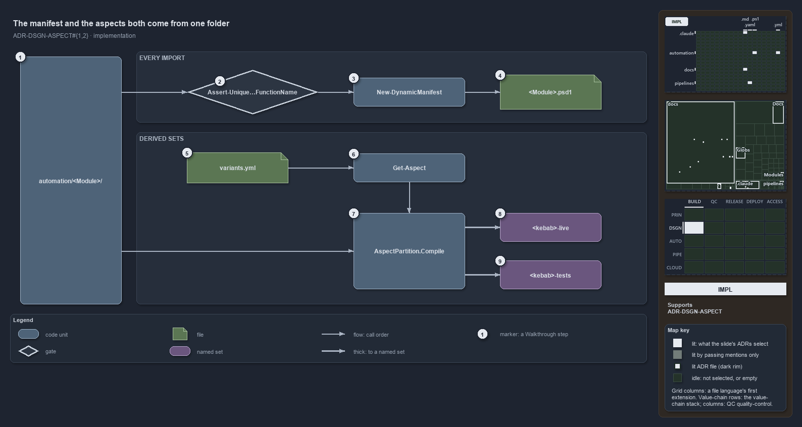

# The manifest and the aspects both come from one folder

```text
The manifest and the aspects both come from one folder, by two code paths in call order.

1  pwsh/<Module>/                the unit root both paths read
2  Assert-Unique...FunctionName  the import guard: unique function names
3  New-DynamicManifest           turns the folder's .ps1 files into a manifest
4  <Module>.psd1                 the manifest: written on drift, gitignored
5  languages.yml                 the layout: its live rows, then the tests remainder
6  Get-Aspect                    reads the aspect convention for the track
7  AspectPartition.Compile       each aspect minus every earlier one, per root
8  <kebab>-live                  the live set
9  <kebab>-tests                 the tests set, plus the language test folders

Supports DDR-ASPECT-MODULESPARTITIONINTOASPECTS and DDR-ASPECT-ASPECTSAREDERIVED (implementation lens).
```

Two code paths in cats read the same module folder and derive different things from it. On every import, the bootstrap guards the function
names and then turns the folder's `.ps1` files into a manifest. Separately, `Get-ModuleGlobSet` compiles the `aspects` variant onto the
folder and derives a live set and a tests set. Each path runs in call order, left to right, and neither needs a file the author maintains by
hand.



## Walkthrough

1. **pwsh/&lt;Module&gt;/.** The unit root both paths read. The import walks every module folder, and the aspects compile per folder with
   `pwsh/<Module>` as the root.
2. **Assert-UniqueModuleFunctionName.** Shown shortened as `Assert-Unique…FunctionName`. `Import-AllModules` calls it before any module or
   C# type loads, reached from `importer.ps1` through `Invoke-Importer`. A duplicate name throws "Function name collision(s) detected before
   import".
3. **New-DynamicManifest.** Called once per module. Root `*.ps1` files, minus `*.Tests.ps1`, become the exported functions; `private/*.ps1`
   files join the nested modules, private first, each group sorted ordinally.
4. **&lt;Module&gt;.psd1.** The manifest is written only when its content differs, and `pwsh/**/*.psd1` is gitignored. A module with no
   `.ps1` left gets no manifest, and `Import-AllModules` deletes a stale one.
5. **languages.yml.** The code track declares no `aspects` entry; its convention is the layout of `languages.yml`. `live` is the layout's
   live rows, `*.ps1`, `private/**`, `types/**`, `configs/**` and `assets/**`, and `tests` is the `**` remainder.
6. **Get-Aspect.** `Get-ModuleGlobSet` calls `Get-Aspect -Track pwsh`. For a track of type `modules` it derives the convention from that
   layout; a track with its own `aspects` entry in `variants.yml`, as `infrastructure` has, is read through `Get-AspectDeclaration` instead.
7. **AspectPartition.Compile.** Called per module with the root `pwsh/<Module>`: aspect _k_ gets its own patterns, prefixed by the root, and
   excludes every earlier aspect's patterns.
8. **&lt;kebab&gt;-live.** The live set, named for the folder lower-cased with dots turned to dashes, plus `-live`.
9. **&lt;kebab&gt;-tests.** The tests set. It also takes `<go|python|bash root>/tests/<kebab>/**`. `tests/` and `README.md` match no live
   pattern, so they fall to this `**` remainder.

## Why it holds

- A module's files partition into aspects that are disjoint and exhaustive (DDR-ASPECT-MODULESPARTITIONINTOASPECTS).
- The aspects are derived from folder conventions by ordered first match, each aspect minus every earlier one, all prefixed by the unit root
  (DDR-ASPECT-ASPECTSAREDERIVED).

## Where the code and the ADR differ

- ADR-PWSH-MANIFEST-MANIFESTSGITIGNORED says `New-DynamicManifest` deletes the manifest when no `.ps1` is left; that function returns
  nothing, and `Import-AllModules` deletes the stale file.
- DDR-ASPECT-ASPECTSAREDERIVED prefixes every aspect pattern by the unit root; `Get-ModuleGlobSet` adds the language test folders to
  the tests set outside it.

## See also

- [Module aspects](../../drs/design/module-aspects.md) — the decision this article explains.
- The other lenses on the same layout: [meta](every-file-in-exactly-one-aspect.md), [architecture](one-folder-two-independent-readers.md),
  [operations](drop-a-file-the-import-exports-it.md) and [governance](partition-integrity-runs-only-in-unit-tests.md).
- [The design explanations](index.md) · [How to read the diagrams](../index.md#how-to-read-the-diagrams)
