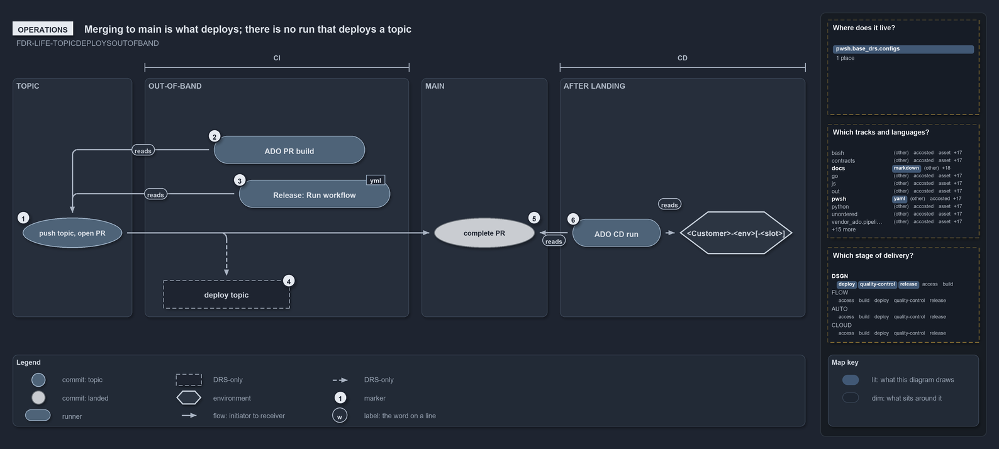

# Merging to main is what deploys; there is no run that deploys a topic

```text
An engineer has nothing to run to deploy a topic commit; completing the pull request into main is what deploys.

1  push topic, open PR     the engineer opens a pull request into main
2  ADO PR build            runs the CI stage and skips every Deploy_* stage
3  Release: Run workflow   builds the package from any ref; a release, not a deploy
4  deploy topic            no pipeline or workflow to run; DRS-only
5  complete PR             lands the commit on main; the push trigger starts the CD run
6  ADO CD run              deploys foundation, discovery, then expedition

Supports FDR-CD-LIFE-TOPICDEPLOYSOUTOFBAND (operations lens).
```

Merging to main is the act that deploys, and an engineer who wants a topic commit in an environment has nothing else to run for it. A pull
request starts a build that skips every deploy stage, and the `Release` workflow builds a package but deploys nothing. Only completing the
pull request into main starts a run that deploys. The out-of-band topic deploy that FDR-CD-LIFE-TOPICDEPLOYSOUTOFBAND allows has no pipeline
behind it.

```yml drawio
description:
  A pull request starts a build that skips every deploy stage and a hand-started release builds a package, while only completing the pull
  request into main starts the run that deploys; a topic deploy has no pipeline behind it.
about:
  adrs: [FDR-CD-LIFE-TOPICDEPLOYSOUTOFBAND]
  lens: operations
content:
  title: Merging to main is what deploys; there is no run that deploys a topic
  kind: explanation
  flow: left-to-right
  theme: dark
  bands:
    - { id: band-topic, label: TOPIC }
    - { id: band-out-of-band, label: OUT-OF-BAND }
    - { id: band-main, label: MAIN }
    - { id: band-after, label: AFTER LANDING }
  spans:
    - id: span-ci
      label: CI
      over: [band-out-of-band]
    - id: span-cd
      label: CD
      over: [band-after]
  glyphs:
    - { id: g-push, kind: commit, label: "push topic, open PR", in: band-topic, state: topic }
    - { id: g-pr-build, kind: runner, label: ADO PR build, in: band-out-of-band }
    - { id: g-release, kind: runner, label: "Release: Run workflow", in: band-out-of-band }
    - { id: g-deploy-topic, kind: drsonly, label: deploy topic, in: band-out-of-band }
    - { id: g-complete, kind: commit, label: complete PR, in: band-main, state: landed }
    - { id: g-cd-run, kind: runner, label: ADO CD run, in: band-after }
    - { id: g-environment, kind: env, label: "<Customer>-<env>[-<slot>]", in: band-after }
  edges:
    - { from: g-push, to: g-pr-build, kind: flow, label: "" }
    - { from: g-push, to: g-release, kind: flow, label: "" }
    - { from: g-push, to: g-deploy-topic, kind: adr, label: "" }
    - { from: g-push, to: g-complete, kind: flow, label: "" }
    - { from: g-complete, to: g-cd-run, kind: flow, label: "" }
    - { from: g-cd-run, to: g-environment, kind: flow, label: "" }
  markers:
    - { at: g-push, number: 1 }
    - { at: g-pr-build, number: 2 }
    - { at: g-release, number: 3 }
    - { at: g-deploy-topic, number: 4 }
    - { at: g-complete, number: 5 }
    - { at: g-cd-run, number: 6 }
  legend: auto
  minimaps: [code-locations, grid, axis]
layout:
  band-topic: { x: 20, y: 108, w: 190, h: 380 }
  band-out-of-band: { x: 230, y: 108, w: 420, h: 380 }
  band-main: { x: 670, y: 108, w: 200, h: 380 }
  band-after: { x: 890, y: 108, w: 390, h: 380 }
  g-push: { x: 36, y: 330, w: 158, h: 48 }
  g-pr-build: { x: 340, y: 200, w: 240, h: 44 }
  g-release: { x: 380, y: 270, w: 240, h: 44 }
  g-deploy-topic: { x: 260, y: 430, w: 200, h: 44 }
  g-complete: { x: 690, y: 330, w: 160, h: 48 }
  g-cd-run: { x: 910, y: 332, w: 140, h: 44 }
  g-environment: { x: 1080, y: 320, w: 180, h: 68 }
```



## Walkthrough

1. **Push topic, open PR.** The engineer pushes a topic branch and opens a pull request into main. The CD pipelines trigger on a PR into
   main.
2. **ADO PR build.** Azure DevOps runs the `CI` stage and skips every `Deploy_*` stage. A PR build's source branch is a pull-request ref,
   and each deploy stage runs only when the source branch is `refs/heads/main`.
3. **Release: Run workflow.** The GitHub `Release` workflow is started by hand and runs on any ref. It always builds the `.nupkg` and
   uploads it; publishing to a GitHub Release, GitHub Packages or the PowerShell Gallery is opt-in per input. It is a release, not a deploy
   to an environment.
4. **Deploy topic.** Deploying a topic commit to an environment has no pipeline or workflow to run.
5. **Complete PR.** Completing the pull request lands the commit on main, and the push trigger on main starts the CD run.
6. **ADO CD run.** On main, the deploy stages run in order, foundation, discovery, then expedition. Each job deploys to an Azure DevOps
   environment named `<Customer>-<env>[-<slot>]`: an expedition entry with a slot adds `-<slot>`, and one without deploys the env's base
   slot.

## Why it holds

- A topic commit can be deployed out-of-band by a workflow or pipeline, and that deploy is not an integration
  (FDR-CD-LIFE-TOPICDEPLOYSOUTOFBAND). The operator sees the stricter code: only main deploys.

## Where the code and the decision record differ

FDR-CD-LIFE-TOPICDEPLOYSOUTOFBAND describes an out-of-band topic deploy that no pipeline offers, so an operator has nothing to run for it.

## See also

- [The commit lifecycle](../../drs/flow/commit-lifecycle.md) — the decision this article explains.
- The other lenses on the same deploy: [meta](deploying-is-not-integrating.md),
  [architecture](deploy-and-integrate-share-only-the-topic.md), [implementation](every-deploy-stage-is-main-only.md) and
  [governance](out-of-band-deploy-is-drs-only.md).
- [The design explanations](index.md) · [How to read the diagrams](../index.md#how-to-read-the-diagrams)
