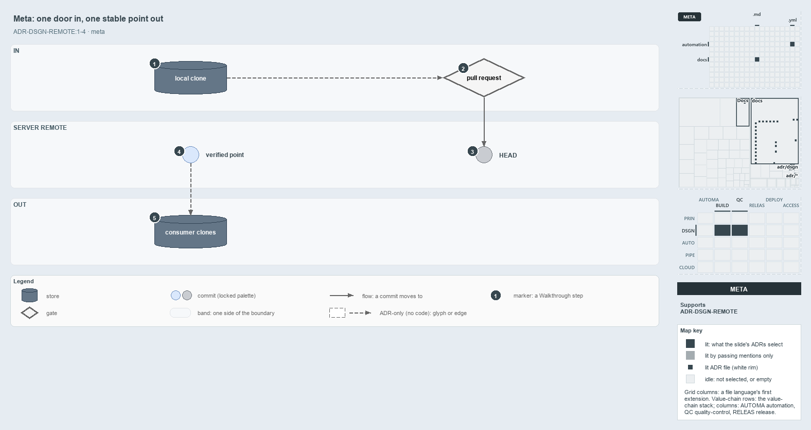

---
catzc:
  derived:
    path: docs/explanation/design/one-door-in-one-stable-point-out.md
    kind: explanation
    body_sha: bb7ec869f6ce
    adrs:
      - ADR-DSGN-REMOTE#*
    links:
      - docs/.assets/explanation/adr-dsgn-remote--one-door-in-one-stable-point-out--meta.drawio.md
      - docs/.assets/explanation/adr-dsgn-remote--one-door-in-one-stable-point-out--meta.drawio.png
      - docs/adr/design/server-remote-integration.md
      - docs/explanation/design/clients-bridge-to-one-server.md
      - docs/explanation/design/guard-and-policies-by-command.md
      - docs/explanation/design/index.md
      - docs/explanation/design/ingress-gated-the-rest-by-review.md
      - docs/explanation/design/local-guard-and-server-policies.md
      - docs/explanation/index.md#how-to-read-the-diagrams
---

# Changes enter through one door, and consumers build on one stable point

```text
Changes enter the mainline through one door, and consumers build on one stable point.

1  local clone      a working copy that bridges to the server remote; no authority of its own
2  pull request     the one door into the server's main: authenticates, runs the merge gates, merges
3  HEAD             the tip of main; provisional, it may be unverified or failed downstream
4  verified point   the last commit the server proved verified; it never moves
5  consumer clones  every consumer builds on the verified point, never on HEAD

Supports ADR-DSGN-REMOTE#1, #2, #3 and #4 (meta lens).
```

The mainline of cats lives on an audited server git remote, and every developer box and CI agent is a client that bridges to it. Work
crosses that boundary in two directions, and each direction has one rule: a change comes in only through a pull request, and a consumer
reads out only the last verified commit, never the raw tip. Together the two rules keep the mainline trustworthy to build on and honest
about its history.



The diagram is described element by element in
[its asset description](../../.assets/explanation/adr-dsgn-remote--one-door-in-one-stable-point-out--meta.drawio.md).

## Walkthrough

1. **Local clone.** A developer's working copy is a bridge to the server remote, not a second truth. It pushes toward the pull request, and
   nothing on it counts as "on main" until the server holds it. No code in cats performs that push, so the edge is dashed.
2. **Pull request.** The pull request is the one door into the server's `main` / `master`. It authenticates the author, runs the merge gates
   and performs the merge itself. The solo `main-direct` mode is the deliberate single-author exception, where the door collapses to a
   direct commit.
3. **HEAD.** The merge lands the commit at the tip of main. HEAD is provisional: it may still be unverified, or verified and then failed
   downstream, and it can be fixed forward, superseded or cut back.
4. **Verified point.** The last commit the server proved verified is stable. The verified history only grows, so nothing that happens at
   HEAD moves this point.
5. **Consumer clones.** Every consumer, whether a developer starting work, a downstream unit or an upstream integrator, builds on the
   verified point. Nothing in cats resolves that point yet, so this edge is dashed too.

## Why it holds

- The audited server remote is the single source of truth, and local and CI clones are bridges to it (ADR-DSGN-REMOTE#1).
- A consumer integrates from the last remote-verified commit, never from the current remote HEAD (ADR-DSGN-REMOTE#2).
- Because the verified point never moves, a consumer never has to reconcile a tip that is later rewritten or superseded (ADR-DSGN-REMOTE#3).
- The pull request is the authenticated ingress, and closing every other door is what makes the `git log` audit trail complete
  (ADR-DSGN-REMOTE#4).

## Where the code and the ADR differ

- The ADR tells every consumer to integrate from the last verified commit, but no function or pipeline in cats resolves that commit, and the
  pipelines trigger on `main`.
- The ADR closes every door but the pull request, but no code in cats denies a direct push to the protected branch.

## See also

- [The audited server git remote](../../adr/design/server-remote-integration.md) — the decision this article explains.
- The other lenses on the same decision: [architecture](clients-bridge-to-one-server.md),
  [implementation](local-guard-and-server-policies.md), [operations](guard-and-policies-by-command.md) and
  [governance](ingress-gated-the-rest-by-review.md).
- [The design explanations](index.md) · [How to read the diagrams](../index.md#how-to-read-the-diagrams)
