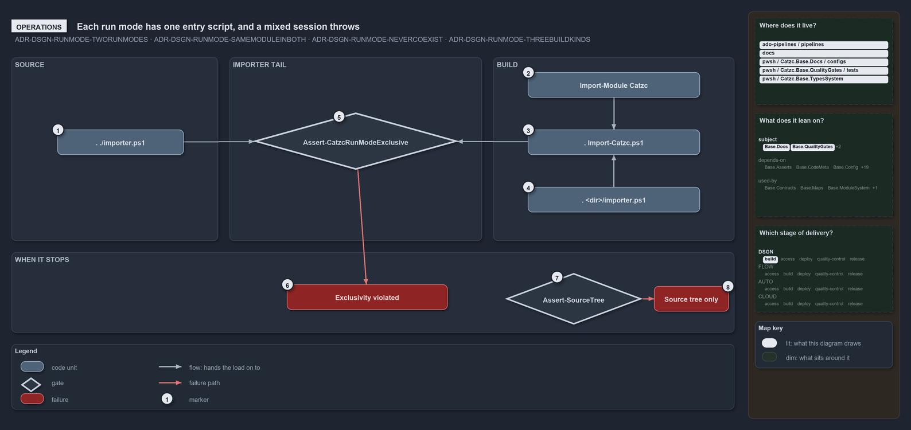

# Each run mode has one entry script, and a mixed session throws

```text
Each run mode has one entry script, and a mixed session throws.

1  . ./importer.ps1              enter source mode at the repository root
2  Import-Module Catzc           enter an installed package; dot-sources its Import-Catzc.ps1
3  . Import-Catzc.ps1            enter a build through its initializer
4  . <dir>/importer.ps1          enter a saved package from another root
5  Assert-CatzcRunModeExclusive  the last load step of every entry
6  Exclusivity violated          the stop when a module from another root is still loaded
7  Assert-SourceTree             the mode check a source-tree tool runs first
8  Source tree only              the stop when such a tool runs in a build

Supports ADR-DSGN-RUNMODE-TWORUNMODES, ADR-DSGN-RUNMODE-SAMEMODULEINBOTH, ADR-DSGN-RUNMODE-NEVERCOEXIST and ADR-DSGN-RUNMODE-THREEBUILDKINDS (operations lens).
```

Entering cats takes one dot-sourced entry script per run mode: `importer.ps1` for the source tree, or a package's `Import-Catzc.ps1` for a
build, which `Import-Module Catzc` and a saved root's own `importer.ps1` both hand the load on to. Switching modes means running the other
mode's entry script. Two things stop a session with a clear message: a load that leaves modules from two roots in one session, and a
source-tree tool run in a build.



The diagram is described element by element in [its asset description](.assets/one-entry-script-per-mode/diagram.drawio.md).

## Walkthrough

1. **`. ./importer.ps1`.** Dot-sourced at the repository root, it loads the modules from `<RepositoryRoot>/pwsh/`. The CI and release
   workflows enter cats the same way.
2. **Import-Module Catzc.** An installed package, put in the user module path by `Install-Catzc -Scope CurrentUser`, loads with
   `Import-Module Catzc`. Its root module dot-sources the package's `Import-Catzc.ps1`.
3. **`. Import-Catzc.ps1`.** A build is entered by dot-sourcing its initializer, for example
   `. <build>/Import-Catzc.ps1 -RepositoryRoot <dir>`. `Build-Modules` writes a temporary build under `out/automation/build/Catzc/<v>/`.
4. **`. <dir>/importer.ps1`.** `Export-Catzc -Root <dir>` builds, then calls `Install-Catzc -Root <dir>`, which saves the package under
   `<dir>/.vendor/Catzc/<v>/` and writes `<dir>/importer.ps1`. That file dot-sources the saved `Import-Catzc.ps1` with `<dir>` as the
   working root.
5. **Assert-CatzcRunModeExclusive.** Every entry ends in the same importer, and the importer's last load step checks that no loaded catzc
   module comes from another root. The importer evicts the other mode's modules first, so a normal switch passes.
6. **Exclusivity violated.** If a foreign module is still loaded, the load stops with
   `Run-mode exclusivity violated: the active CatzcModulesRoot is '…', but N loaded catzc module(s) come from another root (…)`, a line per
   module, and the advice `Restart PowerShell, or re-run the entry script of the mode you want.`
7. **Assert-SourceTree.** Tools that work on the source tree itself call this check first; it stands apart from the entry scripts because it
   runs when such a tool is called, not during a load.
8. **Source tree only.** In a build, such a tool stops with
   `<command> operates on the catzc source tree; this session runs a built Catzc package (…). Load the repository with importer.ps1 to use it.`

To see which mode a session is in, run `Get-CatzcRunMode`, which answers `source` or `build`. A verbose load also writes the roots on the
importer's record, `Roots: RepositoryRoot='…', CatzcModulesRoot='…'`, and after a switch its summary adds `evicted from another root: …`.
That record shows with `. ./importer.ps1 -Verbose`, or with `$VerbosePreference = 'Continue'` before a build's `Import-Catzc.ps1`, which
takes no `-Verbose` of its own. A NuGet package from `Export-Catzc -To nuget` lands in `out/automation/packages/` and cannot be entered
until it is installed or saved.

## Why it holds

- Each mode has its own entry: `importer.ps1` for source mode, and the package's `Import-Catzc.ps1` (or `Import-Module Catzc`) for build
  mode (ADR-DSGN-RUNMODE-TWORUNMODES).
- Source-tree tools assert that they run in source mode and fail fast in a build (ADR-DSGN-RUNMODE-SAMEMODULEINBOTH).
- The two modes never coexist in one session; switching works in any order (ADR-DSGN-RUNMODE-NEVERCOEXIST).
- Every kind of build root enters through the package's `Import-Catzc.ps1` (ADR-DSGN-RUNMODE-THREEBUILDKINDS).

## See also

- [Run modes: source mode and build mode](../../adr/design/run-modes.md) — the decision this article explains.
- The other lenses on the same modes: [meta](where-code-loads-from-decides-the-mode.md),
  [architecture](two-roots-one-importer-same-modules.md), [implementation](shims-set-roots-mode-read-back.md) and
  [governance](which-run-mode-rules-have-a-gate.md).
- [The design explanations](index.md) · [How to read the diagrams](../index.md#how-to-read-the-diagrams)
