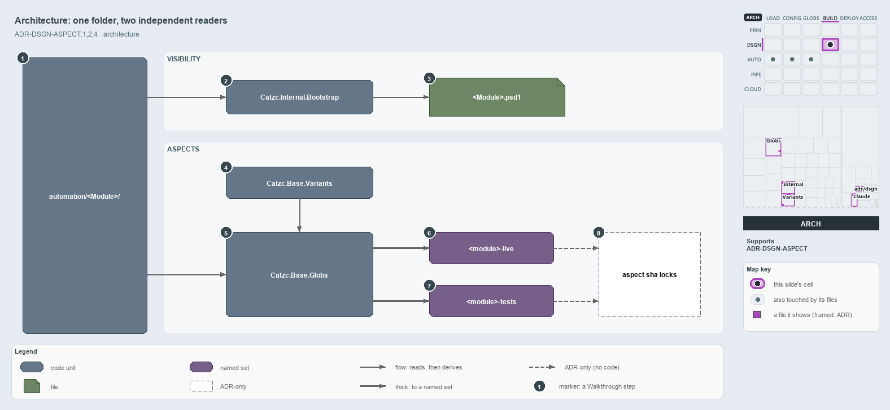

---
catzc:
  immutable:
    with_body_sha: "42f43edabf19"
    path: docs/explanation/design/one-folder-two-independent-readers.md
    folder: docs/explanation/design
    name: one-folder-two-independent-readers
    filetype: md
    kind: explanation
    language: markdown
    track: docs
    tracktype: documentation
  edges:
    cites:
      - ADR-DSGN-ASPECT#{1,2,4}
      - ADR-FLOW-CD-GLOBS#9
    links:
      - docs/.assets/explanation/adr-dsgn-aspect--one-folder-two-independent-readers--architecture.drawio.md
      - docs/.assets/explanation/adr-dsgn-aspect--one-folder-two-independent-readers--architecture.drawio.png
      - docs/adr/design/module-aspects.md
      - docs/explanation/design/drop-a-file-the-import-exports-it.md
      - docs/explanation/design/every-file-in-exactly-one-aspect.md
      - docs/explanation/design/index.md
      - docs/explanation/design/manifest-and-aspects-from-one-folder.md
      - docs/explanation/design/partition-integrity-runs-only-in-unit-tests.md
      - docs/explanation/index.md#how-to-read-the-diagrams
---

# One module folder has two independent readers

```text
One module folder has two independent readers: the loader and the globs engine.

1  automation/<Module>/       the folder that is the module
2  Catzc.Internal.Bootstrap   the loader: derives the manifest on every import
3  <Module>.psd1              the derived manifest: generated, gitignored
4  Catzc.Base.Variants        holds the aspects variant, read through Get-Aspect
5  Catzc.Base.Globs           the globs engine: one set per aspect
6  <module>-live              the first aspect, a closed convention: ships
7  <module>-tests             the last aspect, the ** remainder: never ships
8  Aspect sha locks           ADR-only: one immutable lock per aspect

Supports ADR-DSGN-ASPECT#1, #2 and #4 (architecture lens).
```

A cats module is a folder under `automation/`, and nothing else declares what it contains. Two components read that folder, and neither
reads the other: the loader decides what a module exports, and the globs engine decides which of its files ship. Both decisions come from
where a file sits, so a module author shapes visibility and shipping identity with the same act, placing a file.



The diagram is described element by element in
[its asset description](../../.assets/explanation/adr-dsgn-aspect--one-folder-two-independent-readers--architecture.drawio.md).

## Walkthrough

1. **automation/&lt;Module&gt;/.** The folder is the module. Both readers start from it, and the location of each file inside it is all
   either of them needs.
2. **Catzc.Internal.Bootstrap.** The loader. On every import its `Import-AllModules` derives each module's manifest from the folder. It
   never reads the `aspects` variant.
3. **&lt;Module&gt;.psd1.** The derived manifest. A `.ps1` file at the module root is exported; a file in `private/` is loaded into the
   module but not exported. The manifest is generated and gitignored, never written by hand.
4. **Catzc.Base.Variants.** It holds the `aspects` variant, the ordered first-match convention that names the aspects. The globs engine
   reads it through `Get-Aspect`.
5. **Catzc.Base.Globs.** The globs engine compiles the aspect convention onto each module folder with `AspectPartition`, by first match, and
   derives one set per aspect. It never reads the manifest.
6. **&lt;module&gt;-live.** The first aspect, a closed convention: root `*.ps1`, `private/**`, `types/**` and `configs/**`. It is what
   ships.
7. **&lt;module&gt;-tests.** The last aspect, the `**` remainder: everything the live convention does not claim. It also takes the module's
   Go, Python and Bash test folders, which sit outside the module folder. It never ships.
8. **Aspect sha locks.** The ADR makes each aspect an immutable sha lock, versioned on its own, and never one lock for the whole module. The
   code keeps a separate derived set per aspect but writes no lock or marker file.

## Why it holds

- Every module partitions its tracked files into aspects that are disjoint and exhaustive: no file in two aspects, no file in none
  (ADR-DSGN-ASPECT#1).
- Aspects are derived from folder conventions, never declared by hand; ordered first match with a `**` remainder makes the partition true by
  construction (ADR-DSGN-ASPECT#2).
- Each aspect is its own versioned artifact, so a test-only change never re-keys `live` and a runtime change never re-keys `tests`
  (ADR-DSGN-ASPECT#4).

## Where the code and the ADR differ

- ADR-DSGN-ASPECT#4 makes each aspect a sha lock with a `<unit>-<aspect>.yml` marker by way of ADR-FLOW-CD-GLOBS#9, but that rule computes
  change from git at real refs, never from a committed hash, and no aspect marker exists.
- ADR-DSGN-ASPECT#2 prefixes every aspect pattern with the unit root, but the tests set also reaches the language test folders outside it.

## See also

- [Module aspects](../../adr/design/module-aspects.md) — the decision this article explains.
- The other lenses on the same layout: [meta](every-file-in-exactly-one-aspect.md),
  [implementation](manifest-and-aspects-from-one-folder.md), [operations](drop-a-file-the-import-exports-it.md) and
  [governance](partition-integrity-runs-only-in-unit-tests.md).
- [The design explanations](index.md) · [How to read the diagrams](../index.md#how-to-read-the-diagrams)
