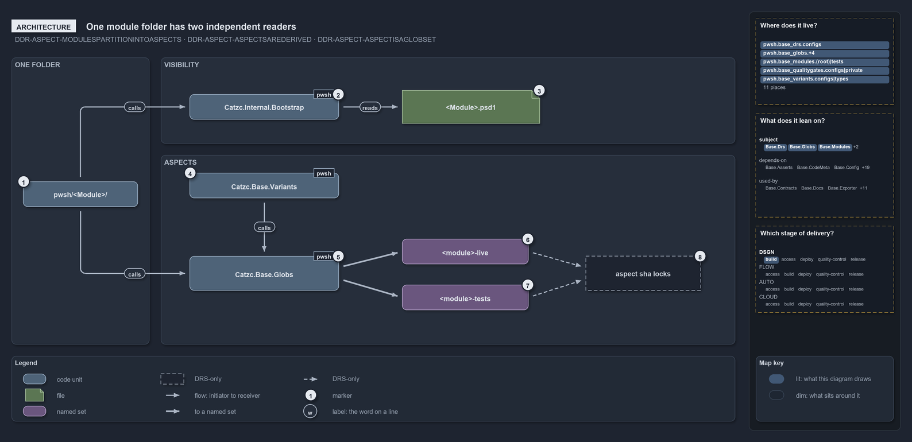

# One module folder has two independent readers

```text
One module folder has two independent readers: the loader and the globs engine.

1  pwsh/<Module>/             the folder that is the module
2  Catzc.Internal.Bootstrap   the loader: derives the manifest on every import
3  <Module>.psd1              the derived manifest: generated, gitignored
4  Catzc.Base.Variants        holds the aspects variant, read through Get-Aspect
5  Catzc.Base.Globs           the globs engine: one set per aspect
6  <module>-live              the first aspect, a closed convention: ships
7  <module>-tests             the last aspect, the ** remainder: never ships
8  Aspect sha locks           DRS-only: one immutable lock per aspect

Supports DDR-ASPECT-MODULESPARTITIONINTOASPECTS, DDR-ASPECT-ASPECTSAREDERIVED and DDR-ASPECT-ASPECTISAGLOBSET (architecture lens).
```

A cats module is a folder under `pwsh/`, and nothing else declares what it contains. Two components read that folder, and neither reads the
other: the loader decides what a module exports, and the globs engine decides which of its files ship. Both decisions come from where a file
sits, so a module author shapes visibility and shipping identity with the same act, placing a file.

```yml drawio
description:
  "One module folder is read by two components that never read each other: the loader derives the manifest and so what the module exports,
  and the globs engine derives the live and tests sets and so what ships."
about:
  adrs: [DDR-ASPECT-MODULESPARTITIONINTOASPECTS, DDR-ASPECT-ASPECTSAREDERIVED, DDR-ASPECT-ASPECTISAGLOBSET]
  lens: architecture
content:
  title: One module folder has two independent readers
  kind: explanation
  flow: left-to-right
  theme: dark
  bands:
    - { id: band-root, label: ONE FOLDER }
    - { id: band-visibility, label: VISIBILITY }
    - { id: band-aspects, label: ASPECTS }
  glyphs:
    - { id: g-root, kind: code, label: pwsh/<Module>/, in: band-root }
    - { id: g-bootstrap, kind: code, label: Catzc.Internal.Bootstrap, in: band-visibility }
    - { id: g-psd1, kind: file, label: <Module>.psd1, in: band-visibility }
    - { id: g-variants, kind: code, label: Catzc.Base.Variants, in: band-aspects }
    - { id: g-globs, kind: code, label: Catzc.Base.Globs, in: band-aspects }
    - { id: g-live, kind: set, label: <module>-live, in: band-aspects }
    - { id: g-tests, kind: set, label: <module>-tests, in: band-aspects }
    - { id: g-locks, kind: drsonly, label: aspect sha locks, in: band-aspects }
  edges:
    - { from: g-root, to: g-bootstrap, kind: flow, label: calls }
    - { from: g-bootstrap, to: g-psd1, kind: flow, label: "" }
    - { from: g-variants, to: g-globs, kind: flow, label: calls }
    - { from: g-root, to: g-globs, kind: flow, label: calls }
    - { from: g-globs, to: g-live, kind: thick, label: "" }
    - { from: g-globs, to: g-tests, kind: thick, label: "" }
    - { from: g-live, to: g-locks, kind: adr, label: "" }
    - { from: g-tests, to: g-locks, kind: adr, label: "" }
  markers:
    - { at: g-root, number: 1 }
    - { at: g-bootstrap, number: 2 }
    - { at: g-psd1, number: 3 }
    - { at: g-variants, number: 4 }
    - { at: g-globs, number: 5 }
    - { at: g-live, number: 6 }
    - { at: g-tests, number: 7 }
    - { at: g-locks, number: 8 }
  legend: auto
  minimaps: [code-locations, module-neighbourhood, axis]
layout:
  band-root: { x: 20, y: 84, w: 240, h: 500 }
  band-visibility: { x: 280, y: 84, w: 1000, h: 150 }
  band-aspects: { x: 280, y: 254, w: 1000, h: 330 }
  g-root: { x: 40, y: 300, w: 200, h: 44 }
  g-bootstrap: { x: 330, y: 148, w: 260, h: 44 }
  g-psd1: { x: 700, y: 141, w: 240, h: 58 }
  g-variants: { x: 330, y: 285, w: 260, h: 44 }
  g-globs: { x: 330, y: 430, w: 260, h: 60 }
  g-live: { x: 700, y: 400, w: 220, h: 44 }
  g-tests: { x: 700, y: 480, w: 220, h: 44 }
  g-locks: { x: 1020, y: 430, w: 200, h: 60 }
```



## Walkthrough

1. **pwsh/&lt;Module&gt;/.** The folder is the module. Both readers start from it, and the location of each file inside it is all either of
   them needs.
2. **Catzc.Internal.Bootstrap.** The loader. On every import its `Import-AllModules` derives each module's manifest from the folder. It
   never reads the `aspects` variant.
3. **&lt;Module&gt;.psd1.** The derived manifest. A `.ps1` file at the module root is exported; a file in `private/` is loaded into the
   module but not exported. The manifest is generated and gitignored, never written by hand.
4. **Catzc.Base.Variants.** It holds the `aspects` variant, the ordered first-match convention that names the aspects. The globs engine
   reads it through `Get-Aspect`.
5. **Catzc.Base.Globs.** The globs engine compiles the aspect convention onto each module folder with `AspectPartition`, by first match, and
   derives one set per aspect. It never reads the manifest.
6. **&lt;module&gt;-live.** The first aspect, a closed convention: root `*.ps1`, `private/**`, `types/**` and `configs/**`. It is what
   ships.
7. **&lt;module&gt;-tests.** The last aspect, the `**` remainder: everything the live convention does not claim. It also takes the module's
   Go, Python and Bash test folders, which sit outside the module folder. It never ships.
8. **Aspect sha locks.** The DDR makes each aspect an immutable sha lock, versioned on its own, and never one lock for the whole module. The
   code keeps a separate derived set per aspect but writes no lock or marker file.

## Why it holds

- Every module partitions its tracked files into aspects that are disjoint and exhaustive: no file in two aspects, no file in none
  (DDR-ASPECT-MODULESPARTITIONINTOASPECTS).
- Aspects are derived from folder conventions, never declared by hand; ordered first match with a `**` remainder makes the partition true by
  construction (DDR-ASPECT-ASPECTSAREDERIVED).
- Each aspect is its own versioned artifact, so a test-only change never re-keys `live` and a runtime change never re-keys `tests`
  (DDR-ASPECT-ASPECTISAGLOBSET).

## Where the code and the decision record differ

- DDR-ASPECT-ASPECTISAGLOBSET makes each aspect a sha lock with a `<unit>-<aspect>.yml` marker by way of FDR-CD-GLOBS-CHANGECOMPUTEDFROMGIT,
  but that rule computes change from git at real refs, never from a committed hash, and no aspect marker exists.
- DDR-ASPECT-ASPECTSAREDERIVED prefixes every aspect pattern with the unit root, but the tests set also reaches the language test folders
  outside it.

## See also

- [Module aspects](../../drs/design/module-aspects.md) — the decision this article explains.
- The other lenses on the same layout: [meta](every-file-in-exactly-one-aspect.md),
  [implementation](manifest-and-aspects-from-one-folder.md), [operations](drop-a-file-the-import-exports-it.md) and
  [governance](partition-integrity-runs-only-in-unit-tests.md).
- [The design explanations](index.md) · [How to read the diagrams](../index.md#how-to-read-the-diagrams)
