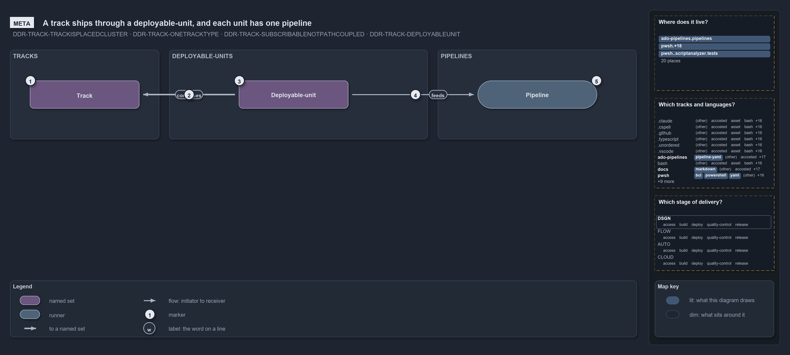

# A track ships through a deployable-unit, and each unit has one pipeline

```text
A track ships through a deployable-unit, and each unit binds one pipeline.

1  Track             one root concern, mapped onto one root folder and named by it
2  Composes into     a unit is a whole track or a reduced composition of one
3  Deployable-unit   what ships
4  Binds one         one unit, one pipeline; two only when DEPLOY splits out of CD
5  Pipeline          the unit's delivery machine

Supports DDR-TRACK-ISPLACEDCLUSTER, DDR-TRACK-ONETRACKTYPE, DDR-TRACK-SUBSCRIBABLENOTPATH
and DDR-TRACK-DEPLOYABLEUNIT (meta lens).
```

Three words carry the delivery side of cats: a track is a concern, a deployable-unit is what ships, and a pipeline is a unit's delivery
machine. The invariant ties them in a line: units are composed from tracks, each unit binds one pipeline, and a pipeline never reaches a
track except through the unit that is that track.

```yml drawio
description: "A track composes into a deployable-unit, and a deployable-unit binds one pipeline: the delivery side in a line."
about:
  rules: [DDR-TRACK-ISPLACEDCLUSTER, DDR-TRACK-ONETRACKTYPE, DDR-TRACK-SUBSCRIBABLENOTPATH, DDR-TRACK-DEPLOYABLEUNIT]
  lens: meta
content:
  title: A track ships through a deployable-unit, and each unit has one pipeline
  kind: explanation
  flow: left-to-right
  theme: dark
  bands:
    - { id: band-tracks, label: TRACKS }
    - { id: band-units, label: DEPLOYABLE-UNITS }
    - { id: band-pipelines, label: PIPELINES }
  glyphs:
    - { id: s-track, kind: set, label: Track, in: band-tracks }
    - { id: s-unit, kind: set, label: Deployable-unit, in: band-units }
    - { id: r-pipeline, kind: runner, label: Pipeline, in: band-pipelines }
  edges:
    - { from: s-unit, to: s-track, kind: thick, label: composes }
    - { from: r-pipeline, to: s-unit, kind: flow, label: reads }
  markers:
    - { at: s-track, number: 1 }
    - { at: s-unit->s-track, number: 2 }
    - { at: s-unit, number: 3 }
    - { at: r-pipeline->s-unit, number: 4 }
    - { at: r-pipeline, number: 5 }
  legend: auto
  minimaps: [code-locations, grid, axis]
layout:
  band-tracks: { x: 20, y: 84, w: 300, h: 180 }
  band-units: { x: 340, y: 84, w: 520, h: 180 }
  band-pipelines: { x: 880, y: 84, w: 400, h: 180 }
  s-track: { x: 60, y: 146, w: 220, h: 56 }
  s-unit: { x: 480, y: 146, w: 220, h: 56 }
  r-pipeline: { x: 960, y: 146, w: 240, h: 56 }
```



## Walkthrough

1. **Track.** One root concern of the repository, mapped onto one root folder and named by it.
2. **Composes into.** A deployable-unit is a reduced composition of tracks; a CI pipeline that verifies a whole track binds the track's own
   set instead. Consumers reach a track only through module dependencies or its globset projection, never by matching its paths.
3. **Deployable-unit.** What ships.
4. **Binds one pipeline.** One unit, one pipeline, widening to two only when a DEPLOY stage splits out of CD. No gate checks it; code review
   holds it.
5. **Pipeline.** The unit's delivery machine.

## Why it holds

- A track is one root concern with one root folder (DDR-TRACK-ISPLACEDCLUSTER).
- Tracks are subscribed to, never path-coupled (DDR-TRACK-SUBSCRIBABLENOTPATH).
- Deployable-units determine CD pipelines one to one, and a CI pipeline that verifies a whole track binds the track's own set
  (DDR-TRACK-DEPLOYABLEUNIT).

A cross-cutting slice, such as every markdown file, is a scope over tracks rather than a track: it selects through the roots and owns none
(DDR-TRACK-ONETRACKTYPE).

## See also

- [Tracks — the repository's root concerns](../../drs/design/tracks.md) — the decision this article explains.
- The other lenses on the same model: [architecture](units-not-tracks-own-the-pipelines.md),
  [implementation](globs-yml-pipeline-field-is-the-binding.md), [operations](a-push-fires-only-touched-pipelines.md) and
  [governance](unit-to-pipeline-rule-is-review-only.md).
- [The design explanations](index.md) · [How to read the diagrams](../index.md#how-to-read-the-diagrams)
