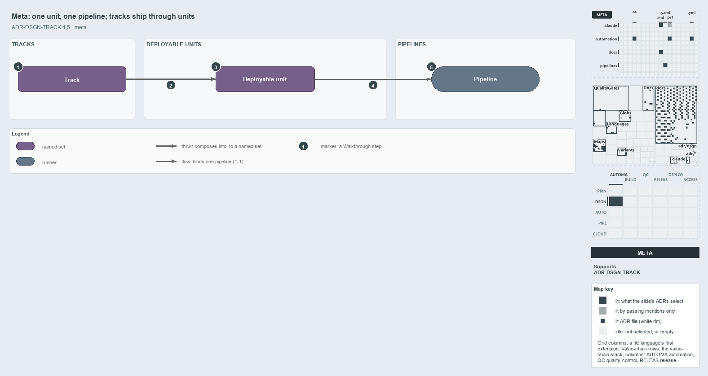

---
catzc:
  immutable:
    with_body_sha: c392cf3de1a3
    path: docs/explanation/design/one-unit-one-pipeline.md
    folder: docs/explanation/design
    name: one-unit-one-pipeline
    filetype: md
    kind: explanation
    language: markdown
    track: docs
    tracktype: documentation
  edges:
    cites:
      - ADR-DSGN-TRACK#{1,2,4,5}
    links:
      - docs/.assets/explanation/adr-dsgn-track--one-unit-one-pipeline--meta.drawio.md
      - docs/.assets/explanation/adr-dsgn-track--one-unit-one-pipeline--meta.drawio.png
      - docs/adr/design/tracks.md
      - docs/explanation/design/a-push-fires-only-touched-pipelines.md
      - docs/explanation/design/globs-yml-pipeline-field-is-the-binding.md
      - docs/explanation/design/index.md
      - docs/explanation/design/unit-to-pipeline-rule-is-review-only.md
      - docs/explanation/design/units-not-tracks-own-the-pipelines.md
      - docs/explanation/index.md#how-to-read-the-diagrams
---

# A track ships through a deployable-unit, and each unit has one pipeline

```text
A track ships through a deployable-unit, and each unit binds one pipeline.

1  Track             one root concern, mapped onto one root folder and named by it
2  Composes into     a unit is a whole track or a reduced composition of one
3  Deployable-unit   what ships
4  Binds one         one unit, one pipeline; two only when DEPLOY splits out of CD
5  Pipeline          the unit's delivery machine

Supports ADR-DSGN-TRACK#1, #2, #4 and #5 (meta lens).
```

Three words carry the delivery side of cats: a track is a concern, a deployable-unit is what ships, and a pipeline is a unit's delivery
machine. The invariant ties them in a line: units are composed from tracks, each unit binds one pipeline, and a pipeline never reaches a
track except through the unit that is that track.



The diagram is described element by element in
[its asset description](../../.assets/explanation/adr-dsgn-track--one-unit-one-pipeline--meta.drawio.md).

## Walkthrough

1. **Track.** One root concern of the repository, mapped onto one root folder and named by it.
2. **Composes into.** A deployable-unit is a whole track or a reduced composition of one. Consumers reach a track only through module
   dependencies or its globset projection, never by matching its paths.
3. **Deployable-unit.** What ships.
4. **Binds one pipeline.** One unit, one pipeline, widening to two only when a DEPLOY stage splits out of CD. No gate checks it; code review
   holds it.
5. **Pipeline.** The unit's delivery machine.

## Why it holds

- A track is one root concern with one root folder (ADR-DSGN-TRACK#1).
- Tracks are subscribed to, never path-coupled (ADR-DSGN-TRACK#4).
- Deployable-units determine pipelines one to one, and a pipeline binds a track only through the unit that is that track (ADR-DSGN-TRACK#5).

A cross-cutting slice, such as every markdown file, is a scope over tracks rather than a track: it selects through the roots and owns none
(ADR-DSGN-TRACK#2).

## Where the code and the ADR differ

The two CI pipelines bind the `automation` and `infrastructure` track sets directly: in `globs.yml` those sets are loose-filesets, not
deployable-units, and carry `pipeline:` themselves, as the globset ADR allows. The tracks ADR asks for a pipeline to bind a track only
through its unit.

## See also

- [Tracks — the repository's root concerns](../../adr/design/tracks.md) — the decision this article explains.
- The other lenses on the same model: [architecture](units-not-tracks-own-the-pipelines.md),
  [implementation](globs-yml-pipeline-field-is-the-binding.md), [operations](a-push-fires-only-touched-pipelines.md) and
  [governance](unit-to-pipeline-rule-is-review-only.md).
- [The design explanations](index.md) · [How to read the diagrams](../index.md#how-to-read-the-diagrams)
