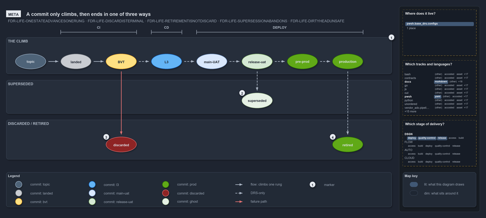

# How a commit climbs the ladder

```text
How a commit climbs the ladder.

1  the climb   eight rungs from topic to production, one state at a time, never backward
2  superseded  a valid commit that a newer commit overtook; never rejected, only not chosen
3  discarded   rejection at a named gate, before any value was delivered
4  retired     a production commit that served and was replaced; a success

Supports FDR-LIFE-ONESTATEADVANCESONERUNG, FDR-LIFE-DISCARDISTERMINAL, FDR-LIFE-RETIREMENTISNOTDISCARD,
FDR-LIFE-SUPERSESSIONABANDONS and FDR-LIFE-DIRTYHEADUNSAFE (meta lens).
```

A commit in cats holds one lifecycle state at a time. It climbs the promotion ladder one rung at a time and never moves backward, because
each colour is a durable fact about the same commit. Off the ladder there are exactly three endings, and all three are terminal: superseded,
discarded and retired. Telling them apart matters because each is a different fact: the pipeline moved fast, the pipeline caught a defect,
or the commit delivered its value.

```yml drawio
description:
  "The eight rungs a commit climbs, one at a time and never backward, and its three endings off the ladder: superseded, drawn as a ghost of
  its last colour, discarded in red at a gate, and retired from production in its kept green."
about:
  rules:
    - FDR-LIFE-ONESTATEADVANCESONERUNG
    - FDR-LIFE-DISCARDISTERMINAL
    - FDR-LIFE-RETIREMENTISNOTDISCARD
    - FDR-LIFE-SUPERSESSIONABANDONS
    - FDR-LIFE-DIRTYHEADUNSAFE
  lens: meta
content:
  title: How a commit climbs the ladder
  kind: explanation
  flow: left-to-right
  relation: climbs one rung
  states: true
  theme: dark
  bands:
    - { id: band-climb, label: THE CLIMB }
    - { id: band-superseded, label: SUPERSEDED }
    - { id: band-ended, label: DISCARDED / RETIRED }
  spans:
    - id: span-ci
      label: CI
      over: [c-landed, c-bvt]
    - id: span-cd
      label: CD
      over: [c-l3]
    - id: span-deploy
      label: DEPLOY
      over: [c-main-uat, c-release-uat, c-pre-prod, c-production]
  glyphs:
    - { id: c-topic, kind: commit, label: topic, in: band-climb, state: topic }
    - { id: c-landed, kind: commit, label: landed, in: band-climb, state: landed }
    - { id: c-bvt, kind: commit, label: BVT, in: band-climb }
    - { id: c-l3, kind: commit, label: L3, in: band-climb, state: l3 }
    - { id: c-main-uat, kind: commit, label: main-UAT, in: band-climb, state: main-uat }
    - { id: c-release-uat, kind: commit, label: release-uat, in: band-climb, state: release-uat }
    - { id: c-pre-prod, kind: commit, label: pre-prod, in: band-climb, state: prod }
    - { id: c-production, kind: commit, label: production, in: band-climb, state: prod }
    - { id: c-superseded, kind: commit, label: superseded, in: band-superseded, state: release-uat, ghost: true }
    - { id: c-discarded, kind: commit, label: discarded, in: band-ended, state: discarded }
    - { id: c-retired, kind: commit, label: retired, in: band-ended, state: prod }
  edges:
    - { from: c-topic, to: c-landed, kind: flow, label: "" }
    - { from: c-landed, to: c-bvt, kind: flow, label: "" }
    - { from: c-bvt, to: c-l3, kind: record, label: "" }
    - { from: c-l3, to: c-main-uat, kind: record, label: "" }
    - { from: c-main-uat, to: c-release-uat, kind: record, label: "" }
    - { from: c-release-uat, to: c-pre-prod, kind: record, label: "" }
    - { from: c-pre-prod, to: c-production, kind: record, label: "" }
    - { from: c-release-uat, to: c-superseded, kind: record, label: "" }
    - { from: c-bvt, to: c-discarded, kind: fail, label: "" }
    - { from: c-production, to: c-retired, kind: record, label: "" }
  markers:
    - { at: band-climb, number: 1, corner: top-right }
    - { at: c-superseded, number: 2 }
    - { at: c-discarded, number: 3 }
    - { at: c-retired, number: 4 }
  legend: auto
  minimaps: [code-locations, grid, axis]
layout:
  band-climb: { x: 20, y: 84, w: 1260, h: 120 }
  band-superseded: { x: 20, y: 224, w: 1260, h: 110 }
  band-ended: { x: 20, y: 354, w: 1260, h: 130 }
  c-topic: { x: 50, y: 138, w: 100, h: 50 }
  c-landed: { x: 198, y: 138, w: 100, h: 50 }
  c-bvt: { x: 346, y: 138, w: 100, h: 50 }
  c-l3: { x: 494, y: 138, w: 100, h: 50 }
  c-main-uat: { x: 642, y: 138, w: 100, h: 50 }
  c-release-uat: { x: 790, y: 138, w: 100, h: 50 }
  c-pre-prod: { x: 938, y: 138, w: 100, h: 50 }
  c-production: { x: 1086, y: 138, w: 100, h: 50 }
  c-superseded: { x: 790, y: 266, w: 100, h: 50 }
  c-discarded: { x: 346, y: 410, w: 100, h: 50 }
  c-retired: { x: 1086, y: 410, w: 100, h: 50 }
```



## Walkthrough

1. **The climb.** Eight rungs in order: topic, landed, BVT, L3, main-UAT, release-uat, pre-prod and production. A commit holds one state at
   a time, climbs one rung at a time and never regresses; a new attempt is a new commit. The pipelines carry a commit from topic to BVT;
   every rung after that is stated by the FDR alone.
2. **Superseded.** A valid commit that a newer commit overtook and rolled over. It was never rejected, only not chosen, and it is drawn as a
   ghost of its last colour. The ghost here is light green, after the FDR's worked example 3, which was superseded at release-uat.
3. **Discarded.** Rejection at a gate, before any value was delivered. BVT and L3 discard automatically, release-uat by hand at RBC, and
   main-UAT can kill a commit or hold it at RC. The commit turns red, stays in history, and can never progress. The pipelines stop a commit
   whose CI stage fails, so nothing downstream runs on it.
4. **Retired.** A commit that reached production, served there, and was replaced by a newer production commit. Retirement is a success: the
   commit keeps its green and is never repainted red.

## Why it holds

- A commit advances one rung or leaves the ladder, and never moves backward (FDR-LIFE-ONESTATEADVANCESONERUNG).
- Discard is terminal rejection at a named stage, and the discarded commit stays in history (FDR-LIFE-DISCARDISTERMINAL).
- Retirement is a successful end of life, not a discard (FDR-LIFE-RETIREMENTISNOTDISCARD).
- Supersession abandons a still-valid commit that a newer one overtook (FDR-LIFE-SUPERSESSIONABANDONS).
- A commit that fails a stage cannot go downstream (FDR-LIFE-DIRTYHEADUNSAFE).
- The endings each have their own rendering: red for discarded, kept green for retired, a ghost for superseded (DDR-VISUAL-DISTINCTENDINGS).

## See also

- [The commit lifecycle](../../drs/flow/commit-lifecycle.md) — the decision this article explains.
- [Visual design](../../drs/design/visual-design.md) — the commit palette and how each ending is rendered.
- The other lenses on the same lifecycle: [architecture](how-one-build-reaches-production.md),
  [implementation](code-wires-only-the-first-rungs.md), [operations](who-does-what-from-merge-to-production.md) and
  [governance](which-ladder-rungs-have-a-gate-in-code.md).
- [The design explanations](index.md) · [How to read the diagrams](../index.md#how-to-read-the-diagrams)
