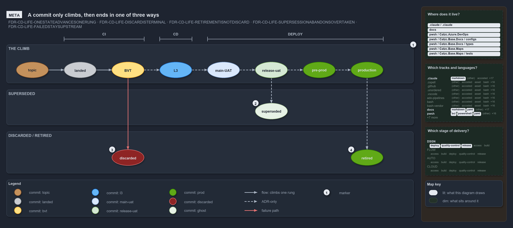

# A commit only climbs, then ends in one of three ways

```text
A commit only climbs the promotion ladder, then ends superseded, discarded or retired.

1  the climb   eight rungs from topic to production, one state at a time, never backward
2  superseded  a valid commit that a newer commit overtook; never rejected, only not chosen
3  discarded   rejection at a named gate, before any value was delivered
4  retired     a production commit that served and was replaced; a success

Supports ADR-DSGN-LIFE-ONESTATEADVANCESONERUNG, ADR-DSGN-LIFE-DISCARDISTERMINAL, ADR-DSGN-LIFE-RETIREMENTISNOTDISCARD, ADR-DSGN-LIFE-SUPERSESSIONABANDONSOVERTAKEN and ADR-DSGN-LIFE-FAILEDSTAYSUPSTREAM (meta lens).
```

A commit in cats holds one lifecycle state at a time. It climbs the promotion ladder one rung at a time and never moves backward, because
each colour is a durable fact about the same commit. Off the ladder there are exactly three endings, and all three are terminal: superseded,
discarded and retired. Telling them apart matters because each is a different fact: the pipeline moved fast, the pipeline caught a defect,
or the commit delivered its value.



The diagram is described element by element in [its asset description](.assets/one-way-climb-three-endings/diagram.drawio.md).

## Walkthrough

1. **The climb.** Eight rungs in order: topic, landed, BVT, L3, main-UAT, release-uat, pre-prod and production. A commit holds one state at
   a time, climbs one rung at a time and never regresses; a new attempt is a new commit. The pipelines carry a commit from topic to BVT;
   every rung after that is stated by the ADR alone.
2. **Superseded.** A valid commit that a newer commit overtook and rolled over. It was never rejected, only not chosen, and it is drawn as a
   ghost of its last colour. The ghost here is light green, after the ADR's worked example 3, which was superseded at release-uat.
3. **Discarded.** Rejection at a gate, before any value was delivered. BVT and L3 discard automatically, release-uat by hand at RBC, and
   main-UAT can kill a commit or hold it at RC. The commit turns red, stays in history, and can never progress. The pipelines stop a commit
   whose CI stage fails, so nothing downstream runs on it.
4. **Retired.** A commit that reached production, served there, and was replaced by a newer production commit. Retirement is a success: the
   commit keeps its green and is never repainted red.

## Why it holds

- A commit advances one rung or leaves the ladder, and never moves backward (ADR-DSGN-LIFE-ONESTATEADVANCESONERUNG).
- Discard is terminal rejection at a named stage, and the discarded commit stays in history (ADR-DSGN-LIFE-DISCARDISTERMINAL).
- Retirement is a successful end of life, not a discard (ADR-DSGN-LIFE-RETIREMENTISNOTDISCARD).
- Supersession abandons a still-valid commit that a newer one overtook (ADR-DSGN-LIFE-SUPERSESSIONABANDONSOVERTAKEN).
- A commit that fails a stage cannot go downstream (ADR-DSGN-LIFE-FAILEDSTAYSUPSTREAM).
- The endings each have their own rendering: red for discarded, kept green for retired, a ghost for superseded
  (ADR-DSGN-VISUAL-DISTINCTENDINGS).

## See also

- [The commit lifecycle](../../adr/design/commit-lifecycle.md) — the decision this article explains.
- [Visual design](../../adr/design/visual-design.md) — the commit palette and how each ending is rendered.
- The other lenses on the same lifecycle: [architecture](four-domains-promote-one-artifact.md),
  [implementation](code-wires-only-the-first-rungs.md), [operations](engineer-merges-pipelines-do-the-rest.md) and
  [governance](which-rung-gates-exist-in-code.md).
- [The design explanations](index.md) · [How to read the diagrams](../index.md#how-to-read-the-diagrams)
