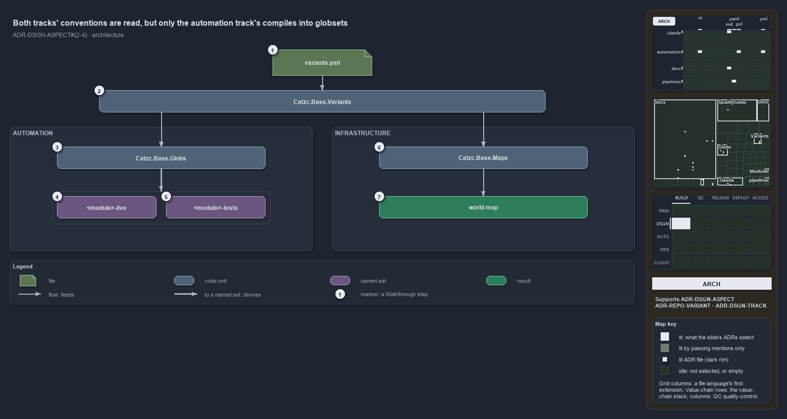

# Both tracks' conventions are read, but only the automation track's compiles into globsets

```text
Both tracks' conventions are read, but only the automation track's compiles into globsets.

1  variants.yml         the one home of the aspects variant, one ordered entry per track
2  Catzc.Base.Variants  reads the file once per session and answers Get-Aspect per track
3  Catzc.Base.Globs     compiles the automation convention onto every module folder
4  <module>-live        the derived globset of a module's live aspect
5  <module>-tests       the derived globset of a module's tests aspect, the remainder
6  Catzc.Base.Maps      reads every track's convention to classify each file live or not
7  world map            what Maps produces; it derives no globset

Supports ADR-DSGN-ASPECT#2, #3 and #4, ADR-REPO-VARIANT#1 and #2, and ADR-DSGN-TRACK#3 (architecture lens).
```

The aspect convention of cats is declared once, in the `aspects` variant, and read by one module, `Catzc.Base.Variants`. Two other modules
depend on that reader, and they use the convention differently. `Catzc.Base.Globs` compiles the automation track's entry onto every module
folder and derives two globsets per module. `Catzc.Base.Maps` reads every track's entry, the infrastructure one included, but only to decide
whether a file is live for the world map. No part of cats derives a globset from the infrastructure convention.



The diagram is described element by element in [its asset description](only-automation-compiles-its-aspects.drawio.md).

## Walkthrough

1. **variants.yml.** The configuration file of `Catzc.Base.Variants` and the one home of every repo-wide variant. Its `aspects` entry is a
   map from track to an ordered list of aspects: `automation` lists `live` then `tests`, `infrastructure` lists `tests` then `live`.
2. **Catzc.Base.Variants.** The module that owns the file. Nothing else reads it: the private `Get-Variant` reads the typed config, which
   the session caches, and `Get-Aspect -Track <track>` returns that track's list in declared order, so a change to the file takes effect
   when the importer runs again.
3. **Catzc.Base.Globs.** The aspect engine. `Get-ModuleGlobSet` asks for the automation convention and compiles it onto every module folder
   under `automation/` with `AspectPartition`, so each aspect becomes a scan program over that one unit root.
4. **The module's live set.** One derived globset per module, named `<module>-live` in kebab form. It is the module's shippable surface, and
   it carries an identity of its own.
5. **The module's tests set.** The second derived globset, `<module>-tests`: everything under the module that `live` did not claim, plus the
   module's Go, Python and Bash test folders. A test-only change re-keys this set and never the live one.
6. **Catzc.Base.Maps.** The second consumer. `Get-WorldMap` asks for the convention of every track that has an entry, and the world-map
   builder classifies each tracked file by first match on its track's aspects: the file is live exactly when the first aspect that matches
   is named `live`. The infrastructure convention is read here, and nowhere else.
7. **World map.** What Maps produces: every tracked file placed by track and file language, with a live flag per file. The classification
   feeds the stack check and the highlight; it derives no globset, so no `<template>-live` or `<template>-tests` set exists.

## Why it holds

- A repo-wide variant lives in `configs/variants.yml` of `Catzc.Base.Variants` and is read through the session-cached config; `aspects` is
  one of them, read by `Get-Aspect` (ADR-REPO-VARIANT#1).
- Nothing reads the file directly: each variant is a typed primitive, and the private `Get-Variant` is the one access point
  (ADR-REPO-VARIANT#2).
- The aspect engine compiles each aspect as its own patterns minus every earlier aspect's, prefixed by the unit root (ADR-DSGN-ASPECT#2),
  and each track names its own remainder (ADR-DSGN-ASPECT#3).
- Each aspect is its own derived globset, `<unit>-<aspect>`, with its own live identity and nothing committed per set (ADR-DSGN-ASPECT#4).
- A track owns one coherent tech-stack, and the world map checks it on live files only, which is why Maps needs every track's convention to
  tell live files from the rest (ADR-DSGN-TRACK#3).

## Where the code and the ADR differ

- The ADR partitions every delivery package at track granularity by the same convention, and says a track's `-live` and `-tests` packages
  use it when derived. No code derives them: the compiler runs only for `automation/<Module>` roots, and Maps classifies without deriving.
- The reference page of the aspect type (`Aspect.cs.md`) names `Get-ModuleAspect` as the PowerShell side that builds the sets; that
  function does not exist, and `Get-ModuleGlobSet` builds them.
- The ADR prefixes every aspect pattern with the unit root; the derived `tests` set also reaches the language test folders outside it.

## See also

- [Module aspects](../../adr/design/module-aspects.md) — the decision this article explains. Also
  [repo-wide variants](../../adr/repository/repo-variants.md) and [tracks](../../adr/design/tracks.md).
- The other lenses on the same catch-all: [meta](each-track-picks-its-catch-all.md), [implementation](get-aspect-feeds-globs-and-maps.md),
  [operations](get-aspect-names-the-remainder.md) and [governance](gate-checks-order-not-liveness.md).
- [The design explanations](index.md) · [How to read the diagrams](../index.md#how-to-read-the-diagrams)
