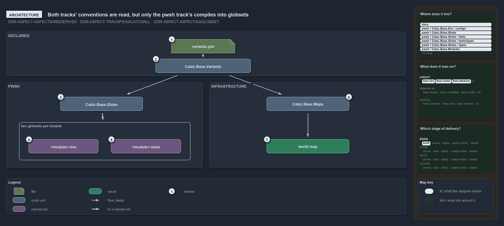

---
catzc:
  warning: "Header is generated by Format-FileMeta via Format-Code; do not change it"
  edges:
    cites:
      - ADR-REPO-VARIANT-SESSIONVARIANT
      - ADR-REPO-VARIANT-NODIRECTREADS
      - DDR-ASPECT-ASPECTSAREDERIVED
      - DDR-ASPECT-TRACKPICKSCATCHALL
      - DDR-ASPECT-ASPECTISAGLOBSET
      - DDR-TRACK-ONETECHSTACK
    drs_total: 6
---

# Both tracks' conventions are read, but only the pwsh track's compiles into globsets

```text
Both tracks' conventions are read, but only the pwsh track's compiles into globsets.

1  variants.yml         the home of the declared aspects: the infrastructure entry
2  Catzc.Base.Variants  reads the file once per session and answers the declared aspects
3  Catzc.Base.Globs     compiles the pwsh convention, from languages.yml, per module
4  <module>-live        the derived globset of a module's live aspect
5  <module>-tests       the derived globset of a module's tests aspect, the remainder
6  Catzc.Base.Maps      reads every track's convention to classify each file live or not
7  world map            what Maps produces; it derives no globset

Supports DDR-ASPECT-ASPECTSAREDERIVED, DDR-ASPECT-TRACKPICKSCATCHALL and DDR-ASPECT-ASPECTISAGLOBSET (architecture lens).
```

A track's aspect convention is declared in the `aspects` variant, read by one module, `Catzc.Base.Variants`, or for the code track derived
from the layout of `languages.yml`. Two other modules take the conventions, and they use them differently. `Catzc.Base.Globs` compiles the
pwsh track's convention onto every module folder and derives two globsets per module. `Catzc.Base.Maps` reads every track's entry, the
infrastructure one included, but only to decide whether a file is live for the world map. No part of cats derives a globset from the
infrastructure convention.

```yml drawio
description:
  "The aspect conventions are declared in one variants file and read by two modules: the globs engine compiles only the pwsh convention into
  a live and a tests globset per module, while the maps module reads every track's convention to classify files and derives no globset."
about:
  adrs: [DDR-ASPECT-ASPECTSAREDERIVED, DDR-ASPECT-TRACKPICKSCATCHALL, DDR-ASPECT-ASPECTISAGLOBSET]
  lens: architecture
content:
  title: Both tracks' conventions are read, but only the pwsh track's compiles into globsets
  kind: explanation
  flow: left-to-right
  relation: feeds
  theme: dark
  bands:
    - { id: band-declared, label: DECLARED }
    - { id: band-pwsh, label: PWSH }
    - { id: band-infrastructure, label: INFRASTRUCTURE }
  groups:
    - { id: grp-globsets, label: two globsets per module, in: band-pwsh }
  glyphs:
    - { id: g-variants-yml, kind: file, label: variants.yml, in: band-declared }
    - { id: g-variants, kind: code, label: Catzc.Base.Variants, in: band-declared }
    - { id: g-globs, kind: code, label: Catzc.Base.Globs, in: band-pwsh }
    - { id: g-live, kind: set, label: <module>-live, in: grp-globsets }
    - { id: g-tests, kind: set, label: <module>-tests, in: grp-globsets }
    - { id: g-maps, kind: code, label: Catzc.Base.Maps, in: band-infrastructure }
    - { id: r-world-map, kind: result, label: world map, in: band-infrastructure }
  edges:
    - { from: g-variants-yml, to: g-variants, kind: flow, label: "" }
    - { from: g-variants, to: g-globs, kind: flow, label: "" }
    - { from: g-variants, to: g-maps, kind: flow, label: "" }
    - { from: g-globs, to: grp-globsets, kind: thick, label: "" }
    - { from: g-maps, to: r-world-map, kind: flow, label: "" }
  markers:
    - { at: g-variants-yml, number: 1 }
    - { at: g-variants, number: 2 }
    - { at: g-globs, number: 3 }
    - { at: g-live, number: 4 }
    - { at: g-tests, number: 5 }
    - { at: g-maps, number: 6 }
    - { at: r-world-map, number: 7 }
  legend: auto
  minimaps:
    code-locations:
      - cell: docs/-/.
        by:
          - docs/drs/design/dora-explains.md
          - docs/drs/design/module-aspects.md
          - docs/drs/index.md
          - docs/references/pwsh/catzc-base-globs/Get-ModuleGlobSet.ps1.md
          - docs/references/pwsh/catzc-base-globs/tests/types/Aspect.Tests.ps1.md
          - docs/references/pwsh/catzc-base-globs/types/Aspect.cs.md
          - docs/references/pwsh/catzc-base-modules/Get-Aspect.ps1.md
          - docs/references/pwsh/catzc-base-quality-gates/private/Get-ModuleProtectionIdentity.ps1.md
          - docs/references/pwsh/catzc-base-variants/configs/variants.yml.md
          - docs/references/pwsh/catzc-base-variants/types/VariantAspect.cs.md
          - docs/references/pwsh/catzc-base-variants/types/VariantsConfig.cs.md
          - DDR-ASPECT-ASPECTISAGLOBSET
          - DDR-ASPECT-ASPECTSAREDERIVED
          - DDR-ASPECT-TRACKPICKSCATCHALL
      - cell: pwsh/Catzc.Base.Drs/configs
        by: [pwsh/Catzc.Base.Drs/configs/drs.yml, DDR-ASPECT-ASPECTISAGLOBSET, DDR-ASPECT-ASPECTSAREDERIVED, DDR-ASPECT-TRACKPICKSCATCHALL]
      - cell: pwsh/Catzc.Base.Globs/.
        by:
          - pwsh/Catzc.Base.Globs/Get-ModuleGlobSet.ps1
          - DDR-ASPECT-ASPECTISAGLOBSET
          - DDR-ASPECT-ASPECTSAREDERIVED
          - DDR-ASPECT-TRACKPICKSCATCHALL
      - cell: pwsh/Catzc.Base.Globs/tests
        by:
          - pwsh/Catzc.Base.Globs/tests/Get-ModuleGlobSet.Tests.ps1
          - DDR-ASPECT-ASPECTISAGLOBSET
          - DDR-ASPECT-ASPECTSAREDERIVED
          - DDR-ASPECT-TRACKPICKSCATCHALL
      - cell: pwsh/Catzc.Base.Globs/tests/types
        by:
          - pwsh/Catzc.Base.Globs/tests/types/Aspect.Tests.ps1
          - DDR-ASPECT-ASPECTISAGLOBSET
          - DDR-ASPECT-ASPECTSAREDERIVED
          - DDR-ASPECT-TRACKPICKSCATCHALL
      - cell: pwsh/Catzc.Base.Globs/types
        by:
          - pwsh/Catzc.Base.Globs/types/Aspect.cs
          - DDR-ASPECT-ASPECTISAGLOBSET
          - DDR-ASPECT-ASPECTSAREDERIVED
          - DDR-ASPECT-TRACKPICKSCATCHALL
      - cell: pwsh/Catzc.Base.Modules/.
        by:
          - pwsh/Catzc.Base.Modules/Get-Aspect.ps1
          - DDR-ASPECT-ASPECTISAGLOBSET
          - DDR-ASPECT-ASPECTSAREDERIVED
          - DDR-ASPECT-TRACKPICKSCATCHALL
      - cell: pwsh/Catzc.Base.Modules/tests
        by:
          - pwsh/Catzc.Base.Modules/tests/Get-Aspect.Tests.ps1
          - DDR-ASPECT-ASPECTISAGLOBSET
          - DDR-ASPECT-ASPECTSAREDERIVED
          - DDR-ASPECT-TRACKPICKSCATCHALL
      - cell: pwsh/Catzc.Base.QualityGates/private
        by:
          - pwsh/Catzc.Base.QualityGates/private/Get-ModuleProtectionIdentity.ps1
          - DDR-ASPECT-ASPECTISAGLOBSET
          - DDR-ASPECT-ASPECTSAREDERIVED
          - DDR-ASPECT-TRACKPICKSCATCHALL
      - cell: pwsh/Catzc.Base.Variants/configs
        by:
          - pwsh/Catzc.Base.Variants/configs/variants.yml
          - DDR-ASPECT-ASPECTISAGLOBSET
          - DDR-ASPECT-ASPECTSAREDERIVED
          - DDR-ASPECT-TRACKPICKSCATCHALL
      - cell: pwsh/Catzc.Base.Variants/types
        by:
          - pwsh/Catzc.Base.Variants/types/VariantAspect.cs
          - pwsh/Catzc.Base.Variants/types/VariantsConfig.cs
          - DDR-ASPECT-ASPECTISAGLOBSET
          - DDR-ASPECT-ASPECTSAREDERIVED
          - DDR-ASPECT-TRACKPICKSCATCHALL
    module-neighbourhood:
      - cell: subject/Catzc.Base.Drs
        by: [pwsh/Catzc.Base.Drs/configs/drs.yml, DDR-ASPECT-ASPECTISAGLOBSET, DDR-ASPECT-ASPECTSAREDERIVED, DDR-ASPECT-TRACKPICKSCATCHALL]
      - cell: subject/Catzc.Base.Globs
        by:
          - pwsh/Catzc.Base.Globs/Get-ModuleGlobSet.ps1
          - pwsh/Catzc.Base.Globs/tests/Get-ModuleGlobSet.Tests.ps1
          - pwsh/Catzc.Base.Globs/tests/types/Aspect.Tests.ps1
          - pwsh/Catzc.Base.Globs/types/Aspect.cs
          - DDR-ASPECT-ASPECTISAGLOBSET
          - DDR-ASPECT-ASPECTSAREDERIVED
          - DDR-ASPECT-TRACKPICKSCATCHALL
      - cell: subject/Catzc.Base.Modules
        by:
          - pwsh/Catzc.Base.Modules/Get-Aspect.ps1
          - pwsh/Catzc.Base.Modules/tests/Get-Aspect.Tests.ps1
          - DDR-ASPECT-ASPECTISAGLOBSET
          - DDR-ASPECT-ASPECTSAREDERIVED
          - DDR-ASPECT-TRACKPICKSCATCHALL
      - cell: subject/Catzc.Base.QualityGates
        by:
          - pwsh/Catzc.Base.QualityGates/private/Get-ModuleProtectionIdentity.ps1
          - DDR-ASPECT-ASPECTISAGLOBSET
          - DDR-ASPECT-ASPECTSAREDERIVED
          - DDR-ASPECT-TRACKPICKSCATCHALL
      - cell: subject/Catzc.Base.Variants
        by:
          - pwsh/Catzc.Base.Variants/configs/variants.yml
          - pwsh/Catzc.Base.Variants/types/VariantAspect.cs
          - pwsh/Catzc.Base.Variants/types/VariantsConfig.cs
          - DDR-ASPECT-ASPECTISAGLOBSET
          - DDR-ASPECT-ASPECTSAREDERIVED
          - DDR-ASPECT-TRACKPICKSCATCHALL
    axis:
      - cell: DSGN/build
        by: [DDR-ASPECT-ASPECTISAGLOBSET, DDR-ASPECT-ASPECTSAREDERIVED, DDR-ASPECT-TRACKPICKSCATCHALL]
layout:
  band-declared: { x: 20, y: 84, w: 1260, h: 140 }
  band-pwsh: { x: 20, y: 244, w: 620, h: 270 }
  band-infrastructure: { x: 660, y: 244, w: 620, h: 270 }
  g-variants-yml: { x: 540, y: 108, w: 200, h: 44 }
  g-variants: { x: 490, y: 170, w: 300, h: 44 }
  g-globs: { x: 190, y: 290, w: 260, h: 44 }
  grp-globsets: { x: 60, y: 370, w: 540, h: 120 }
  g-live: { x: 90, y: 424, w: 220, h: 44 }
  g-tests: { x: 350, y: 424, w: 220, h: 44 }
  g-maps: { x: 840, y: 290, w: 260, h: 44 }
  r-world-map: { x: 840, y: 424, w: 260, h: 44 }
```



## Walkthrough

1. **variants.yml.** The configuration file of `Catzc.Base.Variants` and the one home of every repo-wide variant. Its `aspects` entry is a
   map from track to an ordered list of aspects: `infrastructure` lists `tests` then `live`. The code track `pwsh` declares no entry; its
   convention is the layout of `languages.yml`, `live` then `tests`.
2. **Catzc.Base.Variants.** The module that owns the file. Nothing else reads it: the private `Get-Variant` reads the typed config, which
   the session caches, and `Get-AspectDeclaration` returns the declared lists, so a change to the file takes effect when the importer runs
   again. `Get-Aspect -Track <track>` in `Catzc.Base.Modules` answers a track's list from them, or from the layout for the code track.
3. **Catzc.Base.Globs.** The aspect engine. `Get-ModuleGlobSet` asks for the pwsh convention and compiles it onto every module folder under
   `pwsh/` with `AspectPartition`, so each aspect becomes a scan program over that one unit root.
4. **The module's live set.** One derived globset per module, named `<module>-live` in kebab form. It is the module's shippable surface, and
   it carries an identity of its own.
5. **The module's tests set.** The second derived globset, `<module>-tests`: everything under the module that `live` did not claim, plus the
   module's Go, Python and Bash test folders. A test-only change re-keys this set and never the live one.
6. **Catzc.Base.Maps.** The second consumer. `Get-WorldMap` asks for the convention of every track that has an entry, and the world-map
   builder classifies each tracked file by first match on its track's aspects: the file is live exactly when the first aspect that matches
   is named `live`. The infrastructure convention is read here, and nowhere else.
7. **World map.** What Maps produces: every tracked file placed by track and file language, with a live flag per file. The classification
   feeds the stack check and the highlight; it derives no globset, so no `<template>-live` or `<template>-tests` set exists.

## Why it holds

- A repo-wide variant lives in `configs/variants.yml` of `Catzc.Base.Variants` and is read through the session-cached config; `aspects` is
  one of them, read by `Get-Aspect` (ADR-REPO-VARIANT-SESSIONVARIANT).
- Nothing reads the file directly: each variant is a typed primitive, and the private `Get-Variant` is the one access point
  (ADR-REPO-VARIANT-NODIRECTREADS).
- The aspect engine compiles each aspect as its own patterns minus every earlier aspect's, prefixed by the unit root
  (DDR-ASPECT-ASPECTSAREDERIVED), and each track names its own remainder (DDR-ASPECT-TRACKPICKSCATCHALL).
- Each aspect is its own derived globset, `<unit>-<aspect>`, with its own live identity and nothing committed per set
  (DDR-ASPECT-ASPECTISAGLOBSET).
- A track owns one coherent tech-stack, and the world map checks it on live files only, which is why Maps needs every track's convention to
  tell live files from the rest (DDR-TRACK-ONETECHSTACK).

## Where the code and the decision record differ

- The DDR partitions every delivery package at track granularity by the same convention, and says a track's `-live` and `-tests` packages
  use it when derived. No code derives them: the compiler runs only for `pwsh/<Module>` roots, and Maps classifies without deriving.
- The reference page of the aspect type (`Aspect.cs.md`) names `Get-ModuleAspect` as the PowerShell side that builds the sets; that function
  does not exist, and `Get-ModuleGlobSet` builds them.
- The DDR prefixes every aspect pattern with the unit root; the derived `tests` set also reaches the language test folders outside it.

## See also

- [Module aspects](../../drs/design/module-aspects.md) — the decision this article explains. Also
  [repo-wide variants](../../drs/repository/repo-variants.md) and [tracks](../../drs/design/tracks.md).
- The other lenses on the same catch-all: [meta](each-track-picks-its-catch-all.md), [implementation](get-aspect-feeds-globs-and-maps.md),
  [operations](get-aspect-names-the-remainder.md) and [governance](gate-checks-order-not-liveness.md).
- [The design explanations](index.md) · [How to read the diagrams](../index.md#how-to-read-the-diagrams)
