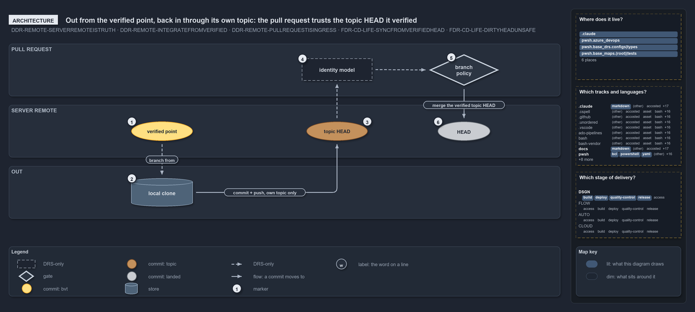

# Out from the verified point, back in through its own topic: the pull request trusts the topic HEAD it verified

```text
Out from the verified point, back in through its own topic: the pull request trusts the topic HEAD it verified.

1  verified point   the stable integration point, the BVT-verified server head; every clone leaves from here
2  local clone      the same working copy; it commits and pushes upward, only to its own topic branch on the server
3  topic HEAD       the server's tip of that topic branch; the only remote ref the clone ever writes
4  identity model   the pull request authenticates the author of the topic HEAD; only the server runs it
5  branch policy    the merge gates verify that topic HEAD, then the server merges it
6  HEAD             the tip of the server's main; the merge lands here, from the verified topic HEAD, never from the clone

Supports DDR-REMOTE-SERVERREMOTEISTRUTH, DDR-REMOTE-INTEGRATEFROMVERIFIED and DDR-REMOTE-PULLREQUESTISINGRESS, and FDR-CD-LIFE-SYNCFROMVERIFIEDHEAD and FDR-CD-LIFE-DIRTYHEADUNSAFE (architecture lens).
```

A clone never writes the server's main. It leaves from the verified point, works, and pushes upward to one remote ref it owns: its own topic
branch on the server. From there the pull request takes over. It authenticates the author of that topic HEAD, runs the merge gates against
that topic HEAD, and merges that verified topic HEAD into main. The clone is trusted for nothing; the server trusts only what it verified
itself. The way in from a fresh clone is the previous drawing, [clients bridge to one server remote](clients-bridge-to-one-server.md).

```yml drawio
description:
  A local clone leaves from the verified point, commits and pushes upward to its own topic branch on the server remote, and the pull request
  authenticates and verifies that topic HEAD before merging it into HEAD.
about:
  adrs:
    - DDR-REMOTE-SERVERREMOTEISTRUTH
    - DDR-REMOTE-INTEGRATEFROMVERIFIED
    - DDR-REMOTE-PULLREQUESTISINGRESS
    - FDR-CD-LIFE-SYNCFROMVERIFIEDHEAD
    - FDR-CD-LIFE-DIRTYHEADUNSAFE
  lens: architecture
content:
  title: "Out from the verified point, back in through its own topic: the pull request trusts the topic HEAD it verified"
  kind: explanation
  flow: top-to-bottom
  relation: a commit moves to
  theme: dark
  bands:
    - { id: band-request, label: PULL REQUEST }
    - { id: band-remote, label: SERVER REMOTE }
    - { id: band-out, label: OUT }
  glyphs:
    - { id: g-identity, kind: drsonly, label: identity model, in: band-request }
    - { id: g-policy, kind: gate, label: branch policy, in: band-request }
    - { id: c-verified, kind: commit, label: verified point, in: band-remote }
    - { id: c-topic, kind: commit, label: topic HEAD, in: band-remote, state: topic }
    - { id: c-head, kind: commit, label: HEAD, in: band-remote, state: landed }
    - { id: s-clone, kind: store, label: local clone, in: band-out }
  edges:
    - { from: c-verified, to: s-clone, kind: adr, label: "branch from" }
    - { from: s-clone, to: c-topic, kind: flow, label: "commit + push, own topic only", via: [[770, 424]] }
    - { from: c-topic, to: g-identity, kind: adr, label: "" }
    - { from: g-identity, to: g-policy, kind: adr, label: "" }
    - { from: g-policy, to: c-head, kind: flow, label: "merge the verified topic HEAD" }
  markers:
    - { at: c-verified, number: 1 }
    - { at: s-clone, number: 2 }
    - { at: c-topic, number: 3 }
    - { at: g-identity, number: 4 }
    - { at: g-policy, number: 5 }
    - { at: c-head, number: 6 }
  legend: auto
  minimaps: [code-locations, grid, axis]
layout:
  band-request: { x: 20, y: 84, w: 1260, h: 120 }
  band-remote: { x: 20, y: 224, w: 1260, h: 120 }
  band-out: { x: 20, y: 364, w: 1260, h: 120 }
  g-identity: { x: 690, y: 118, w: 160, h: 50 }
  g-policy: { x: 980, y: 108, w: 160, h: 72 }
  c-verified: { x: 300, y: 262, w: 140, h: 44 }
  c-topic: { x: 700, y: 262, w: 140, h: 44 }
  c-head: { x: 1000, y: 262, w: 120, h: 44 }
  s-clone: { x: 300, y: 392, w: 140, h: 64 }
```



## Walkthrough

1. **Verified point.** The last commit the server proved verified is the stable integration point. A developer branches from it, a
   downstream deployable unit builds against it, and an upstream integrator syncs to it. No code resolves the verified point yet, so this
   edge is dashed.
2. **Local clone.** The same working copy as the way in. It commits locally and pushes upward, and the only remote ref it ever writes is its
   own topic branch on the server. It has no authority over main.
3. **Topic HEAD.** The server's tip of that topic branch. It is the commit the pull request is about: the clone's push ends here and nothing
   of the clone reaches further.
4. **Identity model.** The pull request authenticates the author of the topic HEAD against the server's identity model. The server does
   this; no code in cats runs or checks it.
5. **Branch policy.** The mandatory merge gates run against that topic HEAD, so what the server verifies is the ref it holds, never the
   clone. In cats the policy is a set of blocking build validations on `main`, registered from code.
6. **HEAD.** The server merges the verified topic HEAD into the tip of main. Landing is not verifying: HEAD may be a dirty HEAD, so the next
   clone leaves from the verified point again, not from here.

## Why it holds

- The server remote is the single source of truth, and a clone only ever writes its own topic branch on it (DDR-REMOTE-SERVERREMOTEISTRUTH).
- Consumers leave from the last remote-verified commit, never the current remote HEAD (DDR-REMOTE-INTEGRATEFROMVERIFIED).
- The pull request authenticates the author, runs the merge gates on the topic HEAD and performs the merge: the server trusts what it
  verified, never the clone (DDR-REMOTE-PULLREQUESTISINGRESS).
- The stable integration point is the BVT-verified server head (FDR-CD-LIFE-SYNCFROMVERIFIEDHEAD), and the dirty HEAD is never a source to
  leave from (FDR-CD-LIFE-DIRTYHEADUNSAFE).

## Where the code and the decision record differ

- The DDR has every consumer leave from the last verified commit, but no function or pipeline in cats resolves that commit, and the
  pipelines trigger on `main`.
- The DDR has the server branch policy admit merges only through a pull request, but cats registers only build-validation policies on Azure
  DevOps, sets no direct-push rule, and has nothing for GitHub.

## See also

- [Clients bridge to one server remote](clients-bridge-to-one-server.md) — the way in, from a fresh clone to HEAD.
- [The audited server git remote](../../drs/design/server-remote-integration.md) — the decision this article explains.
- [Commit lifecycle](../../drs/flow/commit-lifecycle.md) — the stable point and the dirty HEAD.
- [The design explanations](index.md) · [How to read the diagrams](../index.md#how-to-read-the-diagrams)
