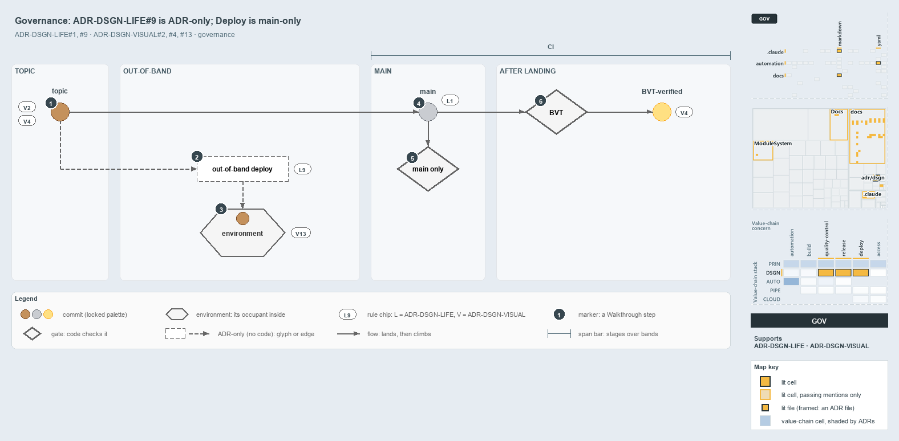

---
catzc:
  derived:
    path: docs/explanation/design/out-of-band-deploy-is-adr-only.md
    kind: explanation
    language: markdown
    filekind: md
    track: docs
    body_sha: e936870e0c62
    adrs:
      - ADR-AUTO-TEST#24
      - ADR-DSGN-LIFE#{1,9}
      - ADR-DSGN-VISUAL#{2,4,13}
    links:
      - docs/.assets/explanation/adr-dsgn-life--out-of-band-deploy-is-adr-only--governance.drawio.md
      - docs/.assets/explanation/adr-dsgn-life--out-of-band-deploy-is-adr-only--governance.drawio.png
      - docs/adr/automation/test-automation.md
      - docs/adr/design/commit-lifecycle.md
      - docs/adr/design/visual-design.md
      - docs/explanation/design/deploy-and-integrate-share-only-the-topic.md
      - docs/explanation/design/deploying-is-not-integrating.md
      - docs/explanation/design/every-deploy-stage-is-main-only.md
      - docs/explanation/design/index.md
      - docs/explanation/design/merging-to-main-is-what-deploys.md
      - docs/explanation/index.md#how-to-read-the-diagrams
---

# No gate checks the out-of-band deploy rule, and the only gate on deploys in code is main-only

```text
ADR-DSGN-LIFE#9 is ADR-only, and the one gate on deploys in code allows main alone.

1  topic                a topic commit, brown and below the mainline; no gate checks either drawing rule
2  out-of-band deploy   the deploy the rule allows; ADR-only, no code runs or checks it
3  environment          a neutral container; its occupant keeps its own colour
4  main                 landing on main is the integration
5  main only            the gate in code: every Deploy_* stage needs refs/heads/main
6  BVT                  checked in part: Test-Automation runs, Test-BuildArtifact does not

Supports ADR-DSGN-LIFE#1 and #9, and ADR-DSGN-VISUAL#2, #4 and #13 (governance lens).
```

ADR-DSGN-LIFE#9 lets a workflow deploy a topic commit without integrating it. Looked at as governance, the rule stands alone: no gate or
checker in cats tests it, and nothing in the repository runs the deploy it allows. The one gate in code on the deploy side points the other
way, since every `Deploy_*` stage runs only from main. The drawing rules of ADR-DSGN-VISUAL that colour these commits have no checker
either, and none is expected.



The diagram is described element by element in
[its asset description](../../.assets/explanation/adr-dsgn-life--out-of-band-deploy-is-adr-only--governance.drawio.md).

## Walkthrough

1. **Topic.** A commit on a topic branch. Topic branches are drawn below the mainline, and a topic commit is brown, never grey. No gate
   checks either drawing rule.
2. **Out-of-band deploy.** A workflow or pipeline may deploy the topic commit for a hotfix or an experiment, and the deploy is not an
   integration. The rule is ADR-only: no code runs this deploy and no gate checks it.
3. **Environment.** The environment is a neutral container, and its occupant keeps its own colour, so a topic commit deployed out of band
   stays brown inside it.
4. **Main.** Landing on main is the integration, and from here a commit climbs one rung at a time.
5. **Main only.** The gate in code: every `Deploy_*` stage carries the condition that the source branch is `refs/heads/main`. A run from any
   other ref skips the deploy stages, so no topic commit is deployed today.
6. **BVT.** The BVT turns a landed commit into a BVT-verified one, yellow. It is checked in part: the CI pipelines run `Test-Automation`,
   and the pipeline guide names the CI type's post-commit run on main the BVT, but no pipeline runs `Test-BuildArtifact`.

## Why it holds

- A topic commit can be deployed out-of-band without integrating into main, and the deploy confers no promotion state on the mainline
  (ADR-DSGN-LIFE#9).
- A commit holds one lifecycle state at a time and advances one rung along the ladder or leaves it (ADR-DSGN-LIFE#1).
- Topic branches render below the mainline and release branches above it (ADR-DSGN-VISUAL#2).
- The commit colours are fixed: a topic commit is brown and never grey, and yellow is past the BVT with an immutable artifact
  (ADR-DSGN-VISUAL#4).
- An environment box is a neutral container whose occupant carries its own state colour (ADR-DSGN-VISUAL#13).

## Where the code and the ADR differ

- ADR-DSGN-LIFE#9 allows a workflow or pipeline to deploy a topic commit; no pipeline or workflow does, and every `Deploy_*` stage is
  main-only.
- ADR-AUTO-TEST#24 makes the BVT include the built-artifact checks of `Test-BuildArtifact`; no pipeline runs them, so the BVT in code is
  narrower.
- The pipeline guide says the CI type produces no artifact, while ADR-DSGN-VISUAL#4 makes yellow carry an immutable versioned artifact.

## See also

- [The commit lifecycle](../../adr/design/commit-lifecycle.md) — the decision this article explains.
- [Visual design](../../adr/design/visual-design.md) — the drawing rules behind the V chips.
- [Test automation](../../adr/automation/test-automation.md) — the BVT's built-artifact checks.
- The other lenses on the same deploy: [meta](deploying-is-not-integrating.md),
  [architecture](deploy-and-integrate-share-only-the-topic.md), [implementation](every-deploy-stage-is-main-only.md) and
  [operations](merging-to-main-is-what-deploys.md).
- [The design explanations](index.md) · [How to read the diagrams](../index.md#how-to-read-the-diagrams)
