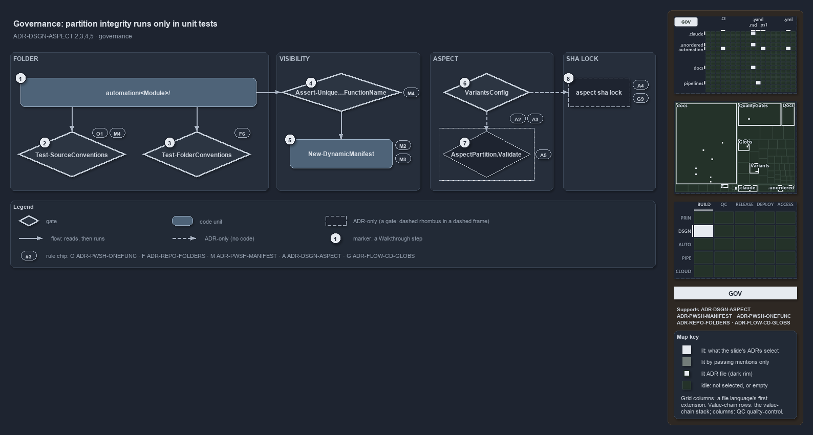

---
catzc:
  derived:
    path: docs/explanation/design/partition-integrity-runs-only-in-unit-tests.md
    kind: explanation
    language: markdown
    track: docs
    body_sha: "5591a605f706"
    adrs:
      - ADR-DSGN-ASPECT#{2,4,5}
      - ADR-FLOW-CD-GLOBS#9
      - ADR-PWSH-MANIFEST#{2-4}
      - ADR-PWSH-ONEFUNC#1
      - ADR-REPO-FOLDERS#{6,10}
    links:
      - docs/.assets/explanation/adr-dsgn-aspect--partition-integrity-runs-only-in-unit-tests--governance.drawio.md
      - docs/.assets/explanation/adr-dsgn-aspect--partition-integrity-runs-only-in-unit-tests--governance.drawio.png
      - docs/adr/design/module-aspects.md
      - docs/adr/flow/durable-sha-globs.md
      - docs/adr/pwsh/dynamic-module-manifests.md
      - docs/adr/pwsh/one-function-per-file.md
      - docs/adr/repository/conventional-folders.md
      - docs/explanation/design/drop-a-file-the-import-exports-it.md
      - docs/explanation/design/every-file-in-exactly-one-aspect.md
      - docs/explanation/design/index.md
      - docs/explanation/design/manifest-and-aspects-from-one-folder.md
      - docs/explanation/design/one-folder-two-independent-readers.md
      - docs/explanation/index.md#how-to-read-the-diagrams
---

# Partition integrity runs only in unit tests

```text
Partition integrity runs only in unit tests, and the per-aspect sha lock has no mechanism.

1  automation/<Module>/          the module folder every stage starts from
2  Test-SourceConventions        quality gate: one function per file, one definition per name
3  Test-FolderConventions        quality gate: only conventional module subfolders
4  Assert-Unique...FunctionName  import guard: unique exported names, fails fast
5  New-DynamicManifest           no gate: the import regenerates every manifest
6  VariantsConfig                config check: ** is last, and only last
7  AspectPartition.Validate      ADR-only on the real tree: runs in unit tests only
8  Aspect sha lock               ADR-only: nothing writes one

Supports ADR-DSGN-ASPECT#2, #3, #4 and #5 (governance lens).
```

Every stage of a cats module's folder layout is ruled by an ADR, and most of those rules have a gate: a quality gate, a guard at import, or
a check when the config loads. Two do not. The partition check of ADR-DSGN-ASPECT#5 runs only in unit tests, on fixtures, and the per-aspect
sha lock of ADR-DSGN-ASPECT#4 has no mechanism at all. Knowing which rules a gate holds, and which only the ADR states, tells a reviewer
where a mistake would slip through.



The diagram is described element by element in
[its asset description](../../.assets/explanation/adr-dsgn-aspect--partition-integrity-runs-only-in-unit-tests--governance.drawio.md).

## Walkthrough

1. **automation/&lt;Module&gt;/.** The module folder every stage starts from. Two quality gates read it, and the import guard reads it
   before anything loads.
2. **Test-SourceConventions.** A quality gate. It checks that each source file holds exactly one top-level function named for the file
   (ADR-PWSH-ONEFUNC#1), and that every function name, public or private, is defined in exactly one file, the integrity half of
   ADR-PWSH-MANIFEST#4.
3. **Test-FolderConventions.** A quality gate. It checks that every module subfolder is a conventional one: `private`, `tests`, `assets`,
   `types` or `configs` (ADR-REPO-FOLDERS#6). `assets/` is conventional but not in the live convention, so module assets fall to `tests`;
   the ADR's Related section calls the bundle payload deliberately broader than `live`.
4. **Assert-UniqueModuleFunctionName.** The import guard, shown shortened as `Assert-Unique…FunctionName`. `Import-AllModules` calls it
   before any module or type loads, and it fails fast on a duplicate exported name or one that shadows an imported command
   (ADR-PWSH-MANIFEST#4).
5. **New-DynamicManifest.** No gate: the import itself regenerates every manifest, and the file is gitignored (ADR-PWSH-MANIFEST#2, #3).
6. **VariantsConfig.** The config type checks the aspect order when the config loads: the last aspect is the bare `**` catch-all and no
   earlier aspect uses it, so `live` stays closed (ADR-DSGN-ASPECT#2, #3).
7. **AspectPartition.Validate.** The disjoint and exhaustive check over `git ls-files` (ADR-DSGN-ASPECT#5). The code exists, but its only
   callers are unit tests on fixture files, so on the real tree it is ADR-only.
8. **Aspect sha lock.** One immutable lock per aspect, so a module is two independently versioned artifacts (ADR-DSGN-ASPECT#4), with the
   mechanism placed in ADR-FLOW-CD-GLOBS#9. Nothing writes such a lock.

## Why it holds

- Each `.ps1` file holds exactly one function, and its name matches the file (ADR-PWSH-ONEFUNC#1).
- Every function name resolves to exactly one definition, and the import fails fast before anything loads when two would collide
  (ADR-PWSH-MANIFEST#4).
- Manifests are generated from the filesystem on every import and never committed (ADR-PWSH-MANIFEST#2, #3).
- Module-internal folder names are fixed (ADR-REPO-FOLDERS#6).
- Aspects are derived by ordered first match, the last one is the `**` remainder, and in the code track that remainder is `tests`
  (ADR-DSGN-ASPECT#2, #3).
- Each aspect is an immutable, independently versioned lock (ADR-DSGN-ASPECT#4), and a file claimed by two aspects, or by none, fails the
  integrity check (ADR-DSGN-ASPECT#5).

## Where the code and the ADR differ

- ADR-DSGN-ASPECT#5 says a broken partition fails `AspectPartition.Validate`, and the type's own comment calls it "the integrity gate", but
  no gate runs it on the real tree.
- ADR-DSGN-ASPECT#4 cites ADR-FLOW-CD-GLOBS#9 for an immutable sha lock with marker `<unit>-<aspect>.yml`; that rule computes change from
  git, never from a committed hash, and no marker exists.
- ADR-PWSH-MANIFEST#3 names `New-DynamicManifest` as the step that deletes a manifest when no `.ps1` is left; the code deletes it in
  `Import-AllModules`.
- ADR-REPO-FOLDERS#10 says unknown folders are ignored, not errors; `Test-FolderConventions` reports every non-conventional module subfolder
  as an issue, while the loader does skip them.

## See also

- [Module aspects](../../adr/design/module-aspects.md) — the decision this article explains. Also
  [dynamic module manifests](../../adr/pwsh/dynamic-module-manifests.md), [one function per file](../../adr/pwsh/one-function-per-file.md),
  [conventional folders](../../adr/repository/conventional-folders.md) and [durable sha globs](../../adr/flow/durable-sha-globs.md).
- The other lenses on the same layout: [meta](every-file-in-exactly-one-aspect.md), [architecture](one-folder-two-independent-readers.md),
  [implementation](manifest-and-aspects-from-one-folder.md) and [operations](drop-a-file-the-import-exports-it.md).
- [The design explanations](index.md) · [How to read the diagrams](../index.md#how-to-read-the-diagrams)
