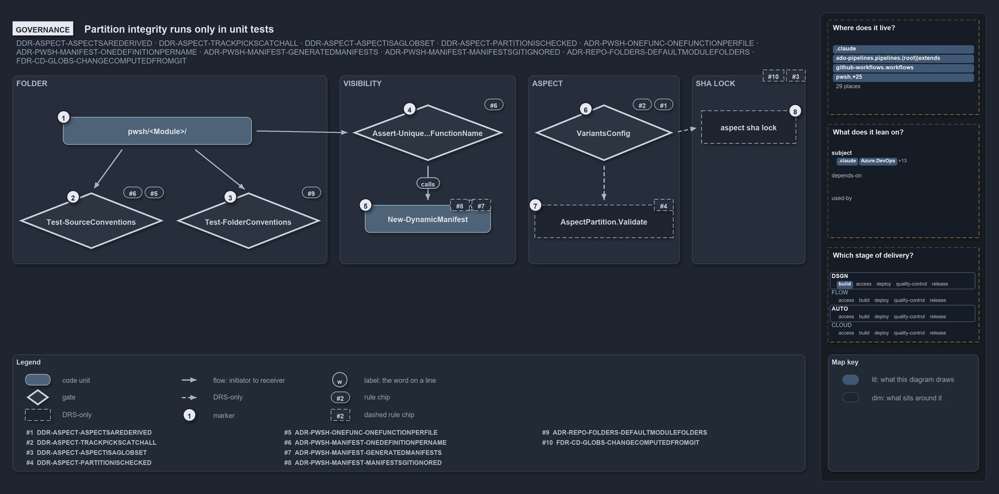

---
catzc:
  warning: "Header is generated by Format-FileMeta via Format-Code; do not change it"
  edges:
    cites:
      - ADR-PWSH-MANIFEST-GENERATEDMANIFESTS
      - ADR-PWSH-MANIFEST-MANIFESTSGITIGNORED
      - ADR-PWSH-MANIFEST-ONEDEFINITIONPERNAME
      - ADR-PWSH-ONEFUNC-ONEFUNCTIONPERFILE
      - ADR-REPO-FOLDERS-FIXEDMODULEFOLDERS
      - ADR-REPO-FOLDERS-UNKNOWNFOLDERSIGNORED
      - DDR-ASPECT-ASPECTSAREDERIVED
      - DDR-ASPECT-TRACKPICKSCATCHALL
      - DDR-ASPECT-ASPECTISAGLOBSET
      - DDR-ASPECT-PARTITIONISCHECKED
      - FDR-CD-GLOBS-CHANGECOMPUTEDFROMGIT
    drs_total: 11
---

# Partition integrity runs only in unit tests

```text
Partition integrity runs only in unit tests, and the per-aspect sha lock has no mechanism.

1  pwsh/<Module>/                the module folder every stage starts from
2  Test-SourceConventions        quality gate: one function per file, one definition per name
3  Test-FolderConventions        quality gate: only conventional module subfolders
4  Assert-Unique...FunctionName  import guard: unique exported names, fails fast
5  New-DynamicManifest           no gate: the import regenerates every manifest
6  VariantsConfig                config check: ** is last, and only last
7  AspectPartition.Validate      DRS-only on the real tree: runs in unit tests only
8  Aspect sha lock               DRS-only: nothing writes one

Supports DDR-ASPECT-ASPECTSAREDERIVED, DDR-ASPECT-TRACKPICKSCATCHALL, DDR-ASPECT-ASPECTISAGLOBSET, DDR-ASPECT-PARTITIONISCHECKED, ADR-PWSH-ONEFUNC-ONEFUNCTIONPERFILE, ADR-PWSH-MANIFEST-ONEDEFINITIONPERNAME, ADR-PWSH-MANIFEST-GENERATEDMANIFESTS, ADR-PWSH-MANIFEST-MANIFESTSGITIGNORED, ADR-REPO-FOLDERS-FIXEDMODULEFOLDERS and FDR-CD-GLOBS-CHANGECOMPUTEDFROMGIT (governance lens).
```

Every stage of a cats module's folder layout is ruled by a decision record, and most of those rules have a gate: a quality gate, a guard at
import, or a check when the config loads. Two do not. The partition check of DDR-ASPECT-PARTITIONISCHECKED runs only in unit tests, on
fixtures, and the per-aspect sha lock of DDR-ASPECT-ASPECTISAGLOBSET has no mechanism at all. Knowing which rules a gate holds, and which
only the DDR states, tells a reviewer where a mistake would slip through.

```yml drawio
description:
  "Which rules of a module folder's layout a gate checks: two quality gates, the import guard and the config check hold theirs, while the
  partition check runs only in unit tests, the manifest has no gate and the per-aspect sha lock has no mechanism."
about:
  adrs:
    - DDR-ASPECT-ASPECTSAREDERIVED
    - DDR-ASPECT-TRACKPICKSCATCHALL
    - DDR-ASPECT-ASPECTISAGLOBSET
    - DDR-ASPECT-PARTITIONISCHECKED
    - ADR-PWSH-ONEFUNC-ONEFUNCTIONPERFILE
    - ADR-PWSH-MANIFEST-ONEDEFINITIONPERNAME
    - ADR-PWSH-MANIFEST-GENERATEDMANIFESTS
    - ADR-PWSH-MANIFEST-MANIFESTSGITIGNORED
    - ADR-REPO-FOLDERS-FIXEDMODULEFOLDERS
    - FDR-CD-GLOBS-CHANGECOMPUTEDFROMGIT
  lens: governance
content:
  title: Partition integrity runs only in unit tests
  kind: explanation
  flow: left-to-right
  relation: reads, then runs
  theme: dark
  bands:
    - { id: band-folder, label: FOLDER }
    - { id: band-visibility, label: VISIBILITY }
    - { id: band-aspect, label: ASPECT }
    - { id: band-lock, label: SHA LOCK }
  glyphs:
    - { id: g-root, kind: code, label: pwsh/<Module>/, in: band-folder }
    - { id: g-source-conventions, kind: gate, label: Test-SourceConventions, in: band-folder }
    - { id: g-folder-conventions, kind: gate, label: Test-FolderConventions, in: band-folder }
    - { id: g-assert-unique, kind: gate, label: Assert-Unique...FunctionName, in: band-visibility }
    - { id: g-manifest, kind: code, label: New-DynamicManifest, in: band-visibility }
    - { id: g-variants-config, kind: gate, label: VariantsConfig, in: band-aspect }
    - { id: g-validate, kind: drsonly, label: AspectPartition.Validate, in: band-aspect }
    - { id: g-sha-lock, kind: drsonly, label: aspect sha lock, in: band-lock }
  edges:
    - { from: g-root, to: g-source-conventions, kind: flow, label: "" }
    - { from: g-root, to: g-folder-conventions, kind: flow, label: "" }
    - { from: g-root, to: g-assert-unique, kind: flow, label: "" }
    - { from: g-assert-unique, to: g-manifest, kind: flow, label: "" }
    - { from: g-variants-config, to: g-validate, kind: adr, label: "" }
    - { from: g-variants-config, to: g-sha-lock, kind: adr, label: "" }
  markers:
    - { at: g-root, number: 1 }
    - { at: g-source-conventions, number: 2 }
    - { at: g-folder-conventions, number: 3 }
    - { at: g-assert-unique, number: 4 }
    - { at: g-manifest, number: 5 }
    - { at: g-variants-config, number: 6 }
    - { at: g-validate, number: 7 }
    - { at: g-sha-lock, number: 8 }
  chips:
    - { at: g-source-conventions, kind: rule, rule: ADR-PWSH-ONEFUNC-ONEFUNCTIONPERFILE }
    - { at: g-source-conventions, kind: rule, rule: ADR-PWSH-MANIFEST-ONEDEFINITIONPERNAME }
    - { at: g-folder-conventions, kind: rule, rule: ADR-REPO-FOLDERS-FIXEDMODULEFOLDERS }
    - { at: g-assert-unique, kind: rule, rule: ADR-PWSH-MANIFEST-ONEDEFINITIONPERNAME }
    - { at: g-manifest, kind: rule, rule: ADR-PWSH-MANIFEST-GENERATEDMANIFESTS, gated: false }
    - { at: g-manifest, kind: rule, rule: ADR-PWSH-MANIFEST-MANIFESTSGITIGNORED, gated: false }
    - { at: g-variants-config, kind: rule, rule: DDR-ASPECT-ASPECTSAREDERIVED }
    - { at: g-variants-config, kind: rule, rule: DDR-ASPECT-TRACKPICKSCATCHALL }
    - { at: g-validate, kind: rule, rule: DDR-ASPECT-PARTITIONISCHECKED, gated: false }
    - { at: band-lock, kind: rule, rule: DDR-ASPECT-ASPECTISAGLOBSET, gated: false }
    - { at: band-lock, kind: rule, rule: FDR-CD-GLOBS-CHANGECOMPUTEDFROMGIT, gated: false }
  legend: auto
  minimaps:
    code-locations:
      - cell: .claude/.claude/.
        by: [.claude/CLAUDE.md, ADR-PWSH-ONEFUNC-ONEFUNCTIONPERFILE, FDR-CD-GLOBS-CHANGECOMPUTEDFROMGIT]
      - cell: ado-pipelines/pipelines/.
        by:
          - .ado/pipelines/cd-apex.yaml
          - .ado/pipelines/cd-flux.yaml
          - .ado/pipelines/cd-nova.yaml
          - .ado/pipelines/cd-shared.yaml
          - .ado/pipelines/ci-infrastructure.yaml
          - .ado/pipelines/ci-pwsh.yaml
          - FDR-CD-GLOBS-CHANGECOMPUTEDFROMGIT
      - cell: ado-pipelines/pipelines/extends
        by: [.ado/pipelines/extends/cd-customer.yaml, FDR-CD-GLOBS-CHANGECOMPUTEDFROMGIT]
      - cell: docs/-/.
        by:
          - docs/drs/automation/pwsh/dora-explains.md
          - docs/drs/automation/pwsh/dynamic-module-manifests.md
          - docs/drs/automation/pwsh/one-function-per-file.md
          - docs/drs/design/dora-explains.md
          - docs/drs/design/module-aspects.md
          - docs/drs/flow/dora-explains.md
          - docs/drs/flow/durable-sha-globs.md
          - docs/drs/index.md
          - docs/drs/repository/conventional-folders.md
          - docs/drs/repository/dora-explains.md
          - docs/how-to/automation/apply-environment-approvals.md
          - docs/references/ado/pipelines/cd-apex.yaml.md
          - docs/references/ado/pipelines/cd-flux.yaml.md
          - docs/references/ado/pipelines/cd-nova.yaml.md
          - docs/references/ado/pipelines/cd-shared.yaml.md
          - docs/references/ado/pipelines/ci-infrastructure.yaml.md
          - docs/references/ado/pipelines/ci-pwsh.yaml.md
          - docs/references/github/workflows/ci-pwsh.yml.md
          - docs/references/pwsh/catzc-azure-dev-ops-build-validation/Get-AdoBuildValidations.ps1.md
          - docs/references/pwsh/catzc-azure-dev-ops-build-validation/Register-AdoBuildValidation.ps1.md
          - docs/references/pwsh/catzc-azure-dev-ops-build-validation/Unregister-AdoBuildValidation.ps1.md
          - docs/references/pwsh/catzc-azure-dev-ops-build-validation/configs/build-validation.yml.md
          - docs/references/pwsh/catzc-azure-dev-ops-build-validation/private/Get-BuildValidationPathFilter.ps1.md
          - docs/references/pwsh/catzc-azure-dev-ops/Sync-AdoEnvironmentApprovals.ps1.md
          - docs/references/pwsh/catzc-base-drs/types/DrsConfig.cs.md
          - docs/references/pwsh/catzc-base-globs/Get-GlobSetChangeRange.ps1.md
          - docs/references/pwsh/catzc-base-globs/Get-ModuleGlobSet.ps1.md
          - docs/references/pwsh/catzc-base-globs/Test-GlobSetAffected.ps1.md
          - docs/references/pwsh/catzc-base-globs/configs/globs.yml.md
          - docs/references/pwsh/catzc-base-globs/private/Get-PipelineTrigger.ps1.md
          - docs/references/pwsh/catzc-base-globs/tests/types/Aspect.Tests.ps1.md
          - docs/references/pwsh/catzc-base-globs/types/Aspect.cs.md
          - docs/references/pwsh/catzc-base-globs/types/DurableHash.cs.md
          - docs/references/pwsh/catzc-base-globs/types/GlobPattern.cs.md
          - docs/references/pwsh/catzc-base-globs/types/GlobSet.cs.md
          - docs/references/pwsh/catzc-base-globs/types/GlobsConfig.cs.md
          - docs/references/pwsh/catzc-base-languages.md
          - docs/references/pwsh/catzc-base-maps/Get-LifecyclePositionMinimapData.ps1.md
          - docs/references/pwsh/catzc-base-maps/Get-ValueChainHighlight.ps1.md
          - docs/references/pwsh/catzc-base-maps/Get-WorldMapHighlight.ps1.md
          - docs/references/pwsh/catzc-base-module-system/Test-FolderConventions.ps1.md
          - docs/references/pwsh/catzc-base-modules/Get-Aspect.ps1.md
          - docs/references/pwsh/catzc-base-quality-gates/private/Get-ChangeTestFile.ps1.md
          - docs/references/pwsh/catzc-base-quality-gates/private/Get-ModuleProtectionIdentity.ps1.md
          - docs/references/pwsh/catzc-base-variants/configs/variants.yml.md
          - docs/references/pwsh/catzc-base-variants/types/VariantAspect.cs.md
          - docs/references/pwsh/catzc-base-variants/types/VariantsConfig.cs.md
          - ADR-PWSH-MANIFEST-GENERATEDMANIFESTS
          - ADR-PWSH-MANIFEST-MANIFESTSGITIGNORED
          - ADR-PWSH-MANIFEST-ONEDEFINITIONPERNAME
          - ADR-PWSH-ONEFUNC-ONEFUNCTIONPERFILE
          - ADR-REPO-FOLDERS-FIXEDMODULEFOLDERS
          - DDR-ASPECT-ASPECTISAGLOBSET
          - DDR-ASPECT-ASPECTSAREDERIVED
          - DDR-ASPECT-PARTITIONISCHECKED
          - DDR-ASPECT-TRACKPICKSCATCHALL
          - FDR-CD-GLOBS-CHANGECOMPUTEDFROMGIT
      - cell: github-workflows/workflows/.
        by: [.github/workflows/ci-pwsh.yml, FDR-CD-GLOBS-CHANGECOMPUTEDFROMGIT]
      - cell: pwsh/Catzc.Azure.DevOps/.
        by: [pwsh/Catzc.Azure.DevOps/Sync-AdoEnvironmentApprovals.ps1, FDR-CD-GLOBS-CHANGECOMPUTEDFROMGIT]
      - cell: pwsh/Catzc.Azure.DevOps.BuildValidation/.
        by:
          - pwsh/Catzc.Azure.DevOps.BuildValidation/Get-AdoBuildValidations.ps1
          - pwsh/Catzc.Azure.DevOps.BuildValidation/Register-AdoBuildValidation.ps1
          - pwsh/Catzc.Azure.DevOps.BuildValidation/Unregister-AdoBuildValidation.ps1
          - FDR-CD-GLOBS-CHANGECOMPUTEDFROMGIT
      - cell: pwsh/Catzc.Azure.DevOps.BuildValidation/configs
        by: [pwsh/Catzc.Azure.DevOps.BuildValidation/configs/build-validation.yml, FDR-CD-GLOBS-CHANGECOMPUTEDFROMGIT]
      - cell: pwsh/Catzc.Azure.DevOps.BuildValidation/private
        by: [pwsh/Catzc.Azure.DevOps.BuildValidation/private/Get-BuildValidationPathFilter.ps1, FDR-CD-GLOBS-CHANGECOMPUTEDFROMGIT]
      - cell: pwsh/Catzc.Base.Docs/configs
        by: [pwsh/Catzc.Base.Docs/configs/capabilities.yml, ADR-PWSH-ONEFUNC-ONEFUNCTIONPERFILE]
      - cell: pwsh/Catzc.Base.Drs/configs
        by:
          - pwsh/Catzc.Base.Drs/configs/drs.yml
          - ADR-PWSH-MANIFEST-GENERATEDMANIFESTS
          - ADR-PWSH-MANIFEST-MANIFESTSGITIGNORED
          - ADR-PWSH-MANIFEST-ONEDEFINITIONPERNAME
          - ADR-PWSH-ONEFUNC-ONEFUNCTIONPERFILE
          - ADR-REPO-FOLDERS-FIXEDMODULEFOLDERS
          - DDR-ASPECT-ASPECTISAGLOBSET
          - DDR-ASPECT-ASPECTSAREDERIVED
          - DDR-ASPECT-PARTITIONISCHECKED
          - DDR-ASPECT-TRACKPICKSCATCHALL
          - FDR-CD-GLOBS-CHANGECOMPUTEDFROMGIT
      - cell: pwsh/Catzc.Base.Drs/types
        by: [pwsh/Catzc.Base.Drs/types/DrsConfig.cs, FDR-CD-GLOBS-CHANGECOMPUTEDFROMGIT]
      - cell: pwsh/Catzc.Base.Globs/.
        by:
          - pwsh/Catzc.Base.Globs/Get-GlobSetChangeRange.ps1
          - pwsh/Catzc.Base.Globs/Get-ModuleGlobSet.ps1
          - pwsh/Catzc.Base.Globs/Test-GlobSetAffected.ps1
          - DDR-ASPECT-ASPECTISAGLOBSET
          - DDR-ASPECT-ASPECTSAREDERIVED
          - DDR-ASPECT-PARTITIONISCHECKED
          - DDR-ASPECT-TRACKPICKSCATCHALL
          - FDR-CD-GLOBS-CHANGECOMPUTEDFROMGIT
      - cell: pwsh/Catzc.Base.Globs/configs
        by: [pwsh/Catzc.Base.Globs/configs/globs.yml, FDR-CD-GLOBS-CHANGECOMPUTEDFROMGIT]
      - cell: pwsh/Catzc.Base.Globs/private
        by: [pwsh/Catzc.Base.Globs/private/Get-PipelineTrigger.ps1, FDR-CD-GLOBS-CHANGECOMPUTEDFROMGIT]
      - cell: pwsh/Catzc.Base.Globs/tests
        by:
          - pwsh/Catzc.Base.Globs/tests/Get-ModuleGlobSet.Tests.ps1
          - DDR-ASPECT-ASPECTISAGLOBSET
          - DDR-ASPECT-ASPECTSAREDERIVED
          - DDR-ASPECT-PARTITIONISCHECKED
          - DDR-ASPECT-TRACKPICKSCATCHALL
      - cell: pwsh/Catzc.Base.Globs/tests/types
        by:
          - pwsh/Catzc.Base.Globs/tests/types/Aspect.Tests.ps1
          - DDR-ASPECT-ASPECTISAGLOBSET
          - DDR-ASPECT-ASPECTSAREDERIVED
          - DDR-ASPECT-PARTITIONISCHECKED
          - DDR-ASPECT-TRACKPICKSCATCHALL
      - cell: pwsh/Catzc.Base.Globs/types
        by:
          - pwsh/Catzc.Base.Globs/types/Aspect.cs
          - pwsh/Catzc.Base.Globs/types/DurableHash.cs
          - pwsh/Catzc.Base.Globs/types/GlobPattern.cs
          - pwsh/Catzc.Base.Globs/types/GlobSet.cs
          - pwsh/Catzc.Base.Globs/types/GlobsConfig.cs
          - DDR-ASPECT-ASPECTISAGLOBSET
          - DDR-ASPECT-ASPECTSAREDERIVED
          - DDR-ASPECT-PARTITIONISCHECKED
          - DDR-ASPECT-TRACKPICKSCATCHALL
          - FDR-CD-GLOBS-CHANGECOMPUTEDFROMGIT
      - cell: pwsh/Catzc.Base.Maps/.
        by:
          - pwsh/Catzc.Base.Maps/Get-LifecyclePositionMinimapData.ps1
          - pwsh/Catzc.Base.Maps/Get-ValueChainHighlight.ps1
          - pwsh/Catzc.Base.Maps/Get-WorldMapHighlight.ps1
          - FDR-CD-GLOBS-CHANGECOMPUTEDFROMGIT
      - cell: pwsh/Catzc.Base.Maps/tests
        by: [pwsh/Catzc.Base.Maps/tests/Get-WorldMapHighlight.Tests.ps1, FDR-CD-GLOBS-CHANGECOMPUTEDFROMGIT]
      - cell: pwsh/Catzc.Base.Modules/.
        by:
          - pwsh/Catzc.Base.Modules/Get-Aspect.ps1
          - DDR-ASPECT-ASPECTISAGLOBSET
          - DDR-ASPECT-ASPECTSAREDERIVED
          - DDR-ASPECT-PARTITIONISCHECKED
          - DDR-ASPECT-TRACKPICKSCATCHALL
      - cell: pwsh/Catzc.Base.Modules/tests
        by:
          - pwsh/Catzc.Base.Modules/tests/Get-Aspect.Tests.ps1
          - DDR-ASPECT-ASPECTISAGLOBSET
          - DDR-ASPECT-ASPECTSAREDERIVED
          - DDR-ASPECT-PARTITIONISCHECKED
          - DDR-ASPECT-TRACKPICKSCATCHALL
      - cell: pwsh/Catzc.Base.ModuleSystem/.
        by: [pwsh/Catzc.Base.ModuleSystem/Test-FolderConventions.ps1, ADR-REPO-FOLDERS-FIXEDMODULEFOLDERS]
      - cell: pwsh/Catzc.Base.QualityGates/configs
        by: [pwsh/Catzc.Base.QualityGates/configs/terminology.yml, FDR-CD-GLOBS-CHANGECOMPUTEDFROMGIT]
      - cell: pwsh/Catzc.Base.QualityGates/private
        by:
          - pwsh/Catzc.Base.QualityGates/private/Get-ChangeTestFile.ps1
          - pwsh/Catzc.Base.QualityGates/private/Get-ModuleProtectionIdentity.ps1
          - ADR-PWSH-ONEFUNC-ONEFUNCTIONPERFILE
          - DDR-ASPECT-ASPECTISAGLOBSET
          - DDR-ASPECT-ASPECTSAREDERIVED
          - DDR-ASPECT-PARTITIONISCHECKED
          - DDR-ASPECT-TRACKPICKSCATCHALL
      - cell: pwsh/Catzc.Base.Variants/configs
        by:
          - pwsh/Catzc.Base.Variants/configs/variants.yml
          - DDR-ASPECT-ASPECTISAGLOBSET
          - DDR-ASPECT-ASPECTSAREDERIVED
          - DDR-ASPECT-PARTITIONISCHECKED
          - DDR-ASPECT-TRACKPICKSCATCHALL
      - cell: pwsh/Catzc.Base.Variants/types
        by:
          - pwsh/Catzc.Base.Variants/types/VariantAspect.cs
          - pwsh/Catzc.Base.Variants/types/VariantsConfig.cs
          - DDR-ASPECT-ASPECTISAGLOBSET
          - DDR-ASPECT-ASPECTSAREDERIVED
          - DDR-ASPECT-PARTITIONISCHECKED
          - DDR-ASPECT-TRACKPICKSCATCHALL
      - cell: pwsh/Catzc.Internal.Assets/.
        by:
          - pwsh/.internal/assets/Import-ModuleFiles.ps1
          - ADR-PWSH-MANIFEST-GENERATEDMANIFESTS
          - ADR-PWSH-MANIFEST-MANIFESTSGITIGNORED
          - ADR-PWSH-MANIFEST-ONEDEFINITIONPERNAME
    module-neighbourhood:
      - cell: subject/.claude
        by: [.claude/CLAUDE.md, ADR-PWSH-ONEFUNC-ONEFUNCTIONPERFILE, FDR-CD-GLOBS-CHANGECOMPUTEDFROMGIT]
      - cell: subject/Catzc.Azure.DevOps
        by: [pwsh/Catzc.Azure.DevOps/Sync-AdoEnvironmentApprovals.ps1, FDR-CD-GLOBS-CHANGECOMPUTEDFROMGIT]
      - cell: subject/Catzc.Azure.DevOps.BuildValidation
        by:
          - pwsh/Catzc.Azure.DevOps.BuildValidation/Get-AdoBuildValidations.ps1
          - pwsh/Catzc.Azure.DevOps.BuildValidation/Register-AdoBuildValidation.ps1
          - pwsh/Catzc.Azure.DevOps.BuildValidation/Unregister-AdoBuildValidation.ps1
          - pwsh/Catzc.Azure.DevOps.BuildValidation/configs/build-validation.yml
          - pwsh/Catzc.Azure.DevOps.BuildValidation/private/Get-BuildValidationPathFilter.ps1
          - FDR-CD-GLOBS-CHANGECOMPUTEDFROMGIT
      - cell: subject/Catzc.Base.Docs
        by: [pwsh/Catzc.Base.Docs/configs/capabilities.yml, ADR-PWSH-ONEFUNC-ONEFUNCTIONPERFILE]
      - cell: subject/Catzc.Base.Drs
        by:
          - pwsh/Catzc.Base.Drs/configs/drs.yml
          - pwsh/Catzc.Base.Drs/types/DrsConfig.cs
          - ADR-PWSH-MANIFEST-GENERATEDMANIFESTS
          - ADR-PWSH-MANIFEST-MANIFESTSGITIGNORED
          - ADR-PWSH-MANIFEST-ONEDEFINITIONPERNAME
          - ADR-PWSH-ONEFUNC-ONEFUNCTIONPERFILE
          - ADR-REPO-FOLDERS-FIXEDMODULEFOLDERS
          - DDR-ASPECT-ASPECTISAGLOBSET
          - DDR-ASPECT-ASPECTSAREDERIVED
          - DDR-ASPECT-PARTITIONISCHECKED
          - DDR-ASPECT-TRACKPICKSCATCHALL
          - FDR-CD-GLOBS-CHANGECOMPUTEDFROMGIT
      - cell: subject/Catzc.Base.Globs
        by:
          - pwsh/Catzc.Base.Globs/Get-GlobSetChangeRange.ps1
          - pwsh/Catzc.Base.Globs/Get-ModuleGlobSet.ps1
          - pwsh/Catzc.Base.Globs/Test-GlobSetAffected.ps1
          - pwsh/Catzc.Base.Globs/configs/globs.yml
          - pwsh/Catzc.Base.Globs/private/Get-PipelineTrigger.ps1
          - pwsh/Catzc.Base.Globs/tests/Get-ModuleGlobSet.Tests.ps1
          - pwsh/Catzc.Base.Globs/tests/types/Aspect.Tests.ps1
          - pwsh/Catzc.Base.Globs/types/Aspect.cs
          - pwsh/Catzc.Base.Globs/types/DurableHash.cs
          - pwsh/Catzc.Base.Globs/types/GlobPattern.cs
          - pwsh/Catzc.Base.Globs/types/GlobSet.cs
          - pwsh/Catzc.Base.Globs/types/GlobsConfig.cs
          - DDR-ASPECT-ASPECTISAGLOBSET
          - DDR-ASPECT-ASPECTSAREDERIVED
          - DDR-ASPECT-PARTITIONISCHECKED
          - DDR-ASPECT-TRACKPICKSCATCHALL
          - FDR-CD-GLOBS-CHANGECOMPUTEDFROMGIT
      - cell: subject/Catzc.Base.Maps
        by:
          - pwsh/Catzc.Base.Maps/Get-LifecyclePositionMinimapData.ps1
          - pwsh/Catzc.Base.Maps/Get-ValueChainHighlight.ps1
          - pwsh/Catzc.Base.Maps/Get-WorldMapHighlight.ps1
          - pwsh/Catzc.Base.Maps/tests/Get-WorldMapHighlight.Tests.ps1
          - FDR-CD-GLOBS-CHANGECOMPUTEDFROMGIT
      - cell: subject/Catzc.Base.ModuleSystem
        by: [pwsh/Catzc.Base.ModuleSystem/Test-FolderConventions.ps1, ADR-REPO-FOLDERS-FIXEDMODULEFOLDERS]
      - cell: subject/Catzc.Base.Modules
        by:
          - pwsh/Catzc.Base.Modules/Get-Aspect.ps1
          - pwsh/Catzc.Base.Modules/tests/Get-Aspect.Tests.ps1
          - DDR-ASPECT-ASPECTISAGLOBSET
          - DDR-ASPECT-ASPECTSAREDERIVED
          - DDR-ASPECT-PARTITIONISCHECKED
          - DDR-ASPECT-TRACKPICKSCATCHALL
      - cell: subject/Catzc.Base.QualityGates
        by:
          - pwsh/Catzc.Base.QualityGates/configs/terminology.yml
          - pwsh/Catzc.Base.QualityGates/private/Get-ChangeTestFile.ps1
          - pwsh/Catzc.Base.QualityGates/private/Get-ModuleProtectionIdentity.ps1
          - ADR-PWSH-ONEFUNC-ONEFUNCTIONPERFILE
          - DDR-ASPECT-ASPECTISAGLOBSET
          - DDR-ASPECT-ASPECTSAREDERIVED
          - DDR-ASPECT-PARTITIONISCHECKED
          - DDR-ASPECT-TRACKPICKSCATCHALL
          - FDR-CD-GLOBS-CHANGECOMPUTEDFROMGIT
      - cell: subject/Catzc.Base.Variants
        by:
          - pwsh/Catzc.Base.Variants/configs/variants.yml
          - pwsh/Catzc.Base.Variants/types/VariantAspect.cs
          - pwsh/Catzc.Base.Variants/types/VariantsConfig.cs
          - DDR-ASPECT-ASPECTISAGLOBSET
          - DDR-ASPECT-ASPECTSAREDERIVED
          - DDR-ASPECT-PARTITIONISCHECKED
          - DDR-ASPECT-TRACKPICKSCATCHALL
      - cell: subject/Catzc.Internal.Assets
        by:
          - pwsh/.internal/assets/Import-ModuleFiles.ps1
          - ADR-PWSH-MANIFEST-GENERATEDMANIFESTS
          - ADR-PWSH-MANIFEST-MANIFESTSGITIGNORED
          - ADR-PWSH-MANIFEST-ONEDEFINITIONPERNAME
      - cell: subject/pipelines
        by:
          - .ado/pipelines/cd-apex.yaml
          - .ado/pipelines/cd-flux.yaml
          - .ado/pipelines/cd-nova.yaml
          - .ado/pipelines/cd-shared.yaml
          - .ado/pipelines/ci-infrastructure.yaml
          - .ado/pipelines/ci-pwsh.yaml
          - .ado/pipelines/extends/cd-customer.yaml
          - FDR-CD-GLOBS-CHANGECOMPUTEDFROMGIT
      - cell: subject/workflows
        by: [.github/workflows/ci-pwsh.yml, FDR-CD-GLOBS-CHANGECOMPUTEDFROMGIT]
    axis:
      - cell: DSGN/build
        by: [DDR-ASPECT-ASPECTISAGLOBSET, DDR-ASPECT-ASPECTSAREDERIVED, DDR-ASPECT-PARTITIONISCHECKED, DDR-ASPECT-TRACKPICKSCATCHALL]
      - cell: DSGN/*
        by: [FDR-CD-GLOBS-CHANGECOMPUTEDFROMGIT]
      - cell: AUTO/*
        by:
          - ADR-PWSH-MANIFEST-GENERATEDMANIFESTS
          - ADR-PWSH-MANIFEST-MANIFESTSGITIGNORED
          - ADR-PWSH-MANIFEST-ONEDEFINITIONPERNAME
          - ADR-PWSH-ONEFUNC-ONEFUNCTIONPERFILE
          - ADR-REPO-FOLDERS-FIXEDMODULEFOLDERS
layout:
  band-folder: { x: 20, y: 104, w: 500, h: 300 }
  band-visibility: { x: 540, y: 104, w: 280, h: 300 }
  band-aspect: { x: 840, y: 104, w: 240, h: 300 }
  band-lock: { x: 1100, y: 104, w: 180, h: 300 }
  g-root: { x: 100, y: 170, w: 300, h: 44 }
  g-source-conventions: { x: 30, y: 290, w: 230, h: 90 }
  g-folder-conventions: { x: 280, y: 290, w: 230, h: 90 }
  g-assert-unique: { x: 560, y: 150, w: 240, h: 90 }
  g-manifest: { x: 580, y: 310, w: 200, h: 44 }
  g-variants-config: { x: 850, y: 150, w: 220, h: 90 }
  g-validate: { x: 850, y: 310, w: 220, h: 52 }
  g-sha-lock: { x: 1115, y: 160, w: 150, h: 52 }
```



## Walkthrough

1. **pwsh/&lt;Module&gt;/.** The module folder every stage starts from. Two quality gates read it, and the import guard reads it before
   anything loads.
2. **Test-SourceConventions.** A quality gate. It checks that each source file holds exactly one top-level function named for the file
   (ADR-PWSH-ONEFUNC-ONEFUNCTIONPERFILE), and that every function name, public or private, is defined in exactly one file, the integrity
   half of ADR-PWSH-MANIFEST-ONEDEFINITIONPERNAME.
3. **Test-FolderConventions.** A quality gate. It checks that every module subfolder is a conventional one: `private`, `tests`, `assets`,
   `types` or `configs` (ADR-REPO-FOLDERS-FIXEDMODULEFOLDERS). `assets/` is conventional but not in the live convention, so module assets
   fall to `tests`; the DDR's Related section calls the bundle payload deliberately broader than `live`.
4. **Assert-UniqueModuleFunctionName.** The import guard, shown shortened as `Assert-Unique…FunctionName`. `Import-AllModules` calls it
   before any module or type loads, and it fails fast on a duplicate exported name or one that shadows an imported command
   (ADR-PWSH-MANIFEST-ONEDEFINITIONPERNAME).
5. **New-DynamicManifest.** No gate: the import itself regenerates every manifest, and the file is gitignored
   (ADR-PWSH-MANIFEST-GENERATEDMANIFESTS, ADR-PWSH-MANIFEST-MANIFESTSGITIGNORED).
6. **VariantsConfig.** The config type checks the aspect order when the config loads: the last aspect is the bare `**` catch-all and no
   earlier aspect uses it, so `live` stays closed (DDR-ASPECT-ASPECTSAREDERIVED, DDR-ASPECT-TRACKPICKSCATCHALL).
7. **AspectPartition.Validate.** The disjoint and exhaustive check over `git ls-files` (DDR-ASPECT-PARTITIONISCHECKED). The code exists, but
   its only callers are unit tests on fixture files, so on the real tree it is DRS-only.
8. **Aspect sha lock.** One immutable lock per aspect, so a module is two independently versioned artifacts (DDR-ASPECT-ASPECTISAGLOBSET),
   with the mechanism placed in FDR-CD-GLOBS-CHANGECOMPUTEDFROMGIT. Nothing writes such a lock.

## Why it holds

- Each `.ps1` file holds exactly one function, and its name matches the file (ADR-PWSH-ONEFUNC-ONEFUNCTIONPERFILE).
- Every function name resolves to exactly one definition, and the import fails fast before anything loads when two would collide
  (ADR-PWSH-MANIFEST-ONEDEFINITIONPERNAME).
- Manifests are generated from the filesystem on every import and never committed (ADR-PWSH-MANIFEST-GENERATEDMANIFESTS,
  ADR-PWSH-MANIFEST-MANIFESTSGITIGNORED).
- Module-internal folder names are fixed (ADR-REPO-FOLDERS-FIXEDMODULEFOLDERS).
- Aspects are derived by ordered first match, the last one is the `**` remainder, and in the code track that remainder is `tests`
  (DDR-ASPECT-ASPECTSAREDERIVED, DDR-ASPECT-TRACKPICKSCATCHALL).
- Each aspect is an immutable, independently versioned lock (DDR-ASPECT-ASPECTISAGLOBSET), and a file claimed by two aspects, or by none,
  fails the integrity check (DDR-ASPECT-PARTITIONISCHECKED).

## Where the code and the decision record differ

- DDR-ASPECT-PARTITIONISCHECKED says a broken partition fails `AspectPartition.Validate`, and the type's reference page (`Aspect.cs.md`)
  says it re-checks "for the integrity gate", but no gate runs it on the real tree.
- DDR-ASPECT-ASPECTISAGLOBSET cites FDR-CD-GLOBS-CHANGECOMPUTEDFROMGIT for an immutable sha lock with marker `<unit>-<aspect>.yml`; that
  rule computes change from git, never from a committed hash, and no marker exists.
- ADR-PWSH-MANIFEST-MANIFESTSGITIGNORED names `New-DynamicManifest` as the step that deletes a manifest when no `.ps1` is left; the code
  deletes it in `Import-AllModules`.
- ADR-REPO-FOLDERS-UNKNOWNFOLDERSIGNORED says unknown folders are ignored, not errors; `Test-FolderConventions` reports every
  non-conventional module subfolder as an issue, while the loader does skip them.

## See also

- [Module aspects](../../drs/design/module-aspects.md) — the decision this article explains. Also
  [dynamic module manifests](../../drs/automation/pwsh/dynamic-module-manifests.md),
  [one function per file](../../drs/automation/pwsh/one-function-per-file.md),
  [conventional folders](../../drs/repository/conventional-folders.md) and [durable sha globs](../../drs/flow/durable-sha-globs.md).
- The other lenses on the same layout: [meta](every-file-in-exactly-one-aspect.md), [architecture](one-folder-two-independent-readers.md),
  [implementation](manifest-and-aspects-from-one-folder.md) and [operations](drop-a-file-the-import-exports-it.md).
- [The design explanations](index.md) · [How to read the diagrams](../index.md#how-to-read-the-diagrams)
