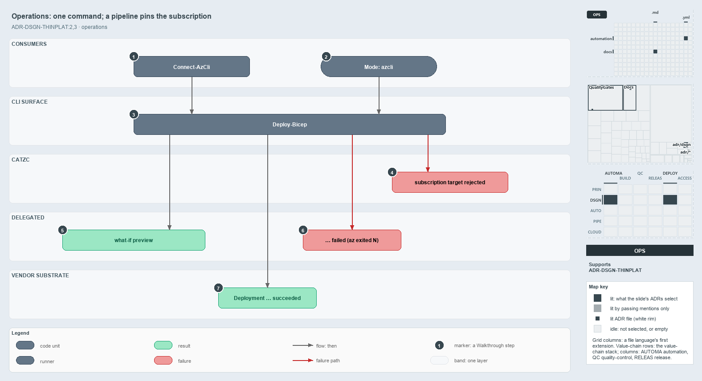

---
catzc:
  immutable:
    with_body_sha: ea64b39cbb52
    path: docs/explanation/design/same-deploy-bicep-on-both-sides.md
    folder: docs/explanation/design
    name: same-deploy-bicep-on-both-sides
    filetype: md
    kind: explanation
    language: markdown
    track: docs
  edges:
    cites:
      - ADR-AUTO-PARITY#3
      - ADR-DSGN-THINPLAT#{2,3}
    links:
      - docs/.assets/explanation/adr-dsgn-thinplat--same-deploy-bicep-on-both-sides--operations.drawio.md
      - docs/.assets/explanation/adr-dsgn-thinplat--same-deploy-bicep-on-both-sides--operations.drawio.png
      - docs/adr/automation/devbox-pipeline-parity.md
      - docs/adr/design/thin-platforms.md
      - docs/explanation/design/bind-to-one-cli-delegate-the-rest.md
      - docs/explanation/design/deploy-bicep-delegates-to-az.md
      - docs/explanation/design/every-vendor-call-leaves-through-az.md
      - docs/explanation/design/index.md
      - docs/explanation/design/what-keeps-the-platform-thin.md
      - docs/explanation/index.md#how-to-read-the-diagrams
---

# A developer and a pipeline type the same Deploy-Bicep; only the pipeline must pin the subscription

```text
A developer and a pipeline type the same Deploy-Bicep; only the pipeline must pin the subscription.

1  Connect-AzCli                  a developer's first step: log az in
2  Mode: azcli                    a pipeline's step: AzureCLI@2 with a service connection
3  Deploy-Bicep                   the one command both sides type
4  subscription target rejected   the throw when the target is unpinned, mismatched or undeclared
5  what-if preview                the -DryRun outcome: a preview, nothing deployed
6  ... failed (az exited N)       the throw when az exits non-zero
7  Deployment ... succeeded       the outcome when the guards pass and az succeeds

Supports ADR-DSGN-THINPLAT#2 and #3 (operations lens).
```

`Deploy-Bicep` is the one command a developer and a CD pipeline both type to deploy infrastructure, because the CLI is the platform's only
surface. The one thing a pipeline must add is `-SubscriptionIdAssertIs`, the subscription it expects the az session to target. Without it,
or when it does not match the az session, the run stops before az deploys anything. From there the run ends in one of four ways: a preview,
a deployment, or one of two failures.



The diagram is described element by element in
[its asset description](../../.assets/explanation/adr-dsgn-thinplat--same-deploy-bicep-on-both-sides--operations.drawio.md).

## Walkthrough

1. **Connect-AzCli.** A developer's first step: it logs az in, and then the developer types `Deploy-Bicep dev sample` (or adds `-DryRun`).
   Without a login, the session lookup stops the run and asks for `az login`.
2. **Mode: azcli.** A pipeline's step: `invoke-automation.yaml` with `Mode: azcli`, a `ServiceConnection` and a `RunCommand`. All six
   `Deploy-Bicep` steps in `cd-shared.yaml` run this way, and each passes `-ArtifactsFolder` and `-SubscriptionIdAssertIs <guid>`.
3. **Deploy-Bicep.** The one command: `Deploy-Bicep <env> <template> [-DryRun] [-SubscriptionIdAssertIs <guid>]`. A devbox builds the
   template on the fly, or reuses the last build with `-DoNotRebuild`; a pipeline deploys the downloaded artifacts, and throws at once on
   `-DoNotRebuild`, `-OverrideDoNotRunAndRun`, or a missing `-ArtifactsFolder`. A template marked DoNotRun prints
   `Skipping deployment for '<template>' (<env>) — DoNotRun` and returns.
4. **Subscription target rejected.** The guard on the target, raised by three functions. `Deploy-Bicep` throws when a pipeline calls it
   without `-SubscriptionIdAssertIs` ("Deploy-Bicep requires -SubscriptionIdAssertIs in a pipeline"). `Get-BicepDeploymentContext` throws
   when the parameter differs from the az session ("-SubscriptionIdAssertIs failed: the az session targets subscription …").
   `Get-AzCliSessionSubscription` throws when the session's subscription is not declared ("The az session's subscription … is not declared
   in azure.yml").
5. **What-if preview.** Under `-DryRun` the command runs `az … --what-if` as a preview and stops; nothing is deployed and no tags are set.
6. **Failed (az exited N).** When az exits non-zero, the run throws `Deployment '<name>' failed (az exited N)`, or
   `What-if preview for '<name>' failed (az exited N)` for a preview, with the az command, its stderr and its stdout.
7. **Deployment succeeded.** When the guards pass and az exits 0, the command checks that the deployment's `provisioningState` is
   `Succeeded` (it throws otherwise), prints `Deployment '<name>' succeeded`, and sets the tracking tags.

## Why it holds

- Thin comes from delegation: the command checks the target and hands the deployment to az (ADR-DSGN-THINPLAT#2).
- The CLI is the only surface, so a developer and a pipeline bind to the same `Deploy-Bicep` (ADR-DSGN-THINPLAT#3).

## Where the code and the ADR differ

ADR-AUTO-PARITY#3 allows a command to branch on the pipeline seam only where the environments genuinely differ, and names where output goes
and the dev-box auto-commit. Here the seam also changes what the command does: `-SubscriptionIdAssertIs` is mandatory only in a pipeline, a
devbox builds where a pipeline needs artifacts, `-DoNotRebuild` and `-OverrideDoNotRunAndRun` work on a devbox only, and the `az_cli` pin is
relaxed off a pipeline, where an installed az matching `devbox_version` is also accepted.

## See also

- [Thin platforms](../../adr/design/thin-platforms.md) — the decision this article explains.
- [Devbox / pipeline parity](../../adr/automation/devbox-pipeline-parity.md) — the one seam between a devbox and a pipeline.
- The other lenses on the same platform: [meta](bind-to-one-cli-delegate-the-rest.md),
  [architecture](every-vendor-call-leaves-through-az.md), [implementation](deploy-bicep-delegates-to-az.md) and
  [governance](what-keeps-the-platform-thin.md).
- [The design explanations](index.md) · [How to read the diagrams](../index.md#how-to-read-the-diagrams)
