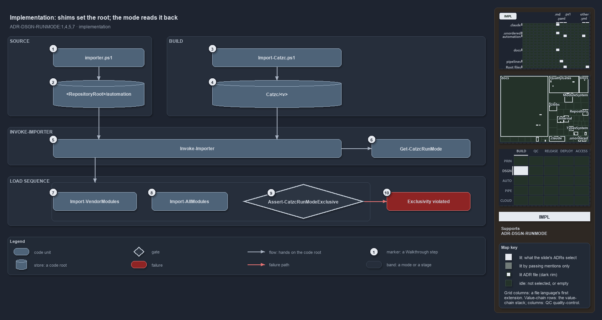

---
catzc:
  immutable:
    with_body_sha: "0ee78f503e58"
    repo_status: clean
    path: docs/explanation/design/shims-set-roots-mode-read-back.md
    folder: docs/explanation/design
    name: shims-set-roots-mode-read-back
    filetype: md
    kind: explanation
    language: markdown
    track: docs
    tracktype: documentation
  edges:
    cites:
      - ADR-DSGN-RUNMODE#{1,4,5,7}
    links:
      - docs/.assets/explanation/adr-dsgn-runmode--shims-set-roots-mode-read-back--implementation.drawio.md
      - docs/.assets/explanation/adr-dsgn-runmode--shims-set-roots-mode-read-back--implementation.drawio.png
      - docs/adr/design/run-modes.md
      - docs/explanation/design/index.md
      - docs/explanation/design/one-entry-script-per-mode.md
      - docs/explanation/design/two-roots-one-importer-same-modules.md
      - docs/explanation/design/where-code-loads-from-decides-the-mode.md
      - docs/explanation/design/which-run-mode-rules-have-a-gate.md
      - docs/explanation/index.md#how-to-read-the-diagrams
---

# Each entry script sets the code root, and Get-CatzcRunMode reads the mode back from it

```text
Each entry script fixes the code root, and Get-CatzcRunMode reads the mode back from it.

1   importer.ps1                  the source-mode shim; sets RepositoryRoot, calls Invoke-Importer
2   <RepositoryRoot>/automation   the code root without -Bundle
3   Import-Catzc.ps1              the build-mode initializer; sets CatzcModulesRoot to its own folder
4   Catzc/<v>                     the code root with -Bundle: the package folder
5   Invoke-Importer               the one living load function; fixes CatzcModulesRoot for the load
6   Get-CatzcRunMode              compares the code root with <RepositoryRoot>/automation
7   Import-VendorModules          loads the vendored modules from the root's .vendor/
8   Import-AllModules             evicts the other root, loads the C# types, imports every module
9   Assert-CatzcRunModeExclusive  the last load step: every loaded catzc module is under the root
10  Exclusivity violated          the throw, naming each offending module and both roots

Supports ADR-DSGN-RUNMODE#1, #4, #5 and #7 (implementation lens).
```

The two entry scripts of cats, one per run mode, are both thin. Each one only fixes the roots and then calls the same function,
`Invoke-Importer`, which runs one load sequence in both modes and hands the code root on to every step of it. Because the mode is read back
from that same code root, the mode a session reports cannot disagree with the code it actually loaded.



The diagram is described element by element in
[its asset description](../../.assets/explanation/adr-dsgn-runmode--shims-set-roots-mode-read-back--implementation.drawio.md).

## Walkthrough

1. **importer.ps1.** The repository-root shim is generated by `New-Importer`. It sets `$env:RepositoryRoot = $PSScriptRoot`, loads the
   internal loader, and calls `Invoke-Importer` with its own parameters. A fresh tree starts from a seed form of the file in
   `Catzc.Base.RootConfig/assets/root/`, which replaces itself with the generated shim on first load.
2. **`<RepositoryRoot>/automation`.** Called without `-Bundle`, `Invoke-Importer` sets `CatzcModulesRoot` to `<RepositoryRoot>/automation`,
   so the source tree is the code root.
3. **Import-Catzc.ps1.** The package initializer sets `RepositoryRoot` from its `-RepositoryRoot` parameter, else keeps the value already
   set, else uses the current location. It then sets `$env:CatzcModulesRoot = $PSScriptRoot` and calls `Invoke-Importer -Bundle`. The build
   copies this file into every package.
4. **`Catzc/<v>`.** With `-Bundle`, the importer keeps the preset code root, so the root is whichever package folder the initializer sits
   in. `Build-Modules` writes a temporary build under `out/automation/build/Catzc/<v>/`, `Install-Catzc -Scope CurrentUser` copies it to the
   user module path, and `Install-Catzc -Root` copies it to `<Root>/.vendor/Catzc/<v>/`.
5. **Invoke-Importer.** The one living load function sets the session preferences (errors and warnings stop, information shows), then fixes
   `CatzcModulesRoot` for the rest of the load and loads its internal Bootstrap, Types and Vendor modules. It hands the code root to the
   three load steps below, which run in order from left to right.
6. **Get-CatzcRunMode.** It compares the full path of `CatzcModulesRoot` with `<RepositoryRoot>/automation`, ignoring case and a trailing
   separator, and answers `source` when they match and `build` otherwise. It reads back exactly the root the importer set.
7. **Import-VendorModules.** The vendored modules load from the active root's `.vendor/` folder.
8. **Import-AllModules.** It evicts every catzc module loaded from another root, loads the C# types, and then imports every module from the
   active root.
9. **Assert-CatzcRunModeExclusive.** The importer's last load step checks that every loaded catzc module, the internal ones included, has
   its base under the active code root.
10. **Exclusivity violated.** If any module comes from another root, the assert throws, naming each offending module and both roots.

## Why it holds

- Source mode is entered by `importer.ps1` and build mode by the package's `Import-Catzc.ps1` (ADR-DSGN-RUNMODE#1).
- The mode is derived from the code root and never stored, so it cannot disagree with what loaded (ADR-DSGN-RUNMODE#4).
- Entering either mode removes every module loaded from the other root, then asserts that every loaded catzc module comes from the active
  root (ADR-DSGN-RUNMODE#5).
- Every kind of build root loads through the same importer (ADR-DSGN-RUNMODE#7).

## Where the code and the ADR differ

- The ADR says the importer evicts the other mode before it loads a root. The eviction runs inside `Import-AllModules`, after the
  preferences and the vendored modules have loaded.
- The ADR says the kind of build root is derived from the code root like the mode, but no code derives it, and the cached kind has no code.
- The ADR names `build-catzc.ps1` and `Write-CatzcLoadBanner`, and neither exists.

## See also

- [Run modes: source mode and build mode](../../adr/design/run-modes.md) — the decision this article explains.
- The other lenses on the same modes: [meta](where-code-loads-from-decides-the-mode.md),
  [architecture](two-roots-one-importer-same-modules.md), [operations](one-entry-script-per-mode.md) and
  [governance](which-run-mode-rules-have-a-gate.md).
- [The design explanations](index.md) · [How to read the diagrams](../index.md#how-to-read-the-diagrams)
