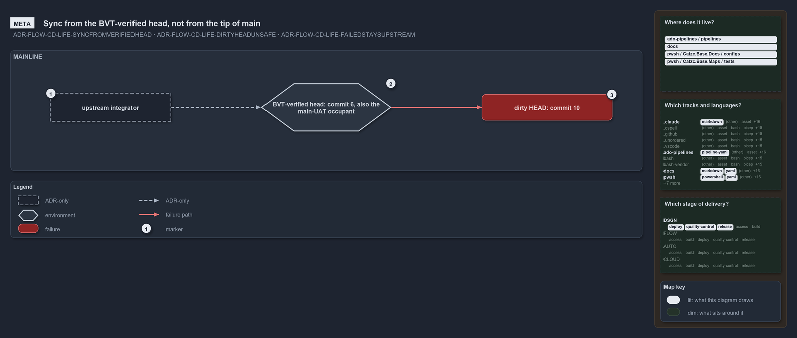

# Sync from the BVT-verified head, not from the tip of main

```text
Integrators build on the BVT-verified server head, never on the tip of main.

1  upstream integrator  anyone who builds on cats from outside; takes its commit from the sync point
2  BVT-verified head    commit 6, the sync point; the commit main-UAT takes first, so its occupant once deployed
3  dirty HEAD           commit 10, the newest commit on main, which failed in main-UAT

Supports FDR-CD-LIFE-SYNCFROMVERIFIEDHEAD, FDR-CD-LIFE-DIRTYHEADUNSAFE and FDR-CD-LIFE-FAILEDSTAYSUPSTREAM (meta lens).
```

"Latest" and "safe to build on" are different questions, and cats answers them with different commits. The newest commit on main is HEAD;
the commit to build on is the BVT-verified server head, because the BVT has already proven it and no later stage has failed it. That same
commit is the one the always-on non-prod environment takes first, so the commit synced from and the commit `main-UAT` takes are one. When
the newest commit fails, it becomes the dirty HEAD, and nothing follows it.



## Walkthrough

1. **Upstream integrator.** Anyone who builds on cats from outside. It takes its commit from the sync point, and never from the tip of main.
2. **BVT-verified head.** Commit 6 is the newest commit on the server's main that the BVT verified and no later stage failed, so it is the
   one well-defined, continuously updated commit that integrators depend on. It is also the commit `main-UAT` takes first, so once deployed
   it is the `main-UAT` occupant too.
3. **Dirty HEAD.** Commit 10 is the newest commit on main, but it failed in `main-UAT`. It answers "what is newest", not "what is good", so
   it is not synced from and goes nowhere downstream.

## Why it holds

- The stable integration point is the BVT-verified server head, and the same commit goes into `main-UAT` first, so the commit synced from
  and the commit `main-UAT` takes are one (FDR-CD-LIFE-SYNCFROMVERIFIEDHEAD).
- The dirty HEAD is the newest commit and still not safe to sync or promote from (FDR-CD-LIFE-DIRTYHEADUNSAFE).
- Downstream flow proceeds only from the last successful state; a failure is a hard stop, not a warning (FDR-CD-LIFE-FAILEDSTAYSUPSTREAM).

## Where the code and the decision record differ

No code holds a sync point: the CD pipelines deploy the tip of main once it passes their CI stage, and no environment named `main-uat`
exists. The rule is a convention the ADR states.

## See also

- [The commit lifecycle](../../drs/flow/commit-lifecycle.md) — the decision this article explains.
- The other lenses on the same sync point: [architecture](integrators-sync-from-the-bvt-verified-head.md) and
  [governance](sync-point-rules-are-adr-only.md).
- [The design explanations](index.md) · [How to read the diagrams](../index.md#how-to-read-the-diagrams)
