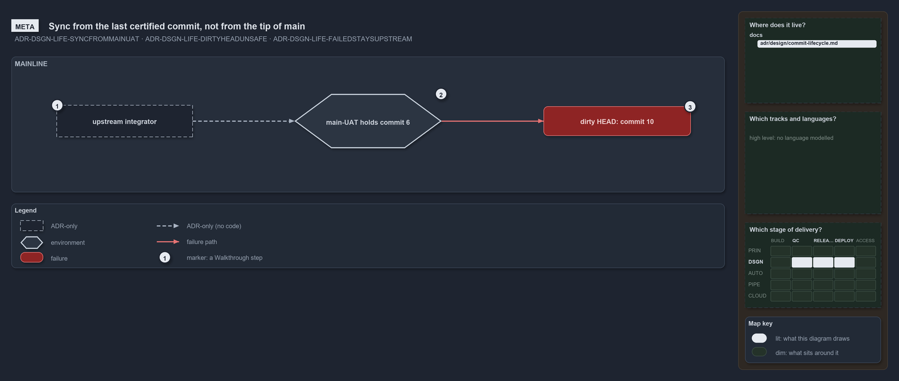

# Sync from the last certified commit, not from the tip of main

```text
Integrators build on the last commit certified in main-UAT, never on the tip of main.

1  upstream integrator  anyone who builds on cats from outside; takes its commit from the sync point
2  main-UAT             the always-on non-prod environment; its occupant, commit 6, is the sync point
3  dirty HEAD           commit 10, the newest commit on main, which failed in main-UAT

Supports ADR-DSGN-LIFE-SYNCFROMMAINUAT, ADR-DSGN-LIFE-DIRTYHEADUNSAFE and ADR-DSGN-LIFE-FAILEDSTAYSUPSTREAM (meta lens).
```

"Latest" and "safe to build on" are different questions, and cats answers them with different commits. The newest commit on main is HEAD;
the commit to build on is the one the always-on non-prod environment holds, because it has already cleared every gate a machine decides.
When the newest commit fails, it becomes the dirty HEAD, and nothing follows it.



## Walkthrough

1. **Upstream integrator.** Anyone who builds on cats from outside. It takes its commit from the sync point, and never from the tip of main.
2. **main-UAT.** The always-on non-prod environment. Its occupant, commit 6, is the latest commit certified there, so it is the one
   well-defined, continuously updated commit that integrators depend on.
3. **Dirty HEAD.** Commit 10 is the newest commit on main, but it failed in `main-UAT`. It answers "what is newest", not "what is good", so
   it is not synced from and goes nowhere downstream.

## Why it holds

- The stable integration point is the `main-UAT` occupant, because that commit has cleared every gate a machine decides
  (ADR-DSGN-LIFE-SYNCFROMMAINUAT).
- The dirty HEAD is the newest commit and still not safe to sync or promote from (ADR-DSGN-LIFE-DIRTYHEADUNSAFE).
- Downstream flow proceeds only from the last successful state; a failure is a hard stop, not a warning (ADR-DSGN-LIFE-FAILEDSTAYSUPSTREAM).

## Where the code and the ADR differ

No code holds a sync point: the CD pipelines deploy the tip of main once it passes their CI stage, and no environment named `main-uat`
exists. The rule is a convention the ADR states.

## See also

- [The commit lifecycle](../../adr/design/commit-lifecycle.md) — the decision this article explains.
- The other lenses on the same sync point: [architecture](integrators-depend-on-an-occupant.md) and
  [governance](sync-point-rules-are-adr-only.md).
- [The design explanations](index.md) · [How to read the diagrams](../index.md#how-to-read-the-diagrams)
