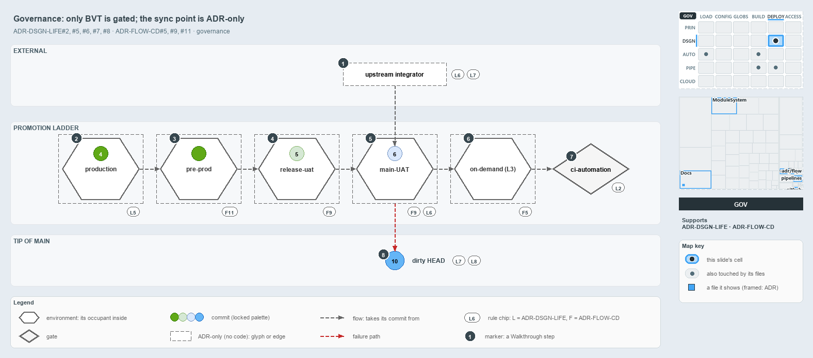

# docs/explanation/design/sync-point-rules-are-adr-only.md

`Only BVT has a gate in code; the sync-point rules are ADR-only`

```text
Only the BVT rung has a gate in code; every sync-point rule is ADR-only.

1  upstream integrator  syncs from the main-UAT occupant, never from the dirty HEAD; no check
2  production           holds one occupant, commit 4, plus a history; not recorded
3  pre-prod             the staged rung between release-uat and production
4  release-uat          holds commit 5; moves on through RBC, a manual gate no code runs
5  main-UAT             holds commit 6, the sync point; moves on through RC, a manual gate no code runs
6  on-demand (L3)       where CD runs the L3 tests; no pipeline defines it
7  ci-automation        the one real gate: BVT, which rejects a failing commit
8  dirty HEAD           commit 10, failed in main-UAT; no sync source, feeds nothing

Supports ADR-DSGN-LIFE#2, #5, #6, #7 and #8, ADR-FLOW-CD#5, #9 and #11 (governance lens).
```

The sync point is the commit `main-UAT` holds: upstream integrators take it, never the tip of main. Of the rules that govern the rungs of
the promotion ladder around it, only one has a gate in cats: the BVT rung, checked by the `ci-automation` pipeline. Every rule about
occupants, the sync point and the dirty HEAD is ADR-only, so "sync from `main-UAT`" is a convention that no code checks.



The diagram is described element by element in
[its asset description](../../.assets/explanation/adr-dsgn-life--sync-point-rules-are-adr-only--governance.drawio.md).

## Walkthrough

1. **Upstream integrator.** Takes its commit from the `main-UAT` occupant (ADR-DSGN-LIFE#6) and never from the dirty HEAD
   (ADR-DSGN-LIFE#7). Nothing in code checks either.
2. **Production.** Holds one occupant, commit 4, plus a history (ADR-DSGN-LIFE#5). No pipeline records which commit that is.
3. **Pre-prod.** The staged rung between release-uat and production (ADR-FLOW-CD#11). It holds one green commit with no worked-example
   number.
4. **Release-uat.** Holds commit 5. Its commit moves on through RBC, the manual gate on release-AT (ADR-FLOW-CD#9). No code runs RBC.
5. **main-UAT.** Holds commit 6, the stable sync point (ADR-DSGN-LIFE#6). Its commit moves on through RC, the manual gate on main-AT
   (ADR-FLOW-CD#9). No code runs RC.
6. **On-demand (L3).** The on-demand environment where CD runs the L3 system-level end-to-end tests before it rolls the artifact onto the
   always-on environment (ADR-FLOW-CD#5). No pipeline defines it.
7. **ci-automation.** The one real gate on the ladder: BVT. It runs on every push to main and on pull requests to main that touch
   `automation/**`, in Azure DevOps and in GitHub Actions, and it runs `Test-Automation -Level 2`. A failing run rejects the commit
   automatically, as BVT should (ADR-DSGN-LIFE#2).
8. **Dirty HEAD.** Commit 10, the tip of main, which entered `main-UAT` and failed there. It is no sync source (ADR-DSGN-LIFE#7) and feeds
   nothing downstream (ADR-DSGN-LIFE#8). It keeps the blue of the state it carried into `main-UAT`.

## Why it holds

- BVT discards automatically, at a named stage (ADR-DSGN-LIFE#2); `ci-automation` is that gate.
- Each always-on environment hosts exactly one occupant plus a history (ADR-DSGN-LIFE#5). The glossary defines "occupant" as `prose-only`,
  so `Test-Glossary` checks only its phrasing ("current occupant", "resident commit") and exempts it from the enforcement check.
- Integrators sync from the `main-UAT` occupant, never from HEAD (ADR-DSGN-LIFE#6, ADR-DSGN-LIFE#7), and a failed commit goes nowhere
  downstream (ADR-DSGN-LIFE#8).
- RC and RBC are manual gates at `main-UAT` and release-uat (ADR-FLOW-CD#9); the tail runs through pre-prod (ADR-FLOW-CD#11); L3 runs in an
  on-demand environment (ADR-FLOW-CD#5).

## Where the code and the ADR differ

The ADRs describe `main-UAT`, release-uat and pre-prod as always-on environments with occupants and RC and RBC gates. The CD pipelines
define none of them: a main commit that passes its CI stage is deployed to dev, test, preprod and prod in one stage, with no gate between
the environments. ADR-DSGN-LIFE#8 holds in code only between pipeline stages, through `succeeded()` conditions, not between environment
rungs. No pipeline defines the on-demand L3 environment. The ADRs also spell the environment `main-UAT` in the commit lifecycle and
`main-uat` in the promotion flow.

## See also

- [The commit lifecycle](../../adr/design/commit-lifecycle.md) — the decision this article explains.
- [CD discipline and promotion flow](../../adr/flow/cd-discipline-and-promotion-flow.md) — RC, RBC, L3 and the pre-prod rung.
- The other lenses on the same sync point: [meta](sync-from-the-last-certified-commit.md) and
  [architecture](integrators-depend-on-an-occupant.md).
- [The design explanations](index.md) · [How to read the diagrams](../index.md#how-to-read-the-diagrams)
