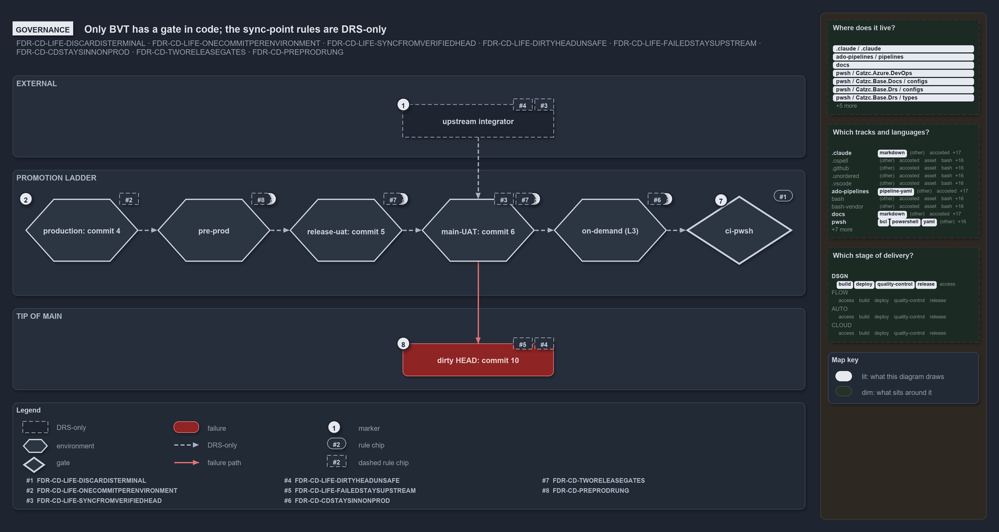

# Only BVT has a gate in code; the sync-point rules are DRS-only

```text
Only the BVT rung has a gate in code; every sync-point rule is DRS-only.

1  upstream integrator  syncs from the BVT-verified head, never from the dirty HEAD; no check
2  production           holds one occupant, commit 4, plus a history; not recorded
3  pre-prod             the staged rung between release-uat and production
4  release-uat          holds commit 5; moves on through RBC, a manual gate no code runs
5  main-UAT             holds commit 6, the sync point it took first; moves on through RC, a manual gate no code runs
6  on-demand (L3)       where CD runs the L3 tests; no pipeline defines it
7  ci-pwsh              the one gate code enforces: BVT, which rejects a failing commit
8  dirty HEAD           commit 10, failed in main-UAT; nothing syncs from it

Supports FDR-CD-LIFE-DISCARDISTERMINAL, FDR-CD-LIFE-ONECOMMITPERENVIRONMENT, FDR-CD-LIFE-SYNCFROMVERIFIEDHEAD, FDR-CD-LIFE-DIRTYHEADUNSAFE and FDR-CD-LIFE-FAILEDSTAYSUPSTREAM, FDR-CD-CDSTAYSINNONPROD, FDR-CD-TWORELEASEGATES and FDR-CD-PREPRODRUNG (governance lens).
```

The sync point is the BVT-verified server head: upstream integrators take it, never the tip of main. The same commit goes into `main-UAT`
first, so when it is deployed it is the `main-UAT` occupant. Of the rules that govern the rungs of the promotion ladder around it, only one
has a gate in cats: the BVT rung, checked by the `ci-pwsh` pipeline. Every rule about occupants, the sync point and the dirty HEAD is
DRS-only, so "sync from the BVT-verified head" is a convention that no code checks.



## Walkthrough

1. **Upstream integrator.** Takes its commit from the BVT-verified head (FDR-CD-LIFE-SYNCFROMVERIFIEDHEAD) and never from the dirty HEAD
   (FDR-CD-LIFE-DIRTYHEADUNSAFE). Nothing in code checks either.
2. **Production.** Holds one occupant, commit 4, plus a history (FDR-CD-LIFE-ONECOMMITPERENVIRONMENT). No pipeline records which commit that
   is.
3. **Pre-prod.** The staged rung between release-uat and production (FDR-CD-PREPRODRUNG). It holds one green commit with no worked-example
   number.
4. **Release-uat.** Holds commit 5. Its commit moves on through RBC, the manual gate on release-AT (FDR-CD-TWORELEASEGATES). No code runs
   RBC.
5. **main-UAT.** Holds commit 6, the BVT-verified head it took first, so the sync point and the occupant are one commit
   (FDR-CD-LIFE-SYNCFROMVERIFIEDHEAD). Its commit moves on through RC, the manual gate on main-AT (FDR-CD-TWORELEASEGATES). No code runs RC.
6. **On-demand (L3).** The on-demand environment where CD runs the L3 system-level end-to-end tests before it rolls the artifact onto the
   always-on environment (FDR-CD-CDSTAYSINNONPROD). No pipeline defines it.
7. **ci-pwsh.** The one gate on the ladder that code enforces: BVT. It runs on every push to main and on pull requests to main that touch
   `pwsh/**`, in Azure DevOps and in GitHub Actions, and it runs `Test-Automation -Level 2`. A failing run rejects the commit automatically,
   as BVT should (FDR-CD-LIFE-DISCARDISTERMINAL).
8. **Dirty HEAD.** Commit 10, the tip of main, which entered `main-UAT` and failed there. Nothing syncs from it
   (FDR-CD-LIFE-DIRTYHEADUNSAFE), and it feeds nothing downstream (FDR-CD-LIFE-FAILEDSTAYSUPSTREAM). It keeps the blue of the state it
   carried into `main-UAT`.

## Why it holds

- BVT discards automatically, at a named stage (FDR-CD-LIFE-DISCARDISTERMINAL); `ci-pwsh` is that gate.
- Each always-on environment hosts exactly one occupant plus a history (FDR-CD-LIFE-ONECOMMITPERENVIRONMENT). The glossary defines
  "occupant" as `prose-only`, so `Test-Glossary` checks only its phrasing ("current occupant", "resident commit") and exempts it from the
  enforcement check.
- Integrators sync from the BVT-verified head, which `main-UAT` takes first, never from HEAD (FDR-CD-LIFE-SYNCFROMVERIFIEDHEAD,
  FDR-CD-LIFE-DIRTYHEADUNSAFE), and a failed commit goes nowhere downstream (FDR-CD-LIFE-FAILEDSTAYSUPSTREAM).
- RC and RBC are manual gates at `main-UAT` and release-uat (FDR-CD-TWORELEASEGATES); the tail runs through pre-prod (FDR-CD-PREPRODRUNG);
  L3 runs in an on-demand environment (FDR-CD-CDSTAYSINNONPROD).

## Where the code and the decision record differ

The decision records describe `main-UAT`, release-uat and pre-prod as always-on environments with occupants and RC and RBC gates. The CD
pipelines define none of them: a main commit that passes its CI stage is deployed to every target of a stage at once, non-prod and prod tier
side by side (`nsub` and `psub`, or the expedition's `dev` and `prod`). The approval check on a prod-tier environment is the engine's,
configured by the adopting team's apply of the shipped `environment-approvals.yml` through `Sync-AdoEnvironmentApprovals`; this repository
runs none. FDR-CD-LIFE-FAILEDSTAYSUPSTREAM holds in code only between pipeline stages, through `succeeded()` conditions, not between
environment rungs. No pipeline defines the on-demand L3 environment. The decision records also spell the environment `main-UAT` in the
commit lifecycle and `main-uat` in the promotion flow.

## See also

- [The commit lifecycle](../../drs/flow/commit-lifecycle.md) — the decision this article explains.
- [CD discipline and promotion flow](../../drs/flow/cd-discipline-and-promotion-flow.md) — RC, RBC, L3 and the pre-prod rung.
- The other lenses on the same sync point: [meta](sync-from-the-bvt-verified-head.md) and
  [architecture](integrators-sync-from-the-bvt-verified-head.md).
- [The design explanations](index.md) · [How to read the diagrams](../index.md#how-to-read-the-diagrams)
