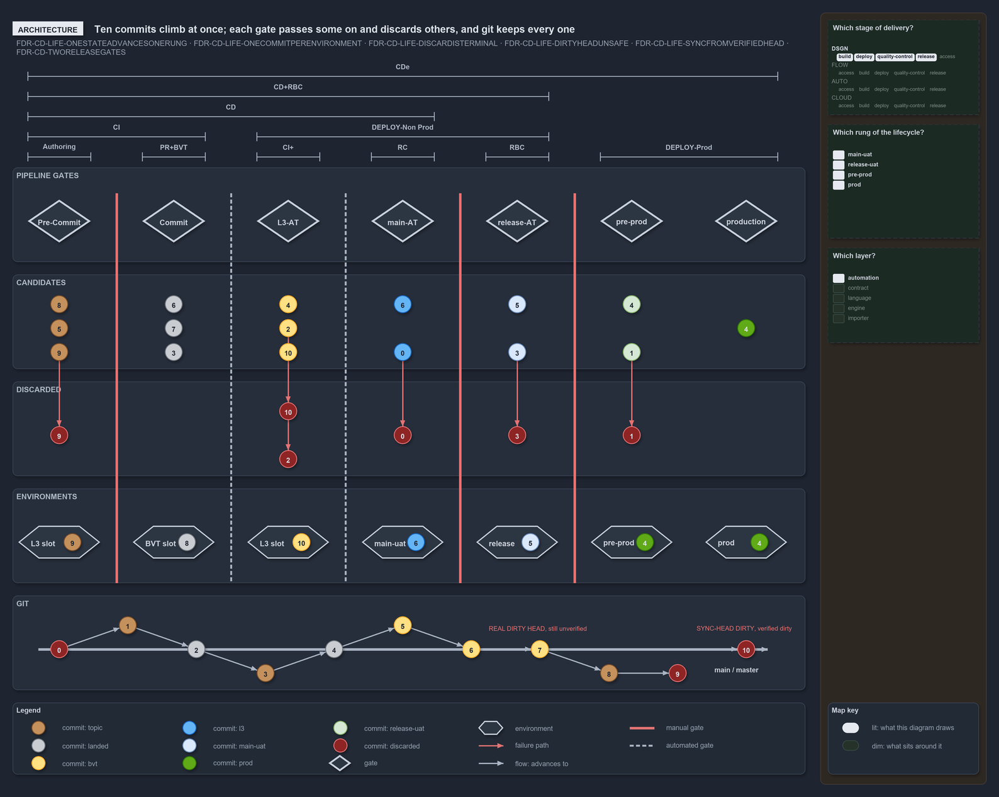

---
catzc:
  warning: "Header is generated by Format-FileMeta via Format-Code; do not change it"
  edges:
    cites:
      - DDR-VISUAL-ONLYGITLANEISTIME
      - DDR-VISUAL-ENVIRONMENTISCONTAINER
      - FDR-CD-TWORELEASEGATES
      - FDR-CD-ACCEPTANCETESTINGISNOTUAT
      - FDR-CD-LIFE-ONESTATEADVANCESONERUNG
      - FDR-CD-LIFE-DISCARDISTERMINAL
      - FDR-CD-LIFE-ONECOMMITPERENVIRONMENT
      - FDR-CD-LIFE-SYNCFROMVERIFIEDHEAD
      - FDR-CD-LIFE-DIRTYHEADUNSAFE
      - FDR-CD-LIFE-FAILEDSTAYSUPSTREAM
      - FDR-CD-LIFE-NUMBERISIDENTITY
    drs_total: 11
---

# Ten numbered commits trace the whole lifecycle across pipeline, environments and git

```text
Ten numbered commits show every stage, gate, environment and ending of the commit lifecycle in one picture.

1  the bands      CI, CD, CDe and the deploy bands each cover a stretch of the stages
2  the gates      red lines are manual gates, dashed lines are automatic ones; each gate has a stage box
3  the lanes      pipeline, discarded, environments and git, read top to bottom
4  the numbers    one digit per commit, the same in every lane, so a commit can be followed
5  the endings    discarded, in process, an environment's occupant, or the dirty head

Supports FDR-CD-LIFE-ONESTATEADVANCESONERUNG, FDR-CD-LIFE-DISCARDISTERMINAL, FDR-CD-LIFE-ONECOMMITPERENVIRONMENT, FDR-CD-LIFE-SYNCFROMVERIFIEDHEAD, FDR-CD-LIFE-DIRTYHEADUNSAFE, FDR-CD-LIFE-FAILEDSTAYSUPSTREAM and FDR-CD-LIFE-NUMBERISIDENTITY, DDR-VISUAL-ONLYGITLANEISTIME and DDR-VISUAL-ENVIRONMENTISCONTAINER, and FDR-CD-TWORELEASEGATES and FDR-CD-ACCEPTANCETESTINGISNOTUAT.
```

A single commit is hard to follow when the picture is organised by stage. This diagram solves that by tracing ten commits at once. Each
commit carries a number in time order, the same number appears in every lane, and the last place a number appears is the verdict on that
commit. Read together, the ten numbers show every state a commit can hold and every way it can end.

```yml drawio
description:
  "Ten commits climb the promotion ladder at once: each stage gate passes some on and discards others, every environment holds one occupant,
  and git keeps the whole history, with the dirty heads called out."
about:
  adrs:
    - FDR-CD-LIFE-ONESTATEADVANCESONERUNG
    - FDR-CD-LIFE-ONECOMMITPERENVIRONMENT
    - FDR-CD-LIFE-DISCARDISTERMINAL
    - FDR-CD-LIFE-DIRTYHEADUNSAFE
    - FDR-CD-LIFE-SYNCFROMVERIFIEDHEAD
    - FDR-CD-TWORELEASEGATES
  lens: architecture
content:
  title: Ten commits climb at once; each gate passes some on and discards others, and git keeps every one
  kind: explanation
  flow: top-to-bottom
  relation: advances to
  bands:
    - { id: band-pipeline, label: PIPELINE GATES }
    - { id: band-candidates, label: CANDIDATES }
    - { id: band-discarded, label: DISCARDED }
    - { id: band-envs, label: ENVIRONMENTS }
    - { id: band-git, label: GIT }
  spans:
    - id: span-ci
      label: CI
      over: [gate-precommit, gate-commit]
    - id: span-deploy-nonprod
      label: DEPLOY-Non Prod
      over: [gate-l3, gate-main-at, gate-release-at]
    - id: span-cd-rbc
      label: CD+RBC
      over: [gate-precommit, gate-commit, gate-l3, gate-main-at, gate-release-at]
    - id: span-cde
      label: CDe
      over: [gate-precommit, gate-commit, gate-l3, gate-main-at, gate-release-at, gate-pre-prod, gate-production]
    - id: span-cd
      label: CD
      over: [gate-precommit, gate-commit, gate-l3, gate-main-at]
    - id: span-authoring
      label: Authoring
      over: [gate-precommit]
    - id: span-pr-bvt
      label: PR+BVT
      over: [gate-commit]
    - id: span-ci-plus
      label: CI+
      over: [gate-l3]
    - id: span-rc
      label: RC
      over: [gate-main-at]
    - id: span-rbc
      label: RBC
      over: [gate-release-at]
    - id: span-deploy-prod
      label: DEPLOY-Prod
      over: [gate-pre-prod, gate-production]
  lanes:
    - band: band-pipeline
      steps: 7
      glyphs:
        - { id: gate-precommit, step: 1, kind: gate, label: Pre-Commit }
        - { id: gate-commit, step: 2, kind: gate, label: Commit }
        - { id: gate-l3, step: 3, kind: gate, label: L3-AT }
        - { id: gate-main-at, step: 4, kind: gate, label: main-AT }
        - { id: gate-release-at, step: 5, kind: gate, label: release-AT }
        - { id: gate-pre-prod, step: 6, kind: gate, label: pre-prod }
        - { id: gate-production, step: 7, kind: gate, label: production }
    - band: band-candidates
      steps: 7
      commits:
        - { id: cand-8, step: 1, row: 1, label: "8", state: topic }
        - { id: cand-9, step: 1, row: -1, label: "9", state: topic }
        - { id: cand-5a, step: 1, label: "5", state: topic }
        - { id: cand-6a, step: 2, row: 1, label: "6", state: landed }
        - { id: cand-7, step: 2, label: "7", state: landed }
        - { id: cand-3a, step: 2, row: -1, label: "3", state: landed }
        - { id: cand-10, step: 3, row: -1, label: "10" }
        - { id: cand-4a, step: 3, row: 1, label: "4" }
        - { id: cand-2, step: 3, label: "2" }
        - { id: cand-6b, step: 4, row: 1, label: "6", state: l3 }
        - { id: cand-0, step: 4, row: -1, label: "0", state: l3 }
        - { id: cand-5b, step: 5, row: 1, label: "5", state: main-uat }
        - { id: cand-3b, step: 5, row: -1, label: "3", state: main-uat }
        - { id: cand-4b, step: 6, row: 1, label: "4", state: release-uat }
        - { id: cand-1, step: 6, row: -1, label: "1", state: release-uat }
        - { id: cand-4c, step: 7, label: "4", state: prod }
    - band: band-discarded
      steps: 7
      commits:
        - { id: gone-9, step: 1, label: "9", state: discarded }
        - { id: gone-10, step: 3, row: 1, label: "10", state: discarded }
        - { id: gone-2, step: 3, row: -1, label: "2", state: discarded }
        - { id: gone-0, step: 4, label: "0", state: discarded }
        - { id: gone-3, step: 5, label: "3", state: discarded }
        - { id: gone-1, step: 6, label: "1", state: discarded }
    - band: band-envs
      steps: 7
      glyphs:
        - { id: env-on-demand-l3a, step: 1, kind: env, label: L3 slot }
        - { id: env-on-demand-bvt, step: 2, kind: env, label: BVT slot }
        - { id: env-on-demand-l3b, step: 3, kind: env, label: L3 slot }
        - { id: env-main-uat, step: 4, kind: env, label: main-uat }
        - { id: env-release-uat, step: 5, kind: env, label: release }
        - { id: env-pre-prod, step: 6, kind: env, label: pre-prod }
        - { id: env-production, step: 7, kind: env, label: prod }
    - band: band-git
      steps: 11
      trunk: main / master
      commits:
        - { id: git-0, step: 1, label: "0", state: discarded }
        - { id: git-1, step: 2, row: 1, label: "1", state: topic, from: git-0 }
        - { id: git-2, step: 3, label: "2", state: landed, from: git-1 }
        - { id: git-3, step: 4, row: -1, label: "3", state: topic, from: git-2 }
        - { id: git-4, step: 5, label: "4", state: landed, from: git-3 }
        - { id: git-5, step: 6, row: 1, label: "5", from: git-4 }
        - { id: git-6, step: 7, label: "6", from: git-5 }
        - { id: git-7, step: 8, label: "7", from: git-6 }
        - { id: git-8, step: 9, row: -1, label: "8", state: topic, from: git-7 }
        - { id: git-9, step: 10, row: -1, label: "9", state: discarded, from: git-8 }
        - { id: git-10, step: 11, label: "10", state: discarded, from: git-7 }
      marks:
        - { at: git-7, text: "REAL DIRTY HEAD, still unverified" }
        - { at: git-10, text: "SYNC-HEAD DIRTY, verified dirty" }
  rules:
    - { after: 1, kind: manual }
    - { after: 2, kind: automated }
    - { after: 3, kind: automated }
    - { after: 4, kind: manual }
    - { after: 5, kind: manual }
  glyphs:
    - { id: occ-9, kind: commit, label: "9", in: env-on-demand-l3a, state: topic }
    - { id: occ-8, kind: commit, label: "8", in: env-on-demand-bvt, state: landed }
    - { id: occ-10, kind: commit, label: "10", in: env-on-demand-l3b }
    - { id: occ-6, kind: commit, label: "6", in: env-main-uat, state: l3 }
    - { id: occ-5, kind: commit, label: "5", in: env-release-uat, state: main-uat }
    - { id: occ-4a, kind: commit, label: "4", in: env-pre-prod, state: prod }
    - { id: occ-4b, kind: commit, label: "4", in: env-production, state: prod }
  edges:
    - { from: cand-9, to: gone-9, kind: fail }
    - { from: cand-10, to: gone-10, kind: fail }
    - { from: cand-2, to: gone-2, kind: fail }
    - { from: cand-0, to: gone-0, kind: fail }
    - { from: cand-3b, to: gone-3, kind: fail }
    - { from: cand-1, to: gone-1, kind: fail }
  legend: auto
  minimaps:
    axis:
      - cell: DSGN/build
        by: [FDR-CD-TWORELEASEGATES]
      - cell: DSGN/quality-control
        by:
          - FDR-CD-LIFE-DIRTYHEADUNSAFE
          - FDR-CD-LIFE-DISCARDISTERMINAL
          - FDR-CD-LIFE-ONECOMMITPERENVIRONMENT
          - FDR-CD-LIFE-ONESTATEADVANCESONERUNG
          - FDR-CD-LIFE-SYNCFROMVERIFIEDHEAD
          - FDR-CD-TWORELEASEGATES
      - cell: DSGN/release
        by:
          - FDR-CD-LIFE-DIRTYHEADUNSAFE
          - FDR-CD-LIFE-DISCARDISTERMINAL
          - FDR-CD-LIFE-ONECOMMITPERENVIRONMENT
          - FDR-CD-LIFE-ONESTATEADVANCESONERUNG
          - FDR-CD-LIFE-SYNCFROMVERIFIEDHEAD
          - FDR-CD-TWORELEASEGATES
      - cell: DSGN/deploy
        by:
          - FDR-CD-LIFE-DIRTYHEADUNSAFE
          - FDR-CD-LIFE-DISCARDISTERMINAL
          - FDR-CD-LIFE-ONECOMMITPERENVIRONMENT
          - FDR-CD-LIFE-ONESTATEADVANCESONERUNG
          - FDR-CD-LIFE-SYNCFROMVERIFIEDHEAD
          - FDR-CD-TWORELEASEGATES
    lifecycle-position:
      - cell: main-uat
        by:
          - .claude/CLAUDE.md
          - docs/drs/flow/dora-explains.md
          - docs/drs/index.md
          - docs/how-to/automation/apply-environment-approvals.md
          - docs/references/pwsh/catzc-azure-dev-ops/Sync-AdoEnvironmentApprovals.ps1.md
          - docs/references/pwsh/catzc-base-drs/types/DrsConfig.cs.md
          - docs/references/pwsh/catzc-base-maps/Get-LifecyclePositionMinimapData.ps1.md
          - docs/references/pwsh/catzc-base-maps/Get-ValueChainHighlight.ps1.md
          - docs/references/pwsh/catzc-base-maps/Get-WorldMapHighlight.ps1.md
          - pwsh/Catzc.Azure.DevOps/Sync-AdoEnvironmentApprovals.ps1
          - pwsh/Catzc.Base.Drs/configs/drs.yml
          - pwsh/Catzc.Base.Drs/types/DrsConfig.cs
          - pwsh/Catzc.Base.Flow/types/RungsConfig.cs
          - pwsh/Catzc.Base.Maps/Get-LifecyclePositionMinimapData.ps1
          - pwsh/Catzc.Base.Maps/Get-ValueChainHighlight.ps1
          - pwsh/Catzc.Base.Maps/Get-WorldMapHighlight.ps1
          - pwsh/Catzc.Base.Maps/tests/Get-WorldMapHighlight.Tests.ps1
          - FDR-CD-LIFE-DIRTYHEADUNSAFE
          - FDR-CD-LIFE-DISCARDISTERMINAL
          - FDR-CD-LIFE-ONECOMMITPERENVIRONMENT
          - FDR-CD-LIFE-ONESTATEADVANCESONERUNG
          - FDR-CD-LIFE-SYNCFROMVERIFIEDHEAD
          - FDR-CD-TWORELEASEGATES
      - cell: release-uat
        by:
          - .ado/pipelines/deploy-apex.yaml
          - .ado/pipelines/deploy-nova.yaml
          - .ado/pipelines/deploy-shared.yaml
          - .claude/CLAUDE.md
          - docs/drs/flow/dora-explains.md
          - docs/drs/index.md
          - docs/how-to/automation/apply-environment-approvals.md
          - docs/references/ado/pipelines/deploy-apex.yaml.md
          - docs/references/ado/pipelines/deploy-nova.yaml.md
          - docs/references/ado/pipelines/deploy-shared.yaml.md
          - docs/references/pwsh/catzc-azure-dev-ops/Sync-AdoEnvironmentApprovals.ps1.md
          - docs/references/pwsh/catzc-base-drs/types/DrsConfig.cs.md
          - docs/references/pwsh/catzc-base-maps/Get-LifecyclePositionMinimapData.ps1.md
          - docs/references/pwsh/catzc-base-maps/Get-ValueChainHighlight.ps1.md
          - docs/references/pwsh/catzc-base-maps/Get-WorldMapHighlight.ps1.md
          - pwsh/Catzc.Azure.DevOps/Sync-AdoEnvironmentApprovals.ps1
          - pwsh/Catzc.Base.Drs/configs/drs.yml
          - pwsh/Catzc.Base.Drs/types/DrsConfig.cs
          - pwsh/Catzc.Base.Flow/types/RungsConfig.cs
          - pwsh/Catzc.Base.Maps/Get-LifecyclePositionMinimapData.ps1
          - pwsh/Catzc.Base.Maps/Get-ValueChainHighlight.ps1
          - pwsh/Catzc.Base.Maps/Get-WorldMapHighlight.ps1
          - pwsh/Catzc.Base.Maps/tests/Get-WorldMapHighlight.Tests.ps1
          - FDR-CD-LIFE-DIRTYHEADUNSAFE
          - FDR-CD-LIFE-DISCARDISTERMINAL
          - FDR-CD-LIFE-ONECOMMITPERENVIRONMENT
          - FDR-CD-LIFE-ONESTATEADVANCESONERUNG
          - FDR-CD-LIFE-SYNCFROMVERIFIEDHEAD
          - FDR-CD-TWORELEASEGATES
      - cell: pre-prod
        by:
          - .claude/CLAUDE.md
          - docs/drs/flow/dora-explains.md
          - docs/drs/index.md
          - docs/how-to/automation/apply-environment-approvals.md
          - docs/references/pwsh/catzc-azure-dev-ops/Sync-AdoEnvironmentApprovals.ps1.md
          - docs/references/pwsh/catzc-base-drs/types/DrsConfig.cs.md
          - docs/references/pwsh/catzc-base-maps/Get-LifecyclePositionMinimapData.ps1.md
          - docs/references/pwsh/catzc-base-maps/Get-ValueChainHighlight.ps1.md
          - docs/references/pwsh/catzc-base-maps/Get-WorldMapHighlight.ps1.md
          - pwsh/Catzc.Azure.DevOps/Sync-AdoEnvironmentApprovals.ps1
          - pwsh/Catzc.Base.Drs/configs/drs.yml
          - pwsh/Catzc.Base.Drs/types/DrsConfig.cs
          - pwsh/Catzc.Base.Flow/types/RungsConfig.cs
          - pwsh/Catzc.Base.Maps/Get-LifecyclePositionMinimapData.ps1
          - pwsh/Catzc.Base.Maps/Get-ValueChainHighlight.ps1
          - pwsh/Catzc.Base.Maps/Get-WorldMapHighlight.ps1
          - pwsh/Catzc.Base.Maps/tests/Get-WorldMapHighlight.Tests.ps1
          - FDR-CD-LIFE-DIRTYHEADUNSAFE
          - FDR-CD-LIFE-DISCARDISTERMINAL
          - FDR-CD-LIFE-ONECOMMITPERENVIRONMENT
          - FDR-CD-LIFE-ONESTATEADVANCESONERUNG
          - FDR-CD-LIFE-SYNCFROMVERIFIEDHEAD
          - FDR-CD-TWORELEASEGATES
      - cell: prod
        by:
          - .ado/pipelines/deploy-apex.yaml
          - .claude/CLAUDE.md
          - docs/drs/flow/dora-explains.md
          - docs/drs/index.md
          - docs/how-to/automation/apply-environment-approvals.md
          - docs/references/ado/pipelines/deploy-apex.yaml.md
          - docs/references/pwsh/catzc-azure-dev-ops/Sync-AdoEnvironmentApprovals.ps1.md
          - docs/references/pwsh/catzc-base-drs/types/DrsConfig.cs.md
          - docs/references/pwsh/catzc-base-maps/Get-LifecyclePositionMinimapData.ps1.md
          - docs/references/pwsh/catzc-base-maps/Get-ValueChainHighlight.ps1.md
          - docs/references/pwsh/catzc-base-maps/Get-WorldMapHighlight.ps1.md
          - pwsh/Catzc.Azure.DevOps/Sync-AdoEnvironmentApprovals.ps1
          - pwsh/Catzc.Base.Drs/configs/drs.yml
          - pwsh/Catzc.Base.Drs/types/DrsConfig.cs
          - pwsh/Catzc.Base.Flow/types/RungsConfig.cs
          - pwsh/Catzc.Base.Maps/Get-LifecyclePositionMinimapData.ps1
          - pwsh/Catzc.Base.Maps/Get-ValueChainHighlight.ps1
          - pwsh/Catzc.Base.Maps/Get-WorldMapHighlight.ps1
          - pwsh/Catzc.Base.Maps/tests/Get-WorldMapHighlight.Tests.ps1
          - FDR-CD-LIFE-DIRTYHEADUNSAFE
          - FDR-CD-LIFE-DISCARDISTERMINAL
          - FDR-CD-LIFE-ONECOMMITPERENVIRONMENT
          - FDR-CD-LIFE-ONESTATEADVANCESONERUNG
          - FDR-CD-LIFE-SYNCFROMVERIFIEDHEAD
          - FDR-CD-TWORELEASEGATES
    layer-stack:
      - cell: automation
        by:
          - .ado/pipelines/deploy-apex.yaml
          - .ado/pipelines/deploy-nova.yaml
          - .ado/pipelines/deploy-shared.yaml
          - .claude/CLAUDE.md
          - docs/drs/flow/cd-discipline-and-promotion-flow.md
          - docs/drs/flow/commit-lifecycle.md
          - docs/drs/flow/dora-explains.md
          - docs/drs/glossary.md
          - docs/drs/index.md
          - docs/how-to/automation/apply-environment-approvals.md
          - docs/references/ado/pipelines/deploy-apex.yaml.md
          - docs/references/ado/pipelines/deploy-nova.yaml.md
          - docs/references/ado/pipelines/deploy-shared.yaml.md
          - docs/references/pwsh/catzc-azure-dev-ops/Sync-AdoEnvironmentApprovals.ps1.md
          - docs/references/pwsh/catzc-base-drs/types/DrsConfig.cs.md
          - docs/references/pwsh/catzc-base-maps/Get-LifecyclePositionMinimapData.ps1.md
          - docs/references/pwsh/catzc-base-maps/Get-ValueChainHighlight.ps1.md
          - docs/references/pwsh/catzc-base-maps/Get-WorldMapHighlight.ps1.md
          - pwsh/Catzc.Azure.DevOps/Sync-AdoEnvironmentApprovals.ps1
          - pwsh/Catzc.Base.Docs/configs/glossary.yml
          - pwsh/Catzc.Base.Drs/configs/drs.yml
          - pwsh/Catzc.Base.Drs/types/DrsConfig.cs
          - pwsh/Catzc.Base.Flow/types/RungsConfig.cs
          - pwsh/Catzc.Base.Maps/Get-LifecyclePositionMinimapData.ps1
          - pwsh/Catzc.Base.Maps/Get-ValueChainHighlight.ps1
          - pwsh/Catzc.Base.Maps/Get-WorldMapHighlight.ps1
          - pwsh/Catzc.Base.Maps/tests/Get-WorldMapHighlight.Tests.ps1
          - pwsh/Catzc.Base.ModuleSystem/configs/glossary.yml
          - FDR-CD-LIFE-DIRTYHEADUNSAFE
          - FDR-CD-LIFE-DISCARDISTERMINAL
          - FDR-CD-LIFE-ONECOMMITPERENVIRONMENT
          - FDR-CD-LIFE-ONESTATEADVANCESONERUNG
          - FDR-CD-LIFE-SYNCFROMVERIFIEDHEAD
          - FDR-CD-TWORELEASEGATES
```



## Walkthrough

1. **The bands across the top.** Six stages run left to right: Authoring, PR+BVT, CI+, RC, RBC and DEPLOY-Prod. Brackets above them name the
   pipeline kinds and the stretch each one covers. CI covers the first two stages, CD covers everything up to the end of RC, CD+RBC and
   DEPLOY-Non Prod cover the middle stages, and CDe spans all six. The gate definitions, including RC and RBC, belong to the flow model
   ([FDR-CD-TWORELEASEGATES](../../drs/flow/cd-discipline-and-promotion-flow.md#rule-fdr-cd-tworeleasegates)).
2. **The gates.** A red vertical line is a manual gate, where a human decides. A dashed grey line is a gate that runs by itself. Each stage
   has one box: Pre-Commit (L0/L2) is decided by a human in authoring and review, Commit (L0/L2) is the automatic BVT gate, L3-vertical-AT
   is an AT gate, and main-AT and release-AT are manual gates. Prod deploy has two boxes, inactive/pre-prod and live/production. Arrows
   between the bands show how work is triggered: pushes such as Direct-Commit and PR-Complete, and pulls such as the mb and rb triggers,
   Manual RC and Manual RBC.
3. **The pipeline lane.** Under each stage box, the candidates in process are drawn in their state colour. A dashed ghost means the commit
   has been in that state at an earlier stage and has since moved on.
4. **The discarded lane.** A red row sits under the queue. A candidate that fails a gate drops into it at the stage where it failed, and it
   keeps its number there. Recording where it died is the point: "discarded at BVT" and "discarded at release-uat" are different facts
   ([FDR-CD-LIFE-DISCARDISTERMINAL](../../drs/flow/commit-lifecycle.md#rule-fdr-cd-life-discardisterminal)).
5. **The environments lane.** Each hexagon is an env slot. The commit inside it is its occupant, drawn in that commit's own state colour
   ([DDR-VISUAL-ENVIRONMENTISCONTAINER](../../drs/design/visual-design.md#rule-ddr-visual-environmentiscontainer)). In this picture, 8 sits
   in the BVT env slot, 6 is the main-UAT occupant, 5 is the release-UAT occupant, and 4 is both the pre-prod and the production occupant.
   Slot 9 shows a topic commit deployed on demand, and slot 10 shows a commit that was deployed and then discarded.
6. **The git lane.** This is the only lane where left to right is real time
   ([DDR-VISUAL-ONLYGITLANEISTIME](../../drs/design/visual-design.md#rule-ddr-visual-onlygitlaneistime)). The main line carries the landed
   commits, and side branches carry topic commits. Reading along it, the three newest commits, 7, 8 and 10, are labelled as dirty heads: the
   tip of main is not always a commit that is safe to build on.
7. **The legend.** Each state has a solid circle, a dashed ghost and a crossed discard. The legend also names the symbols: manual gate, a
   gate that runs by itself, env slot, push and pull.

## Why it holds

- A commit holds one state at a time and moves one rung along the ladder or leaves it
  ([FDR-CD-LIFE-ONESTATEADVANCESONERUNG](../../drs/flow/commit-lifecycle.md#rule-fdr-cd-life-onestateadvancesonerung)).
- Discard is terminal rejection at a named stage, and the commit stays in history
  ([FDR-CD-LIFE-DISCARDISTERMINAL](../../drs/flow/commit-lifecycle.md#rule-fdr-cd-life-discardisterminal)).
- Each always-on environment has exactly one occupant plus its history
  ([FDR-CD-LIFE-ONECOMMITPERENVIRONMENT](../../drs/flow/commit-lifecycle.md#rule-fdr-cd-life-onecommitperenvironment)).
- Consumers sync from the BVT-verified server head, never from the tip of main; that same commit goes into main-UAT first, so commit 6 is
  both the sync point and the main-UAT occupant
  ([FDR-CD-LIFE-SYNCFROMVERIFIEDHEAD](../../drs/flow/commit-lifecycle.md#rule-fdr-cd-life-syncfromverifiedhead)).
- The tip of main can be a dirty head that is unsafe to sync or promote from
  ([FDR-CD-LIFE-DIRTYHEADUNSAFE](../../drs/flow/commit-lifecycle.md#rule-fdr-cd-life-dirtyheadunsafe)).
- A commit that fails a stage cannot go downstream
  ([FDR-CD-LIFE-FAILEDSTAYSUPSTREAM](../../drs/flow/commit-lifecycle.md#rule-fdr-cd-life-failedstaysupstream)).
- A commit's number is its time-ordered identity, and its last appearance is where its story ends
  ([FDR-CD-LIFE-NUMBERISIDENTITY](../../drs/flow/commit-lifecycle.md#rule-fdr-cd-life-numberisidentity)).

## See also

- [The commit lifecycle](../../drs/flow/commit-lifecycle.md) — the decision this article explains. Its worked-examples table gives the
  canonical verdict for each of the ten numbers; where a label in the picture words an ending differently, the table decides.
- [Visual design](../../drs/design/visual-design.md) — the lanes, ghosts, numbers and colours used here.
- [Each pipeline shape runs a stretch of the same ladder](each-pipeline-shape-runs-a-stretch-of-the-ladder.md) — the companion flow variants
  of this picture.
- [The design explanations](index.md) · [How to read the diagrams](../index.md#how-to-read-the-diagrams)
