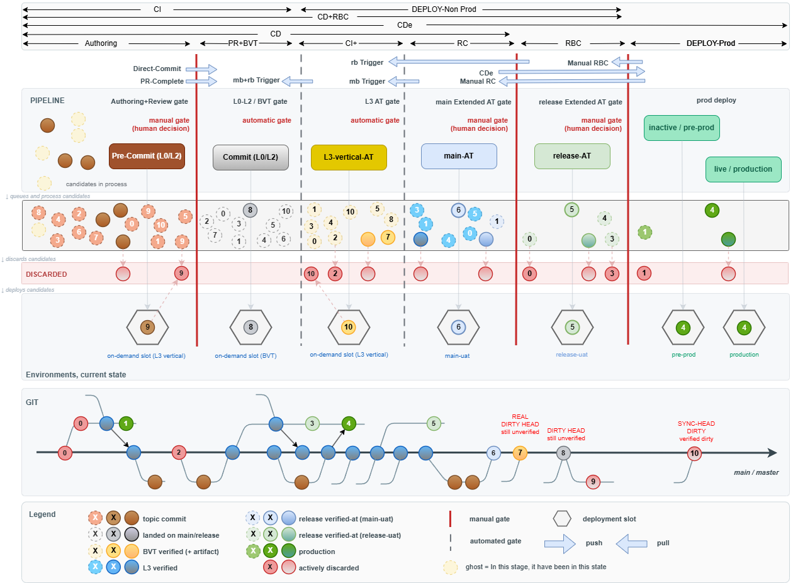

---
catzc:
  derived:
    path: docs/explanation/design/ten-commits-trace-the-whole-lifecycle.md
    kind: explanation
    language: markdown
    filekind: md
    track: docs
    body_sha: "923959505b90"
    adrs:
      - ADR-DSGN-LIFE#{1,2,5-8,10}
      - ADR-DSGN-VISUAL#{12,13}
      - ADR-FLOW-CD#9
    links:
      - docs/.assets/commits-quality/10-commits-story.drawio.png
      - docs/adr/design/commit-lifecycle.md
      - docs/adr/design/commit-lifecycle.md#rule-adr-dsgn-life1
      - docs/adr/design/commit-lifecycle.md#rule-adr-dsgn-life10
      - docs/adr/design/commit-lifecycle.md#rule-adr-dsgn-life2
      - docs/adr/design/commit-lifecycle.md#rule-adr-dsgn-life5
      - docs/adr/design/commit-lifecycle.md#rule-adr-dsgn-life6
      - docs/adr/design/commit-lifecycle.md#rule-adr-dsgn-life7
      - docs/adr/design/commit-lifecycle.md#rule-adr-dsgn-life8
      - docs/adr/design/visual-design.md
      - docs/adr/design/visual-design.md#rule-adr-dsgn-visual12
      - docs/adr/design/visual-design.md#rule-adr-dsgn-visual13
      - docs/adr/flow/cd-discipline-and-promotion-flow.md#rule-adr-flow-cd9
      - docs/explanation/design/each-pipeline-shape-runs-a-stretch-of-the-ladder.md
      - docs/explanation/design/index.md
      - docs/explanation/index.md#how-to-read-the-diagrams
---

# Ten numbered commits trace the whole lifecycle across pipeline, environments and git

```text
Ten numbered commits show every stage, gate, environment and ending of the commit lifecycle in one picture.

1  the bands      CI, CD, CDe and the deploy bands each cover a stretch of the stages
2  the gates      red lines are manual gates, dashed lines are automatic ones; each gate has a stage box
3  the lanes      pipeline, discarded, environments and git, read top to bottom
4  the numbers    one digit per commit, the same in every lane, so a commit can be followed
5  the endings    discarded, in process, an environment's occupant, or the dirty head

Supports ADR-DSGN-LIFE#1, #2, #5, #6, #7, #8 and #10, ADR-DSGN-VISUAL#12 and #13, and ADR-FLOW-CD#9 and #10.
```

A single commit is hard to follow when the picture is organised by stage. This diagram solves that by tracing ten commits at once. Each
commit carries a number in time order, the same number appears in every lane, and the last place a number appears is the verdict on that
commit. Read together, the ten numbers show every state a commit can hold and every way it can end.



## Walkthrough

1. **The bands across the top.** Six stages run left to right: Authoring, PR+BVT, CI+, RC, RBC and DEPLOY-Prod. Brackets above them name the
   pipeline kinds and the stretch each one covers. CI covers the first two stages, CD covers everything up to the end of RC, CD+RBC and
   DEPLOY-Non Prod cover the middle stages, and CDe spans all six. The gate definitions, including RC and RBC, belong to the flow model
   ([ADR-FLOW-CD#9](../../adr/flow/cd-discipline-and-promotion-flow.md#rule-adr-flow-cd9)).
2. **The gates.** A red vertical line is a manual gate, where a human decides. A dashed grey line is a gate that runs by itself. Each stage
   has one box: Pre-Commit (L0/L2) is decided by a human in authoring and review, Commit (L0/L2) is the automatic BVT gate, L3-vertical-AT
   is an AT gate, and main-AT and release-AT are manual gates. Prod deploy has two boxes, inactive/pre-prod and live/production. Arrows
   between the bands show how work is triggered: pushes such as Direct-Commit and PR-Complete, and pulls such as the mb and rb triggers,
   Manual RC and Manual RBC.
3. **The pipeline lane.** Under each stage box, the candidates in process are drawn in their state colour. A dashed ghost means the commit
   has been in that state at an earlier stage and has since moved on.
4. **The discarded lane.** A red row sits under the queue. A candidate that fails a gate drops into it at the stage where it failed, and it
   keeps its number there. Recording where it died is the point: "discarded at BVT" and "discarded at release-uat" are different facts
   ([ADR-DSGN-LIFE#2](../../adr/design/commit-lifecycle.md#rule-adr-dsgn-life2)).
5. **The environments lane.** Each hexagon is an env slot. The commit inside it is its occupant, drawn in that commit's own state colour
   ([ADR-DSGN-VISUAL#13](../../adr/design/visual-design.md#rule-adr-dsgn-visual13)). In this picture, 8 sits in the BVT env slot, 6 is the
   main-UAT occupant, 5 is the release-UAT occupant, and 4 is both the pre-prod and the production occupant. Slot 9 shows a topic commit
   deployed on demand, and slot 10 shows a commit that was deployed and then discarded.
6. **The git lane.** This is the only lane where left to right is real time
   ([ADR-DSGN-VISUAL#12](../../adr/design/visual-design.md#rule-adr-dsgn-visual12)). The main line carries the landed commits, and side
   branches carry topic commits. Reading along it, the three newest commits, 7, 8 and 10, are labelled as dirty heads: the tip of main is
   not always a commit that is safe to build on.
7. **The legend.** Each state has a solid circle, a dashed ghost and a crossed discard. The legend also names the symbols: manual gate, a
   gate that runs by itself, env slot, push and pull.

## Why it holds

- A commit holds one state at a time and moves one rung along the ladder or leaves it
  ([ADR-DSGN-LIFE#1](../../adr/design/commit-lifecycle.md#rule-adr-dsgn-life1)).
- Discard is terminal rejection at a named stage, and the commit stays in history
  ([ADR-DSGN-LIFE#2](../../adr/design/commit-lifecycle.md#rule-adr-dsgn-life2)).
- Each always-on environment has exactly one occupant plus its history
  ([ADR-DSGN-LIFE#5](../../adr/design/commit-lifecycle.md#rule-adr-dsgn-life5)).
- Consumers sync from the main-UAT occupant, never from the tip of main
  ([ADR-DSGN-LIFE#6](../../adr/design/commit-lifecycle.md#rule-adr-dsgn-life6)).
- The tip of main can be a dirty head that is unsafe to sync or promote from
  ([ADR-DSGN-LIFE#7](../../adr/design/commit-lifecycle.md#rule-adr-dsgn-life7)).
- A commit that fails a stage cannot go downstream ([ADR-DSGN-LIFE#8](../../adr/design/commit-lifecycle.md#rule-adr-dsgn-life8)).
- A commit's number is its time-ordered identity, and its last appearance is where its story ends
  ([ADR-DSGN-LIFE#10](../../adr/design/commit-lifecycle.md#rule-adr-dsgn-life10)).

## See also

- [The commit lifecycle](../../adr/design/commit-lifecycle.md) — the decision this article explains. Its worked-examples table gives the
  canonical verdict for each of the ten numbers; where a label in the picture words an ending differently, the table decides.
- [Visual design](../../adr/design/visual-design.md) — the lanes, ghosts, numbers and colours used here.
- [Each pipeline shape runs a stretch of the same ladder](each-pipeline-shape-runs-a-stretch-of-the-ladder.md) — the companion flow variants
  of this picture.
- [The design explanations](index.md) · [How to read the diagrams](../index.md#how-to-read-the-diagrams)
