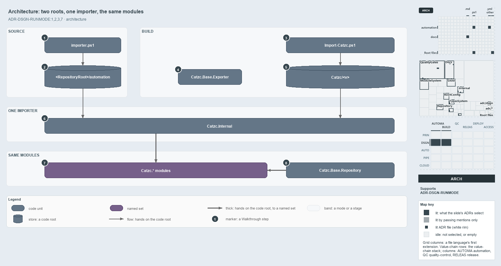

---
catzc:
  derived:
    path: docs/explanation/design/two-roots-one-importer-same-modules.md
    kind: explanation
    body_sha: "4d9cd07a82cf"
    adrs:
      - ADR-DSGN-RUNMODE#{1-3,7}
    links:
      - docs/.assets/explanation/adr-dsgn-runmode--two-roots-one-importer-same-modules--architecture.drawio.md
      - docs/.assets/explanation/adr-dsgn-runmode--two-roots-one-importer-same-modules--architecture.drawio.png
      - docs/adr/design/run-modes.md
      - docs/explanation/design/index.md
      - docs/explanation/design/one-entry-script-per-mode.md
      - docs/explanation/design/shims-set-roots-mode-read-back.md
      - docs/explanation/design/where-code-loads-from-decides-the-mode.md
      - docs/explanation/design/which-run-mode-rules-have-a-gate.md
      - docs/explanation/index.md#how-to-read-the-diagrams
---

# Two code roots feed one importer, which loads the same modules

```text
Two code roots feed one importer, which loads the same modules.

1  importer.ps1                  the source-mode entry script at the repository root
2  <RepositoryRoot>/automation   the source-mode code root
3  Import-Catzc.ps1              the build-mode entry script inside every package
4  Catzc.Base.Exporter           builds the package from the source tree, before any load
5  Catzc/<v>                     the build-mode code root, a versioned package folder
6  Catzc.Internal                the one importer, the same in both modes
7  Catzc.* modules               the same modules in both modes, one script scope each
8  Catzc.Base.Repository         hands each module the code root it finds its files under

Supports ADR-DSGN-RUNMODE#1, #2, #3 and #7 (architecture lens).
```

The two run modes of cats differ only in where the code root sits: source mode loads straight from the repository, and build mode loads from
a built `Catzc` package. Each mode has its own entry script and its own code root, and from there on everything is shared: the code root is
handed on to one importer, which loads one set of modules, and those modules find their own files through the same code root. That is why a
build is a second run mode of the same modules, and not a second product.



The diagram is described element by element in
[its asset description](../../.assets/explanation/adr-dsgn-runmode--two-roots-one-importer-same-modules--architecture.drawio.md).

## Walkthrough

1. **importer.ps1.** The source-mode entry script sits at the repository root and is dot-sourced (`. ./importer.ps1`). It is a small
   generated shim: it sets `$env:RepositoryRoot` to its own folder and hands the whole load to the importer, which takes that folder's
   `automation/` as the code root.
2. **`<RepositoryRoot>/automation`.** The source-mode code root is the repository's `automation/` folder, where each module is a folder of
   one-function `.ps1` files. When nothing presets the code root, the importer sets `CatzcModulesRoot` to this folder.
3. **Import-Catzc.ps1.** The build-mode entry script ships inside every package. It sets `CatzcModulesRoot` to its own folder and runs the
   importer in its bundle mode. The package's `Catzc.psm1` dot-sources this file, so `Import-Module Catzc` and dot-sourcing the file set up
   the same session.
4. **Catzc.Base.Exporter.** The exporter turns the source tree into a package. It holds `Build-Modules`, which builds it, and
   `Install-Catzc` and `Export-Catzc`, which put a build where it can be loaded. It stands apart from the arrows because it works before any
   load: it writes the package that a later load reads, and never hands a code root to the importer itself.
5. **`Catzc/<v>`.** The build-mode code root is a versioned package folder. Each module in it is a generated `.psd1` manifest and one merged
   `<Module>.functions.ps1`. The ADR names four kinds of build root by where the folder lives: temporary, cached, installed and saved.
6. **Catzc.Internal.** The one importer is the same in both modes. Its shared modules evict any catzc module loaded from the other root,
   load the active root, and then assert that nothing from another root is left.
7. **Catzc.\* modules.** The modules are the same in both modes: the same names, the same public and private functions, the same configs and
   assets. Each one is its own PowerShell module with its own script scope, even inside the one package.
8. **Catzc.Base.Repository.** The modules find their own files only through the code root, using `Get-CatzcModuleRoot` from this module,
   never through the folder their source file sits in. The same module holds `Get-CatzcRunMode`, which reads the mode back from the code
   root.

## Why it holds

- Cats runs in exactly two modes: source mode loads from `automation/` and is entered by `importer.ps1`, and build mode loads from a built
  package and is entered by its `Import-Catzc.ps1` (ADR-DSGN-RUNMODE#1).
- Every module works in both modes and is the same module in both; only its form on disk differs (ADR-DSGN-RUNMODE#2).
- The package `Catzc` is a container, not a scope, so no module ever shares `$script:` state with another (ADR-DSGN-RUNMODE#3).
- Build mode has four kinds of root, told apart by where the code root lives, and every kind loads through the same importer
  (ADR-DSGN-RUNMODE#7). A NuGet package from `Export-Catzc -To nuget` is a distribution file, not a code root, until it is installed or
  saved.

## Where the code and the ADR differ

- The ADR names a third build entry, `build-catzc.ps1` at the repository root, but the repository has no such file.
- The ADR says both modes end with a load banner from `Write-CatzcLoadBanner`, but no such function exists.
- The ADR lists a cached kind of build root, but no code makes or reads a cached build.

## See also

- [Run modes: source mode and build mode](../../adr/design/run-modes.md) — the decision this article explains.
- The other lenses on the same modes: [meta](where-code-loads-from-decides-the-mode.md),
  [implementation](shims-set-roots-mode-read-back.md), [operations](one-entry-script-per-mode.md) and
  [governance](which-run-mode-rules-have-a-gate.md).
- [The design explanations](index.md) · [How to read the diagrams](../index.md#how-to-read-the-diagrams)
